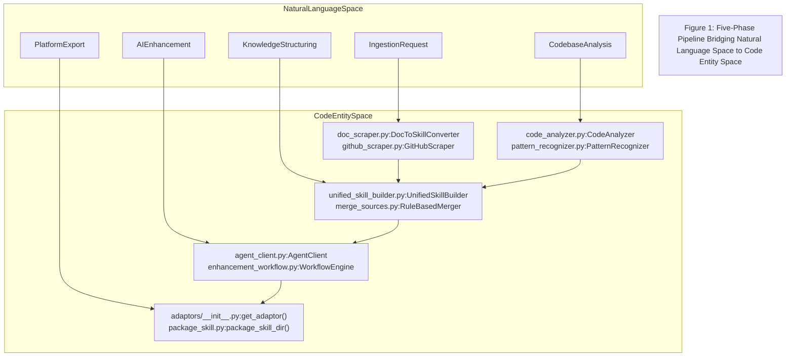
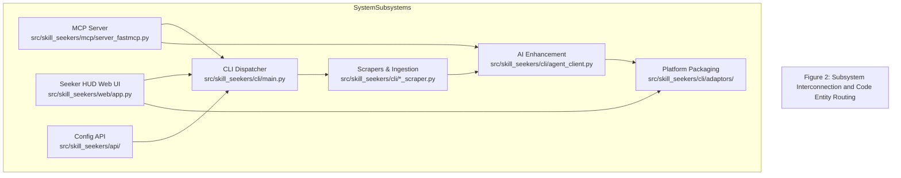

<!-- source: DeepWiki mcp.deepwiki.com · repo yusufkaraaslan/Skill_Seekers · page 1 Overview · fetched 2026-10-26 -->

# Overview

<details>
<summary>Relevant source files</summary>

The following files were used as context for generating this wiki page:

- [CHANGELOG.md](CHANGELOG.md)
- [CLAUDE.md](CLAUDE.md)
- [README.ar.md](README.ar.md)
- [README.de.md](README.de.md)
- [README.es.md](README.es.md)
- [README.fr.md](README.fr.md)
- [README.hi.md](README.hi.md)
- [README.ja.md](README.ja.md)
- [README.ko.md](README.ko.md)
- [README.md](README.md)
- [README.pt-BR.md](README.pt-BR.md)
- [README.ru.md](README.ru.md)
- [README.tr.md](README.tr.md)
- [README.zh-CN.md](README.zh-CN.md)
- [pyproject.toml](pyproject.toml)
- [src/skill_seekers/_version.py](src/skill_seekers/_version.py)
- [tests/test_cli_paths.py](tests/test_cli_paths.py)
- [tests/test_package_structure.py](tests/test_package_structure.py)
- [uv.lock](uv.lock)

</details>


This wiki page provides a comprehensive technical overview of **Skill Seekers** (`skill-seekers`), a high-performance data layer for AI systems designed to convert unstructured documentation and codebases into structured knowledge assets [pyproject.toml:6-11](), [README.md:22](). This section details the system's core capabilities, the five-phase pipeline, the "prepare once, export everywhere" philosophy, and its primary subsystems.

---

## What Skill Seekers Does

Skill Seekers bridges the gap between raw, external knowledge sources and AI execution environments. It extracts documentation, code structures, media transcripts, and configuration manifests from **18 distinct source types** [README.md:22]() and transforms them into standardized, context-rich knowledge packs. These packs power **AI Skills** (Claude, Gemini, OpenAI), **RAG pipelines** (LangChain, LlamaIndex, Pinecone), and **AI coding assistants** (Cursor, Windsurf, Cline) [README.md:22]().

```bash
# Ingest and auto-detect a documentation source
skill-seekers create https://docs.djangoproject.com/

# Package the resulting universal knowledge asset for a target environment
skill-seekers package output/django --target claude
```
Sources: [README.md:45-51](), [CLAUDE.md:59-64]()

---

## The Five-Phase Workflow Concept

Every skill creation and enhancement cycle orchestrated by `UnifiedScraper` [src/skill_seekers/cli/unified_scraper.py:41-51]() or `create_command.py` [src/skill_seekers/cli/create_command.py:33-60]() adheres strictly to a deterministic **five-phase pipeline**.

### Pipeline Architecture: Natural Language to Code Entity Space


Sources: [CLAUDE.md:55-151](), [src/skill_seekers/cli/unified_scraper.py:41-51]()

| Phase | Functional Role | Primary Classes & Functions |
|-------|-----------------|-----------------------------|
| **1. Ingestion** | Crawling and raw data extraction across 18 source formats. | `DocToSkillConverter` [src/skill_seekers/cli/doc_scraper.py:155](), `GitHubScraper` [src/skill_seekers/cli/github_scraper.py:50]() |
| **2. Analysis** | Deep AST parsing, dependency graphs, and pattern recognition. | `CodeAnalyzer`, `PatternRecognizer`, `DependencyAnalyzer` [src/skill_seekers/cli/github_scraper.py:50]() |
| **3. Structuring** | Category bucketing, conflict resolution, and markdown synthesis. | `UnifiedSkillBuilder` [src/skill_seekers/cli/unified_skill_builder.py:25](), `RuleBasedMerger` [src/skill_seekers/cli/merge_sources.py]() |
| **4. Enhancement** | AI-driven prompt generation, summarization, and distillation. | `AgentClient` [src/skill_seekers/cli/agent_client.py](), `WorkflowEngine` [src/skill_seekers/cli/enhancement_workflow.py]() |
| **5. Export** | Platform adaptation, packaging, RAG chunking, and deployment. | `SkillAdaptor` [src/skill_seekers/cli/adaptors/base.py:76](), `get_adaptor()` [src/skill_seekers/cli/adaptors/__init__.py:80]() |

Sources: [CLAUDE.md:55-151](), [src/skill_seekers/cli/doc_scraper.py:155-188]()

---

## Do-It-Once / Export-To-All-Targets Philosophy

Skill Seekers enforces a strict separation between ingestion/structuring and platform packaging. A user processes a source exactly once, writing a universal knowledge structure to `output/{name}/` [src/skill_seekers/cli/doc_scraper.py:165](). 

The system supports **18 Source Types**:
1. Documentation Websites (`doc_scraper.py`) [src/skill_seekers/cli/doc_scraper.py:155]()
2. GitHub Repositories (`github_scraper.py`) [src/skill_seekers/cli/github_scraper.py:50]()
3. Local Codebases (`codebase_scraper.py`)
4. PDF Documents (`pdf_scraper.py`)
5. Word Documents (`docx`) [pyproject.toml:147-151]()
6. EPUB Books (`epub`) [pyproject.toml:153-156]()
7. Jupyter Notebooks (`jupyter`) [pyproject.toml:208-210]()
8. OpenAPI/Swagger Specs
9. PowerPoint Presentations (`pptx`) [pyproject.toml:216-218]()
10. AsciiDoc Files (`asciidoc`) [pyproject.toml:212-214]()
11. Local HTML Files / Directories
12. RSS/Atom Feeds (`rss`) [pyproject.toml:228-230]()
13. Man Pages
14. Video Content (YouTube/Vimeo/Local via `video_scraper`) [pyproject.toml:159-174]()
15. Confluence Wikis (`confluence`) [pyproject.toml:220-222]()
16. Notion Pages (`notion`) [pyproject.toml:224-226]()
17. Chat Exports (Slack/Discord via `chat`) [pyproject.toml:232-234]()
18. Unified Multi-Source Bundles (`UnifiedScraper`) [src/skill_seekers/cli/unified_scraper.py:41-51]()

And exports to **22 Targets** (LLM platforms, IDE assistants, and vector databases):
* **LLM Platforms**: Claude, Gemini, OpenAI, Kimi, DeepSeek, Qwen, Minimax, OpenRouter, Together AI, Fireworks AI, IBM Bob, OpenCode [CHANGELOG.md:15](), [pyproject.toml:83-126](), [CLAUDE.md:61-64]()
* **AI Coding Assistants & Markdown**: Cursor, Windsurf, Cline, Markdown, Atlas [CLAUDE.md:61-64]()
* **Vector Databases & RAG Frameworks**: ChromaDB, Weaviate, Qdrant, FAISS, Pinecone, LangChain, LlamaIndex, Haystack [pyproject.toml:67-68, 177-198]()

---

## Main Subsystems Summary

### Subsystem Architecture & Code Mapping


Sources: [CLAUDE.md:55-151](), [CHANGELOG.md:22](), [pyproject.toml:243-254]()

1. **CLI Layer**: Built around a git-style argument dispatcher (`src/skill_seekers/cli/main.py`), supporting unified commands (`create`, `scan`, `package`, `enhance`, `doctor`, `ui`) [CLAUDE.md:55-77]().
2. **Scrapers**: Modular ingestion engines translating raw inputs into standardized markdown and metadata assets [README.md:86]().
3. **Enhancement**: Agent-agnostic rewriting and prompt distillation via `AgentClient` supporting local CLI agents and cloud LLM APIs [CHANGELOG.md:15](), [CLAUDE.md:148]().
4. **Packaging**: Strategy-pattern based adaptors (`get_adaptor()`) compiling universal assets into platform-specific ZIP archives or vector database collections [src/skill_seekers/cli/adaptors/__init__.py:80]().
5. **MCP Server**: FastMCP server implementation exposing 40+ tools via stdio/HTTP transport for AI coding assistants [README.md:12](), [src/skill_seekers/mcp/server_fastmcp.py]().
6. **Seeker HUD Web UI**: Loopback web application (`skill-seekers ui`) providing a React SPA front-end backed by a FastAPI service (`src/skill_seekers/web/app.py`) for managing jobs and configurations [CHANGELOG.md:22]().
7. **Config API & Validation**: Standalone FastAPI service and validator (`config_validator.py`) ensuring JSON configuration schema compliance [src/skill_seekers/cli/doc_scraper.py:35]().

---

## Package Layout

```text
src/skill_seekers/
├── cli/                  # CLI Dispatcher & Business Logic
│   ├── adaptors/         # Platform-specific exporters (Strategy Pattern)
│   ├── arguments/        # CLI flag definitions
│   └── parsers/          # Subcommand registrations
├── mcp/                  # FastMCP Server & Tool Implementations
├── web/                  # Seeker HUD FastAPI Backend & Job Runner
├── api/                  # Standalone Config API Service
├── workflows/            # YAML Enhancement Workflow Presets
└── embedding/            # Vector Embedding & RAG Utilities
```
Sources: [CLAUDE.md:79-122](), [src/skill_seekers/cli/main.py:58-96]()

---

