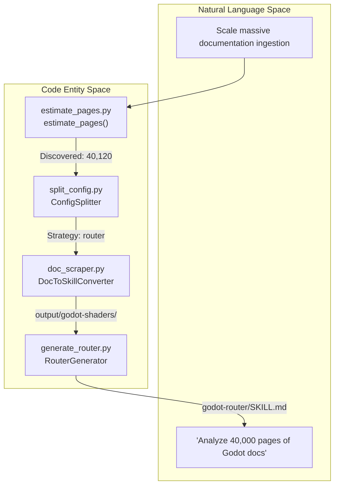
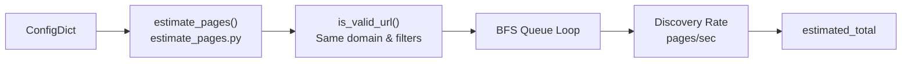
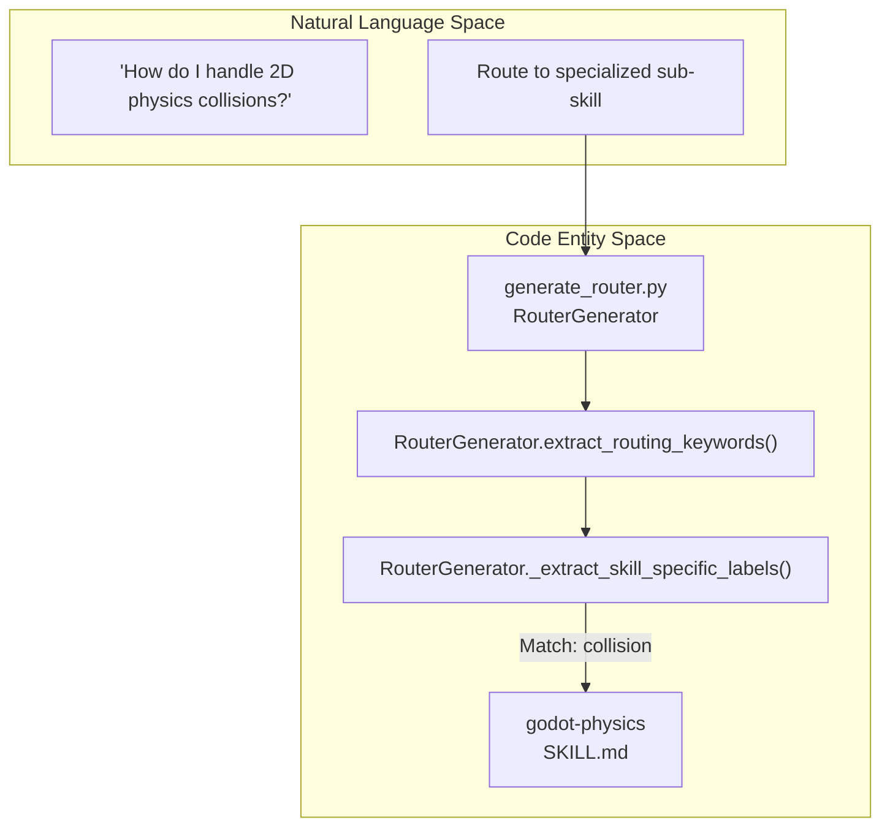

<!-- source: DeepWiki mcp.deepwiki.com · repo yusufkaraaslan/Skill_Seekers · page 10 Large Documentation Handling · fetched 2026-10-26 -->

# Large Documentation Handling

Relevant source files

The following files were used as context for generating this wiki page:

- [src/skill_seekers/cli/arguments/package.py](src/skill_seekers/cli/arguments/package.py)
- [src/skill_seekers/cli/arguments/upload.py](src/skill_seekers/cli/arguments/upload.py)
- [src/skill_seekers/cli/config_validator.py](src/skill_seekers/cli/config_validator.py)
- [src/skill_seekers/cli/estimate_pages.py](src/skill_seekers/cli/estimate_pages.py)
- [src/skill_seekers/cli/generate_router.py](src/skill_seekers/cli/generate_router.py)
- [src/skill_seekers/cli/github_scraper.py](src/skill_seekers/cli/github_scraper.py)
- [src/skill_seekers/cli/pdf_scraper.py](src/skill_seekers/cli/pdf_scraper.py)
- [src/skill_seekers/cli/split_config.py](src/skill_seekers/cli/split_config.py)
- [tests/test_estimate_pages.py](tests/test_estimate_pages.py)
- [tests/test_github_scraper.py](tests/test_github_scraper.py)
- [tests/test_package_skill.py](tests/test_package_skill.py)
- [tests/test_parallel_scraping.py](tests/test_parallel_scraping.py)
- [tests/test_setup_scripts.py](tests/test_setup_scripts.py)
- [tests/test_upload_skill.py](tests/test_upload_skill.py)
- [tests/test_utilities.py](tests/test_utilities.py)

## Purpose and Scope

This page documents Skill Seeker's strategies for processing massive documentation sets containing 10,000–40,000+ pages. These techniques address the scalability challenges that arise when documentation exceeds reasonable scraping times and the context window limits of downstream AI models.

For basic scraping workflows, see [Getting Started](#2). As a parent page, this document provides a high-level overview. For deep technical details, refer to the following child pages:
- **Page Estimation**: [Page Estimation](#10.1) — covers `estimate_pages` with `max_discovery`, discovery thresholds, BFS sampling, and pre-flight MCP checks [src/skill_seekers/cli/estimate_pages.py:29-145]().
- **Config Splitting**: [Config Splitting](#10.2) — covers `ConfigSplitter` strategies (source, category, size), the `split_config` CLI, and splitting MCP tools [src/skill_seekers/cli/split_config.py:1-50]().
- **Router Architecture**: [Router Skills & Hub Architecture](#10.3) — covers `RouterGenerator` hub skill patterns, `config_pattern` matching, and keyword routing [src/skill_seekers/cli/generate_router.py:36-77]().
- **Search Indexing**: [Skill Search Index (SQLite FTS5)](#10.4) — covers `skill_indexer` with SQLite FTS5, BM25 ranking, and query tools [src/skill_seekers/cli/doc_scraper.py:1-10]().

Sources: [src/skill_seekers/cli/doc_scraper.py:1-10](), [src/skill_seekers/cli/estimate_pages.py:29-145](), [src/skill_seekers/cli/split_config.py:1-50](), [src/skill_seekers/cli/generate_router.py:36-77]()

## Solution Architecture

The large documentation strategy employs a decomposition approach that transforms monolithic documentation into a distributed hub-and-spoke architecture using estimation, splitting, routing, and search indexing engines.

### Code-to-Natural-Language Bridge: Large Doc Pipeline

Sources: [src/skill_seekers/cli/estimate_pages.py:29-145](), [src/skill_seekers/cli/doc_scraper.py:204-210](), [src/skill_seekers/cli/split_config.py:1-50]()

## Implementation Components

### Core Subsystems Reference

| Subsystem | CLI Command / Module | File Path | Key Functions / Classes |
|-----------|----------------------|-----------|-------------------------|
| **Estimation** | `skill-seekers estimate` | [src/skill_seekers/cli/estimate_pages.py:1-145]() | `estimate_pages()`, `is_valid_url()` |
| **Splitting** | `skill-seekers split` | [src/skill_seekers/cli/split_config.py:1-50]() | `ConfigSplitter`, `split_config_file()` |
| **Router** | `generate_router.py` | [src/skill_seekers/cli/generate_router.py:36-149]() | `RouterGenerator`, `extract_routing_keywords()` |
| **Indexing** | `skill-seekers index` | [src/skill_seekers/cli/doc_scraper.py:1-10]() | `skill_indexer`, `build_index()` |

Sources: [src/skill_seekers/cli/estimate_pages.py:29-145](), [src/skill_seekers/cli/split_config.py:1-50](), [src/skill_seekers/cli/generate_router.py:36-149]()

## Page Estimation

Before processing large documentation sets, the `estimate_pages` function executes a rapid Breadth-First Search (BFS) discovery crawl to compute expected total pages without full content extraction [src/skill_seekers/cli/estimate_pages.py:29-50](). It respects safety caps (`max_discovery`), applies inclusion/exclusion filters via `is_valid_url`, and evaluates discovery throughput (`pages/sec`) [src/skill_seekers/cli/estimate_pages.py:74-145]().

For details, see [Page Estimation](#10.1).

### Estimation Flow

Sources: [src/skill_seekers/cli/estimate_pages.py:29-145](), [src/skill_seekers/cli/estimate_pages.py:148-166]()

## Config Splitting

When a single configuration yields too many pages for an effective standalone skill, `ConfigSplitter` breaks the target down based on criteria such as source type, category headings, or size limits [src/skill_seekers/cli/split_config.py:1-50](). These split configuration files are then processed independently and eventually re-aggregated under a unified hub schema.

For details, see [Config Splitting](#10.2).

Sources: [src/skill_seekers/cli/split_config.py:1-50]()

## Router Skills & Hub Architecture

Router skills act as intelligent query dispatchers. Using `RouterGenerator`, the system matches user prompts against extracted keyword profiles and GitHub issue labels, automatically directing execution toward the relevant specialized sub-skill [src/skill_seekers/cli/generate_router.py:36-149]().

For details, see [Router Skills & Hub Architecture](#10.3).

### Code-to-Natural-Language Bridge: Router Dispatch

Sources: [src/skill_seekers/cli/generate_router.py:100-149](), [src/skill_seekers/cli/generate_router.py:151-165]()

## Skill Search Index (SQLite FTS5)

To allow precise retrieval across massive reference libraries without loading all markdown files into memory, `skill_indexer` builds a SQLite FTS5 full-text search index [src/skill_seekers/cli/doc_scraper.py:1-10](). It parses reference markdown headings, computes BM25 relevance rankings (with a `LIKE` fallback), and exposes query commands via `scripts/search.py` [src/skill_seekers/cli/doc_scraper.py:1-10]().

For details, see [Skill Search Index (SQLite FTS5)](#10.4).

Sources: [src/skill_seekers/cli/doc_scraper.py:1-10]()

---

