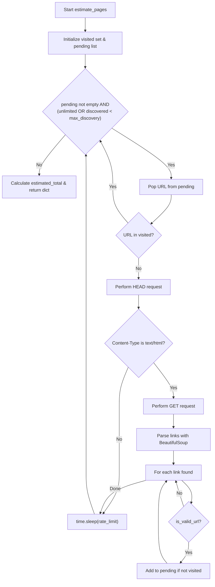

<!-- source: DeepWiki mcp.deepwiki.com · repo yusufkaraaslan/Skill_Seekers · page 10.1 Page Estimation · fetched 2026-10-26 -->

# Page Estimation

<details>
<summary>Relevant source files</summary>

The following files were used as context for generating this wiki page:

- [src/skill_seekers/cli/arguments/package.py](src/skill_seekers/cli/arguments/package.py)
- [src/skill_seekers/cli/arguments/upload.py](src/skill_seekers/cli/arguments/upload.py)
- [src/skill_seekers/cli/estimate_pages.py](src/skill_seekers/cli/estimate_pages.py)
- [tests/test_estimate_pages.py](tests/test_estimate_pages.py)
- [tests/test_package_skill.py](tests/test_package_skill.py)
- [tests/test_parallel_scraping.py](tests/test_parallel_scraping.py)
- [tests/test_setup_scripts.py](tests/test_setup_scripts.py)
- [tests/test_upload_skill.py](tests/test_upload_skill.py)
- [tests/test_utilities.py](tests/test_utilities.py)

</details>


This page covers the `estimate_pages` function and its MCP tool wrapper, which performs a lightweight BFS (Breadth-First Search) page-count sampling on a documentation site before a full scrape is committed. This is a critical pre-flight step in the Large Documentation Handling subsystem.

---

## Purpose

Before scraping a large documentation site, it is useful to know approximately how many pages exist. A full scrape can take hours. `estimate_pages` resolves this by crawling only a bounded number of URLs (controlled by `max_discovery`), measuring how much of the site has been reached, and projecting a total.

The function does **not** download or persist full page content — it only follows links to determine site volume.

Sources: `[src/skill_seekers/cli/estimate_pages.py:29-145]`, `[tests/test_estimate_pages.py:17-67]`

---

## Core Function: `estimate_pages`

**Module:** `src/skill_seekers/cli/estimate_pages.py`  
**Import:** `from skill_seekers.cli.estimate_pages import estimate_pages`

### Signature

```python
def estimate_pages(config, max_discovery=DEFAULT_MAX_DISCOVERY, timeout=30):
```
`[src/skill_seekers/cli/estimate_pages.py:29-29]`

### Parameters

| Parameter | Type | Description |
|-----------|------|-------------|
| `config` | `dict` | Skill config dict; must include `base_url`. Optionally includes `start_urls` and `rate_limit`. |
| `max_discovery` | `int` | Maximum number of URLs to visit during BFS sampling. Default `1000`. Use `-1` for unlimited discovery. |
| `timeout` | `int` | Per-request timeout in seconds. Default `30`. |

### Return Value

The function returns a `dict` containing the following keys:

| Key | Type | Description |
|-----|------|-------------|
| `discovered` | `int` | Number of URLs actually visited during BFS sampling. |
| `pending` | `int` | Number of URLs remaining in the queue when traversal stopped. |
| `estimated_total` | `int` | Projected total page count (`discovered` + `pending`). |
| `elapsed_seconds` | `float` | Wall-clock time the estimation took. |
| `discovery_rate` | `float` | Pages discovered per second. |
| `hit_limit` | `bool` | `True` if `max_discovery` was reached before exhaustion. |
| `unlimited` | `bool` | `True` if `max_discovery` was set to `-1` or `None`. |

Sources: `[src/skill_seekers/cli/estimate_pages.py:29-145]`, `[tests/test_estimate_pages.py:17-67]`

---

## Implementation Detail: BFS Sampling

The function applies a breadth-first search starting from `start_urls` (if provided) or `base_url`. It uses `requests.head` to check `Content-Type` before performing a full `GET` to extract links via `BeautifulSoup`.

### Logic Flow

1. **URL Normalization**: Uses `urljoin` and `urlparse` to ensure consistency.
2. **Validation**: `is_valid_url` checks if the URL starts with the `base_url` and respects `include_patterns`/`exclude_patterns`.
3. **Rate Limiting**: Applies `time.sleep(rate_limit)` between requests to avoid triggering anti-bot measures.
4. **Recommendations**: If the estimate exceeds the current `max_pages` in the config, it recommends a new value capped at `DISCOVERY_THRESHOLD` (3000).

**Diagram: estimate_pages Logic Flow**



Sources: `[src/skill_seekers/cli/estimate_pages.py:74-145]`, `[src/skill_seekers/cli/estimate_pages.py:148-165]`

---

## CLI and MCP Entry Points

The estimation functionality is accessible via the `skill-seekers` CLI and the FastMCP server.

### CLI Subcommand
The `estimate` subcommand uses `EstimateParser` to handle arguments. It includes a safety check to ensure `max_discovery` has a finite default (`DEFAULT_MAX_DISCOVERY = 1000`) to prevent accidental site-wide crawls.

**CLI Flags:**
- `<config>`: Path to the JSON configuration file.
- `--all`: Lists all available configurations in the registry instead of running estimation.
- `--max-discovery`: Overrides the sampling limit.

### MCP Tool: `estimate_pages`
The MCP tool `estimate_pages` allows AI agents to perform pre-flight checks. It maps the natural language request to the `estimate_pages` implementation.

**Diagram: MCP Tool to Code Entity Mapping**


Sources: `[src/skill_seekers/cli/estimate_pages.py:1-27]`, `[tests/test_estimate_pages.py:87-105]`, `[tests/test_estimate_pages.py:139-168]`

---

## Integration with Large Documentation Handling

Estimation results determine the next steps in the ingestion pipeline. If `estimated_total` is significantly higher than the system's single-skill capacity, the system suggests using the splitting tools.

| Estimated Pages | Recommended Action |
|-----------------|--------------------|
| < 200           | Direct scrape (standard) |
| 200 - 1000      | Increase `max_pages` in config. |
| > 1000          | Consider splitting into sub-configs. |

Sources: `[src/skill_seekers/cli/estimate_pages.py:196-210]`, `[src/skill_seekers/cli/constants.py:21-25]`

---

