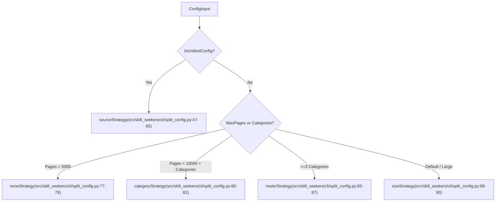
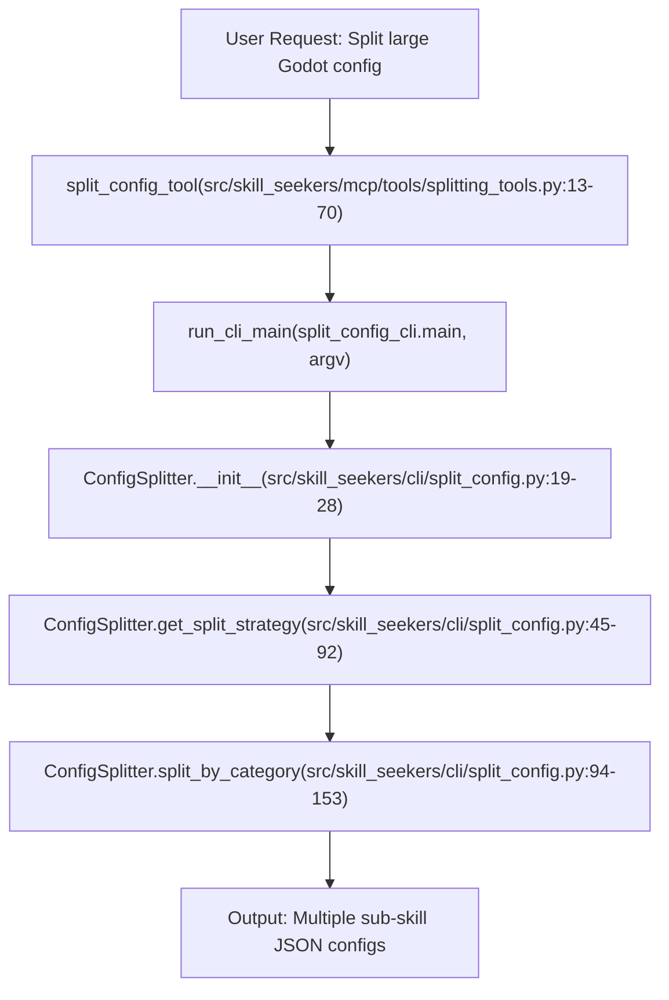
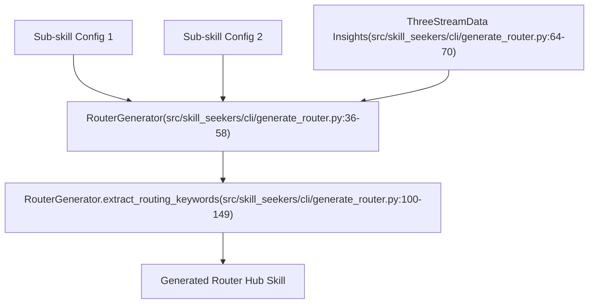

<!-- source: DeepWiki mcp.deepwiki.com · repo yusufkaraaslan/Skill_Seekers · page 10.2 Config Splitting · fetched 2026-10-26 -->

# Config Splitting

Relevant source files

The following files were used as context for generating this wiki page:

- [src/skill_seekers/cli/config_validator.py](src/skill_seekers/cli/config_validator.py)
- [src/skill_seekers/cli/generate_router.py](src/skill_seekers/cli/generate_router.py)
- [src/skill_seekers/cli/github_scraper.py](src/skill_seekers/cli/github_scraper.py)
- [src/skill_seekers/cli/pdf_scraper.py](src/skill_seekers/cli/pdf_scraper.py)
- [src/skill_seekers/cli/split_config.py](src/skill_seekers/cli/split_config.py)
- [src/skill_seekers/mcp/tools/_common.py](src/skill_seekers/mcp/tools/_common.py)
- [src/skill_seekers/mcp/tools/config_tools.py](src/skill_seekers/mcp/tools/config_tools.py)
- [src/skill_seekers/mcp/tools/marketplace_tools.py](src/skill_seekers/mcp/tools/marketplace_tools.py)
- [src/skill_seekers/mcp/tools/packaging_tools.py](src/skill_seekers/mcp/tools/packaging_tools.py)
- [src/skill_seekers/mcp/tools/splitting_tools.py](src/skill_seekers/mcp/tools/splitting_tools.py)
- [src/skill_seekers/mcp/tools/sync_config_tools.py](src/skill_seekers/mcp/tools/sync_config_tools.py)
- [src/skill_seekers/mcp/tools/vector_db_tools.py](src/skill_seekers/mcp/tools/vector_db_tools.py)
- [tests/test_github_scraper.py](tests/test_github_scraper.py)
- [tests/test_mcp_tools_common.py](tests/test_mcp_tools_common.py)

## Purpose and Scope
This page details the **Config Splitting** subsystem of `skill-seekers`, which handles large documentation sites (10K+ pages) and multi-source unified configurations. When a documentation set exceeds single-skill token or page limits, the configuration must be partitioned into focused sub-configs using `ConfigSplitter` strategies (source, category, size) [src/skill_seekers/cli/split_config.py:19-28](). These sub-skills are then managed and queried collectively through router/hub skills generated by `RouterGenerator` [src/skill_seekers/cli/generate_router.py:36-58]. This page covers the Python classes, CLI command routing, MCP tool integrations, and re-joining mechanisms.

Sources: [src/skill_seekers/cli/split_config.py:19-28](), [src/skill_seekers/cli/generate_router.py:36-58]()

---

## 1. ConfigSplitter Strategies

The core splitting logic resides in the `ConfigSplitter` class, initialized with a target configuration path, strategy, and target page count [src/skill_seekers/cli/split_config.py:19-25]().

### Strategy Selection and Evaluation
The `get_split_strategy()` method inspects the configuration structure to determine the appropriate partitioning mechanism [src/skill_seekers/cli/split_config.py:45-92]():
- **`source` Strategy**: Automatically selected for unified multi-source configs (`sources` array present) [src/skill_seekers/cli/split_config.py:41-65](). It separates individual ingestion engines (e.g., documentation, github, pdf, jupyter, openapi) into distinct skill configurations.
- **`category` Strategy**: Used for medium-to-large documentation sets where content is structured into logical categories. It iterates over configuration categories and generates subset configs containing scoped `url_patterns` [src/skill_seekers/cli/split_config.py:94-153]().
- **`size` Strategy**: Invoked when categories are absent or page counts exceed thresholds (`max_pages` / `target_pages`). It partitions the total expected pages into numbered part-configs (`-part1`, `-part2`, etc.) [src/skill_seekers/cli/split_config.py:155-169]().
- **`router` Strategy**: Combines category-based splitting with the automatic generation of a parent hub router configuration [src/skill_seekers/cli/split_config.py:83-87]().

Sources: [src/skill_seekers/cli/split_config.py:19-169]()

---

## 2. CLI Integration (`split_config.py`)

The config splitting CLI module exposes command-line parsing and batch execution for splitting operations. 

### Key Methods in `ConfigSplitter`
- `load_config(self) -> dict[str, Any]`: Loads and validates JSON configuration files, handling `FileNotFoundError` and `json.JSONDecodeError` [src/skill_seekers/cli/split_config.py:29-40]().
- `is_unified_config(self) -> bool`: Checks for the presence of the `sources` key to identify unified multi-source configurations [src/skill_seekers/cli/split_config.py:41-44]().
- `split_by_category(self, create_router: bool = False) -> list[dict[str, Any]]`: Subdivides the configuration by category definitions, adjusts `max_pages` limits, and injects category include patterns [src/skill_seekers/cli/split_config.py:94-153]().

Sources: [src/skill_seekers/cli/split_config.py:19-153](), [src/skill_seekers/mcp/tools/splitting_tools.py:13-70](), [src/skill_seekers/mcp/tools/_common.py:89-121]()

---

## 3. MCP Splitting Tools (`splitting_tools.py`)

Model Context Protocol (MCP) servers expose config splitting and router generation via dedicated tools mapped to CLI handlers [src/skill_seekers/mcp/tools/splitting_tools.py:1-119]().

### Tool Definitions
- `split_config(args: dict) -> list[TextContent]`: Invokes `split_config_cli.main()` in-process via `run_cli_tool()`, taking `config_path`, `strategy`, `target_pages`, and `dry_run` arguments [src/skill_seekers/mcp/tools/splitting_tools.py:13-70]().
- `generate_router(args: dict) -> list[TextContent]`: Expands glob patterns matching sub-skill configurations and executes `generate_router_cli.main()` to build a unified hub skill [src/skill_seekers/mcp/tools/splitting_tools.py:72-119]().

Both tools utilize the shared execution utility `run_cli_tool` from `src/skill_seekers/mcp/tools/_common.py`, ensuring captured logs and error states propagate correctly without spawning separate Python interpreter subprocesses [src/skill_seekers/mcp/tools/_common.py:158-170]().

Sources: [src/skill_seekers/mcp/tools/splitting_tools.py:1-119](), [src/skill_seekers/mcp/tools/_common.py:158-170]()

---

## 4. Router Re-joining & Hub Architecture (`RouterGenerator`)

When documentation is split across multiple sub-skills, agents require a routing mechanism to direct user queries to the correct domain context. The `RouterGenerator` class handles this aggregation [src/skill_seekers/cli/generate_router.py:36-58]().

### Keyword Routing and GitHub Weighting
The `extract_routing_keywords()` method builds a routing table mapping sub-skill names to category keywords and topic tokens [src/skill_seekers/cli/generate_router.py:100-149]():
- Category keys from each sub-config are extracted at a base weight of `1x` [src/skill_seekers/cli/generate_router.py:114-116]().
- When GitHub insights (`ThreeStreamData`) are present, top issue labels matching skill keywords are duplicated in the keyword array to apply a `2x` weighting factor [src/skill_seekers/cli/generate_router.py:122-139]().
- Skill-specific problem labels are extracted and appended to enhance routing precision [src/skill_seekers/cli/generate_router.py:141-149]().

Sources: [src/skill_seekers/cli/generate_router.py:36-149]()

---

