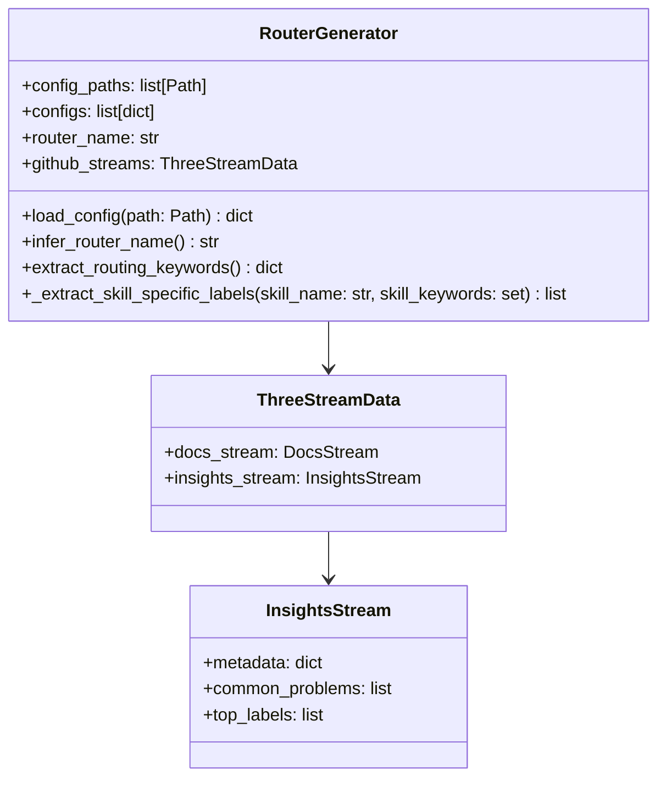
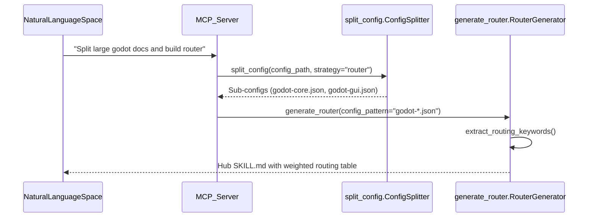

<!-- source: DeepWiki mcp.deepwiki.com · repo yusufkaraaslan/Skill_Seekers · page 10.3 Router Skills & Hub Architecture · fetched 2026-10-26 -->

# Router Skills & Hub Architecture

<details>
<summary>Relevant source files</summary>

The following files were used as context for generating this wiki page:

- [src/skill_seekers/cli/config_validator.py](src/skill_seekers/cli/config_validator.py)
- [src/skill_seekers/cli/generate_router.py](src/skill_seekers/cli/generate_router.py)
- [src/skill_seekers/cli/github_scraper.py](src/skill_seekers/cli/github_scraper.py)
- [src/skill_seekers/cli/pdf_scraper.py](src/skill_seekers/cli/pdf_scraper.py)
- [src/skill_seekers/cli/split_config.py](src/skill_seekers/cli/split_config.py)
- [tests/test_github_scraper.py](tests/test_github_scraper.py)

</details>


This page covers the router/hub skill pattern used when a single documentation source or codebase is too large to fit into a single skill. It details the configuration schemas, the `[src/skill_seekers/cli/generate_router.py:36-77]()` implementation, keyword and GitHub label routing mechanics, MCP integration tools, and the resulting file layout.

For context on what triggers a split, see page **10.2** (Configuration Splitting Strategies). For pre-flight page estimation, see page **10.1**.

---

## 1. Concept: Router vs. Sub-Skills

When a documentation set or repository exceeds context window thresholds (~5,000–10,000 pages or large multi-module codebases), it is partitioned into focused **sub-skills**. A **router skill** acts as an intelligent hub: its `SKILL.md` contains high-level architecture and metadata enabling an AI agent or language model to evaluate a user request in "Natural Language Space" and dispatch it to the correct specialized code entity in "Code Entity Space".

**Hub/Router Architecture & Code Bridge**

```mermaid
graph TD
    UserQuery[""NaturalLanguageQuery: User Query (e.g. 'Fix auth token bug')""] --> Router[""RouterGenerator: Hub SKILL.md & Routing Table""]
    Router -->|"KeywordMatch"| Sub1[""SubSkill: <name>-auth""]
    Router -->|"KeywordMatch"| Sub2[""SubSkill: <name>-api""]
    Router -->|"KeywordMatch"| Sub3[""SubSkill: <name>-ui""]
    Sub1 --> Code1[""CodeEntity: references/auth_logic.md""]
    Sub2 --> Code2[""CodeEntity: references/endpoints.md""]
    Sub3 --> Code3[""CodeEntity: references/components.md""]
```

Sources: [src/skill_seekers/cli/generate_router.py:3-13](), [src/skill_seekers/mcp/tools/splitting_tools.py:72-88]()

---

## 2. Router Config Schema

A router configuration is a standard JSON skill config augmented with internal control fields utilized by `RouterGenerator` [src/skill_seekers/cli/generate_router.py:36-77]() and `split_config` [src/skill_seekers/cli/split_config.py:19-21]().

| Field | Type | Description |
|---|---|---|
| `_router` | `bool` | Explicit flag set to `true` designating the configuration as a hub. |
| `_sub_skills` | `list[str]` | Collection of sub-skill configuration names governed by the router. |
| `_routing_keywords` | `dict[str, list[str]]` | Mapping of sub-skill identifiers to extracted routing tokens and GitHub labels. |
| `max_pages` | `int` | Typically bounded to low capacities as router skills prioritize architectural overviews. |

Sources: [src/skill_seekers/mcp/tools/splitting_tools.py:74-78](), [src/skill_seekers/mcp/tools/config_tools.py:59-74]()

---

## 3. `RouterGenerator` Class & Implementation

The `RouterGenerator` class [src/skill_seekers/cli/generate_router.py:36-77]() orchestrates hub skill generation. It ingests configuration paths and optional `ThreeStreamData` [src/skill_seekers/cli/generate_router.py:24-33]() objects to synthesize routing tables.

**Class Design & Data Flow**



Sources: [src/skill_seekers/cli/generate_router.py:36-77](), [src/skill_seekers/cli/generate_router.py:24-33]()

### Router Name Inference
The method `infer_router_name()` inspects sub-skill identifiers (e.g., `react-hooks`, `react-components`) and parses the common string prefix prior to the primary hyphen delimiter (e.g., `react`) [src/skill_seekers/cli/generate_router.py:87-98]().

Sources: [src/skill_seekers/cli/generate_router.py:87-98]()

---

## 4. Keyword & Label Routing Pipeline

The function `extract_routing_keywords()` [src/skill_seekers/cli/generate_router.py:100-149]() constructs routing rules by aggregating category definitions, namespace suffixes, and weighted GitHub issue metadata.

**Keyword Extraction Pipeline**

```mermaid
flowchart TD
    Start[""extract_routing_keywords()""] --> Cat[""Config Categories (Weight: 1x)""]
    Start --> Suffix[""Skill Suffix from Name (Weight: 1x)""]
    Start --> Labels[""GitHub Top Labels (Weight: 2x)""]
    Start --> SpecificLabels[""pi:_extract_skill_specific_labels() (Weight: 2x)""]
    Cat & Suffix & Labels & SpecificLabels --> Map[""Routing Table: SubSkill Name -> Keywords""]
```

### GitHub-Enhanced Routing
`_extract_skill_specific_labels()` [src/skill_seekers/cli/generate_router.py:151-199]() queries `common_problems` and `known_solutions` inside the `InsightsStream` [src/skill_seekers/cli/generate_router.py:24-33](). When issue labels intersect with sub-skill keyword sets, those labels are duplicated to achieve a $2\times$ scoring weight while filtering out generic terms like `bug` or `question`.

Sources: [src/skill_seekers/cli/generate_router.py:100-149](), [src/skill_seekers/cli/generate_router.py:151-199]()

---

## 5. MCP Router Tools & Execution Flow

MCP integration provides dedicated tools for configuration splitting and hub generation.

### Natural Language to Code Execution Mapping



Sources: [src/skill_seekers/mcp/tools/splitting_tools.py:13-69](), [src/skill_seekers/mcp/tools/splitting_tools.py:72-119](), [src/skill_seekers/cli/generate_router.py:36-55]()

---

## 6. Output Structure

The directory layout generated by a router build operation houses the central hub alongside specialized reference artifacts:

```text
output/<router_name>/
├── SKILL.md               # Hub Skill & Routing Table
└── references/
    ├── routing_table.md   # Keyword-to-sub-skill mapping
    └── project_overview.md # High-level architectural reference
```

Sources: [src/skill_seekers/mcp/tools/splitting_tools.py:74-88](), [src/skill_seekers/cli/generate_router.py:3-13]()

---

