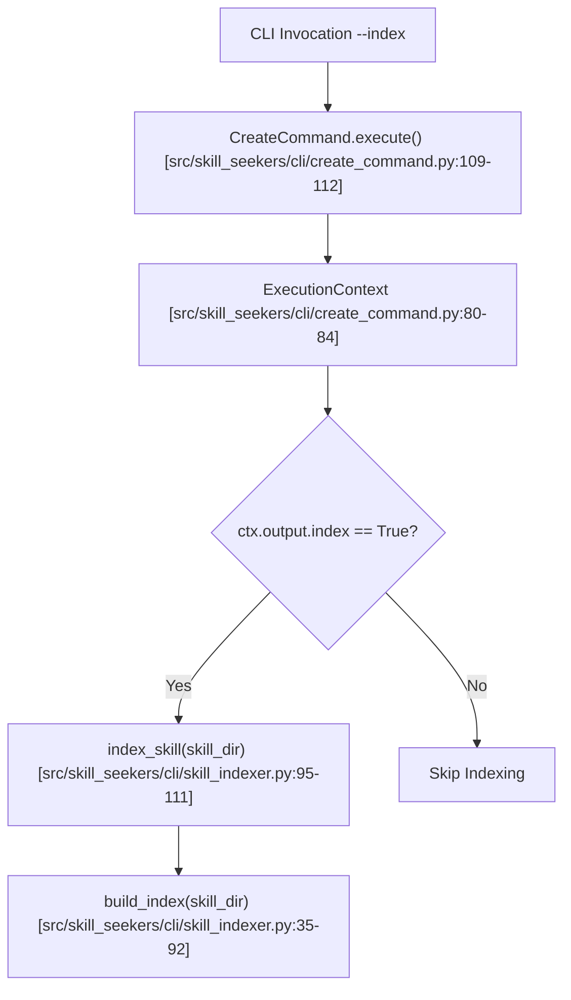
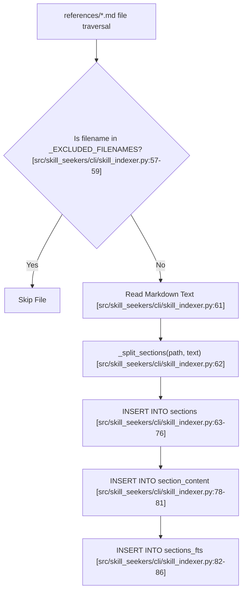

<!-- source: DeepWiki mcp.deepwiki.com · repo yusufkaraaslan/Skill_Seekers · page 10.4 Skill Search Index (SQLite FTS5) · fetched 2026-10-26 -->

# Skill Search Index (SQLite FTS5)

<details>
<summary>Relevant source files</summary>

The following files were used as context for generating this wiki page:

- [docs/features/SKILL_SEARCH_INDEX.md](docs/features/SKILL_SEARCH_INDEX.md)
- [src/skill_seekers/cli/arguments/common.py](src/skill_seekers/cli/arguments/common.py)
- [src/skill_seekers/cli/arguments/create.py](src/skill_seekers/cli/arguments/create.py)
- [src/skill_seekers/cli/arguments/scrape.py](src/skill_seekers/cli/arguments/scrape.py)
- [src/skill_seekers/cli/create_command.py](src/skill_seekers/cli/create_command.py)
- [src/skill_seekers/cli/skill_indexer.py](src/skill_seekers/cli/skill_indexer.py)
- [tests/test_create_arguments.py](tests/test_create_arguments.py)
- [tests/test_create_integration_basic.py](tests/test_create_integration_basic.py)

</details>


The Skill Search Index subsystem provides a lightweight, self-contained search engine for generated skill reference files. It allows AI coding agents to search through large documentation collections using SQLite FTS5 (Full-Text Search) and BM25 ranking before reading entire Markdown files into context. The feature is strictly opt-in, relying on standard library `sqlite3` so that the generated query tool requires no external dependencies.

Sources: [docs/features/SKILL_SEARCH_INDEX.md:1-65](), [src/skill_seekers/cli/skill_indexer.py:1-6]()

---

## 1. CLI Flag and Configuration Integration

The search index generation is triggered via the universal `--index` flag on CLI creation commands or through the `"index": true` parameter in unified JSON configurations. 

When `CreateCommand.execute()` reaches the final stages of a build pipeline, it inspects `ExecutionContext` for the index setting. If enabled, it invokes the indexing routine after all documentation has been scraped, enhanced, and formatted into Markdown reference files.


*Figure 1: Control flow from CLI command execution to index builder initialization.*

Sources: [src/skill_seekers/cli/create_command.py:109-112](), [src/skill_seekers/cli/arguments/create.py:51-56](), [src/skill_seekers/cli/skill_indexer.py:95-112]()

---

## 2. Index Build Pipeline (`skill_indexer.py`)

The indexing process is implemented in `src/skill_seekers/cli/skill_indexer.py`. The primary entry points are `build_index()` and `index_skill()`, supported by data structures like `IndexBuildResult`.

### Key Functions and Dataclasses
- `IndexBuildResult`: A frozen dataclass tracking `index_path`, `section_count`, and `fts_enabled` status [src/skill_seekers/cli/skill_indexer.py:26-33].
- `build_index(skill_dir)`: Iterates over rendered markdown files in `references/`, skips `index.md` files, parses headings using regular expressions while ignoring fenced code blocks, and populates the SQLite database [src/skill_seekers/cli/skill_indexer.py:35-92].
- `index_skill(skill_dir)`: Wraps `build_index()`, validates that `section_count > 0` (removing empty databases), installs `scripts/search.py`, and appends search guidance to `SKILL.md` [src/skill_seekers/cli/skill_indexer.py:95-112].


*Figure 2: Data pipeline for parsing reference files and populating index tables.*

Sources: [src/skill_seekers/cli/skill_indexer.py:26-112]()

---

## 3. SQLite Schema and Search Engine (FTS5 vs LIKE Fallback)

The database schema separates structural metadata from large text content to optimize query performance. It maintains three primary tables:

1. `sections`: Stores bibliographic metadata including `file`, `heading`, `anchor`, `category`, `kind`, and `code_langs` [src/skill_seekers/cli/skill_indexer.py:148-156].
2. `section_content`: Stores raw section body text linked via foreign key to `sections(id)` [src/skill_seekers/cli/skill_indexer.py:157-161].
3. `sections_fts`: A virtual FTS5 table indexing `heading` and `content` for full-text search [src/skill_seekers/cli/skill_indexer.py:166-173].

### Fallback Mechanism
If the Python environment's compiled `sqlite3` library lacks FTS5 extension support, `_create_fts_table()` catches the `sqlite3.OperationalError`, returns `False`, and the query script transparently falls back to portable `LIKE`-based matching and occurrence counting [src/skill_seekers/cli/skill_indexer.py:166-173, docs/features/SKILL_SEARCH_INDEX.md:62-64].

Sources: [src/skill_seekers/cli/skill_indexer.py:144-173](), [docs/features/SKILL_SEARCH_INDEX.md:60-65]()

---

## 4. Query Tool (`scripts/search.py`) & SKILL.md Guidance

When an index is successfully built, `skill_indexer` writes a self-contained Python script to `scripts/search.py` and injects usage instructions into `SKILL.md`.

### SKILL.md Integration
`append_search_instruction()` updates the skill's root documentation to instruct coding agents to query the index before reading raw files [src/skill_seekers/cli/skill_indexer.py:114-131]:

```markdown
## Search reference documentation

Before reading a reference file wholesale, search the generated index for confirmed hits:

```bash
python scripts/search.py "your query" --limit 5
```

Read only the returned `file#anchor` sections that apply to the task. Use `--category` to narrow results or `--json` for machine-readable output.
```

### Query Tool Execution
The generated `scripts/search.py` operates entirely on Python's standard library. Agents invoke it directly from the skill directory:
- Search queries with BM25 ranking: `python scripts/search.py "connect signal" --limit 5` [docs/features/SKILL_SEARCH_INDEX.md:34]
- Filter by category: `python scripts/search.py "timeout" --category network` [docs/features/SKILL_SEARCH_INDEX.md:35]
- Output structured JSON: `python scripts/search.py "authentication token" --json` [docs/features/SKILL_SEARCH_INDEX.md:36]

Sources: [src/skill_seekers/cli/skill_indexer.py:114-141](), [docs/features/SKILL_SEARCH_INDEX.md:24-40]()

---

