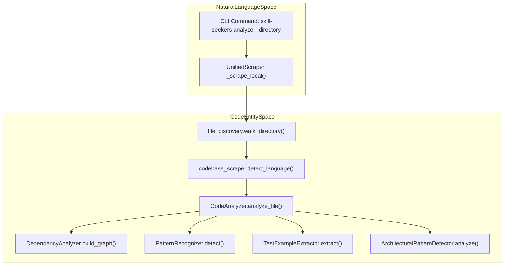
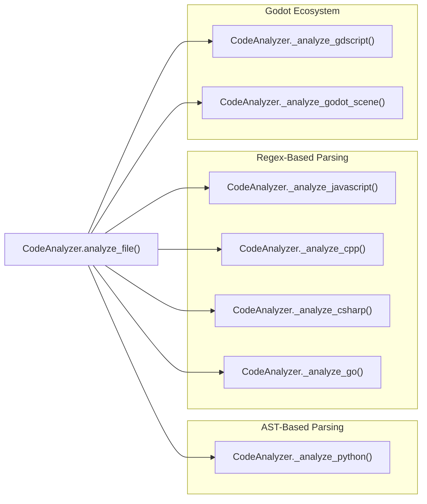

<!-- source: DeepWiki mcp.deepwiki.com · repo yusufkaraaslan/Skill_Seekers · page 11 C3.x Codebase Analysis Features · fetched 2026-10-26 -->

# C3.x Codebase Analysis Features

Relevant source files

The following files were used as context for generating this wiki page:

- [src/skill_seekers/cli/ai_enhancer.py](src/skill_seekers/cli/ai_enhancer.py)
- [src/skill_seekers/cli/architectural_pattern_detector.py](src/skill_seekers/cli/architectural_pattern_detector.py)
- [src/skill_seekers/cli/code_analyzer.py](src/skill_seekers/cli/code_analyzer.py)
- [src/skill_seekers/cli/codebase_scraper.py](src/skill_seekers/cli/codebase_scraper.py)
- [src/skill_seekers/cli/config_enhancer.py](src/skill_seekers/cli/config_enhancer.py)
- [src/skill_seekers/cli/config_extractor.py](src/skill_seekers/cli/config_extractor.py)
- [src/skill_seekers/cli/dependency_analyzer.py](src/skill_seekers/cli/dependency_analyzer.py)
- [src/skill_seekers/cli/llms_txt_parser.py](src/skill_seekers/cli/llms_txt_parser.py)
- [src/skill_seekers/cli/pattern_recognizer.py](src/skill_seekers/cli/pattern_recognizer.py)
- [src/skill_seekers/cli/signal_flow_analyzer.py](src/skill_seekers/cli/signal_flow_analyzer.py)
- [src/skill_seekers/cli/test_example_extractor.py](src/skill_seekers/cli/test_example_extractor.py)
- [tests/test_code_analyzer.py](tests/test_code_analyzer.py)
- [tests/test_codebase_scraper.py](tests/test_codebase_scraper.py)
- [tests/test_dependency_analyzer.py](tests/test_dependency_analyzer.py)
- [tests/test_framework_detection.py](tests/test_framework_detection.py)
- [tests/test_install_agent.py](tests/test_install_agent.py)
- [tests/test_integration.py](tests/test_integration.py)
- [tests/test_issue_219_e2e.py](tests/test_issue_219_e2e.py)
- [tests/test_kotlin_support.py](tests/test_kotlin_support.py)
- [tests/test_llms_txt_downloader.py](tests/test_llms_txt_downloader.py)
- [tests/test_skip_llms_txt.py](tests/test_skip_llms_txt.py)
- [tests/test_test_example_extractor.py](tests/test_test_example_extractor.py)

**Purpose**: This page documents the C3.x codebase analysis system, which provides deep code intelligence by analyzing local codebases or GitHub repositories. C3.x features extract design patterns, test examples, configuration patterns, architectural information, and signal flow without requiring documentation scraping.

**Scope**: Covers the 8 analysis features (C3.1-C3.10), the `CodeAnalyzer` multi-language engine, AI enhancement integration, and usage patterns. For documentation scraping, see [Documentation Scraper](#5.1). For GitHub repository scraping without C3.x analysis, see [GitHub Scraper](#5.2).

---

## Overview

The C3.x analysis system consists of specialized analyzers that extract different aspects of code intelligence, bridging natural language requirements to precise code entities:

| Feature | Module | Primary Output | Languages |
|---------|--------|----------------|-----------|
| C3.1 Design Pattern Detection | `pattern_recognizer.py` | `patterns.json`, `patterns.md` | 9+ languages |
| C3.2 Test Example Extraction | `test_example_extractor.py` | `test_examples.json`, `test_examples.md` | 10 languages |
| C3.3 How-To Guide Generation | `how_to_guide_builder.py` | `how_to_guides.md` | Language-agnostic |
| C3.4 Config Pattern Extraction | `config_extractor.py` | `config_patterns.json`, `config_patterns.md` | 9 formats |
| C3.5 ARCHITECTURE.md Generation | `unified_skill_builder.py` | `ARCHITECTURE.md` | Multi-file |
| C3.6 Dependency Graph Analysis | `dependency_analyzer.py` | `dependencies.json`, `.mmd`, `.dot` | 10+ languages |
| C3.7 Architectural Pattern Detection | `architectural_pattern_detector.py` | `architectural_patterns.json` | Multi-file |
| C3.10 Signal Flow Analysis | `signal_flow_analyzer.py` | `signal_flow.json`, `signal_flow.mmd` | GDScript/Godot |

**Entry Point**: All features are triggered via `codebase_scraper.py` or the `UnifiedScraper` which dispatches analysis based on the specified `depth` and source configuration.

Sources: [src/skill_seekers/cli/codebase_scraper.py:34-40](), [src/skill_seekers/cli/code_analyzer.py:107-108]()

---

## System Architecture: Natural Language to Code Entities

The following diagram bridges the high-level natural language intent (e.g., codebase analysis request) to concrete code entities (`CodeAnalyzer`, `DependencyAnalyzer`, `PatternRecognizer`) within the codebase.

Sources: [src/skill_seekers/cli/codebase_scraper.py:232-255](), [src/skill_seekers/cli/code_analyzer.py:95-110]()

---

## Multi-Language Code Analysis Engine

### CodeAnalyzer Architecture

The `CodeAnalyzer` class [src/skill_seekers/cli/code_analyzer.py:76-80]() provides language-agnostic code analysis at three depth levels:

| Depth | Behavior | Use Case |
|-------|----------|----------|
| `surface` | File tree only | Quick overview (1-2 min) |
| `deep` | Parse signatures, parameters, types | Balanced (5-10 min) |
| `full` | Complete AST analysis (future) | Thorough analysis |

**Language Support Matrix**:
The engine supports 10+ languages, utilizing AST for Python and specialized regex parsers for others. It includes deep support for the Godot ecosystem including `.gd`, `.tscn`, and `.tres` files.

Sources: [src/skill_seekers/cli/code_analyzer.py:10-23](), [src/skill_seekers/cli/code_analyzer.py:113-144](), [src/skill_seekers/cli/codebase_scraper.py:53-78]()

---

## C3.1: Design Pattern Detection

Detects Gang of Four design patterns by analyzing class signatures and relationships via `PatternRecognizer`. It identifies common structures like Singletons, Factories, and Observers across supported languages.

For details, see [C3.1: Design Pattern Detection](#11.1).

Sources: [src/skill_seekers/cli/codebase_scraper.py:13-19](), [src/skill_seekers/cli/pattern_recognizer.py:64-94]()

---

## C3.2: Test Example Extraction

Extracts usage examples from test files across 10 languages using `TestExampleExtractor`. It identifies high-value code snippets that demonstrate how to use specific classes or methods, categorizing them into groups like instantiation or workflow examples.

For details, see [C3.2: Test Example Extraction](#11.2).

Sources: [src/skill_seekers/cli/codebase_scraper.py:17-18](), [src/skill_seekers/cli/test_example_extractor.py:50-80]()

---

## C3.3: How-To Guide Generation

Transforms extracted test examples and codebase workflows into educational tutorials using the `HowToGuideBuilder` pipeline. It utilizes automated workflow analysis to identify common task sequences and can be augmented with AI to provide natural language context.

For details, see [C3.3: How-To Guide Generation](#11.3).

Sources: [src/skill_seekers/cli/codebase_scraper.py:16-17]()

---

## C3.4: Configuration Pattern Extraction

The `ConfigExtractor` and `ConfigFileDetector` identify project settings across formats like JSON, YAML, TOML, and `.env`. It parses configuration files to extract key-value pairs and their purposes, providing insights into project setup.

For details, see [C3.4: Configuration Pattern Extraction](#11.4).

Sources: [src/skill_seekers/cli/config_extractor.py:1-12](), [src/skill_seekers/cli/config_extractor.py:169-183]()

---

## C3.5: ARCHITECTURE.md Generation

The `UnifiedSkillBuilder` synthesizes C3.x analysis results to generate a project-level `ARCHITECTURE.md` file. This includes the technology stack, directory structure, and links to the `codebase_analysis` reference directory.

For details, see [C3.5: ARCHITECTURE.md Generation](#11.5).

Sources: [src/skill_seekers/cli/codebase_scraper.py:16-17]()

---

## C3.6: Dependency Graph Analysis

The `DependencyAnalyzer` [src/skill_seekers/cli/dependency_analyzer.py:82-88]() uses NetworkX to build a directed graph of file dependencies (`FileNode`, `DependencyInfo`). It can detect circular dependencies and export the graph to formats like Mermaid or DOT. It supports specialized extraction for Godot resources (`.tscn`, `.tres`) alongside standard programming languages.

For details, see [C3.6: Dependency Graph Analysis](#11.6).

Sources: [src/skill_seekers/cli/dependency_analyzer.py:9-13](), [src/skill_seekers/cli/dependency_analyzer.py:62-81](), [src/skill_seekers/cli/dependency_analyzer.py:106-118]()

---

## C3.7: Architectural Pattern Detection

Detects high-level patterns like MVC, MVVM, or Clean Architecture via `ArchitecturalPatternDetector.analyze()` [src/skill_seekers/cli/architectural_pattern_detector.py:74-79]() by analyzing directory structures and framework markers [src/skill_seekers/cli/architectural_pattern_detector.py:90-142](). It produces an `ArchitecturalReport` [src/skill_seekers/cli/architectural_pattern_detector.py:44-45]() summarizing the findings, including framework-specific detection for engines like Unity, Unreal, and Godot [src/skill_seekers/cli/architectural_pattern_detector.py:90-102]().

For details, see [C3.7: Architectural Pattern Detection](#11.7).

Sources: [src/skill_seekers/cli/architectural_pattern_detector.py:8-17](), [src/skill_seekers/cli/architectural_pattern_detector.py:44-45](), [src/skill_seekers/cli/architectural_pattern_detector.py:90-142]()

---

## C3.10: Signal Flow Analysis (Godot)

A specialized `SignalFlowAnalyzer` for Godot projects tracks signal declarations, connections (`.connect()`), and emissions (`.emit()`) [src/skill_seekers/cli/signal_flow_analyzer.py:14-17](). It identifies patterns such as the EventBus, Observer, and Event Chains [src/skill_seekers/cli/signal_flow_analyzer.py:124-166]().

For details, see [C3.10: Signal Flow Analysis (Godot)](#11.8).

Sources: [src/skill_seekers/cli/signal_flow_analyzer.py:30-50](), [src/skill_seekers/cli/signal_flow_analyzer.py:124-166]()

---

