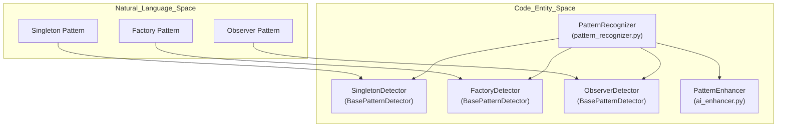
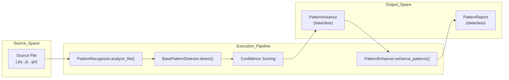

<!-- source: DeepWiki mcp.deepwiki.com · repo yusufkaraaslan/Skill_Seekers · page 11.1 C3.1: Design Pattern Detection · fetched 2026-10-26 -->

# C3.1: Design Pattern Detection

Relevant source files

The following files were used as context for generating this wiki page:

- [src/skill_seekers/cli/ai_enhancer.py](src/skill_seekers/cli/ai_enhancer.py)
- [src/skill_seekers/cli/config_enhancer.py](src/skill_seekers/cli/config_enhancer.py)
- [src/skill_seekers/cli/config_extractor.py](src/skill_seekers/cli/config_extractor.py)
- [src/skill_seekers/cli/embedding_pipeline.py](src/skill_seekers/cli/embedding_pipeline.py)
- [src/skill_seekers/cli/llms_txt_parser.py](src/skill_seekers/cli/llms_txt_parser.py)
- [src/skill_seekers/cli/pattern_recognizer.py](src/skill_seekers/cli/pattern_recognizer.py)
- [src/skill_seekers/cli/storage/azure_storage.py](src/skill_seekers/cli/storage/azure_storage.py)
- [src/skill_seekers/cli/storage/gcs_storage.py](src/skill_seekers/cli/storage/gcs_storage.py)
- [src/skill_seekers/cli/storage/s3_storage.py](src/skill_seekers/cli/storage/s3_storage.py)
- [src/skill_seekers/cli/test_example_extractor.py](src/skill_seekers/cli/test_example_extractor.py)
- [src/skill_seekers/embedding/generator.py](src/skill_seekers/embedding/generator.py)
- [tests/test_cloud_storage.py](tests/test_cloud_storage.py)
- [tests/test_embedding.py](tests/test_embedding.py)
- [tests/test_embedding_pipeline.py](tests/test_embedding_pipeline.py)
- [tests/test_install_agent.py](tests/test_install_agent.py)
- [tests/test_integration.py](tests/test_integration.py)
- [tests/test_issue_219_e2e.py](tests/test_issue_219_e2e.py)
- [tests/test_llms_txt_downloader.py](tests/test_llms_txt_downloader.py)
- [tests/test_pattern_recognizer.py](tests/test_pattern_recognizer.py)
- [tests/test_server_fastmcp_http.py](tests/test_server_fastmcp_http.py)
- [tests/test_skip_llms_txt.py](tests/test_skip_llms_txt.py)
- [tests/test_test_example_extractor.py](tests/test_test_example_extractor.py)

## Purpose and Scope

C3.1 provides automated detection of common design patterns across multiple programming languages within the `skill_seekers` suite. The system analyzes code structure at three configurable depth levels (surface, deep, full) and generates confidence-scored pattern reports. Pattern detection informs downstream tasks such as `ARCHITECTURE.md` generation and configuration/codebase understanding.

Key capabilities include:
- Detection of Gang of Four (GoF) patterns across Creational, Structural, and Behavioral categories. [src/skill_seekers/cli/pattern_recognizer.py:7-11]()
- Multi-level structural analysis (surface naming conventions, deep structural AST/signature checks, full behavioral inspection). [src/skill_seekers/cli/pattern_recognizer.py:12-16]()
- Robust normalization of generic and qualified base classes to support inheritance-based patterns in languages like C#, Java, and Kotlin. [src/skill_seekers/cli/pattern_recognizer.py:43-60]()
- Integration with AI enhancement via `PatternEnhancer` to explain patterns and boost confidence based on context. [src/skill_seekers/cli/ai_enhancer.py:110-189]()

Sources: [src/skill_seekers/cli/pattern_recognizer.py:5-20](), [src/skill_seekers/cli/pattern_recognizer.py:43-60](), [src/skill_seekers/cli/ai_enhancer.py:110-189]()

---

## Supported Patterns

The detector maps structural signatures to standard GoF design pattern definitions:

| Category | Patterns | Detection Strategies |
|----------|----------|---------------------|
| **Creational** | Singleton, Factory, Builder, Prototype | Instance control, naming conventions, method signatures |
| **Structural** | Adapter, Decorator, Facade, Proxy | Interface wrapping, composition patterns, method delegation |
| **Behavioral** | Observer, Strategy, Command, Template Method, Chain of Responsibility | Event subscriptions, polymorphic composition, abstract methods |

Sources: [src/skill_seekers/cli/pattern_recognizer.py:7-11](), [src/skill_seekers/cli/pattern_recognizer.py:64-76]()

---

## Detection Depths

Pattern detection operates at three configurable depth levels handled by `BasePatternDetector` subclasses:

### Surface Detection (Naming Conventions)
Matches patterns based on class or method naming heuristics (e.g., a class named `UserFactory` or `DatabaseSingleton`). [src/skill_seekers/cli/pattern_recognizer.py:141-153]()
- **Confidence Range:** 0.50 - 0.60

### Deep Detection (Structural Analysis)
Inspects class relationships, inheritance hierarchies, and method signatures using `CodeAnalyzer` integration. [src/skill_seekers/cli/pattern_recognizer.py:155-167]()
- **Confidence Range:** 0.70 - 0.80

### Full Detection (Behavioral Analysis)
Analyzes method implementations, control flow, and inter-class messaging using complete file contents (`_file_content`). [src/skill_seekers/cli/pattern_recognizer.py:169-184]()
- **Confidence Range:** 0.85 - 0.95

Sources: [src/skill_seekers/cli/pattern_recognizer.py:12-16](), [src/skill_seekers/cli/pattern_recognizer.py:127-200]()

---

## System Architecture

The following diagram maps natural language pattern concepts to concrete implementation classes within the codebase, demonstrating the architectural bridge from concept to code entities.

### Design Pattern Component Map

Sources: [src/skill_seekers/cli/pattern_recognizer.py:20-27](), [src/skill_seekers/cli/pattern_recognizer.py:127-215](), [src/skill_seekers/cli/ai_enhancer.py:110-189]()

---

## Detection Workflow

The data flow from raw source files to structured pattern reports is managed through the orchestrator.

### Pattern Detection Data Flow

Sources: [src/skill_seekers/cli/pattern_recognizer.py:64-125](), [src/skill_seekers/cli/pattern_recognizer.py:186-215](), [src/skill_seekers/cli/ai_enhancer.py:110-189]()

---

## Core Classes and Components

### PatternRecognizer
The central orchestrator that parses files, coordinates detectors, and compiles results into reports. [src/skill_seekers/cli/pattern_recognizer.py:202-232]()

### PatternInstance
A data class representing an individual detected pattern instance:
- `pattern_type`: String identifier (e.g., `'Singleton'`). [src/skill_seekers/cli/pattern_recognizer.py:67]()
- `category`: GoF category (`'Creational'`, `'Structural'`, `'Behavioral'`). [src/skill_seekers/cli/pattern_recognizer.py:68]()
- `confidence`: Floating-point score between 0.0 and 1.0. [src/skill_seekers/cli/pattern_recognizer.py:69]()
- `evidence`: List of strings capturing detection rationale. [src/skill_seekers/cli/pattern_recognizer.py:74]()
- `ai_analysis`: Optional dictionary containing AI insights from `PatternEnhancer`. [src/skill_seekers/cli/pattern_recognizer.py:76]()

Sources: [src/skill_seekers/cli/pattern_recognizer.py:64-94]()

### PatternEnhancer
Extends `AIEnhancer` to invoke downstream LLM calls (via `AgentClient`) to provide explanations, identify potential issues, and adjust confidence scores via `confidence_boost`. [src/skill_seekers/cli/ai_enhancer.py:110-189]()

Sources: [src/skill_seekers/cli/ai_enhancer.py:110-189]()

---

## Confidence Scoring and Filtering

Confidence scores are evaluated against defined thresholds to govern whether patterns are surfaced in documentation outputs like `ARCHITECTURE.md`. [src/skill_seekers/cli/pattern_recognizer.py:31-41]()

| Level | Threshold | Target Usage |
|-------|-----------|--------------|
| `critical` | ≥ 0.80 | High-confidence patterns included in `ARCHITECTURE.md` |
| `high` | ≥ 0.70 | Included in detailed analysis reports |
| `medium` | ≥ 0.60 | Included with contextual warnings |
| `low` | ≥ 0.50 | Minimum detection threshold (`DEFAULT_MIN_CONFIDENCE`) |

Sources: [src/skill_seekers/cli/pattern_recognizer.py:31-41]()

---

## Implementation Details

### Normalization Utilities
To prevent generic type parameters or namespace qualifiers from breaking inheritance checks across languages like C#, Java, and Kotlin, the module relies on robust helper functions:
- `_base_root(name)`: Strips generic arguments (e.g., `<Foo>`) and namespace qualifiers (e.g., `ns.BaseStrategy`) down to the root class name. [src/skill_seekers/cli/pattern_recognizer.py:43-54]()
- `_matches_base(name, bases)`: Evaluates whether a class inherits from a target base after normalization. [src/skill_seekers/cli/pattern_recognizer.py:57-60]()

### PatternReport
Aggregates file-level scan metadata, total counts, analysis depth, and the collection of `PatternInstance` objects into an exportable dictionary or summary. [src/skill_seekers/cli/pattern_recognizer.py:97-125]()

Sources: [src/skill_seekers/cli/pattern_recognizer.py:43-60](), [src/skill_seekers/cli/pattern_recognizer.py:97-125]()

---

