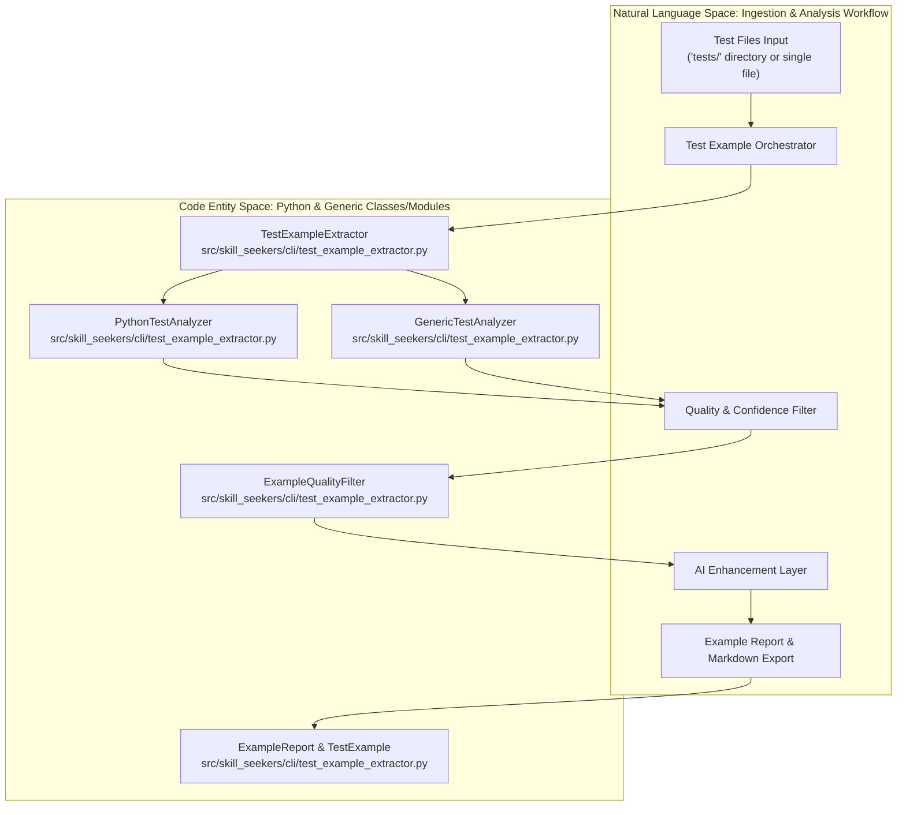
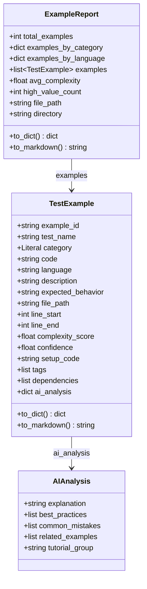
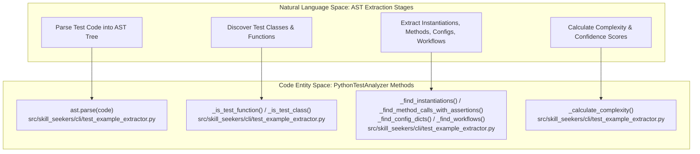

<!-- source: DeepWiki mcp.deepwiki.com · repo yusufkaraaslan/Skill_Seekers · page 11.2 C3.2: Test Example Extraction · fetched 2026-10-26 -->

# C3.2: Test Example Extraction

<details>
<summary>Relevant source files</summary>

The following files were used as context for generating this wiki page:

- [src/skill_seekers/cli/ai_enhancer.py](src/skill_seekers/cli/ai_enhancer.py)
- [src/skill_seekers/cli/config_enhancer.py](src/skill_seekers/cli/config_enhancer.py)
- [src/skill_seekers/cli/config_extractor.py](src/skill_seekers/cli/config_extractor.py)
- [src/skill_seekers/cli/llms_txt_parser.py](src/skill_seekers/cli/llms_txt_parser.py)
- [src/skill_seekers/cli/pattern_recognizer.py](src/skill_seekers/cli/pattern_recognizer.py)
- [src/skill_seekers/cli/test_example_extractor.py](src/skill_seekers/cli/test_example_extractor.py)
- [tests/test_install_agent.py](tests/test_install_agent.py)
- [tests/test_integration.py](tests/test_integration.py)
- [tests/test_issue_219_e2e.py](tests/test_issue_219_e2e.py)
- [tests/test_llms_txt_downloader.py](tests/test_llms_txt_downloader.py)
- [tests/test_skip_llms_txt.py](tests/test_skip_llms_txt.py)
- [tests/test_test_example_extractor.py](tests/test_test_example_extractor.py)

</details>


## Purpose and Scope

C3.2 is a codebase analysis feature that extracts real usage examples from test files to demonstrate how code should be used in practice. It analyzes test files across 10 programming languages to identify meaningful patterns including object instantiation, method calls with assertions, configuration examples, setup patterns, and multi-step workflows. The extracted examples include code snippets, expected behaviors, confidence scores, and optional AI-generated explanations.

This page covers the test example extraction system implemented in `src/skill_seekers/cli/test_example_extractor.py`. For AI enhancement of extracted examples, see [C3.3: How-To Guide Generation](). For the broader codebase analysis pipeline, see [C3.x Codebase Analysis Features](). For pattern detection in non-test code, see [C3.1: Design Pattern Detection]().

---

## System Overview

The test example extraction system implements a dual-strategy architecture: deep AST-based analysis for Python and regex-based extraction for other languages. It processes test files to extract five categories of examples, applies quality filtering, and optionally enhances results with AI-generated explanations and tutorial groupings.

### High-Level Architecture & Entity Mapping



Sources: `[src/skill_seekers/cli/test_example_extractor.py:49-160]()`, `[src/skill_seekers/cli/test_example_extractor.py:167-193]()`

---

## Core Data Models

The system uses three primary data structures to represent extracted examples and analysis results defined in `src/skill_seekers/cli/test_example_extractor.py`.

### TestExample Structure



**Category Values (`src/skill_seekers/cli/test_example_extractor.py`):**
- `instantiation`: Object creation with parameters `[src/skill_seekers/cli/test_example_extractor.py:56-56]()`
- `method_call`: Method invocations with assertions `[src/skill_seekers/cli/test_example_extractor.py:56-56]()`
- `config`: Configuration dictionaries/objects `[src/skill_seekers/cli/test_example_extractor.py:56-56]()`
- `setup`: Test fixtures and setup code `[src/skill_seekers/cli/test_example_extractor.py:56-56]()`
- `workflow`: Multi-step integration test scenarios `[src/skill_seekers/cli/test_example_extractor.py:56-56]()`

Sources: `[src/skill_seekers/cli/test_example_extractor.py:49-160]()`

---

## Dual Analysis Strategy

### Python AST-Based Analysis

The `PythonTestAnalyzer` class performs deep semantic analysis using Python's `ast` module to understand test structure and extract meaningful patterns.



**Key Implementation Details (`src/skill_seekers/cli/test_example_extractor.py`):**

| Method | Purpose | Returns |
|--------|---------|---------|
| `_is_test_class()` | Detects unittest.TestCase subclasses `[src/skill_seekers/cli/test_example_extractor.py:228-235]()` | bool |
| `_is_test_function()` | Detects pytest test functions (test_* or @pytest.mark) `[src/skill_seekers/cli/test_example_extractor.py:237-248]()` | bool |
| `_extract_imports()` | Extracts imported modules for dependency tracking `[src/skill_seekers/cli/test_example_extractor.py:209-226]()` | list[str] |
| `_extract_setup_method()` | Extracts setUp() method code as context `[src/skill_seekers/cli/test_example_extractor.py:284-301]()` | str or None |
| `_extract_fixtures()` | Extracts pytest fixture parameters `[src/skill_seekers/cli/test_example_extractor.py:329-349]()` | str or None |
| `_find_instantiations()` | Finds object creation patterns with parameters `[src/skill_seekers/cli/test_example_extractor.py:351-404]()` | list[TestExample] |
| `_find_method_calls_with_assertions()` | Finds method calls followed by assertions `[src/skill_seekers/cli/test_example_extractor.py:406-456]()` | list[TestExample] |
| `_find_config_dicts()` | Finds configuration dictionary patterns `[src/skill_seekers/cli/test_example_extractor.py:458-500]()` | list[TestExample] |
| `_find_workflows()` | Detects multi-step integration tests `[src/skill_seekers/cli/test_example_extractor.py:502-545]()` | list[TestExample] |
| `_is_integration_test()` | Heuristic: 4+ assignments, 3+ calls, or workflow keywords `[src/skill_seekers/cli/test_example_extractor.py:577-610]()` | bool |

Sources: `[src/skill_seekers/cli/test_example_extractor.py:167-641]()`

### Generic Regex-Based Analysis

The `GenericTestAnalyzer` class uses language-specific regex patterns to extract examples from non-Python test files (`[src/skill_seekers/cli/test_example_extractor.py:648-864]()`).

Sources: `[src/skill_seekers/cli/test_example_extractor.py:648-864]()`

---

## Quality Filtering System

The `ExampleQualityFilter` class removes trivial or low-value examples before final output (`[src/skill_seekers/cli/test_example_extractor.py:871-913]()`).

**Quality Filter Configuration (`src/skill_seekers/cli/test_example_extractor.py`):**

| Parameter | Default | Purpose |
|-----------|---------|---------|
| `min_confidence` | 0.5 (CLI), 0.7 (programmatic) | Minimum confidence score to accept `[src/skill_seekers/cli/test_example_extractor.py:871-873]()` |
| `min_code_length` | 20 | Minimum code length in characters `[src/skill_seekers/cli/test_example_extractor.py:874-874]()` |
| `trivial_patterns` | 7 patterns | List of patterns to exclude `[src/skill_seekers/cli/test_example_extractor.py:171-177]()` |

Sources: `[src/skill_seekers/cli/test_example_extractor.py:871-913, 1027-1035]()`

---

## Command-Line Interface

### Basic Usage

```bash
# Extract from directory
python test_example_extractor.py tests/ --language python

# Extract from single file
python test_example_extractor.py --file tests/test_scraper.py

# JSON output
python test_example_extractor.py tests/ --json > examples.json

# Filter by confidence
python test_example_extractor.py tests/ --min-confidence 0.7
```

Sources: `[src/skill_seekers/cli/test_example_extractor.py:16-28, 1112-1145]()`

---

