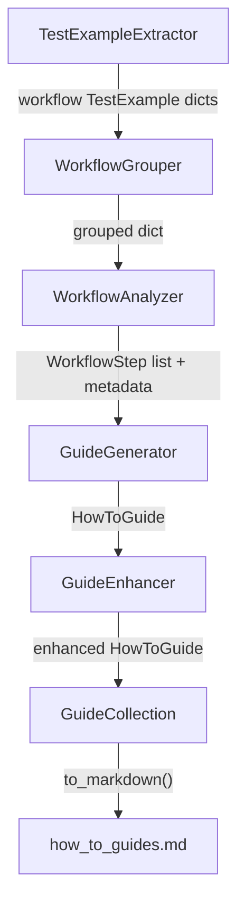
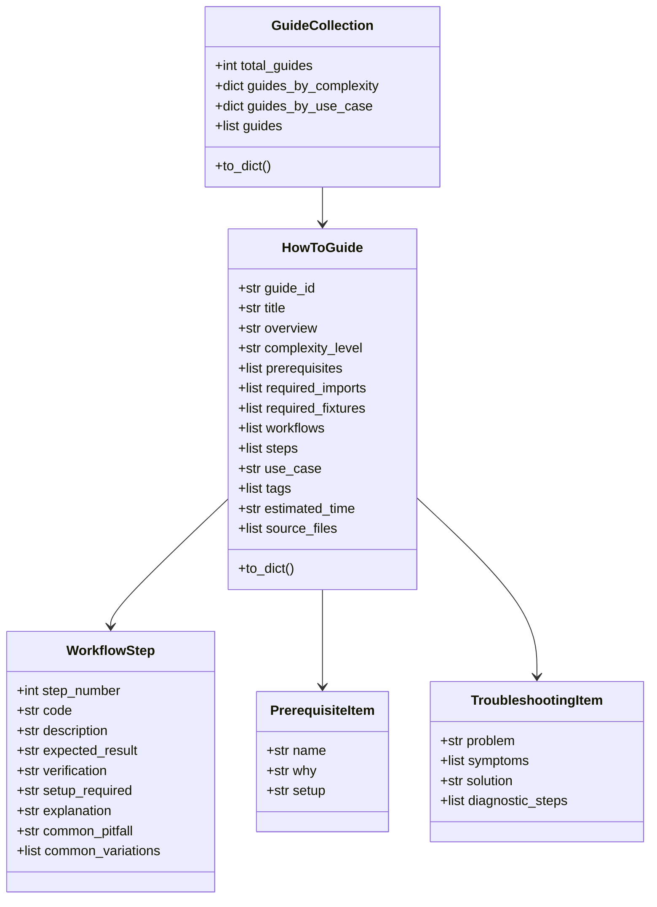
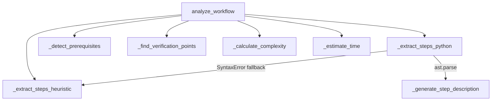
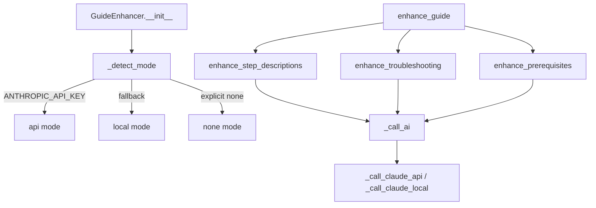
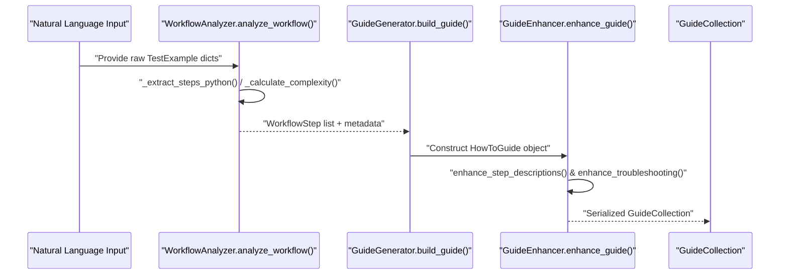

<!-- source: DeepWiki mcp.deepwiki.com · repo yusufkaraaslan/Skill_Seekers · page 11.3 C3.3: How-To Guide Generation · fetched 2026-10-26 -->

# C3.3: How-To Guide Generation

Relevant source files

The following files were used as context for generating this wiki page:

- [src/skill_seekers/cli/guide_enhancer.py](src/skill_seekers/cli/guide_enhancer.py)
- [src/skill_seekers/cli/how_to_guide_builder.py](src/skill_seekers/cli/how_to_guide_builder.py)
- [src/skill_seekers/embedding/models.py](src/skill_seekers/embedding/models.py)
- [tests/test_async_scraping.py](tests/test_async_scraping.py)
- [tests/test_guide_enhancer.py](tests/test_guide_enhancer.py)
- [tests/test_how_to_guide_builder.py](tests/test_how_to_guide_builder.py)

## Purpose & Scope

This page documents the C3.3 subsystem: the pipeline that converts multi-step workflow examples (extracted by C3.2) into structured, educational "how-to" guides in markdown format. It covers the `WorkflowAnalyzer`, `WorkflowGrouper`, `GuideGenerator`, and `GuideEnhancer` classes along with the data models that carry guide content through the pipeline.

- For how workflow examples are *extracted from test files* in the first place, see [C3.2: Test Example Extraction]().
- For how the output files are placed inside the skill directory, see [12. Output Structure & Files]().
- For the AI enhancement system more broadly, see [8. AI Enhancement System]().

Sources: [src/skill_seekers/cli/how_to_guide_builder.py:1-30]()

---

## Overview

C3.3 reads `TestExample` dicts with `category="workflow"` produced by C3.2 and transforms them into `HowToGuide` objects. A guide breaks a multi-step test workflow into discrete numbered steps, infers prerequisites, detects verification checkpoints, assigns a complexity level, and optionally augments all sections with AI-generated explanations via `GuideEnhancer`.

**Pipeline diagram: C3.2 to C3.3 to Markdown output**

Sources: [src/skill_seekers/cli/how_to_guide_builder.py:155-193](), [tests/test_guide_enhancer.py:1-10]()

---

## Data Models

All data structures live in `how_to_guide_builder.py`. They form a hierarchy from individual steps up to a full collection of guides.

**Data model hierarchy diagram**

Sources: [src/skill_seekers/cli/how_to_guide_builder.py:51-148]()

| Field | Type | Description |
|---|---|---|
| `WorkflowStep.verification` | `str \| None` | An assertion extracted from the source test to serve as a checkpoint |
| `WorkflowStep.common_variations` | `list[str]` | Alternative approaches added by AI enhancement |
| `HowToGuide.complexity_level` | `"beginner" \| "intermediate" \| "advanced"` | Derived from step count and language features |
| `HowToGuide.prerequisites_detailed` | `list[PrerequisiteItem]` | AI-enriched prerequisites with `why` and `setup` instructions |
| `HowToGuide.troubleshooting_detailed` | `list[TroubleshootingItem]` | AI-enriched troubleshooting with `symptoms` and `diagnostic_steps` |
| `GuideCollection.guides_by_use_case` | `dict[str, list[HowToGuide]]` | Guides grouped by their `use_case` field for navigation |

Sources: [src/skill_seekers/cli/how_to_guide_builder.py:51-148]()

---

## WorkflowAnalyzer

`WorkflowAnalyzer` is the first processing stage. It takes one `TestExample` dict (a workflow) and returns a list of `WorkflowStep` objects plus a metadata dict [src/skill_seekers/cli/how_to_guide_builder.py:156-192]().

**WorkflowAnalyzer method call graph**

Sources: [src/skill_seekers/cli/how_to_guide_builder.py:155-193]()

### Step Extraction

`_extract_steps_python` parses the workflow code with Python's `ast` module [src/skill_seekers/cli/how_to_guide_builder.py:173-174](). Assertions are paired with the step that immediately follows them in document order to populate the `verification` field [src/skill_seekers/cli/how_to_guide_builder.py:181-186]().

For non-Python workflows, `_extract_steps_heuristic` falls back to line-by-line splitting [src/skill_seekers/cli/how_to_guide_builder.py:175-176]().

Sources: [src/skill_seekers/cli/how_to_guide_builder.py:173-202]()

### Complexity Classification & Time Estimation

`_calculate_complexity` derives a complexity level (`beginner`, `intermediate`, `advanced`) based on step counts and language features [src/skill_seekers/cli/how_to_guide_builder.py:189](). `_estimate_time` returns a human-readable string duration [src/skill_seekers/cli/how_to_guide_builder.py:190]().

Sources: [src/skill_seekers/cli/how_to_guide_builder.py:189-190]()

---

## WorkflowGrouper & GuideGenerator

`WorkflowGrouper` organizes flat workflow lists using strategies such as `file-path`, `test-name`, or `complexity` [src/skill_seekers/cli/how_to_guide_builder.py:37-43](). `GuideGenerator` compiles the final `HowToGuide` instances containing steps, metadata, and structured markdown sections [src/skill_seekers/cli/how_to_guide_builder.py:86-108]().

Sources: [src/skill_seekers/cli/how_to_guide_builder.py:37-43](), [src/skill_seekers/cli/how_to_guide_builder.py:86-108]()

---

## GuideEnhancer & AI Augmentation

`GuideEnhancer` (in `src/skill_seekers/cli/guide_enhancer.py`) provides dual-mode AI augmentation (`api` vs `local`) to enrich guide descriptions, troubleshooting steps, and prerequisites [src/skill_seekers/cli/guide_enhancer.py:60-112]().

**GuideEnhancer mode selection and method map**

Sources: [src/skill_seekers/cli/guide_enhancer.py:60-112](), [tests/test_guide_enhancer.py:26-70]()

---

## Pipeline Flow: Natural Language to Code Entities

The sequence below bridges natural language requirements to the concrete Python classes and functions executing the generation pipeline.

Sources: [src/skill_seekers/cli/how_to_guide_builder.py:155-193](), [src/skill_seekers/cli/guide_enhancer.py:89-112]()

---

## Output: `GuideCollection`

`GuideCollection.to_dict()` serializes the generated guides into a JSON-compatible dictionary containing aggregate counters and grouped structures [src/skill_seekers/cli/how_to_guide_builder.py:139-148]().

Sources: [src/skill_seekers/cli/how_to_guide_builder.py:131-148]()

---

