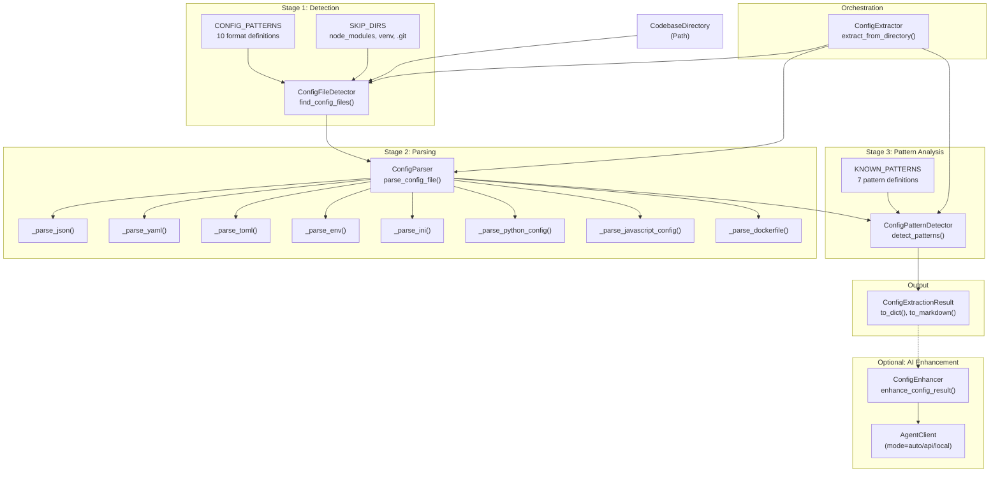
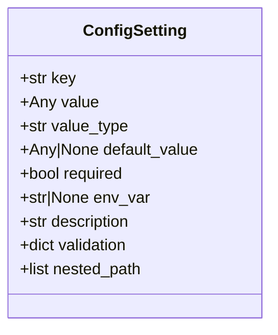
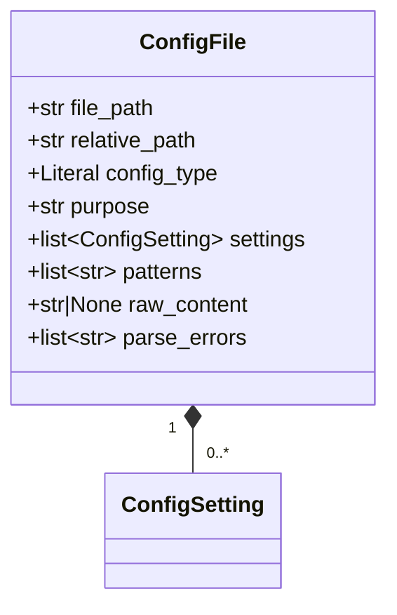
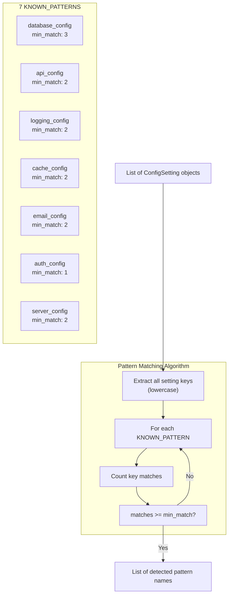

<!-- source: DeepWiki mcp.deepwiki.com · repo yusufkaraaslan/Skill_Seekers · page 11.4 C3.4: Configuration Pattern Extraction · fetched 2026-10-26 -->

# C3.4: Configuration Pattern Extraction

Relevant source files

The following files were used as context for generating this wiki page:

- [src/skill_seekers/cli/ai_enhancer.py](src/skill_seekers/cli/ai_enhancer.py)
- [src/skill_seekers/cli/config_enhancer.py](src/skill_seekers/cli/config_enhancer.py)
- [src/skill_seekers/cli/config_extractor.py](src/skill_seekers/cli/config_extractor.py)
- [src/skill_seekers/cli/llms_txt_parser.py](src/skill_seekers/cli/llms_txt_parser.py)
- [src/skill_seekers/cli/pattern_recognizer.py](src/skill_seekers/cli/pattern_recognizer.py)
- [src/skill_seekers/cli/test_example_extractor.py](src/skill_seekers/cli/test_example_extractor.py)
- [tests/test_config_extractor.py](tests/test_config_extractor.py)
- [tests/test_install_agent.py](tests/test_install_agent.py)
- [tests/test_integration.py](tests/test_integration.py)
- [tests/test_issue_219_e2e.py](tests/test_issue_219_e2e.py)
- [tests/test_llms_txt_downloader.py](tests/test_llms_txt_downloader.py)
- [tests/test_skip_llms_txt.py](tests/test_skip_llms_txt.py)
- [tests/test_test_example_extractor.py](tests/test_test_example_extractor.py)
- [tests/test_unified_analyzer.py](tests/test_unified_analyzer.py)

## Purpose and Scope

C3.4: Configuration Pattern Extraction analyzes actual configuration files in a codebase to document project configuration patterns, settings, and best practices. This feature extracts configuration from 10 different file formats (JSON, YAML, TOML, ENV, INI, Python, JavaScript/TypeScript, Kotlin-Gradle, Dockerfile, Docker-Compose) and detects 7 common configuration patterns (database, API, logging, cache, email, authentication, server).

This differs from [C3.2: Test Example Extraction]() (implemented in `TestExampleExtractor` [src/skill_seekers/cli/test_example_extractor.py:3-9]()) which extracts configuration examples from test code. C3.4 focuses on documenting the actual project configuration structure found in production-like files via `ConfigExtractor` and `ConfigFileDetector` [src/skill_seekers/cli/config_extractor.py:3-10]().

Sources: [src/skill_seekers/cli/config_extractor.py:3-10](), [src/skill_seekers/cli/test_example_extractor.py:3-9]()

---

## System Architecture

C3.4 implements a three-stage pipeline: detection (`ConfigFileDetector`) -> parsing (`ConfigParser`) -> pattern analysis (`ConfigPatternDetector`), with optional AI augmentation via `ConfigEnhancer` [src/skill_seekers/cli/config_extractor.py:169-173](), [src/skill_seekers/cli/config_enhancer.py:49-57]().

**Diagram 1:** C3.4 System Architecture bridging natural language requirements to code entities such as `ConfigFileDetector`, `ConfigParser`, `ConfigPatternDetector`, and `ConfigEnhancer`.

Sources: [src/skill_seekers/cli/config_extractor.py:169-209](), [src/skill_seekers/cli/config_enhancer.py:49-57]()

---

## Data Structures

### ConfigSetting

Represents an individual configuration setting extracted from a configuration file, modeled by the `ConfigSetting` dataclass [src/skill_seekers/cli/config_extractor.py:52-64]().

**Table 1:** ConfigSetting Fields

| Field | Type | Description | Example |
|-------|------|-------------|---------|
| `key` | `str` | Setting key/name | `"database.host"` |
| `value` | `Any` | Current value | `"localhost"` |
| `value_type` | `str` | Type classification | `"string"`, `"integer"`, `"boolean"`, `"array"`, `"object"`, `"null"` |
| `default_value` | `Any\|None` | Default if not set | `"127.0.0.1"` |
| `required` | `bool` | Whether required | `True` |
| `env_var` | `str\|None` | Environment variable name | `"DATABASE_HOST"` |
| `description` | `str` | Extracted description | `"Database host address"` |
| `validation` | `dict` | Validation rules | `{"min": 1, "max": 65535}` |
| `nested_path` | `list[str]` | Path for nested configs | `["database", "host"]` |

Sources: [src/skill_seekers/cli/config_extractor.py:52-64]()

### ConfigFile

Represents a complete configuration file with all extracted settings, defined by the `ConfigFile` dataclass [src/skill_seekers/cli/config_extractor.py:67-89]().

**Table 2:** ConfigFile Fields

| Field | Type | Description |
|-------|------|-------------|
| `config_type` | `Literal` | One of: `json`, `yaml`, `toml`, `env`, `ini`, `python`, `javascript`, `kotlin-gradle`, `dockerfile`, `docker-compose` |
| `purpose` | `str` | Inferred purpose: database, api, logging, etc. |
| `patterns` | `list[str]` | Detected patterns (e.g., `database_config`) |

Sources: [src/skill_seekers/cli/config_extractor.py:67-89]()

---

## Supported Configuration Formats

C3.4 supports multiple configuration file formats with dedicated parser methods in `ConfigExtractor`.

### Format-Specific Parsing Details

**Table 3:** Parser Methods by Format

| Format | Parser Method | Key Features |
|--------|---------------|--------------|
| JSON | `_parse_json()` | Handles dicts and arrays at root, recursive nested extraction [src/skill_seekers/cli/config_extractor.py:375-403](). |
| YAML | `_parse_yaml()` | Uses `yaml.safe_load()`, requires `PyYAML` [src/skill_seekers/cli/config_extractor.py:405-434](). |
| TOML | `_parse_toml()` | Uses `tomli`/`toml`/`tomllib` [src/skill_seekers/cli/config_extractor.py:436-466](). |
| ENV | `_parse_env()` | Regex-based `KEY=VALUE` parsing, comment handling [src/skill_seekers/cli/config_extractor.py:468-494](). |
| INI | `_parse_ini()` | Uses `configparser`, section-based keys [src/skill_seekers/cli/config_extractor.py:496-522](). |
| Python | `_parse_python_config()` | AST-based parsing with `ast.literal_eval()` [src/skill_seekers/cli/config_extractor.py:524-555](). |
| JavaScript | `_parse_javascript_config()` | Regex-based extraction (basic) [src/skill_seekers/cli/config_extractor.py:557-581](). |
| Dockerfile | `_parse_dockerfile()` | Extracts `ENV` and `ARG` directives [src/skill_seekers/cli/config_extractor.py:583-601](). |

Sources: [src/skill_seekers/cli/config_extractor.py:375-601]()

---

## Configuration Pattern Detection

The pattern detection system identifies common configuration patterns based on setting key names using predefined known patterns.

**Diagram 2:** Pattern detection algorithm showing key extraction and `KNOWN_PATTERNS` matching.

### Pattern Definitions

**Table 4:** `KNOWN_PATTERNS` Configuration

| Pattern | Key Keywords | Min Matches |
|---------|--------------|-------------|
| `database_config` | `host`, `port`, `database`, `user`, `username`, `password`, `db_name` | 3 |
| `api_config` | `base_url`, `api_key`, `api_secret`, `timeout`, `retry`, `endpoint` | 2 |
| `logging_config` | `level`, `format`, `handler`, `file`, `console`, `log_level` | 2 |
| `cache_config` | `backend`, `ttl`, `timeout`, `max_size`, `redis`, `memcached` | 2 |
| `email_config` | `smtp_host`, `smtp_port`, `email`, `from_email`, `mail_server` | 2 |
| `auth_config` | `secret_key`, `jwt_secret`, `token`, `oauth`, `authentication` | 1 |
| `server_config` | `host`, `port`, `bind`, `workers`, `threads` | 2 |

Sources: [src/skill_seekers/cli/config_extractor.py:653-732]()

---

## AI Enhancement System (`ConfigEnhancer`)

The `ConfigEnhancer` class [src/skill_seekers/cli/config_enhancer.py:49-57]() provides AI-powered analysis of extracted configurations, supporting dual-mode operation (API + LOCAL) via `AgentClient`.

### Enhancement Features
- **Explanations**: Clarifies the purpose of configuration files and specific settings [src/skill_seekers/cli/config_enhancer.py:149-149]().
- **Best Practices**: Suggests structural improvements and naming conventions [src/skill_seekers/cli/config_enhancer.py:150-150]().
- **Security Analysis**: Identifies hardcoded secrets or exposed credentials [src/skill_seekers/cli/config_enhancer.py:151-151]().
- **Migration Suggestions**: Identifies opportunities to consolidate or standardize configurations [src/skill_seekers/cli/config_enhancer.py:152-152]().

### AI Mode Priority
1. **API Mode**: Direct calls to AI APIs (requires `ANTHROPIC_API_KEY`) [src/skill_seekers/cli/config_enhancer.py:92-117]().
2. **LOCAL Mode**: Uses a coding agent CLI (e.g., Claude Code, Kimi) [src/skill_seekers/cli/config_enhancer.py:199-224]().
3. **AUTO Mode**: Automatically detects the best available mode [src/skill_seekers/cli/config_enhancer.py:59-70]().

Sources: [src/skill_seekers/cli/config_enhancer.py:3-13](), [src/skill_seekers/cli/config_enhancer.py:49-70](), [src/skill_seekers/cli/config_enhancer.py:147-154]()

---

## Integration with CLI

C3.4 is integrated into the `skill-seekers scan` command and the unified codebase analysis pipeline.

**Table 5:** CLI Flag Support

| Flag | Purpose |
|------|---------|
| `--enhance-level` | Controls the depth of AI enhancement (0-3) [tests/test_issue_219_e2e.py:121-131](). |
| `--enhance-local` | Forces the use of local CLI agents for enhancement [tests/test_issue_219_e2e.py:7-7](). |
| `--max-ai-generations` | Limits the number of AI-driven analysis tasks [src/skill_seekers/cli/config_manager.py:54-55](). |

Sources: [tests/test_issue_219_e2e.py:7-131](), [src/skill_seekers/cli/config_manager.py:51-56]()

---

## Performance and Limits

- **Max Files**: `ConfigFileDetector.find_config_files()` defaults to processing a maximum of 100 configuration files to prevent excessive analysis time [src/skill_seekers/cli/config_extractor.py:260-264]().
- **Directory Exclusion**: Common non-source directories like `node_modules`, `venv`, and `.git` are skipped during detection [src/skill_seekers/cli/config_extractor.py:224-239]().
- **Batching**: Local AI enhancement uses parallel workers (default: 3) and batching to optimize performance [src/skill_seekers/cli/config_manager.py:54-55]().

Sources: [src/skill_seekers/cli/config_extractor.py:224-264](), [src/skill_seekers/cli/config_manager.py:51-56]()

---

