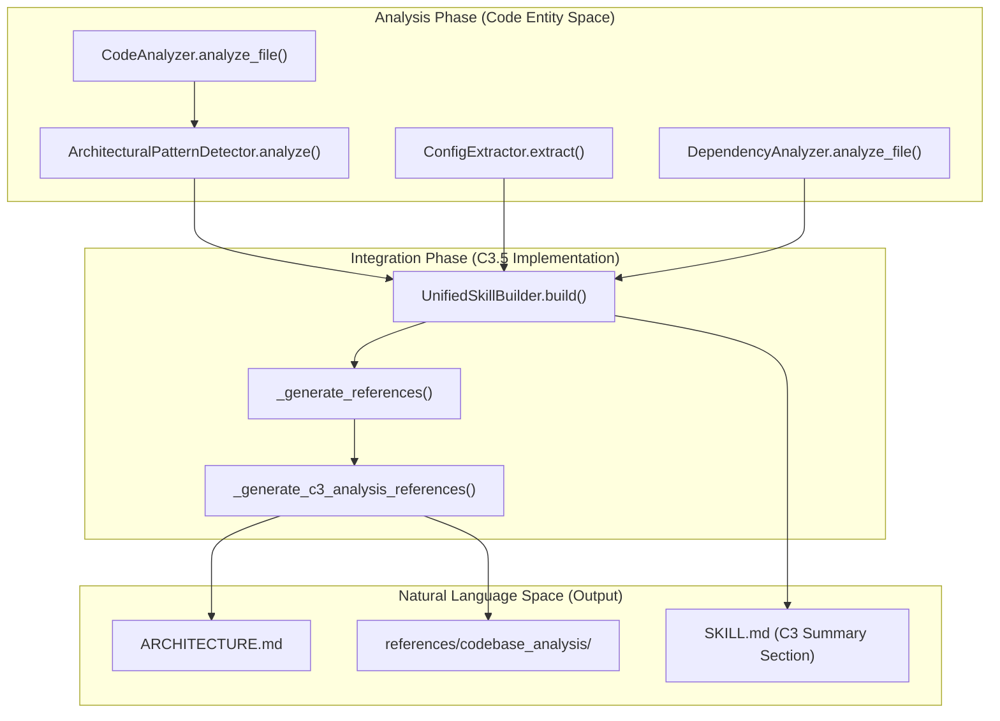
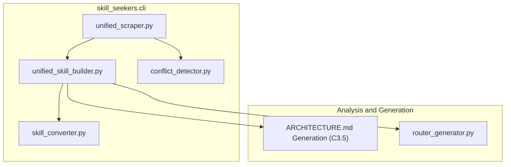

<!-- source: DeepWiki mcp.deepwiki.com · repo yusufkaraaslan/Skill_Seekers · page 11.5 C3.5: ARCHITECTURE.md Generation · fetched 2026-10-26 -->

# C3.5: ARCHITECTURE.md Generation

<details>
<summary>Relevant source files</summary>

The following files were used as context for generating this wiki page:

- [src/skill_seekers/cli/doc_scraper.py](src/skill_seekers/cli/doc_scraper.py)
- [src/skill_seekers/cli/unified_codebase_analyzer.py](src/skill_seekers/cli/unified_codebase_analyzer.py)
- [src/skill_seekers/cli/unified_scraper.py](src/skill_seekers/cli/unified_scraper.py)
- [src/skill_seekers/cli/unified_skill_builder.py](src/skill_seekers/cli/unified_skill_builder.py)
- [tests/test_architecture_scenarios.py](tests/test_architecture_scenarios.py)
- [tests/test_c3_integration.py](tests/test_c3_integration.py)
- [tests/test_multi_source.py](tests/test_multi_source.py)
- [tests/test_unified.py](tests/test_unified.py)
- [tests/test_unified_scraper_orchestration.py](tests/test_unified_scraper_orchestration.py)

</details>


## Purpose and Scope

C3.5 is the **integration and reporting layer** within the `UnifiedSkillBuilder` [src/skill_seekers/cli/unified_skill_builder.py:26-36]() that assembles outputs from the C3.x analysis suite (C3.1–C3.4 and C3.7) into a coherent `ARCHITECTURE.md` file and a structured `references/codebase_analysis/` directory [src/skill_seekers/cli/unified_skill_builder.py:61-70](). 

While modules like `CodeAnalyzer` and `ArchitecturalPatternDetector` perform the heavy lifting of parsing source code, C3.5 acts as the synthesizer that transforms these raw analysis results into human-readable documentation and machine-readable JSON mirrors during the `build()` phase [src/skill_seekers/cli/unified_skill_builder.py:108-123]().

Sources: [src/skill_seekers/cli/unified_skill_builder.py:26-36](), [src/skill_seekers/cli/unified_skill_builder.py:61-70](), [src/skill_seekers/cli/unified_skill_builder.py:108-123]()

---

## Architecture Generation Data Flow

The generation process is triggered during the final phase of the `UnifiedScraper` orchestration [src/skill_seekers/cli/unified_scraper.py:41-51](), specifically when the `UnifiedSkillBuilder` assembles the final skill structure from the scraped data [src/skill_seekers/cli/unified_skill_builder.py:108-123]().

### From Code to Markdown

Title: "C3.5 Data Synthesis Pipeline"

Sources: [src/skill_seekers/cli/unified_skill_builder.py:108-123](), [src/skill_seekers/cli/unified_scraper.py:41-51](), [src/skill_seekers/cli/unified_skill_builder.py:61-70]()

---

## Implementation Details

### The `c3_analysis` Data Structure
The `UnifiedSkillBuilder` expects a `scraped_data` dictionary containing a `c3_analysis` key, typically populated by the `GitHubScraper` or `CodebaseScraper` [src/skill_seekers/cli/unified_skill_builder.py:71-78](). This dictionary serves as the single source of truth for the generated report:

| Component | Source Data Key | Description |
|:---|:---|:---|
| **Architecture** | `architecture` | Frameworks, directory structure, and high-level patterns [tests/test_c3_integration.py:120-137](). |
| **Design Patterns** | `patterns` | Detected design patterns (Singleton, Factory, etc.) [tests/test_c3_integration.py:60-72](). |
| **Config Patterns** | `config_patterns` | Project configuration files and environment variables [tests/test_c3_integration.py:104-119](). |
| **Test Examples** | `test_examples` | Usage examples derived from test suites [tests/test_c3_integration.py:73-86](). |
| **How-To Guides** | `how_to_guides` | Step-by-step guides derived from workflow analysis [tests/test_c3_integration.py:87-103](). |

Sources: [src/skill_seekers/cli/unified_skill_builder.py:71-78](), [tests/test_c3_integration.py:60-137]()

### Key Generation Logic
The generation logic is encapsulated in `UnifiedSkillBuilder` methods that transform structured data into Markdown:

1.  **`_generate_references`**: Orchestrates the creation of the `references/` subdirectory [src/skill_seekers/cli/unified_skill_builder.py:115-116]().
2.  **`_generate_c3_analysis_references`**: Specifically handles the `codebase_analysis` folder, creating the `ARCHITECTURE.md` and associated JSON reports [tests/test_c3_integration.py:190-193]().
3.  **`_format_c3_summary_section`**: Generates a condensed summary block for the main `SKILL.md`, providing a high-level view of the technology stack and primary architectural patterns.

Sources: [src/skill_seekers/cli/unified_skill_builder.py:108-123](), [tests/test_c3_integration.py:57-137]()

---

## ARCHITECTURE.md Structure

The generated `ARCHITECTURE.md` is organized into standard sections (8 sections total in comprehensive mode) to ensure consistency [tests/test_c3_integration.py:8]():

1. **Technology Stack**: Derived from detected frameworks and language analysis [tests/test_c3_integration.py:133-134]().
2. **Architectural Patterns**: Displays patterns detected (e.g., MVC), including confidence scores and evidence directories [tests/test_c3_integration.py:121-132]().
3. **Directory Structure Overview**: A high-level map of the codebase highlighting key directory purposes and file counts [tests/test_c3_integration.py:135]().
4. **Design Patterns**: A table of design patterns detected, linking to specific files [tests/test_c3_integration.py:60-71]().
5. **Configuration and Environment**: Summary of configuration patterns, listing primary config files [tests/test_c3_integration.py:104-119]().

Sources: [tests/test_c3_integration.py:8](), [tests/test_c3_integration.py:60-137]()

---

## Codebase Analysis Reference Directory

C3.5 populates `references/codebase_analysis/` with granular details that are too voluminous for the main `SKILL.md` [src/skill_seekers/cli/unified_skill_builder.py:61-70]():

```text
output/{skill_name}/references/codebase_analysis/
├── ARCHITECTURE.md          # The main human-readable report
├── patterns.json            # Raw design pattern data
├── config_report.json       # Detailed configuration analysis
├── dependency_graph.mermaid # Mermaid-compatible dependency visualization
└── test_examples.md         # Extracted usage examples from tests
```

### Visualizing Dependencies
The `DependencyAnalyzer` provides data for C3.5 to generate Mermaid diagrams within the reference files.

Title: "Internal Tooling Dependency Graph"

Sources: [src/skill_seekers/cli/unified_skill_builder.py:61-70](), [src/skill_seekers/cli/unified_scraper.py:25-32]()

---

## Integration with Unified Scraper

The `UnifiedScraper` [src/skill_seekers/cli/unified_scraper.py:41-51]() manages the transition between raw scraping and the C3.5 generation phase:

1. **Configuration**: Codebase analysis is enabled by default for GitHub and local sources via the `enable_codebase_analysis` flag [tests/test_c3_integration.py:139-159]().
2. **Phase 1 (Scraping)**: Scrapers run analysis tools and store results in `scraped_data` [src/skill_seekers/cli/unified_scraper.py:124-142]().
3. **Phase 2 (Synthesis)**: `UnifiedSkillBuilder` is initialized with the collected `scraped_data` [src/skill_seekers/cli/unified_skill_builder.py:71-93]().
4. **Phase 3 (Generation)**: `UnifiedSkillBuilder.build()` is invoked, triggering C3.5 logic to write files to the output directory [src/skill_seekers/cli/unified_skill_builder.py:108-123]().

Sources: [src/skill_seekers/cli/unified_scraper.py:41-51](), [src/skill_seekers/cli/unified_scraper.py:124-142](), [src/skill_seekers/cli/unified_skill_builder.py:71-123](), [tests/test_c3_integration.py:139-159]()

---

