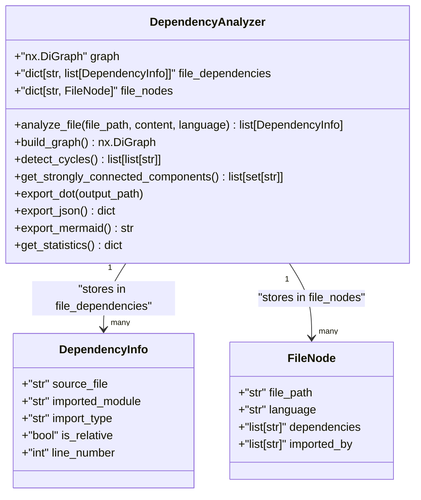

<!-- source: DeepWiki mcp.deepwiki.com · repo yusufkaraaslan/Skill_Seekers · page 11.6 C3.6: Dependency Graph Analysis · fetched 2026-10-26 -->

# C3.6: Dependency Graph Analysis

<details>
<summary>Relevant source files</summary>

The following files were used as context for generating this wiki page:

- [src/skill_seekers/cli/architectural_pattern_detector.py](src/skill_seekers/cli/architectural_pattern_detector.py)
- [src/skill_seekers/cli/code_analyzer.py](src/skill_seekers/cli/code_analyzer.py)
- [src/skill_seekers/cli/codebase_scraper.py](src/skill_seekers/cli/codebase_scraper.py)
- [src/skill_seekers/cli/dependency_analyzer.py](src/skill_seekers/cli/dependency_analyzer.py)
- [src/skill_seekers/cli/signal_flow_analyzer.py](src/skill_seekers/cli/signal_flow_analyzer.py)
- [tests/test_code_analyzer.py](tests/test_code_analyzer.py)
- [tests/test_codebase_scraper.py](tests/test_codebase_scraper.py)
- [tests/test_dependency_analyzer.py](tests/test_dependency_analyzer.py)
- [tests/test_framework_detection.py](tests/test_framework_detection.py)
- [tests/test_kotlin_support.py](tests/test_kotlin_support.py)

</details>


This page documents the `DependencyAnalyzer` class, which forms a core component of the C3.x codebase analysis suite. Its primary purpose is to parse import, require, include, and use statements across multiple programming languages, construct directed dependency graphs using NetworkX, detect circular dependencies, find strongly connected components (SCCs), and export dependency graphs in various standard formats (JSON, DOT/GraphViz, and Mermaid).

This feature operates directly on local codebases. For how dependency analysis integrates into the overall codebase analysis pipeline and contributes to `ARCHITECTURE.md`, see page [11.5](). For architectural pattern detection that works alongside it, see page [11.7]().

---

## Overview

`DependencyAnalyzer` is implemented in `[src/skill_seekers/cli/dependency_analyzer.py:83-162]()`. It leverages [NetworkX](https://networkx.org/) to build a directed graph (`nx.DiGraph`) where nodes represent source files and directed edges represent import/dependency relationships [src/skill_seekers/cli/dependency_analyzer.py:98]().

**Prerequisite:** NetworkX must be installed in the environment. If it is missing, `DependencyAnalyzer` raises an `ImportError` upon instantiation [src/skill_seekers/cli/dependency_analyzer.py:92-96]().

Sources: `[src/skill_seekers/cli/dependency_analyzer.py:83-101]()`

---

## Core Data Structures

The analyzer relies on two primary dataclasses to hold intermediate and structured dependency metadata: `DependencyInfo` and `FileNode`.

### `DependencyInfo`

Represents a single extracted import or dependency statement within a specific source file `[src/skill_seekers/cli/dependency_analyzer.py:62-71]()`.

| Field | Type | Description |
|---|---|---|
| `source_file` | `str` | File path where the dependency statement appears |
| `imported_module` | `str` | Name or path of the imported module/file |
| `import_type` | `str` | Syntax classification (`"import"`, `"from"`, `"require"`, `"include"`, etc.) |
| `is_relative` | `bool` | Flag indicating whether the import is relative to the current file |
| `line_number` | `int` | Line number of the dependency statement |

### `FileNode`

Represents a file entity node inside the graph network model `[src/skill_seekers/cli/dependency_analyzer.py:73-81]`.

| Field | Type | Description |
|---|---|---|
| `file_path` | `str` | Unique path identifying the file node |
| `language` | `str` | Programming language identifier (e.g., `"Python"`, `"Go"`, `"C++"`) |
| `dependencies` | `list[str]` | List of imported module names or target files |
| `imported_by` | `list[str]` | List of files that import this node |

### Entity Relationship Diagram



Sources: `[src/skill_seekers/cli/dependency_analyzer.py:62-101]()`

---

## `DependencyAnalyzer` Execution Flow

Files are analyzed iteratively via `analyze_file(...)`, populating internal dictionary stores, after which `build_graph()` constructs the NetworkX directed graph `[src/skill_seekers/cli/dependency_analyzer.py:83-162]()`.

```python
# Typical programmatic usage pattern [src/skill_seekers/cli/dependency_analyzer.py:28-36]
from skill_seekers.cli.dependency_analyzer import DependencyAnalyzer

analyzer = DependencyAnalyzer()
analyzer.analyze_file("src/main.py", content_a, "Python")
analyzer.analyze_file("src/utils.go", go_content, "Go")
graph = analyzer.build_graph()
cycles = analyzer.detect_cycles()
```

### Internal State Attributes

| Attribute | Type | Description |
|---|---|---|
| `graph` | `nx.DiGraph` | NetworkX directed graph containing file nodes and dependency edges `[src/skill_seekers/cli/dependency_analyzer.py:98]()` |
| `file_dependencies` | `dict[str, list[DependencyInfo]]` | Raw extracted dependency records mapped by file path `[src/skill_seekers/cli/dependency_analyzer.py:100]()` |
| `file_nodes` | `dict[str, FileNode]` | Structured `FileNode` instances mapped by file path `[src/skill_seekers/cli/dependency_analyzer.py:101]()` |
| `_newline_offsets` | `list[int]` | Character offset index for fast line number translation `[src/skill_seekers/cli/dependency_analyzer.py:102]()` |

Sources: `[src/skill_seekers/cli/dependency_analyzer.py:91-103]()`

---

## Language Dispatch & Extraction Mechanics

When `analyze_file(file_path, content, language)` is called, it builds a line offset index for performance and then dispatches parsing to a language-specific extraction routine `[src/skill_seekers/cli/dependency_analyzer.py:108-152]()`.

### Language Dispatch Diagram

```mermaid
flowchart TD
    A["DependencyAnalyzer.analyze_file(file_path, content, language)"] --> B{"language"}
    B -->|"Python"| C["DependencyAnalyzer._extract_python_imports()"]
    B -->|"GDScript"| D["DependencyAnalyzer._extract_gdscript_imports()"]
    B -->|"GodotScene/Resource/Shader"| E["DependencyAnalyzer._extract_godot_resources()"]
    B -->|"JavaScript/TypeScript"| F["DependencyAnalyzer._extract_js_imports()"]
    B -->|"C/C++"| G["DependencyAnalyzer._extract_cpp_includes()"]
    B -->|"C#"| H["DependencyAnalyzer._extract_csharp_imports()"]
    B -->|"Go"| I["DependencyAnalyzer._extract_go_imports()"]
    B -->|"Rust"| J["DependencyAnalyzer._extract_rust_imports()"]
    B -->|"Java"| K["DependencyAnalyzer._extract_java_imports()"]
    B -->|"Kotlin"| KK["DependencyAnalyzer._extract_kotlin_imports()"]
    B -->|"Ruby"| L["DependencyAnalyzer._extract_ruby_imports()"]
    B -->|"PHP"| M["DependencyAnalyzer._extract_php_imports()"]
    B -->|"Other"| N["logger.warning() & return []"]
    C --> O["list[DependencyInfo]"]
    D --> O
    E --> O
    F --> O
    G --> O
    H --> O
    I --> O
    J --> O
    K --> O
    KK --> O
    L --> O
    M --> O
```



Sources: `[src/skill_seekers/cli/dependency_analyzer.py:108-153]()`

---

## Supported Extraction Strategies

1. **Python (`_extract_python_imports`)**: Uses the built-in `ast` module to parse `ast.Import`, `ast.ImportFrom`, and relative imports accurately without comment interference `[src/skill_seekers/cli/dependency_analyzer.py:164-200]()`.
2. **GDScript & Godot Assets (`_extract_gdscript_imports`, `_extract_godot_resources`)**: Parses GDScript `preload()`, `load()`, and `extends` statements, as well as `ext_resource` definitions in `.tscn`, `.tres`, and `.gdshader` files `[src/skill_seekers/cli/dependency_analyzer.py:126-131]()`.
3. **JavaScript & TypeScript (`_extract_js_imports`)**: Extracts ES6 `import` statements and CommonJS `require()` calls via regular expressions `[src/skill_seekers/cli/dependency_analyzer.py:19]()`.
4. **C and C++ (`_extract_cpp_includes`)**: Parses `#include` directives, distinguishing system headers (`<...>`) from local headers (`"..."`) `[src/skill_seekers/cli/dependency_analyzer.py:20]()`.
5. **Other Compiled and Scripting Languages**: Uses dedicated regular expression sets mapped from official specifications for C#, Go, Rust, Java, Kotlin, Ruby, and PHP `[src/skill_seekers/cli/dependency_analyzer.py:21-26]()`.

Sources: `[src/skill_seekers/cli/dependency_analyzer.py:15-27]`, `[src/skill_seekers/cli/dependency_analyzer.py:124-150]()`

---

## Graph Analysis & Export Functions

Once all repository files have been analyzed via `analyze_file()`, the graph analysis methods can be invoked:

* **`build_graph()`**: Adds all registered `file_nodes` as vertices and creates directed edges corresponding to file-level imports `[src/skill_seekers/cli/dependency_analyzer.py:152-160]()`.
* **`detect_cycles()`**: Identifies circular dependency paths using `nx.simple_cycles(self.graph)` `[src/skill_seekers/cli/dependency_analyzer.py:11]()`.
* **`get_strongly_connected_components()`**: Groups mutually reachable files using `nx.strongly_connected_components(self.graph)` `[src/skill_seekers/cli/dependency_analyzer.py:13]()`.
* **Export Utilities**: Export routines serialize the graph into JSON (`export_json()`), GraphViz DOT format (`export_dot()`), or Mermaid diagram markup (`export_mermaid()`) `[src/skill_seekers/cli/dependency_analyzer.py:12]()`.
* **`get_statistics()`**: Aggregates node counts, edge counts, cycle counts, and component metrics into a summary dictionary `[src/skill_seekers/cli/dependency_analyzer.py:12]()`.

Sources: `[src/skill_seekers/cli/dependency_analyzer.py:11-13]()`

---

