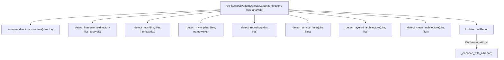
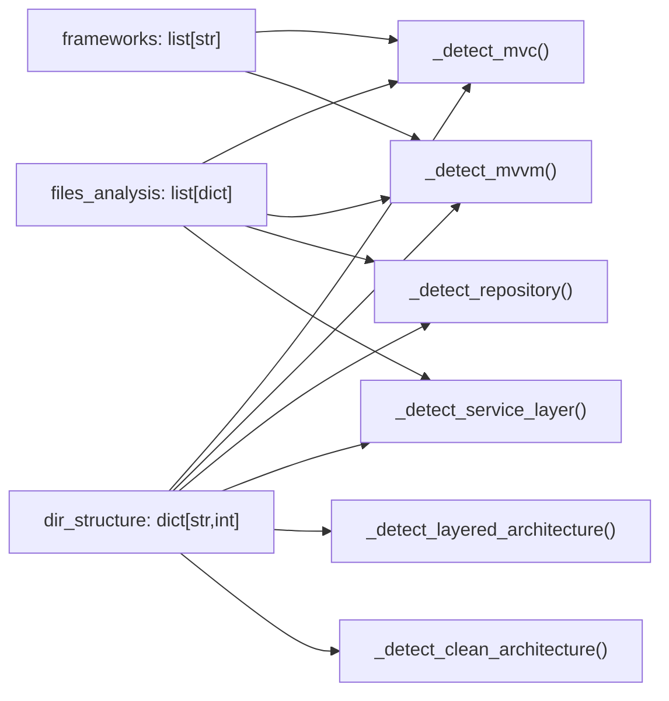
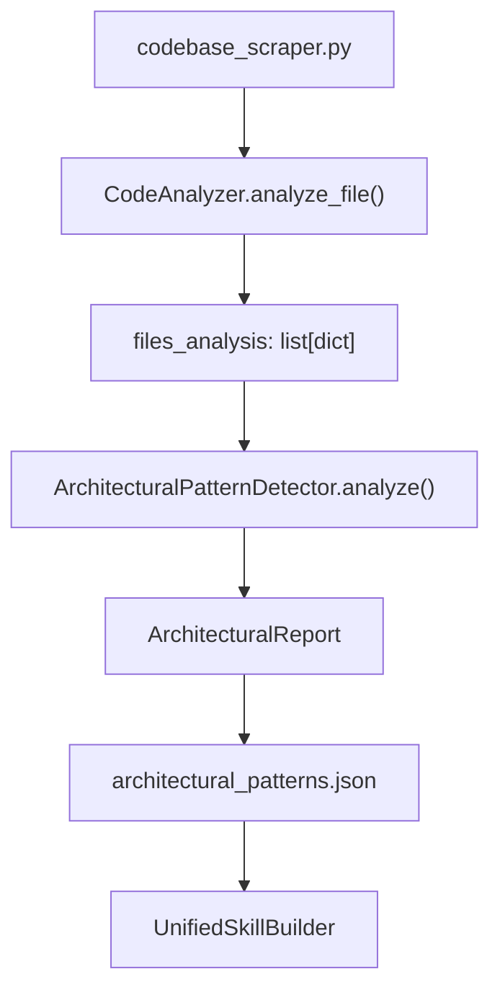

<!-- source: DeepWiki mcp.deepwiki.com · repo yusufkaraaslan/Skill_Seekers · page 11.7 C3.7: Architectural Pattern Detection · fetched 2026-10-26 -->

# C3.7: Architectural Pattern Detection

<details>
<summary>Relevant source files</summary>

The following files were used as context for generating this wiki page:

- [scripts/run_benchmarks.sh](scripts/run_benchmarks.sh)
- [src/skill_seekers/cli/adaptors/atlas.py](src/skill_seekers/cli/adaptors/atlas.py)
- [src/skill_seekers/cli/architectural_pattern_detector.py](src/skill_seekers/cli/architectural_pattern_detector.py)
- [src/skill_seekers/cli/code_analyzer.py](src/skill_seekers/cli/code_analyzer.py)
- [src/skill_seekers/cli/codebase_scraper.py](src/skill_seekers/cli/codebase_scraper.py)
- [src/skill_seekers/cli/dependency_analyzer.py](src/skill_seekers/cli/dependency_analyzer.py)
- [src/skill_seekers/cli/signal_flow_analyzer.py](src/skill_seekers/cli/signal_flow_analyzer.py)
- [tests/fixtures/generate_fixtures.py](tests/fixtures/generate_fixtures.py)
- [tests/test_adaptor_benchmarks.py](tests/test_adaptor_benchmarks.py)
- [tests/test_adaptors/test_openai_compatible_shared.py](tests/test_adaptors/test_openai_compatible_shared.py)
- [tests/test_architectural_pattern_detector.py](tests/test_architectural_pattern_detector.py)
- [tests/test_code_analyzer.py](tests/test_code_analyzer.py)
- [tests/test_codebase_scraper.py](tests/test_codebase_scraper.py)
- [tests/test_dependency_analyzer.py](tests/test_dependency_analyzer.py)
- [tests/test_docker_smoke.py](tests/test_docker_smoke.py)
- [tests/test_embedding_server.py](tests/test_embedding_server.py)
- [tests/test_encoding.py](tests/test_encoding.py)
- [tests/test_framework_detection.py](tests/test_framework_detection.py)
- [tests/test_kotlin_support.py](tests/test_kotlin_support.py)

</details>


C3.7 is the architectural pattern detection component of the C3.x codebase analysis suite. It identifies high-level structural patterns (MVC, MVVM, Clean Architecture, etc.) and the frameworks associated with them by examining directory naming conventions, file paths, and import statements across an entire codebase. It is not concerned with file-level design patterns (those are handled by C3.1 `PatternRecognizer`; see page [11.1]()) or with individual dependency relationships (see C3.6 `DependencyAnalyzer`, page [11.6]()).

The results of C3.7 feed into `ARCHITECTURE.md` generation (see page [11.5]()) and are written to `references/codebase_analysis/architecture/architectural_patterns.json` within the skill output directory.

---

## Core Data Structures

All analysis results are expressed through two dataclasses defined in `src/skill_seekers/cli/architectural_pattern_detector.py`.

| Dataclass | Fields | Purpose |
|---|---|---|
| `ArchitecturalPattern` | `pattern_name`, `confidence`, `evidence`, `components`, `framework`, `description` | Represents one detected pattern [src/skill_seekers/cli/architectural_pattern_detector.py:32-41]() |
| `ArchitecturalReport` | `patterns`, `directory_structure`, `total_files_analyzed`, `frameworks_detected`, `ai_analysis` | The complete report returned by `analyze()` [src/skill_seekers/cli/architectural_pattern_detector.py:44-51]() |

**`ArchitecturalPattern` field details:**

| Field | Type | Description |
|---|---|---|
| `pattern_name` | `str` | Human-readable label, e.g. `"MVC"`, `"MVVM"`, `"Repository"` [src/skill_seekers/cli/architectural_pattern_detector.py:35-35]() |
| `confidence` | `float` | Score from `0.0` to `1.0` [src/skill_seekers/cli/architectural_pattern_detector.py:36-36]() |
| `evidence` | `list[str]` | Sentences describing each signal that contributed to detection [src/skill_seekers/cli/architectural_pattern_detector.py:37-37]() |
| `components` | `dict[str, list[str]]` | Maps component type (e.g. `"Models"`) to file paths [src/skill_seekers/cli/architectural_pattern_detector.py:38-38]() |
| `framework` | `str \| None` | Framework name if boosted by framework detection, e.g. `"Django"` [src/skill_seekers/cli/architectural_pattern_detector.py:39-39]() |
| `description` | `str` | Human-readable architectural description [src/skill_seekers/cli/architectural_pattern_detector.py:40-40]() |

`ArchitecturalReport.to_dict()` [src/skill_seekers/cli/architectural_pattern_detector.py:53-71]() serializes the report for JSON output.

Sources: [src/skill_seekers/cli/architectural_pattern_detector.py:32-71]()

---

## ArchitecturalPatternDetector Class

The single public entry point is `ArchitecturalPatternDetector.analyze()` [src/skill_seekers/cli/architectural_pattern_detector.py:168-178]().

Title: "ArchitecturalPatternDetector analyze() Call Graph"


Sources: [src/skill_seekers/cli/architectural_pattern_detector.py:168-203]()

**Constructor parameters:**

| Parameter | Default | Effect |
|---|---|---|
| `enhance_with_ai` | `True` | If `True`, attempts to import `AIEnhancer` and call `_enhance_with_ai()` after pattern detection [src/skill_seekers/cli/architectural_pattern_detector.py:159-166]() |
| `agent` | `None` | Local CLI agent name for AI enhancement [src/skill_seekers/cli/architectural_pattern_detector.py:148-155]() |

Sources: [src/skill_seekers/cli/architectural_pattern_detector.py:148-166]()

---

## Directory Structure Analysis

`_analyze_directory_structure()` [src/skill_seekers/cli/architectural_pattern_detector.py:205-221]() recursively scans the directory tree and builds a `dict[str, int]` mapping lowercased directory names to file counts. This map is the primary input to all pattern detectors.

Sources: [src/skill_seekers/cli/architectural_pattern_detector.py:205-221]()

---

## Framework Detection

`_detect_frameworks()` [src/skill_seekers/cli/architectural_pattern_detector.py:223-296]() searches for frameworks using three signal sources:

1. **File paths** from `files_analysis` (the `"file"` field of each analyzed file dict)
2. **Imports** from `files_analysis` (the `"imports"` field, populated by `CodeAnalyzer`)
3. **Root directory listing** (non-recursive `directory.iterdir()`)

The `FRAMEWORK_MARKERS` dict [src/skill_seekers/cli/architectural_pattern_detector.py:90-142]() defines the marker strings for each framework:

| Framework | Example Markers |
|---|---|
| Unity | `"Assembly-CSharp.csproj"`, `".unity"`, `"ProjectSettings/ProjectVersion.txt"` [src/skill_seekers/cli/architectural_pattern_detector.py:92-100]() |
| Unreal | `".uproject"`, `"Config/DefaultEngine.ini"`, `"Binaries/"` [src/skill_seekers/cli/architectural_pattern_detector.py:101-101]() |
| Godot | `"project.godot"`, `".tscn"`, `".gd"` [src/skill_seekers/cli/architectural_pattern_detector.py:102-102]() |
| Django | `"django"`, `"manage.py"`, `"settings.py"`, `"urls.py"` [src/skill_seekers/cli/architectural_pattern_detector.py:104-104]() |
| Flask | `"flask"`, `"app.py"`, `"wsgi.py"` [src/skill_seekers/cli/architectural_pattern_detector.py:105-105]() |
| Spring | `"springframework"`, `"@Controller"`, `"@Service"` [src/skill_seekers/cli/architectural_pattern_detector.py:106-111]() |
| ASP.NET | `"Microsoft.AspNetCore"`, `"Startup.cs"`, `".cshtml"` [src/skill_seekers/cli/architectural_pattern_detector.py:113-121]() |
| Rails | `"rails"`, `"app/models"`, `"config/routes.rb"` [src/skill_seekers/cli/architectural_pattern_detector.py:122-129]() |
| Angular | `"@angular"`, `"app.module.ts"`, `"angular.json"` [src/skill_seekers/cli/architectural_pattern_detector.py:130-137]() |
| React | `"react"`, `"package.json"`, `"components"` [src/skill_seekers/cli/architectural_pattern_detector.py:138-138]() |
| Vue.js | `"vue"`, `".vue"`, `"components"` [src/skill_seekers/cli/architectural_pattern_detector.py:139-139]() |
| Express | `"express"`, `"app.js"`, `"routes"` [src/skill_seekers/cli/architectural_pattern_detector.py:140-140]() |
| Laravel | `"laravel"`, `"illuminate"`, `"app/Http/Controllers"` [src/skill_seekers/cli/architectural_pattern_detector.py:141-141]() |

**Detection priority and thresholds:**

- **Game engines** (Unity, Unreal, Godot) are checked first [src/skill_seekers/cli/architectural_pattern_detector.py:91-102](). Detection logic prioritizes these to avoid false positives in mixed environments [src/skill_seekers/cli/architectural_pattern_detector.py:240-264]().
- **Other frameworks**: if 1+ import matches exist → detected. If 2+ path/directory matches exist with no import match → detected [src/skill_seekers/cli/architectural_pattern_detector.py:280-294]().

Sources: [src/skill_seekers/cli/architectural_pattern_detector.py:90-296]()

---

## Pattern Detectors

All detectors return `list[ArchitecturalPattern]`. They check directory names, scan `files_analysis` for corroborating files, compute confidence, and optionally boost confidence based on detected frameworks.

Title: "Pattern Detector Inputs and Classification Flow"


Sources: [src/skill_seekers/cli/architectural_pattern_detector.py:190-195]()

### Directory Keyword Constants

Each detector uses a class-level set for quick membership testing:

```python
MVC_DIRS = {"models", "views", "controllers", "model", "view", "controller"}
MVVM_DIRS = {"models", "views", "viewmodels", "viewmodel"}
LAYERED_DIRS = {"presentation", "business", "data", "dal", "bll", "ui"}
CLEAN_ARCH_DIRS = {"domain", "application", "infrastructure", "presentation"}
REPO_DIRS = {"repositories", "repository"}
SERVICE_DIRS = {"services", "service"}
```

[src/skill_seekers/cli/architectural_pattern_detector.py:82-87]()

### MVC Detection (`_detect_mvc`)

[src/skill_seekers/cli/architectural_pattern_detector.py:298-364]()

**Trigger:** `mvc_dir_matches >= 2` (2+ of `MVC_DIRS` present in `dir_structure`).

**Component classification:** A file is counted as a Model if `"model"` appears in its path AND (`"models/"` or `"/model/"` is in the path). Same logic for Views and Controllers.

**Confidence formula:** Base confidence starts at `0.6` and adds `0.15` per component type found (Model, View, Controller), capped at `0.95`. Frameworks like Django or Rails provide a `+0.1` boost.

Sources: [src/skill_seekers/cli/architectural_pattern_detector.py:298-364]()

### MVVM Detection (`_detect_mvvm`)

[src/skill_seekers/cli/architectural_pattern_detector.py:366-436]()

**Trigger:** `"viewmodels"` or `"viewmodel"` in `dir_structure`, OR 2+ files with `"viewmodel"` in their path.

Confidence is `0.7` when all three component types (Models, Views, ViewModels) are found, `0.6` otherwise. Frameworks that boost: ASP.NET, Angular, Vue.js.

Sources: [src/skill_seekers/cli/architectural_pattern_detector.py:366-436]()

### Repository Pattern Detection (`_detect_repository`)

[src/skill_seekers/cli/architectural_pattern_detector.py:438-478]()

**Trigger:** `"repositories"` or `"repository"` in `dir_structure`, OR 2+ files with `"repository"` in their path or class names. Confidence: `0.75`.

Sources: [src/skill_seekers/cli/architectural_pattern_detector.py:438-478]()

### Service Layer Detection (`_detect_service_layer`)

[src/skill_seekers/cli/architectural_pattern_detector.py:480-517]()

**Trigger:** `"services"` or `"service"` in `dir_structure`, OR 3+ files with `"service"` in their path or class names. Confidence: `0.75`.

Sources: [src/skill_seekers/cli/architectural_pattern_detector.py:480-517]()

---

## Integration with C3.x Pipeline

Title: "C3.7 Position in Codebase Analysis Pipeline"


Sources: [src/skill_seekers/cli/codebase_scraper.py:35-39](), [src/skill_seekers/cli/architectural_pattern_detector.py:168-178]()

The `files_analysis` list passed to `ArchitecturalPatternDetector.analyze()` must include an `"imports"` key per file for import-based framework detection to work. This data originates from `CodeAnalyzer.analyze_file()` [src/skill_seekers/cli/code_analyzer.py:95-147](), which extracts and returns the `"imports"` field via language-specific methods like `_analyze_python` [src/skill_seekers/cli/code_analyzer.py:149-192]().

Sources: [src/skill_seekers/cli/code_analyzer.py:95-192](), [src/skill_seekers/cli/codebase_scraper.py:35-39]()

---

## Output Schema

The JSON file produced by the C3.7 step matches `ArchitecturalReport.to_dict()`:

```json
{
  "patterns": [
    {
      "pattern_name": "MVC",
      "confidence": 0.9,
      "evidence": ["Found directory: models", "Found directory: views"],
      "components": {
        "Models": ["src/models/user.py"],
        "Views": ["src/views/main.html"]
      },
      "framework": "Django",
      "description": "Model-View-Controller architecture"
    }
  ],
  "directory_structure": {"models": 2, "views": 5},
  "total_files_analyzed": 50,
  "frameworks_detected": ["Django"],
  "ai_analysis": null
}
```

Sources: [src/skill_seekers/cli/architectural_pattern_detector.py:53-71]()

---

