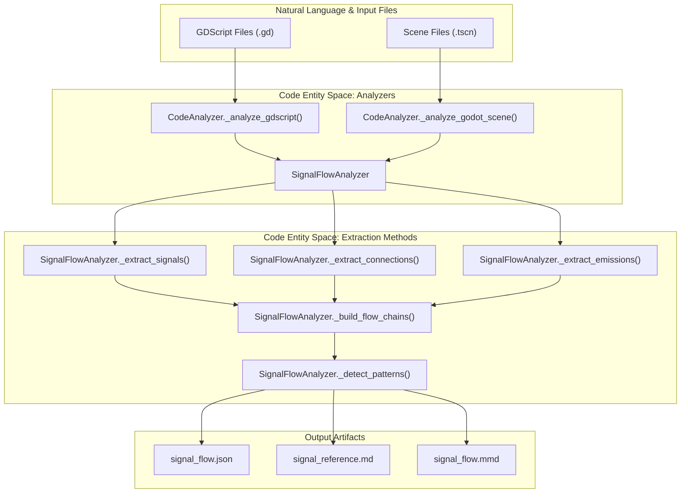
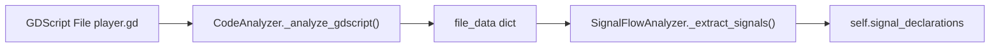
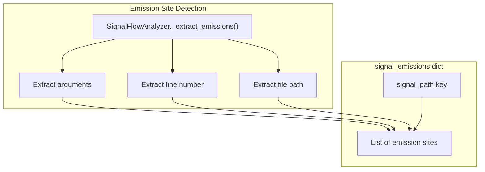
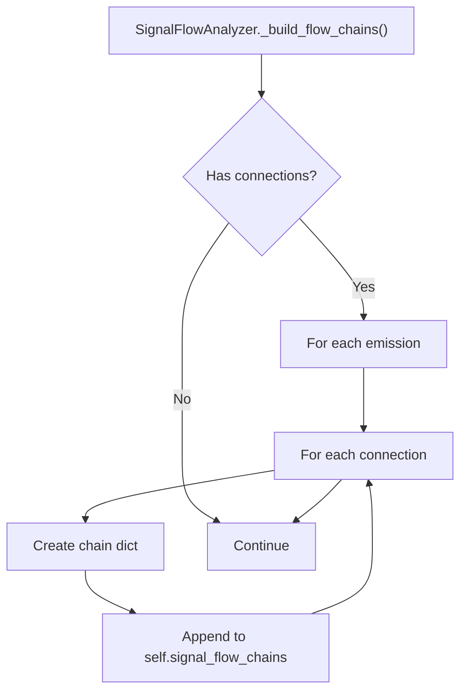
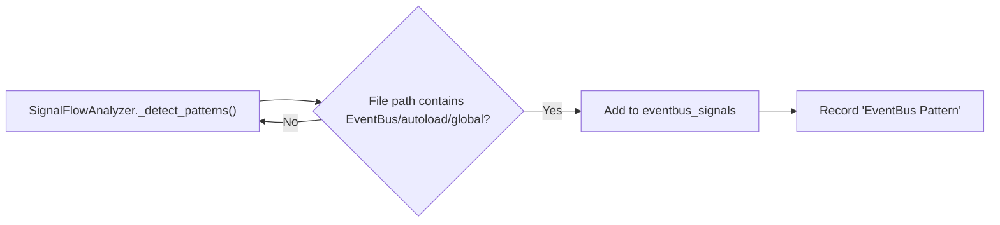
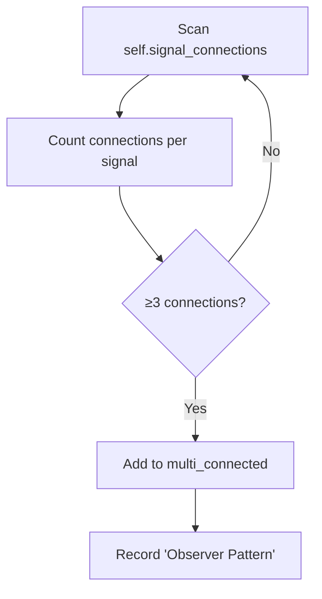

<!-- source: DeepWiki mcp.deepwiki.com · repo yusufkaraaslan/Skill_Seekers · page 11.8 C3.10: Signal Flow Analysis (Godot) · fetched 2026-10-26 -->

# C3.10: Signal Flow Analysis (Godot)

<details>
<summary>Relevant source files</summary>

The following files were used as context for generating this wiki page:

- [src/skill_seekers/cli/architectural_pattern_detector.py](src/skill_seekers/cli/architectural_pattern_detector.py)
- [src/skill_seekers/cli/code_analyzer.py](src/skill_seekers/cli/code_analyzer.py)
- [src/skill_seekers/cli/codebase_scraper.py](src/skill_seekers/cli/codebase_scraper.py)
- [src/skill_seekers/cli/dependency_analyzer.py](src/skill_seekers/cli/dependency_analyzer.py)
- [src/skill_seekers/cli/signal_flow_analyzer.py](src/skill_seekers/cli/signal_flow_analyzer.py)
- [tests/test_code_analyzer.py](tests/test_code_analyzer.py)
- [tests/test_codebase_scraper.py](tests/test_codebase_scraper.py)
- [tests/test_dependency_analyzer.py](tests/test_dependency_analyzer.py)
- [tests/test_framework_detection.py](tests/test_framework_detection.py)
- [tests/test_kotlin_support.py](tests/test_kotlin_support.py)

</details>


**Purpose**: C3.10 analyzes signal-based event flow patterns in Godot game engine projects. It extracts signal declarations, connection patterns, emission sites, and detects architectural patterns like EventBus and Observer, generating flow diagrams and usage documentation.

**Scope**: This feature is specific to Godot GDScript codebases and requires GDScript file analysis. For general codebase analysis features, see [C3.x Codebase Analysis Features](). For dependency analysis of Godot imports (preload/load), see [C3.6: Dependency Graph Analysis]().

---

## Overview

Godot's signal system is a core event-driven programming mechanism where nodes emit signals that other nodes connect to. C3.10 performs static analysis of GDScript files to:

1. **Extract signal declarations** - `signal signal_name(params)` statements [src/skill_seekers/cli/signal_flow_analyzer.py:52-69]()
2. **Map signal connections** - `.connect(handler)` call sites [src/skill_seekers/cli/signal_flow_analyzer.py:70-87]()
3. **Track signal emissions** - `.emit(args)` call sites [src/skill_seekers/cli/signal_flow_analyzer.py:89-105]()
4. **Build flow chains** - Trace signal propagation paths through the codebase [src/skill_seekers/cli/signal_flow_analyzer.py:106-123]()
5. **Detect patterns** - Identify EventBus, Observer, and event chain patterns [src/skill_seekers/cli/signal_flow_analyzer.py:124-167]()
6. **Generate documentation** - Create reference docs and how-to guides [src/skill_seekers/cli/signal_flow_analyzer.py:306-475]()

Sources: [src/skill_seekers/cli/signal_flow_analyzer.py:1-475]()

---

## Architecture

### Component Overview



**Diagram: Signal Flow Analysis Pipeline (Bridging Natural Language to Code Entities)**

Sources: [src/skill_seekers/cli/signal_flow_analyzer.py:14-50](), [src/skill_seekers/cli/code_analyzer.py:115-123]()

---

## Data Extraction

### Signal Declarations

The analyzer extracts signal declarations from GDScript files and stores them in `self.signal_declarations` [src/skill_seekers/cli/signal_flow_analyzer.py:25]():

```python
# Data structure (signal_flow_analyzer.py:25)
signal_declarations = {
    "signal_name": {
        "file": "path/to/script.gd",
        "parameters": "player: Node, score: int",
        "documentation": "Emitted when score changes",
        "line_number": 42
    }
}
```

**Extraction Process**:



**Diagram: Signal Declaration Extraction (Code Entity Mapping)**

Sources: [src/skill_seekers/cli/signal_flow_analyzer.py:52-69](), [src/skill_seekers/cli/code_analyzer.py:115-117]()

---

### Signal Connections

Tracks all `.connect()` calls that register signal handlers [src/skill_seekers/cli/signal_flow_analyzer.py:70-87]():

| Field | Type | Description |
|-------|------|-------------|
| `signal` | str | Signal path (e.g., `player.health_changed`) |
| `handler` | str | Handler function name (e.g., `_on_health_changed`) |
| `file` | str | File containing the connection |
| `line` | int | Line number of `.connect()` call |

**Data Structure**:

```python
# signal_flow_analyzer.py:26
signal_connections = defaultdict(list)
```

Sources: [src/skill_seekers/cli/signal_flow_analyzer.py:70-87]()

---

### Signal Emissions

Tracks all `.emit()` calls that trigger signals [src/skill_seekers/cli/signal_flow_analyzer.py:89-105]():



**Diagram: Signal Emission Tracking**

Sources: [src/skill_seekers/cli/signal_flow_analyzer.py:89-105]()

---

### Signal Flow Chains

Flow chains connect emissions to their handlers, creating a complete picture of signal propagation [src/skill_seekers/cli/signal_flow_analyzer.py:106-123]():

```python
# signal_flow_analyzer.py:28
signal_flow_chains = [
    {
        "signal": "player.health_changed",
        "source": "scripts/player.gd",
        "target": "scripts/ui.gd",
        "handler": "_on_health_changed"
    }
]
```

**Chain Building Algorithm**:



**Diagram: Flow Chain Construction Algorithm**

Sources: [src/skill_seekers/cli/signal_flow_analyzer.py:106-123]()

---

## Pattern Detection

### Detected Patterns

| Pattern | Detection Criteria | Confidence | Description |
|---------|-------------------|------------|-------------|
| **EventBus Pattern** | Signals in files named `EventBus`, `autoload/`, or `global/` | 0.9 | Centralized event system using global signals |
| **Observer Pattern** | Signals with ≥3 connections | 0.85 | Multiple observers subscribing to one signal |
| **Event Chains** | Signals that trigger other signal emissions | 0.8 | Cascading event propagation |

Sources: [src/skill_seekers/cli/signal_flow_analyzer.py:124-167]()

---

### EventBus Pattern Detection



**Diagram: EventBus Detection Algorithm**

Sources: [src/skill_seekers/cli/signal_flow_analyzer.py:129-144]()

---

### Observer Pattern Detection

Identifies signals with multiple subscribers (3+ connections) [src/skill_seekers/cli/signal_flow_analyzer.py:146-157]():



**Diagram: Observer Pattern Detection**

Sources: [src/skill_seekers/cli/signal_flow_analyzer.py:146-157]()

---

## Statistics Calculation

`_calculate_statistics` computes usage metrics returned under the `"statistics"` key [src/skill_seekers/cli/signal_flow_analyzer.py:168-200]():

| Field | Description |
|-------|-------------|
| `total_signals` | Count of all declared signals |
| `total_connections` | Sum of all `.connect()` call records |
| `total_emissions` | Sum of all `.emit()` call records |
| `signal_density` | `total_signals / gdscript_files`, rounded to 2 decimal places |
| `gdscript_files` | Number of GDScript files in the input |
| `most_connected_signals` | Top 5 signals sorted by connection count (desc) |
| `most_emitted_signals` | Top 5 signals sorted by emission count (desc) |

Sources: [src/skill_seekers/cli/signal_flow_analyzer.py:168-200]()

---

## Output Generation

### JSON Analysis Output

Complete machine-readable analysis saved to `output_dir/signals/signal_flow.json` [src/skill_seekers/cli/signal_flow_analyzer.py:30-50]():

| Key | Type | Description |
|-----|------|-------------|
| `signal_declarations` | dict | `signal_name → {file, parameters, documentation, line_number}` |
| `signal_connections` | dict | `signal → [{handler, file, line}]` |
| `signal_emissions` | dict | `signal → [{arguments, file, line}]` |
| `signal_flow_chains` | list | `[{signal, source, target, handler}]` |
| `patterns` | dict | Detected EventBus / Observer / Event Chains entries |
| `statistics` | dict | Counts, density metrics, top-N signals |

Sources: [src/skill_seekers/cli/signal_flow_analyzer.py:30-50](), [src/skill_seekers/cli/signal_flow_analyzer.py:396-418]()

---

### Mermaid Flow Diagram

Generates a visual signal flow diagram saved to `output_dir/signals/signal_flow.mmd` via `generate_signal_flow_diagram()` [src/skill_seekers/cli/signal_flow_analyzer.py:202-227]().

```mermaid
graph LR
    "playerScript"["player.gd"]
    "healthchanged"[("health_changed")]
    "uiScript"["ui.gd"]

    "playerScript" -->|"emit"| "healthchanged"
    "healthchanged" -->|"on_health_changed"| "uiScript"
```

**Diagram: Example Signal Flow Diagram Output**

Sources: [src/skill_seekers/cli/signal_flow_analyzer.py:202-227]()

---

## Code Entity Reference

### Class: SignalFlowAnalyzer

| Method | Purpose | Returns |
|--------|---------|---------|
| `__init__(analysis_results)` | Initialize with code analysis results [src/skill_seekers/cli/signal_flow_analyzer.py:17-29]() | None |
| `analyze()` | Perform complete signal flow analysis [src/skill_seekers/cli/signal_flow_analyzer.py:30-50]() | dict |
| `_extract_signals()` | Extract signal declarations [src/skill_seekers/cli/signal_flow_analyzer.py:52-69]() | None |
| `_extract_connections()` | Extract `.connect()` calls [src/skill_seekers/cli/signal_flow_analyzer.py:70-87]() | None |
| `_extract_emissions()` | Extract `.emit()` calls [src/skill_seekers/cli/signal_flow_analyzer.py:89-105]() | None |
| `_build_flow_chains()` | Build flow chains [src/skill_seekers/cli/signal_flow_analyzer.py:106-123]() | None |
| `_detect_patterns()` | Detect architectural patterns [src/skill_seekers/cli/signal_flow_analyzer.py:124-167]() | None |
| `_calculate_statistics()` | Compute usage metrics [src/skill_seekers/cli/signal_flow_analyzer.py:168-200]() | dict |
| `generate_signal_flow_diagram()` | Create Mermaid diagram [src/skill_seekers/cli/signal_flow_analyzer.py:202-227]() | str |
| `save_analysis(output_dir, ai_mode)` | Save outputs to disk [src/skill_seekers/cli/signal_flow_analyzer.py:396-434]() | Path |

Sources: [src/skill_seekers/cli/signal_flow_analyzer.py:14-475]()

---

## Limitations

1. **Static Analysis Only**: Cannot detect runtime signal connections created dynamically.
2. **GDScript-Specific**: Only analyzes `.gd` files [src/skill_seekers/cli/signal_flow_analyzer.py:55-56]().
3. **Diagram Complexity**: Flow diagrams limited to 20 chains to prevent visual overload [src/skill_seekers/cli/signal_flow_analyzer.py:214]().

Sources: [src/skill_seekers/cli/signal_flow_analyzer.py:1-475]()

---

## Related Features

- **[C3.1: Design Pattern Detection]()**: Detects Observer pattern in general codebases.
- **[C3.6: Dependency Graph Analysis]()**: Analyzes GDScript imports [src/skill_seekers/cli/dependency_analyzer.py:124-126]().
- **[C3.7: Architectural Pattern Detection]()**: Detects high-level architecture [src/skill_seekers/cli/architectural_pattern_detector.py:102]().

Sources: [src/skill_seekers/cli/signal_flow_analyzer.py:1-6](), [src/skill_seekers/cli/dependency_analyzer.py:124-126](), [src/skill_seekers/cli/architectural_pattern_detector.py:102]()

---

