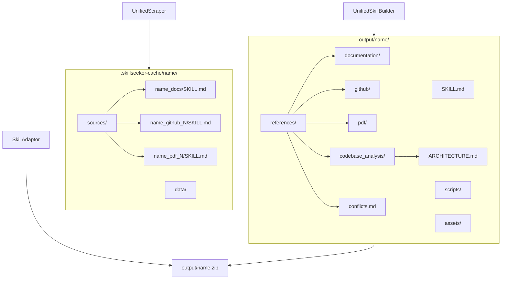

<!-- source: DeepWiki mcp.deepwiki.com · repo yusufkaraaslan/Skill_Seekers · page 12 Output Structure & Files · fetched 2026-10-26 -->

# Output Structure & Files

Relevant source files

The following files were used as context for generating this wiki page:

- [.codex-plugin/plugin.json](.codex-plugin/plugin.json)
- [.mcp.json](.mcp.json)
- [skills/skill-seekers/SKILL.md](skills/skill-seekers/SKILL.md)
- [src/skill_seekers/cli/doc_scraper.py](src/skill_seekers/cli/doc_scraper.py)
- [src/skill_seekers/cli/unified_scraper.py](src/skill_seekers/cli/unified_scraper.py)
- [src/skill_seekers/cli/unified_skill_builder.py](src/skill_seekers/cli/unified_skill_builder.py)
- [tests/test_c3_integration.py](tests/test_c3_integration.py)
- [tests/test_multi_source.py](tests/test_multi_source.py)
- [tests/test_unified.py](tests/test_unified.py)
- [tests/test_unified_scraper_orchestration.py](tests/test_unified_scraper_orchestration.py)

This page gives a high-level overview of all filesystem artifacts that `skill-seekers` produces — the intermediate cache, the final skill directory, and platform-specific package files. It covers the overall layout and the relationship between phases and files.

- For details on the intermediate cache directory, checkpointing, and resumption, see [Data Cache Directory Structure](#12.1).
- For the full layout of the final skill directory and its sidecar metadata, see [Skill Directory Structure](#12.2).
- For `SKILL.md` frontmatter fields, expected sections, and templates, see [SKILL.md Format & Sections](#12.3).
- For the `references/` subdirectory organization, managed entries, and conflicts reporting, see [Reference Files Organization](#12.4).

Sources: [src/skill_seekers/cli/unified_scraper.py:165-173](), [src/skill_seekers/cli/unified_skill_builder.py:61-70]()

---

## Overview

`skill-seekers` writes to two distinct directory trees during execution:

| Directory | Purpose |
|---|---|
| `.skillseeker-cache/{name}/` | Intermediate scrape state, checkpoints, and per-source `SKILL.md` files. |
| `output/{name}/` | Final skill directory consumed by AI platforms and packaging commands. |

After a packaging or installation operation, a platform-specific package file or archive (such as a `.zip`) is generated alongside the output directory.

Sources: [src/skill_seekers/cli/unified_scraper.py:165-173](), [src/skill_seekers/cli/unified_skill_builder.py:102-107]()

---

## Directory Layout at a Glance

The diagram below maps the two output trees and package artifacts to their producing components.

**Diagram: Output directory structure and producing components**

Sources: [src/skill_seekers/cli/unified_scraper.py:165-173](), [src/skill_seekers/cli/unified_skill_builder.py:61-70](), [src/skill_seekers/cli/unified_skill_builder.py:102-107]()

---

## Phase-to-File Mapping

Each workflow phase interacts with specific file targets:

| Phase | Primary Producing Component | Output Location |
|---|---|---|
| **Ingestion** | `DocToSkillConverter`, `GitHubScraper`, `PDFToSkillConverter` | `.skillseeker-cache/{name}/sources/` |
| **Analysis** | `CodeAnalyzer`, C3.x analyzers | `output/{name}/references/codebase_analysis/` |
| **Structuring** | `UnifiedSkillBuilder` | `output/{name}/` and `output/{name}/references/` |
| **Enhancement** | Enhancement workflows and agent clients | `output/{name}/SKILL.md` |
| **Export** | `SkillAdaptor` | `output/{name}.zip` |

Sources: [src/skill_seekers/cli/unified_scraper.py:41-51](), [src/skill_seekers/cli/unified_skill_builder.py:26-36](), [tests/test_c3_integration.py:179-195]()

---

## Intermediate Cache Layout

The intermediate cache at `.skillseeker-cache/{name}/` stores raw extraction data and sub-skill outputs. For complete details on cache clearing, sub-skill sources, and resumption files, see [Data Cache Directory Structure](#12.1).

Sources: [src/skill_seekers/cli/unified_scraper.py:165-173](), [src/skill_seekers/cli/unified_skill_builder.py:124-136]()

---

## Final Skill Directory Layout

The final skill directory `output/{name}/` contains the core `SKILL.md`, managed reference files under `references/`, optional helper scripts, and assets. For detailed breakdowns of each subdirectory, see [Skill Directory Structure](#12.2), [SKILL.md Format & Sections](#12.3), and [Reference Files Organization](#12.4).

Sources: [src/skill_seekers/cli/unified_skill_builder.py:102-107]()

---

## Platform Package Formats

The export system converts output skill directories into various platform-specific packages and vector database formats using adaptors.

| Target Category | Examples | Format Description |
|---|---|---|
| **AI Assistants** | `claude`, `gemini`, `openai` | ZIP archives or structured bundles containing `SKILL.md` and reference markdown files. |
| **RAG Frameworks** | `langchain`, `llama-index` | Chunked structures suitable for document loaders. |
| **Vector DBs** | `chroma`, `qdrant`, `weaviate` | Export formats optimized for direct embedding ingestion. |

Sources: [skills/skill-seekers/SKILL.md:43-69]()

---

