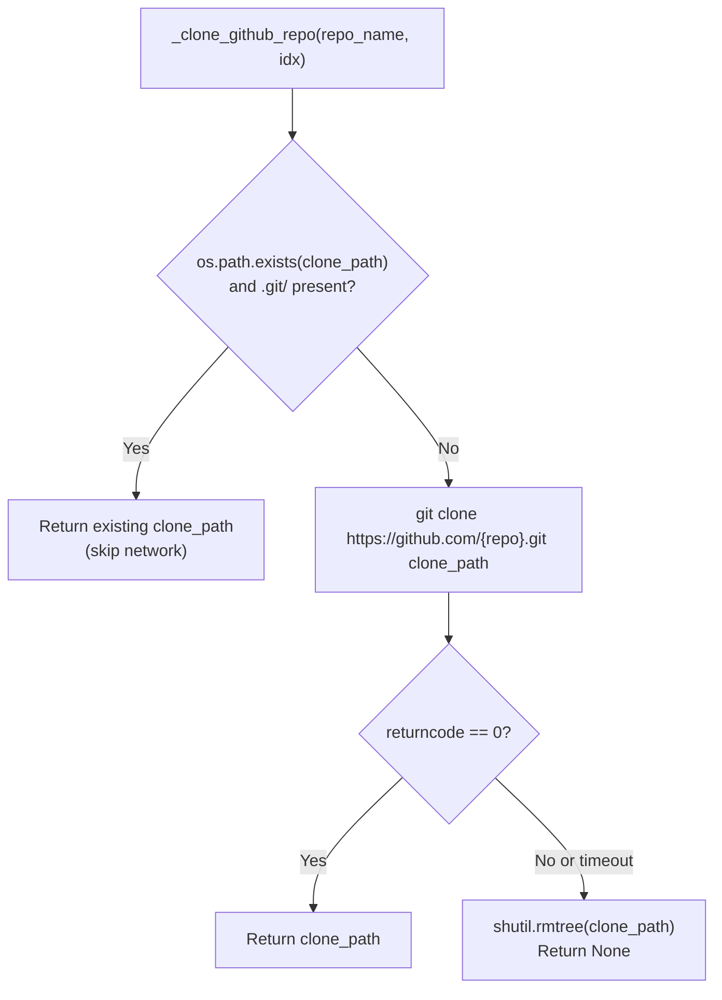
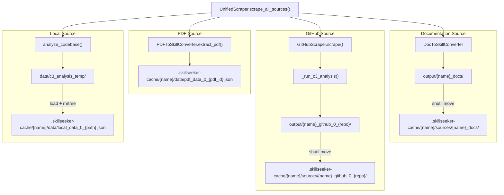

<!-- source: DeepWiki mcp.deepwiki.com · repo yusufkaraaslan/Skill_Seekers · page 12.1 Data Cache Directory Structure · fetched 2026-10-26 -->

# Data Cache Directory Structure

<details>
<summary>Relevant source files</summary>

The following files were used as context for generating this wiki page:

- [src/skill_seekers/cli/doc_scraper.py](src/skill_seekers/cli/doc_scraper.py)
- [src/skill_seekers/cli/unified_scraper.py](src/skill_seekers/cli/unified_scraper.py)
- [src/skill_seekers/cli/unified_skill_builder.py](src/skill_seekers/cli/unified_skill_builder.py)
- [tests/test_c3_integration.py](tests/test_c3_integration.py)
- [tests/test_multi_source.py](tests/test_multi_source.py)
- [tests/test_unified.py](tests/test_unified.py)
- [tests/test_unified_scraper_orchestration.py](tests/test_unified_scraper_orchestration.py)

</details>


The data cache is a hidden directory (`.skillseeker-cache/{name}/`) created by `UnifiedScraper` to store all intermediate files produced during multi-source scraping [src/skill_seekers/cli/unified_scraper.py:166-183](). It isolates the heavy lifting of ingestion (cloning, scraping, extraction) from the final synthesis, keeping the `output/` directory clean and reserved for final skill packages.

For the final skill output directory, see page 12.2. For the complete scraping workflow, see page 2.3. For checkpoint/resume details at the `DocToSkillConverter` level, see page 13.1.

---

## Purpose and Location

`UnifiedScraper.__init__` creates the cache at `.skillseeker-cache/{name}/` where `name` comes from the unified config's `name` field [src/skill_seekers/cli/unified_scraper.py:166-178](). Four subdirectories are always created to organize the diverse data streams:

| Attribute on `UnifiedScraper` | Path | Purpose |
|-------------------------------|------|---------|
| `self.sources_dir` | `.skillseeker-cache/{name}/sources/` | Individual per-source skill outputs before merge [src/skill_seekers/cli/unified_scraper.py:179-179]() |
| `self.data_dir` | `.skillseeker-cache/{name}/data/` | Raw JSON data files and temporary configs [src/skill_seekers/cli/unified_scraper.py:180-180]() |
| `self.repos_dir` | `.skillseeker-cache/{name}/repos/` | Cloned GitHub repositories for C3.x analysis [src/skill_seekers/cli/unified_scraper.py:181-181]() |
| `self.logs_dir` | `.skillseeker-cache/{name}/logs/` | Timestamped session log files [src/skill_seekers/cli/unified_scraper.py:182-182]() |

Sources: [src/skill_seekers/cli/unified_scraper.py:177-183]()

---

## Directory Structure and Code Mapping

The following diagram bridges the natural language conceptual view of cache directories to the exact code entities and variables managed within `UnifiedScraper`.

Diagram Title: Cache Directory Structure to Code Entities Mapping
```mermaid
graph TB
    ROOT["".skillseeker-cache/{name}/" (UnifiedCacheRoot)"]
    SOURCES[""sources/" (self.sources_dir)"]
    DATA[""data/" (self.data_dir)"]
    REPOS[""repos/" (self.repos_dir)"]
    LOGS[""logs/" (self.logs_dir)"]

    ROOT --> SOURCES
    ROOT --> DATA
    ROOT --> REPOS
    ROOT --> LOGS

    subgraph "sources/ contents (Managed by UnifiedSkillBuilder._load_source_skill_mds)"
        DS[""{name}_docs/" (DocToSkillConverter output)""]
        GS[""{name}_github_0_{repo_id}/" (GitHubToSkillConverter output)""]
        PS[""{name}_pdf_0_{pdf_id}/" (PDFToSkillConverter output)""]
        LS[""local_0_{path_id}/" (analyze_codebase output)""]
    end

    subgraph "data/ contents (Raw JSON Payloads)"
        DD[""{name}_docs_data/" (Summary JSON)""]
        GD[""github_data_0_{repo_id}.json" (GitHubScraper.scrape)""]
        PD[""pdf_data_0_{pdf_id}.json" (PDFExtractor)""]
        LD[""local_data_0_{path_id}.json" (CodeAnalyzer)""]
        CF[""conflicts.json" (ConflictDetector)""]
    end

    subgraph "repos/ contents (Cloned Repositories)"
        RC[""0_{owner}_{repo}/" (_clone_github_repo)""]
    end

    subgraph "logs/ contents (Execution Logs)"
        LF[""unified_{timestamp}.log" (_setup_logging)""]
    end

    SOURCES --> DS
    SOURCES --> GS
    SOURCES --> PS
    SOURCES --> LS

    DATA --> DD
    DATA --> GD
    DATA --> PD
    DATA --> LD
    DATA --> CF

    REPOS --> RC
    LOGS --> LF
```
Sources: [src/skill_seekers/cli/unified_scraper.py:177-183](), [src/skill_seekers/cli/unified_scraper.py:255-259](), [src/skill_seekers/cli/unified_skill_builder.py:130-188]()

---

## `sources/` Subdirectory

Each scraper produces an intermediate skill directory in `output/`. After scraping completes, `_scrape_documentation`, `_scrape_github`, and `_scrape_local` move these directories into `sources/` using `shutil.move()` [src/skill_seekers/cli/unified_scraper.py:255-259]().

| Source Type | Directory Name Pattern | Contains |
|-------------|------------------------|----------|
| `documentation` | `{name}_docs/` | `SKILL.md`, `references/` |
| `github` | `{name}_github_{idx}_{repo_id}/` | `SKILL.md`, `references/` |
| `pdf` | `{name}_pdf_{idx}_{pdf_id}/` | `SKILL.md` |
| `local` | `local_{idx}_{path_id}/` | `SKILL.md` |

`UnifiedSkillBuilder._load_source_skill_mds()` reads these `SKILL.md` files by globbing `sources/` for each pattern [src/skill_seekers/cli/unified_skill_builder.py:130-188](), then concatenates them for the final `SKILL.md` synthesis.

Sources: [src/skill_seekers/cli/unified_scraper.py:255-259](), [src/skill_seekers/cli/unified_skill_builder.py:130-188]()

---

## `data/` Subdirectory

Stores raw scraped data as JSON and temporary config files. Each scraper method names files with a consistent `{idx}_{identifier}` prefix to support multiple sources of the same type [src/skill_seekers/cli/unified_scraper.py:144-163]().

| File / Directory | Created By | Description |
|-----------------|-----------|-------------|
| `temp_docs_config.json` | `_scrape_documentation` | Temporary doc config; deleted after scraping [src/skill_seekers/cli/unified_scraper.py:189-197]() |
| `{name}_docs_data/` | `_scrape_documentation` | Moved from `output/{name}_docs_data/`; contains `summary.json` [src/skill_seekers/cli/unified_scraper.py:257-259]() |
| `github_data_{idx}_{repo_id}.json` | `_scrape_github` | Full output of `GitHubScraper.scrape()` including `c3_analysis` [src/skill_seekers/cli/unified_scraper.py:401-408]() |
| `{name}_github_{idx}_{repo_id}_github_data.json` | `_scrape_github` | Moved copy; read by `GitHubToSkillConverter` [src/skill_seekers/cli/unified_scraper.py:448-451]() |
| `pdf_data_{idx}_{pdf_id}.json` | `_scrape_pdf` | Copy of `PDFExtractor` output [src/skill_seekers/cli/unified_scraper.py:494-495]() |
| `local_data_{idx}_{path_id}.json` | `_scrape_local` | Results of `analyze_codebase()` [src/skill_seekers/cli/unified_scraper.py:635-639]() |
| `conflicts.json` | `detect_conflicts` | Output of `ConflictDetector.save_conflicts()` [src/skill_seekers/cli/unified_scraper.py:752-755]() |

Sources: [src/skill_seekers/cli/unified_scraper.py:189-197](), [src/skill_seekers/cli/unified_scraper.py:401-408](), [src/skill_seekers/cli/unified_scraper.py:494-495](), [src/skill_seekers/cli/unified_scraper.py:635-639](), [src/skill_seekers/cli/unified_scraper.py:752-755]()

---

## `repos/` Subdirectory

GitHub repositories cloned for C3.x analysis are stored here under names formatted as `{idx}_{owner}_{repo}` [src/skill_seekers/cli/unified_scraper.py:261-270](). `_clone_github_repo()` checks for an existing clone by looking for a `.git/` directory inside the expected path before running `git clone` [src/skill_seekers/cli/unified_scraper.py:280-285]().

Diagram Title: Repository Clone and Reuse Workflow

Sources: [src/skill_seekers/cli/unified_scraper.py:261-319]()

Clones are **not deleted between runs**, enabling subsequent `skill-seekers unified` invocations to reuse the existing clone for faster analysis.

---

## `logs/` Subdirectory

`_setup_logging()` adds a `FileHandler` to the root logger for every new session [src/skill_seekers/cli/unified_scraper.py:145-155](). Log files are named `unified_{YYYY-MM-DD_HH-MM-SS}.log` and contain `DEBUG`-level output from all modules [src/skill_seekers/cli/unified_scraper.py:141-146]().

Sources: [src/skill_seekers/cli/unified_scraper.py:136-159]()

---

## Data Flow: From `UnifiedScraper` to Cache

The following diagram details how individual source scrapers push intermediate outputs into the structured cache partitions.

Diagram Title: Unified Scraping Data Flow to Cache

Sources: [src/skill_seekers/cli/unified_scraper.py:160-260](), [src/skill_seekers/cli/unified_scraper.py:321-515](), [src/skill_seekers/cli/unified_scraper.py:517-657]()

---

## Cache Usage: Rapid Iteration

The cached data enables rapid iteration during skill development by separating the slow scraping phase from the fast build phase.

### Use Cases for Resumption and Checkpoints

`DocToSkillConverter` implements a checkpoint system for documentation scraping [src/skill_seekers/cli/doc_scraper.py:204-205]().

| Scenario | Feature | Function Called | Benefit |
|----------|---------|-----------------|---------|
| Interrupted scrape | `resume=True` | `load_checkpoint()` | Resumes from `visited_urls` |
| Testing new CSS selectors | `--skip-scrape` | `load_pages_from_cache()` | Skips network I/O entirely |
| Periodic state saving | `checkpoint` | `save_checkpoint()` | Persists state every N pages |

Sources: [src/skill_seekers/cli/doc_scraper.py:204-205]()

---

## Manual Cache Inspection

The JSON files can be manually inspected to verify scraping quality and troubleshoot issues.

### Inspecting PDF Extraction Data

`PDFToSkillConverter` extraction results are stored in the `data/` subdirectory [src/skill_seekers/cli/pdf_scraper.py:131-135]().

**Key Fields in PDF Cache:**
- `total_pages`: Count of pages extracted [src/skill_seekers/cli/pdf_scraper.py:76-76]().
- `chapters`: Detected document structure [src/skill_seekers/cli/pdf_scraper.py:171-174]().
- `pages`: List of page objects with text and extracted code blocks [src/skill_seekers/cli/pdf_scraper.py:178-180]().

Sources: [src/skill_seekers/cli/pdf_scraper.py:71-180](), [src/skill_seekers/cli/unified_scraper.py:494-495]()

---

## Cache Invalidation

The cache is **not automatically invalidated** when configuration changes. This is intentional to support rapid iteration on categorization and selectors without re-scraping the internet.

### Clearing the Cache

To force a clean scrape, the cache directory must be deleted manually:

```bash
rm -rf .skillseeker-cache/{name}/
```

This will force `UnifiedScraper` to re-clone repositories [src/skill_seekers/cli/unified_scraper.py:280-285]() and `DocToSkillConverter` to restart the BFS crawl from the `base_url`.

Sources: [src/skill_seekers/cli/unified_scraper.py:280-285]()

---

