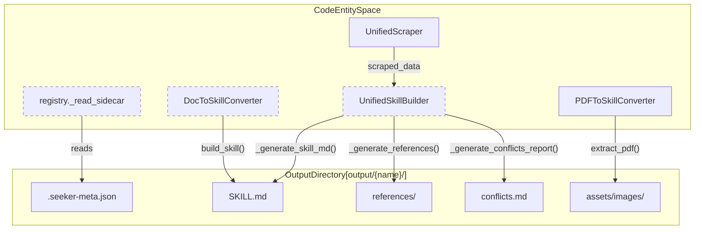
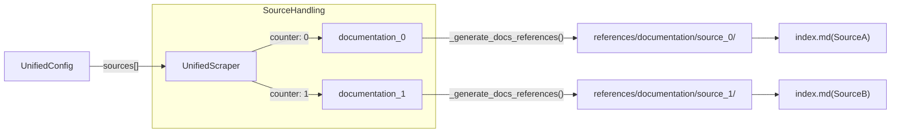

<!-- source: DeepWiki mcp.deepwiki.com · repo yusufkaraaslan/Skill_Seekers · page 12.2 Skill Directory Structure · fetched 2026-10-26 -->

# Skill Directory Structure

<details>
<summary>Relevant source files</summary>

The following files were used as context for generating this wiki page:

- [.codex-plugin/plugin.json](.codex-plugin/plugin.json)
- [.mcp.json](.mcp.json)
- [skills/skill-seekers/SKILL.md](skills/skill-seekers/SKILL.md)
- [src/skill_seekers/web/analysis_store.py](src/skill_seekers/web/analysis_store.py)
- [src/skill_seekers/web/routes/configs.py](src/skill_seekers/web/routes/configs.py)
- [src/skill_seekers/web/routes/environment.py](src/skill_seekers/web/routes/environment.py)
- [src/skill_seekers/web/routes/skill_detail.py](src/skill_seekers/web/routes/skill_detail.py)
- [src/skill_seekers/web/runner.py](src/skill_seekers/web/runner.py)
- [tests/test_web_configs.py](tests/test_web_configs.py)
- [tests/test_web_environment.py](tests/test_web_environment.py)
- [tests/test_web_runner_jobs.py](tests/test_web_runner_jobs.py)
- [tests/test_web_skill_detail.py](tests/test_web_skill_detail.py)

</details>


## Purpose and Scope

This document describes the structure and organization of the skill directory located at `output/{name}/`. This is the final output directory containing synthesized skill content ready for packaging, distribution, and consumption by AI agents and platforms [src/skill_seekers/web/runner.py:110-118]().

The skill directory is generated during the **Build Phase** of the five-phase workflow, taking intermediate data from `.skillseeker-cache/{name}/` and transforming it into a structured format optimized for Large Language Models (LLMs) [src/skill_seekers/cli/unified_scraper.py:41-51](). It also maintains sidecar metadata files such as `.seeker-meta.json` for tracking source provenance and deployment state [tests/test_web_skill_detail.py:22-24]().

Sources: [src/skill_seekers/web/runner.py:110-118](), [src/skill_seekers/cli/unified_scraper.py:41-51](), [tests/test_web_skill_detail.py:22-24]()

---

## Directory Structure Overview

The skill directory follows a standardized layout regardless of whether it was sourced from web documentation, GitHub repositories, or PDF files. The `UnifiedSkillBuilder` class and associated converters orchestrate the creation of this structure [src/skill_seekers/cli/unified_skill_builder.py:26-36]().

```
output/{name}/
├── .seeker-meta.json           # Sidecar metadata (source, version, targets)
├── SKILL.md                    # Main skill file (synthesis of all data)
├── references/                 # Categorized reference content
│   ├── documentation/          # Scraped web documentation pages (per-source)
│   ├── github/                 # GitHub-specific data (README, Issues, etc.)
│   ├── pdf/                    # Extracted PDF text and chapters
│   └── codebase_analysis/      # C3.x analysis (architecture, patterns, guides)
├── scripts/                    # Helper scripts for the skill
├── assets/                     # Images, diagrams, and static assets
│   └── images/                 # Extracted PDF images (if applicable)
└── conflicts.md                # Summary of detected multi-source conflicts
```

**Key characteristics:**
- **Synthesis-First**: `SKILL.md` serves as the primary entry point for AI coding agents [src/skill_seekers/cli/unified_skill_builder.py:79-80]().
- **Sidecar Tracking**: The `.seeker-meta.json` file in the skill root stores metadata including source type, origin URL, and target platforms [tests/test_web_skill_detail.py:22-24]().
- **Source Separation**: Original content is preserved in `references/` subdirectories, organized by source type and identifier [src/skill_seekers/cli/unified_skill_builder.py:133-140]().
- **Analysis Integration**: Codebase analysis results (C3.x) are integrated into a dedicated `codebase_analysis` reference folder [tests/test_c3_integration.py:190-192]().

### System Data Flow Diagram
This diagram maps system components and code entities to the generated directory artifacts.


Sources: [src/skill_seekers/cli/unified_skill_builder.py:26-88](), [src/skill_seekers/cli/doc_scraper.py:204-206](), [src/skill_seekers/cli/unified_scraper.py:41-51](), [src/skill_seekers/cli/pdf_scraper.py:108-121](), [tests/test_web_skill_detail.py:22-24]()

---

## Core Components

### SKILL.md (The Entry Point)
The `SKILL.md` file is the primary document read by AI agents. It is synthesized by `UnifiedSkillBuilder._generate_skill_md()` [src/skill_seekers/cli/unified_skill_builder.py:79-80]().
- **YAML Frontmatter**: Contains metadata like `name` and `description` [src/skill_seekers/cli/unified_skill_builder.py:62-63]().
- **Merged Content**: Aggregates data from multiple sources, combining content from all intermediate `SKILL.md` files found in the cache [src/skill_seekers/cli/unified_skill_builder.py:91-126]().

### The `.seeker-meta.json` Sidecar
Located at the root of each built skill directory (`output/{name}/.seeker-meta.json`), this JSON sidecar records configuration state, original source URL, source type, and active export targets [tests/test_web_skill_detail.py:22-24](). It is parsed by the web HUD and registry via `registry._read_sidecar(skill_dir)` to render skill details and installation status [src/skill_seekers/web/routes/skill_detail.py:77-77]().

### references/ Directory
This directory holds raw or semi-processed reference data:
- **`documentation/`**: Contains subdirectories per source, each with its own markdown reference files [tests/test_multi_source.py:133-140]().
- **`pdf/`**: Organized by chapters or extracted sections [src/skill_seekers/cli/pdf_scraper.py:154-174]().
- **`codebase_analysis/`**: Contains outputs from the C3.x codebase analysis suite, including architecture overviews and pattern reports [tests/test_c3_integration.py:179-181]().

Sources: [src/skill_seekers/cli/unified_skill_builder.py:79-126](), [tests/test_web_skill_detail.py:22-24](), [src/skill_seekers/web/routes/skill_detail.py:77-77]()

---

## Quality and Validation

The output directory is inspected and validated by quality checking routines before packaging or deployment [src/skill_seekers/cli/package_skill.py:101-107]().

### Quality Checks and Impact

| Check Area | Implementation | Impact on Output |
| :--- | :--- | :--- |
| **Structure** | `validate_skill_directory` | Prevents packaging if `SKILL.md` or `references/` are missing [src/skill_seekers/cli/package_skill.py:95-98](). |
| **Content** | `checker.check_all()` | Generates a `QualityReport` assessing frontmatter, length, and code examples [src/skill_seekers/cli/package_skill.py:106-110](). |
| **Gatekeeper** | `_confirm_packaging` | Prompts users or fails job execution if quality thresholds are not met in strict mode [src/skill_seekers/cli/package_skill.py:40-53](). |

Sources: [src/skill_seekers/cli/package_skill.py:40-118]()

---

## Multi-Source Organization (Unified)

When `UnifiedScraper` executes, the directory structure reflects the merging of multiple ingestion streams using an indexed counter system [src/skill_seekers/cli/unified_scraper.py:144-163]().

### Unified Output Logic Diagram
This diagram illustrates how multi-source ingestion maps into the organized `references/` subdirectory hierarchy.


Sources: [src/skill_seekers/cli/unified_scraper.py:144-163](), [src/skill_seekers/cli/unified_skill_builder.py:133-140](), [tests/test_multi_source.py:103-111]()

### Conflict Handling
If discrepancies are detected between documentation and implementation during multi-source builds, a `conflicts.md` file is generated in the root of the skill directory [src/skill_seekers/cli/unified_skill_builder.py:85-88](). This report highlights conflicting function signatures, API mismatches, or outdated documentation points identified by the merger pipeline [src/skill_seekers/cli/unified_scraper.py:28-32]().

Sources: [src/skill_seekers/cli/unified_scraper.py:28-51](), [src/skill_seekers/cli/unified_skill_builder.py:85-88](), [tests/test_multi_source.py:18-24]()

---

