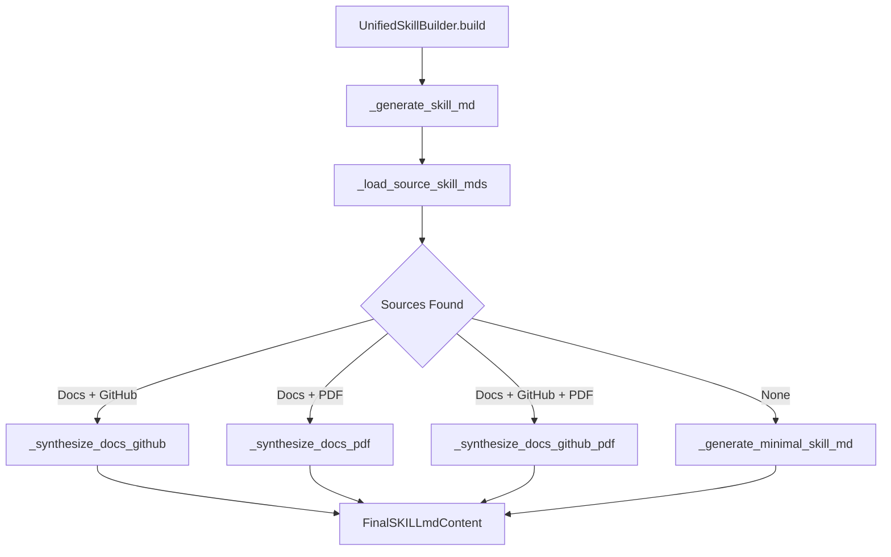
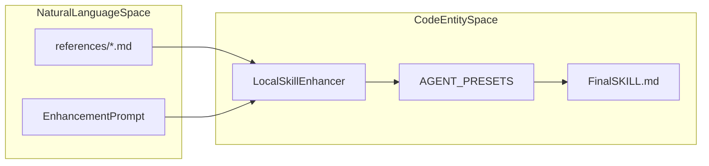
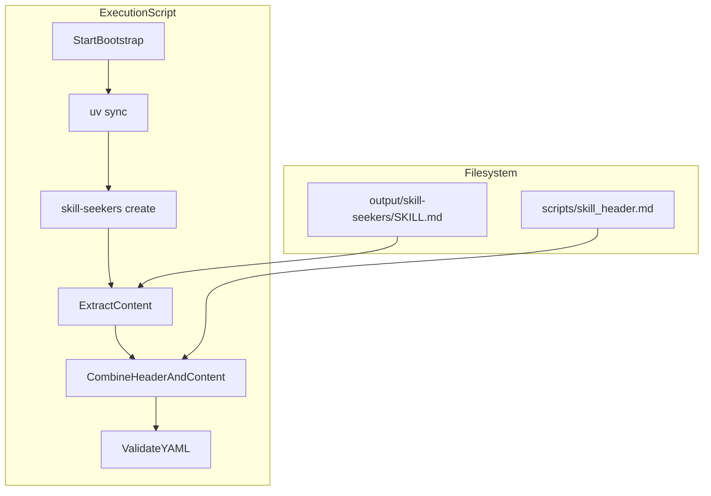

<!-- source: DeepWiki mcp.deepwiki.com · repo yusufkaraaslan/Skill_Seekers · page 12.3 SKILL.md Format & Sections · fetched 2026-10-26 -->

# SKILL.md Format & Sections

<details>
<summary>Relevant source files</summary>

The following files were used as context for generating this wiki page:

- [.codex-plugin/plugin.json](.codex-plugin/plugin.json)
- [.mcp.json](.mcp.json)
- [scripts/bootstrap_skill.sh](scripts/bootstrap_skill.sh)
- [scripts/skill_header.md](scripts/skill_header.md)
- [skills/skill-seekers/SKILL.md](skills/skill-seekers/SKILL.md)
- [src/skill_seekers/cli/setup_wizard.py](src/skill_seekers/cli/setup_wizard.py)
- [tests/test_bootstrap_skill.py](tests/test_bootstrap_skill.py)
- [tests/test_bootstrap_skill_e2e.py](tests/test_bootstrap_skill_e2e.py)

</details>


This document describes the structure and format of `SKILL.md`, the primary output file generated by Skill Seekers. It covers the YAML frontmatter schema, standard sections, synthesis strategies, and how content is adapted for different AI platforms. For information about the reference files that accompany `SKILL.md`, see page 12.2 and 12.4. For the AI enhancement process that improves `SKILL.md` quality, see page 8.

## Purpose and Structure

`SKILL.md` is a markdown file that serves as the primary knowledge artifact consumed by AI systems. While the core structure is generated by `UnifiedSkillBuilder`, platform-specific adaptors modify this structure to meet the requirements of different LLM ecosystems.

The standard file structure generated from multi-source data follows this general shape:

```markdown
---
name: skill-name
description: Skill description text
---

# Skill Name

[Introduction paragraph]

## 📚 Sources
[Source list with URLs/repos]

## 📦 About            (optional: GitHub description)
## 💡 When to Use This Skill
## 🎯 Quick Reference
## 🏗️ Architecture & Code Analysis   (optional: C3.x data)
## 🧪 Code Examples
## 🔧 API Reference    (optional: merged API data)
## ⚠️ Known Issues     (optional: GitHub issues)
## ⚠️ Data Quality     (optional: conflict summary)
## 📖 Reference Documentation
```

Sources: [src/skill_seekers/cli/unified_skill_builder.py:431-489](), [src/skill_seekers/cli/adaptors/claude.py:33-83](), [skills/skill-seekers/SKILL.md:1-4](), [scripts/skill_header.md:1-4]()

---

## Platform-Specific Formats

Different AI platforms have unique requirements for the "system instructions" or "skill" file. Skill Seekers uses the Adaptor Pattern to transform the generic `SKILL.md` into platform-optimized formats.

### Format Comparison

| Platform | Format | Metadata Location | File Name in Package |
|----------|--------|-------------------|----------------------|
| **Claude** | Markdown + YAML | Frontmatter (`---`) | `SKILL.md` |
| **OpenAI** | Plain Text Instructions | `openai_metadata.json` | `assistant_instructions.txt` |
| **Gemini** | Plain Markdown | `gemini_metadata.json` | `system_instructions.md` |
| **Markdown**| Pure Markdown | `metadata.json` | `README.md` |

### YAML Frontmatter (Claude-Specific)
The `ClaudeAdaptor` ensures `SKILL.md` includes required fields in its frontmatter:
- `name`: Kebab-case identifier.
- `description`: High-level summary for the LLM.
- `version`: Version string.

Sources: [src/skill_seekers/cli/adaptors/claude.py:76-83](), [src/skill_seekers/cli/adaptors/openai.py:33-105](), [src/skill_seekers/cli/adaptors/gemini.py:34-88](), [skills/skill-seekers/SKILL.md:1-4](), [.codex-plugin/plugin.json:1-4]()

---

## Standard Sections

The following table lists the sections that `UnifiedSkillBuilder` includes, how they are populated, and whether they are always present.

| Section Header | Always Present | Content Source |
|----------------|---------------|----------------|
| `# {Name}` + intro | Yes | Config `name` and `description` |
| `## 📚 Sources` | Yes | Config `sources` array |
| `## 📦 About` | GitHub only | GitHub `description` and `repo_info` |
| `## 💡 When to Use This Skill` | Yes | Docs/GitHub `When to Use` sections |
| `## 🎯 Quick Reference` | Yes | Docs/GitHub `Quick Reference` sections |
| `## 🏗️ Architecture & Code Analysis` | C3.x data only | `c3_analysis` from GitHub source |
| `## 🧪 Code Examples` | Yes | GitHub `Code Examples` or `Usage Examples` |
| `## 🔧 API Reference` | When available | Merged API data or GitHub/docs API sections |
| `## ⚠️ Data Quality` | Conflicts only | `self.conflicts` list from conflict detection |

Sources: [src/skill_seekers/cli/unified_skill_builder.py:228-355](), [src/skill_seekers/cli/unified_skill_builder.py:577-672](), [scripts/skill_header.md:1-43](), [skills/skill-seekers/SKILL.md:10-42]()

---

## Multi-Source Content Synthesis

`UnifiedSkillBuilder._generate_skill_md()` selects among synthesis strategies depending on which source `SKILL.md` files were found in the cache.

### Synthesis Strategy Selection



Sources: [src/skill_seekers/cli/unified_skill_builder.py:431-489](), [src/skill_seekers/cli/unified_skill_builder.py:80-140]()

---

## AI Enhancement Integration

Once the initial `SKILL.md` is generated, it is passed to an AI Enhancer (`SkillEnhancer` or `LocalSkillEnhancer`). The enhancer reads the reference files and rewrites the `SKILL.md` to be more instructional and accurate.

### Enhancement Data Flow (Natural Language Space to Code Entity Space)



**Key Features of Enhancement:**
- **Local Enhancement:** Uses local CLI agents like `claude` or `codex` to avoid API costs [src/skill_seekers/cli/enhance_skill_local.py:114-141]().
- **Conflict Awareness:** If `conflicts.md` is present in the references, the prompt explicitly instructs the AI to address these discrepancies [src/skill_seekers/cli/enhance_skill.py:119-130]().
- **Multi-Source Synthesis:** The AI is given a breakdown of all sources (Docs, GitHub, PDF) to ensure the final output synthesizes all knowledge [src/skill_seekers/cli/enhance_skill.py:154-164]().

Sources: [src/skill_seekers/cli/enhance_skill_local.py:160-200](), [src/skill_seekers/cli/enhance_skill.py:104-165](), [tests/test_enhance_skill_local.py:26-104]()

---

## Bootstrap Template

For new projects, a bootstrap script (`scripts/bootstrap_skill.sh`) uses a predefined header template (`scripts/skill_header.md`) to ensure the skill is immediately operational for tools like Claude Code.

### Required Operational Sections (Bootstrap)
- **Prerequisites:** Installation instructions (`pip install skill-seekers`).
- **Commands:** A table mapping sources to their respective CLI commands [scripts/skill_header.md:15-23]().
- **Quick Start:** Concrete examples of `create` and `package` commands [scripts/skill_header.md:24-33]().

### Bootstrap Logic Diagram



Sources: [scripts/bootstrap_skill.sh:45-66](), [scripts/skill_header.md:6-43](), [tests/test_bootstrap_skill.py:29-43](), [scripts/bootstrap_skill.sh:22-35]()

---

