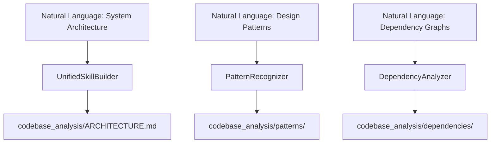

<!-- source: DeepWiki mcp.deepwiki.com · repo yusufkaraaslan/Skill_Seekers · page 12.4 Reference Files Organization · fetched 2026-10-26 -->

# Reference Files Organization

<details>
<summary>Relevant source files</summary>

The following files were used as context for generating this wiki page:

- [src/skill_seekers/cli/doc_scraper.py](src/skill_seekers/cli/doc_scraper.py)
- [src/skill_seekers/cli/unified_scraper.py](src/skill_seekers/cli/unified_scraper.py)
- [src/skill_seekers/cli/unified_skill_builder.py](src/skill_seekers/cli/unified_skill_builder.py)
- [tests/test_c3_integration.py](tests/test_c3_integration.py)
- [tests/test_multi_source.py](tests/test_multi_source.py)
- [tests/test_unified.py](tests/test_unified.py)
- [tests/test_unified_scraper_orchestration.py](tests/test_unified_scraper_orchestration.py)

</details>


This page describes the layout, generation mechanics, and contents of the `references/` subdirectory within a generated skill directory. The `references/` directory serves as the primary repository for raw, categorized documentation, codebase analysis artifacts, API schemas, and cross-source conflict reports that back the primary `SKILL.md`. For broader skill directory layouts, see page [12.2](). For the structural format of `SKILL.md`, see page [12.3]().

---

## Two Reference Layout Modes

The internal organization of reference files branches depending on whether the skill is initialized via a single-source ingestion engine (such as `DocToSkillConverter`) or a multi-source orchestration config (`UnifiedScraper` and `UnifiedSkillBuilder`).

| Builder / Converter | Entry Point Pattern | References Layout Strategy |
|---|---|---|
| `DocToSkillConverter` | Single documentation URL, repository, or PDF path | Flat category-based `.md` files directly in `references/` |
| `UnifiedSkillBuilder` | Multi-source JSON config containing a `sources` array | Nested subdirectories per source type (`documentation/`, `github/`, `pdf/`, `api/`, `codebase_analysis/`) |

Sources: [src/skill_seekers/cli/unified_skill_builder.py:26-36](), [src/skill_seekers/cli/doc_scraper.py:204-206]()

### Diagram: Natural Language Space to Code Entity Space (Single-Source Flow)
```mermaid
flowchart TD
    NL1[""Natural Language: Getting Started Docs""] --> D1["DocToSkillConverter"]
    NL2[""Natural Language: API Reference Docs""] --> D1
    D1 --> FN1[""smart_categorize()""]
    FN1 --> OUT1[""references/getting_started.md""]
    FN1 --> OUT2[""references/api.md""]
```
Sources: [src/skill_seekers/cli/doc_scraper.py:47-50](), [src/skill_seekers/cli/doc_scraper.py:204-206]()

---

## Single-Source Layout (`DocToSkillConverter`)

When building a skill from a single documentation source, `DocToSkillConverter` delegates text parsing and bucketing to categorization algorithms. Pages are matched against configured keyword dictionaries and written into designated markdown files.

```
output/{name}/references/
├── index.md               # Master index linking all category files
├── getting_started.md     # Pages matched to "getting_started" category
├── api.md                 # Pages matched to "api" category
├── guides.md              # Pages matched to "guides" category
├── other.md               # Unmatched fallback pages
├── llms.md                # Standard llms.txt format variant (if detected)
├── llms-full.md           # llms-full.txt variant (if detected)
└── llms-small.md          # llms-small.txt variant (if detected)
```

Category filenames map directly to keys defined within the active profile's `categories` configuration block. Any page failing keyword thresholds falls back to `other.md`. Detected `llms.txt` artifacts are fetched and preserved as structured reference companions.

Sources: [src/skill_seekers/cli/doc_scraper.py:47-50](), [src/skill_seekers/cli/doc_scraper.py:58-66]()

---

## Multi-Source Layout (`UnifiedSkillBuilder`)

When using multi-source ingestion configurations, `UnifiedSkillBuilder` constructs a hierarchical reference tree. This layout isolates documentation streams, repository metadata, binary extractions, and architectural analyses into discrete compartments.

```
output/{name}/references/
├── documentation/
│   ├── index.md                      # Unified documentation index
│   └── {source_id}/
│       └── *.md                      # Source-specific category files
├── github/
│   └── {repo_id}/
│       ├── index.md                  # Repo metadata & statistics
│       ├── README.md                 # Raw repository README
│       ├── issues.md                 # Extracted issue summaries
│       └── releases.md               # Release notes
├── pdf/
│   └── {pdf_id}/
│       └── *.md                      # Chunked and parsed PDF sections
├── api/
│   └── *.md                          # Merged API signatures
├── codebase_analysis/
│   ├── ARCHITECTURE.md               # Master architectural summary (C3.5)
│   ├── patterns/                     # Design pattern instances (C3.1)
│   ├── examples/                     # Extracted test snippets (C3.2)
│   ├── guides/                       # Generated how-to guides (C3.3)
│   ├── configuration/                # Config patterns & env vars (C3.4)
│   ├── dependencies/                 # Module dependency graphs (C3.6)
│   └── architecture_details/         # Framework structural trees (C3.7)
└── conflicts.md                      # Inter-stream discrepancy report
```

Sources: [src/skill_seekers/cli/unified_skill_builder.py:26-36](), [src/skill_seekers/cli/unified_skill_builder.py:61-70]()

---

## Source Subdirectory Implementation

### `documentation/`
The `documentation/` subtree supports multiple documentation origins. Each origin receives an isolated `{source_id}/` subdirectory. `UnifiedSkillBuilder` iterates over items in `scraped_data["documentation"]`, constructing source indices and categorized markdowns. Multiple documentation blocks resolve naming collisions using sequential index suffixes (e.g., `{name}_docs_0`, `{name}_docs_1`).

Sources: [tests/test_multi_source.py:103-140](), [src/skill_seekers/cli/unified_skill_builder.py:91-126](), [src/skill_seekers/cli/unified_scraper.py:144-163]()

### `github/`
Populated via `GitHubScraper` integration. Repositories are organized under unique `{repo_id}` directories. The builder aggregates standalone `SKILL.md` documents from multiple repository caches, writing out unified reference pages covering README content, issues, release histories, and change logs.

Sources: [src/skill_seekers/cli/unified_skill_builder.py:127-145](), [src/skill_seekers/cli/github_scraper.py:5-9]()

### `codebase_analysis/`
This directory holds outputs from the **C3.x codebase analysis suite**, triggered when `enable_codebase_analysis` evaluates to `True` on local or GitHub sources.

| Reference Subpath | Analysis Engine / Class | Purpose |
|---|---|---|
| `ARCHITECTURE.md` | `UnifiedSkillBuilder` | C3.5: Comprehensive architectural summary across 8 core domains |
| `patterns/` | `PatternRecognizer` | C3.1: Detected design pattern instances (Factory, Singleton, etc.) |
| `examples/` | `TestExampleExtractor` | C3.2: High-value test assertion and example extractions |
| `guides/` | `HowToGuideBuilder` | C3.3: Step-by-step developer guides synthesized from workflows |
| `configuration/` | `ConfigExtractor` | C3.4: Configuration file patterns, schemas, and environment flags |
| `dependencies/` | `DependencyAnalyzer` | C3.6: Cyclic dependency detection and import topology |
| `architecture_details/` | `ArchitecturalPatternDetector` | C3.7: Macro architectural classification (MVC, Clean Architecture) |

Sources: [tests/test_c3_integration.py:179-200](), [src/skill_seekers/cli/github_scraper.py:46-54](), [src/skill_seekers/cli/config_validator.py:151-152]()

### Diagram: Natural Language Space to Code Entity Space (Codebase Analysis Flow)

Sources: [src/skill_seekers/cli/unified_scraper.py:41-51](), [src/skill_seekers/cli/unified_skill_builder.py:75-89]()

---

## Conflict Reporting (`conflicts.md`)

When discrepancies arise between documentation and underlying code streams (e.g., mismatched function arguments or unreferenced API endpoints), `ConflictDetector` generates a structured anomaly record. `UnifiedSkillBuilder` reads these records, injects inline warning markers (`⚠️`) into `SKILL.md`, and compiles a dedicated summary report at `references/conflicts.md`.

Sources: [src/skill_seekers/cli/unified_skill_builder.py:86-88](), [src/skill_seekers/cli/unified_scraper.py:28-32](), [tests/test_unified.py:185-191]()

---

## Managed Reference Entries & Invariants

To prevent stale artifacts from persisting across incremental builds, `UnifiedSkillBuilder` enforces a strict managed reference boundary defined in `_MANAGED_REFERENCE_ENTRIES`.

- **Managed Cleansing**: On each execution, `UnifiedSkillBuilder` purges and rebuilds the entries defined in `_MANAGED_REFERENCE_ENTRIES` (including all sub-streams, `api/`, `codebase_analysis/`, and `conflicts.md`). User-created files outside this scope are left intact.
- **Encoding Standard**: All reference markdown files are serialized using UTF-8 encoding.
- **Source Naming Collisions**: Multi-source orchestration relies on internal counter tracking (`_source_counters`) to guarantee distinct path resolutions in both cache directories and final reference outputs.

Sources: [src/skill_seekers/cli/unified_skill_builder.py:61-70](), [src/skill_seekers/cli/unified_scraper.py:144-163](), [tests/test_multi_source.py:103-140]()

---

