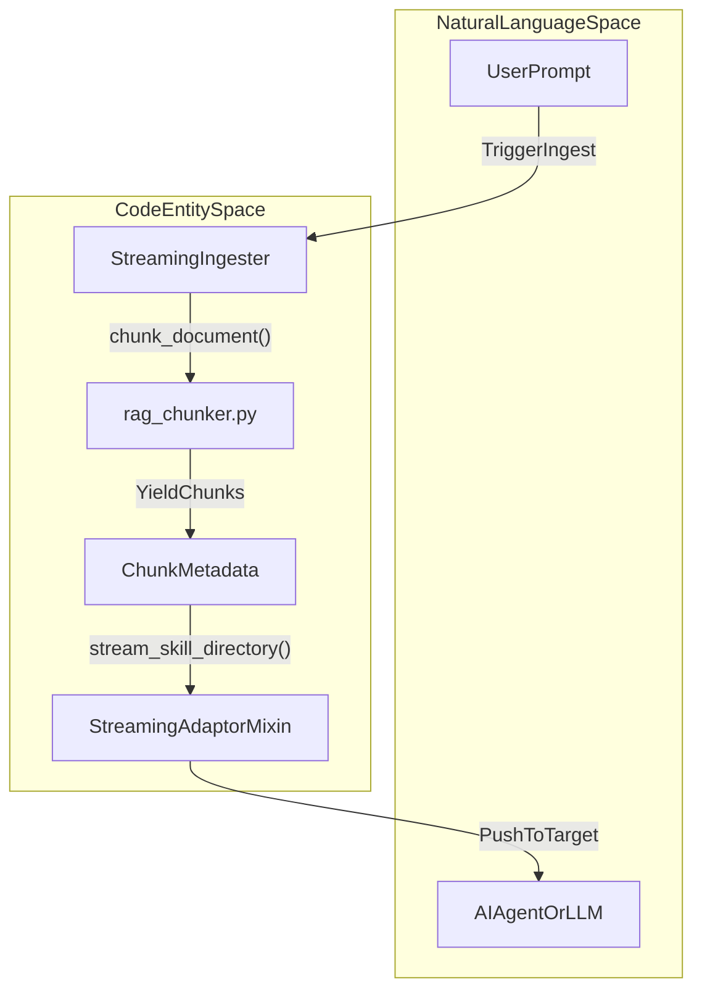
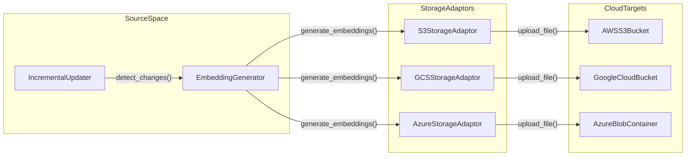

<!-- source: DeepWiki mcp.deepwiki.com · repo yusufkaraaslan/Skill_Seekers · page 13 Advanced Features · fetched 2026-10-26 -->

# Advanced Features

Relevant source files

The following files were used as context for generating this wiki page:

- [docs/FAQ.md](docs/FAQ.md)
- [docs/TROUBLESHOOTING.md](docs/TROUBLESHOOTING.md)
- [docs/features/HOW_TO_GUIDES.md](docs/features/HOW_TO_GUIDES.md)
- [src/skill_seekers/cli/arguments/enhance.py](src/skill_seekers/cli/arguments/enhance.py)
- [src/skill_seekers/cli/config_manager.py](src/skill_seekers/cli/config_manager.py)
- [src/skill_seekers/cli/execution_context.py](src/skill_seekers/cli/execution_context.py)
- [src/skill_seekers/cli/incremental_updater.py](src/skill_seekers/cli/incremental_updater.py)
- [src/skill_seekers/cli/multilang_support.py](src/skill_seekers/cli/multilang_support.py)
- [tests/conftest.py](tests/conftest.py)
- [tests/test_execution_context.py](tests/test_execution_context.py)
- [tests/test_incremental_updates.py](tests/test_incremental_updates.py)
- [tests/test_multilang_support.py](tests/test_multilang_support.py)

This page provides an overview of advanced operational capabilities within Skill Seekers that extend beyond the basic scrape-enhance-package workflow. These features are designed for high-performance data ingestion, robust long-running jobs, multi-source synchronization, and enterprise-grade storage.

## 13.1 Caching & Rapid Iteration

The Skill Seekers architecture prioritizes developer velocity by implementing a sophisticated caching layer. The `DocToSkillConverter` utilizes a checkpoint system that stores intermediate scraping states, allowing users to modify configuration parameters and rebuild skills without re-fetching remote content.

*   **Checkpointing:** Methods like `save_checkpoint` and `load_checkpoint` manage the persistence of `visited_urls` and `pending_urls` [src/skill_seekers/cli/doc_scraper.py:199-250]().
*   **Rapid Rebuilds:** The system utilizes a hidden cache directory organized by skill name to store intermediate files [src/skill_seekers/cli/unified_scraper.py:178-182]().

Sources: [src/skill_seekers/cli/doc_scraper.py:199-250](), [src/skill_seekers/cli/unified_scraper.py:178-182]()

For details, see [Caching & Rapid Iteration](#13.1).

## 13.2 Checkpoint & Resume System

To handle massive documentation sets or unstable network conditions, Skill Seekers includes a global progress persistence mechanism. This ensures that interrupted jobs can be resumed exactly where they left off by maintaining state across sessions.

*   **State Persistence:** `DocToSkillConverter` tracks traversal state and can resume from existing checkpoints if the `resume` flag is set [src/skill_seekers/cli/doc_scraper.py:202-210]().
*   **Cache Organization:** Data is stored in `.skillseeker-cache/{name}/data` to separate raw source data from processed metadata [src/skill_seekers/cli/unified_scraper.py:178-185]().

Sources: [src/skill_seekers/cli/doc_scraper.py:202-210](), [src/skill_seekers/cli/unified_scraper.py:178-185]()

For details, see [Checkpoint & Resume System](#13.2).

## 13.3 Rate Limit Management

Skill Seekers provides granular control over request velocity to respect source server constraints and avoid IP blocking. This is particularly critical for the GitHub scraper and high-concurrency web scraping.

*   **Universal Limits:** The `rate_limit` field in configurations sets the mandatory delay between requests [src/skill_seekers/cli/doc_scraper.py:36-41](), [src/skill_seekers/cli/estimate_pages.py:21-25]().
*   **Estimation Logic:** The `estimate_pages` utility simulates the rate-limited traversal to provide accurate time estimates for full scrapes [src/skill_seekers/cli/estimate_pages.py:212-217]().

Sources: [src/skill_seekers/cli/doc_scraper.py:36-41](), [src/skill_seekers/cli/estimate_pages.py:21-25](), [src/skill_seekers/cli/estimate_pages.py:212-217]()

For details, see [Rate Limit Management](#13.3).

## 13.4 Dry Run & Testing Modes

Before committing to a multi-hour scrape, users can utilize the `dry_run` flag to validate configurations. This mode simulates the execution path without performing actual network I/O or writing final output.

*   **Validation:** `UnifiedScraper` accepts a `dry_run` argument which previews the sources that would be scraped without creating directories [src/skill_seekers/cli/unified_scraper.py:82-97]().
*   **Safe Estimation:** The `estimate_pages` tool allows for pre-flight checks on documentation size without downloading content [src/skill_seekers/cli/estimate_pages.py:2-10]().

Sources: [src/skill_seekers/cli/unified_scraper.py:82-97](), [src/skill_seekers/cli/estimate_pages.py:2-10]()

For details, see [Dry Run & Testing Modes](#13.4).

## 13.5 Streaming Ingestion

For real-time applications, Skill Seekers supports streaming content as it is discovered. This bypasses the need for a full local build phase before data becomes available to downstream consumers.

Title: Streaming Data Flow

Sources: [src/skill_seekers/cli/quality_metrics.py:39-47](), [src/skill_seekers/cli/unified_skill_builder.py:26-36]()

For details, see [Streaming Ingestion](#13.5).

## 13.6 Incremental Updates & Cloud Storage

The system detects changes in source documentation to perform partial updates, significantly reducing the overhead of keeping AI skills synchronized. It also supports enterprise storage providers for distributing these skills.

*   **Change Detection:** `IncrementalUpdater` uses `_compute_file_hash` to identify modified files and generates a `ChangeSet` [src/skill_seekers/cli/incremental_updater.py:79-175]().
*   **Version Tracking:** The system increments version numbers for modified documents and generates delta packages [src/skill_seekers/cli/incremental_updater.py:205-235]().
*   **Cloud Adaptors:** Supports S3, GCS, and Azure via a factory pattern in `get_storage_adaptor` [src/skill_seekers/cli/storage/__init__.py](). Concrete implementations include `S3StorageAdaptor` [src/skill_seekers/cli/storage/s3_storage.py:19-30](), `GCSStorageAdaptor` [src/skill_seekers/cli/storage/gcs_storage.py:20-30](), and `AzureStorageAdaptor` [src/skill_seekers/cli/storage/azure_storage.py:20-30]().
*   **Embedding Pipeline:** Integrates with `EmbeddingGenerator` to update vector representations of skill content using providers like OpenAI or Voyage AI [src/skill_seekers/embedding/generator.py:34-56]().

Title: Incremental Update and Storage Pipeline

Sources: [src/skill_seekers/cli/incremental_updater.py:58-64](), [src/skill_seekers/cli/storage/s3_storage.py:92-95](), [src/skill_seekers/cli/storage/gcs_storage.py:84-87](), [src/skill_seekers/cli/storage/azure_storage.py:109-112](), [src/skill_seekers/embedding/generator.py:187-204]()

For details, see [Incremental Updates & Cloud Storage](#13.6).

### Advanced Feature Summary

| Feature | Key Component | Primary Benefit |
| :--- | :--- | :--- |
| **Caching** | `DocToSkillConverter` | Instant rebuilds using intermediate state. |
| **Resumption** | `cache_dir` logic | Recovery from network interruptions. |
| **Rate Limiting** | `estimate_pages` | Respects source server constraints. |
| **Dry Run** | `UnifiedScraper` | Configuration validation without I/O. |
| **Incremental** | `IncrementalUpdater` | Only process changed files using SHA256 hashes. |
| **Cloud Storage** | `BaseStorageAdaptor` | Native support for AWS, GCP, and Azure. |
| **Embeddings** | `EmbeddingGenerator` | Multi-provider (OpenAI, Voyage, Local) vector generation. |

Sources: [src/skill_seekers/cli/doc_scraper.py:199-250](), [src/skill_seekers/cli/incremental_updater.py:58-64](), [src/skill_seekers/cli/storage/s3_storage.py:19-30](), [src/skill_seekers/embedding/generator.py:34-56]()

---

