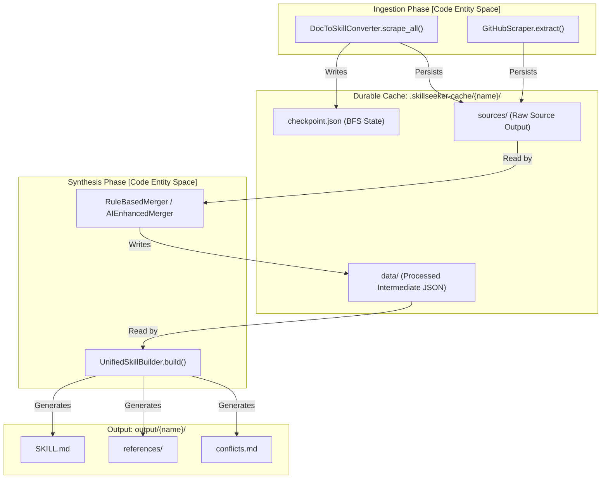
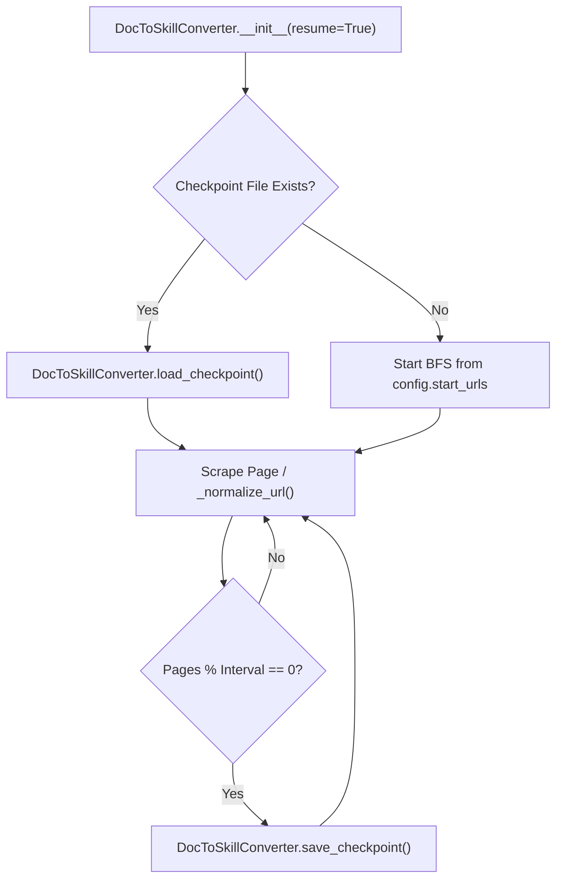

<!-- source: DeepWiki mcp.deepwiki.com · repo yusufkaraaslan/Skill_Seekers · page 13.1 Caching & Rapid Iteration · fetched 2026-10-26 -->

# Caching & Rapid Iteration

Relevant source files

The following files were used as context for generating this wiki page:

- [src/skill_seekers/cli/doc_scraper.py](src/skill_seekers/cli/doc_scraper.py)
- [src/skill_seekers/cli/main.py](src/skill_seekers/cli/main.py)
- [src/skill_seekers/cli/parsers/__init__.py](src/skill_seekers/cli/parsers/__init__.py)
- [src/skill_seekers/cli/skill_converter.py](src/skill_seekers/cli/skill_converter.py)
- [src/skill_seekers/cli/source_detector.py](src/skill_seekers/cli/source_detector.py)
- [src/skill_seekers/cli/unified_scraper.py](src/skill_seekers/cli/unified_scraper.py)
- [src/skill_seekers/cli/unified_skill_builder.py](src/skill_seekers/cli/unified_skill_builder.py)
- [tests/test_c3_integration.py](tests/test_c3_integration.py)
- [tests/test_cli_parsers.py](tests/test_cli_parsers.py)
- [tests/test_multi_source.py](tests/test_multi_source.py)
- [tests/test_new_source_types.py](tests/test_new_source_types.py)
- [tests/test_unified.py](tests/test_unified.py)
- [tests/test_unified_scraper_orchestration.py](tests/test_unified_scraper_orchestration.py)

## Purpose and Scope

This page describes the caching and checkpoint systems that enable rapid iteration on skill development without repeating expensive scraping operations. The system employs two primary mechanisms:
1. **Durable Scraped Data Cache**: `DocToSkillConverter` and `UnifiedScraper` persist raw scraped content in hidden and explicit cache directories, allowing the build, merge, and enhancement phases to be re-run independently [src/skill_seekers/cli/doc_scraper.py:164-167](), [src/skill_seekers/cli/unified_scraper.py:177-181]().
2. **Streaming Checkpoints**: `DocToSkillConverter` provides a checkpoint mechanism—specifically `save_checkpoint()` and `load_checkpoint()`—to resume interrupted ingestion tasks [src/skill_seekers/cli/doc_scraper.py:1360-1405]().

For details about the output directory layout, see page [12.1](). For `ConfigManager`-level progress persistence, see page [13.2]().

Sources: [src/skill_seekers/cli/doc_scraper.py:164-167](), [src/skill_seekers/cli/doc_scraper.py:1360-1405](), [src/skill_seekers/cli/unified_scraper.py:177-181]()

## Cache Architecture

The caching system separates raw scraped data from processed skill artifacts. This separation allows developers to tweak categorization rules, merge strategies, or enhancement prompts without re-downloading documentation or re-cloning repositories.

### Cache Storage Model

`DocToSkillConverter` manages the lifecycle of the documentation cache. In the unified workflow, `UnifiedScraper` centralizes these artifacts under a hidden `.skillseeker-cache/` directory [src/skill_seekers/cli/unified_scraper.py:177-181]().

**Diagram: Data Flow and Cache Persistence (Natural Language to Code Entity Space)**

Sources: [src/skill_seekers/cli/doc_scraper.py:164-172](), [src/skill_seekers/cli/unified_scraper.py:177-185](), [src/skill_seekers/cli/unified_skill_builder.py:101-105]()

### Directory Layout & Persistence

| Path | Contents | Persistence |
|------|----------|-------------|
| `.skillseeker-cache/{name}/` | Hidden unified cache root | Persistent across runs |
| `.skillseeker-cache/{name}/sources/` | Standalone output from each scraper | Permanent until manual clear |
| `.skillseeker-cache/{name}/data/` | Merged data and conflict reports | Regenerated during merge |
| `output/{name}_data/` | Legacy documentation-only cache | Manual deletion only |

Sources: [src/skill_seekers/cli/unified_scraper.py:177-185](), [src/skill_seekers/cli/unified_skill_builder.py:101-105]()

## Checkpoint & Resume System

The `DocToSkillConverter` includes a robust checkpoint system designed to handle network interruptions or process crashes during long-running breadth-first search (BFS) crawls.

### State Persistence

The converter tracks state using `self.visited_urls` and `self.pending_urls`. When `resume=True` is passed to the constructor, it attempts to load these from the `checkpoint_file` [src/skill_seekers/cli/doc_scraper.py:156-166]().

**Key Functions:**
- `save_checkpoint()`: Serializes the current BFS queue (`pending_urls`) and `visited_urls` set to JSON [src/skill_seekers/cli/doc_scraper.py:1360-1380]().
- `load_checkpoint()`: Restores the queue and visited set, allowing the scraper to pick up exactly where it left off [src/skill_seekers/cli/doc_scraper.py:1382-1405]().

### Checkpoint Interval
The frequency of saves is controlled by `checkpoint_interval` in the configuration, which defaults to `DEFAULT_CHECKPOINT_INTERVAL` (typically every 10 pages) [src/skill_seekers/cli/doc_scraper.py:168-171](), [src/skill_seekers/cli/constants.py:38]().

Sources: [src/skill_seekers/cli/doc_scraper.py:156-171](), [src/skill_seekers/cli/doc_scraper.py:1360-1405](), [src/skill_seekers/cli/constants.py:38]()

## Rapid Iteration Workflows

The system is optimized for "Scrape Once, Build Many" workflows.

### Pattern 1: Multi-Source Synthesis Iteration
In the `UnifiedScraper` workflow, the `cache_dir` stores intermediate data from multiple sources (GitHub, PDF, Docs).
1. **Initial Run**: Scrape all sources. This populates `.skillseeker-cache/{name}/sources/`.
2. **Iteration**: If the user changes the `merge_mode` from `rule-based` to `ai-enhanced`, the system reads from the cache instead of re-scraping [src/skill_seekers/cli/unified_scraper.py:43-51]().
3. **Conflict Resolution**: Iteratively run `ConflictDetector` and `AIEnhancedMerger` to refine the `conflicts.md` output [src/skill_seekers/cli/unified_scraper.py:118-121]().

### Pattern 2: Categorization Tuning
If a user wants to change how documentation pages are grouped:
1. Update `categories` in the JSON config.
2. Re-run the build phase. `DocToSkillConverter.build_skill()` will re-run `smart_categorize()` on the cached raw pages [src/skill_seekers/cli/doc_scraper.py:1150-1180]().

**Diagram: Resume Logic in DocToSkillConverter (Natural Language to Code Entity Space)**

Sources: [src/skill_seekers/cli/doc_scraper.py:105-120](), [src/skill_seekers/cli/doc_scraper.py:1360-1405](), [src/skill_seekers/cli/unified_scraper.py:41-131](), [src/skill_seekers/cli/unified_skill_builder.py:75-89]()

## Performance & Rate Limits

Caching is critical for respecting rate limits and minimizing bandwidth.
- **Rate Limiting**: `DEFAULT_RATE_LIMIT` is applied during documentation BFS crawls to prevent IP blocking [src/skill_seekers/cli/constants.py:40]().
- **GitHub Backoff**: The system respects GitHub API rate limits; if interrupted, the checkpoint system ensures the scraper doesn't restart the entire issue or release history scan [src/skill_seekers/cli/github_scraper.py:28-30]().

Sources: [src/skill_seekers/cli/doc_scraper.py:40](), [src/skill_seekers/cli/github_scraper.py:28-30](), [src/skill_seekers/cli/constants.py:40]()

## Cache Invalidation

The cache is considered stale only when manually invalidated or explicitly bypassed.
- **Dry Run**: Using `--dry-run` prevents any cache or output creation, allowing for configuration validation without side effects [src/skill_seekers/cli/unified_scraper.py:82]().
- **Manual Clear**: Deleting the `.skillseeker-cache/` directory forces a full re-scrape of all sources in a unified config [src/skill_seekers/cli/unified_scraper.py:177-185]().

Sources: [src/skill_seekers/cli/unified_scraper.py:82](), [src/skill_seekers/cli/unified_scraper.py:177-185]()

---

