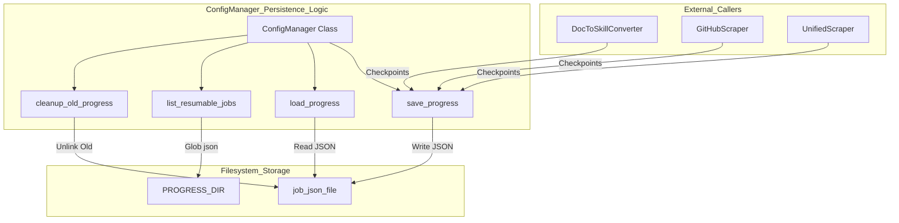
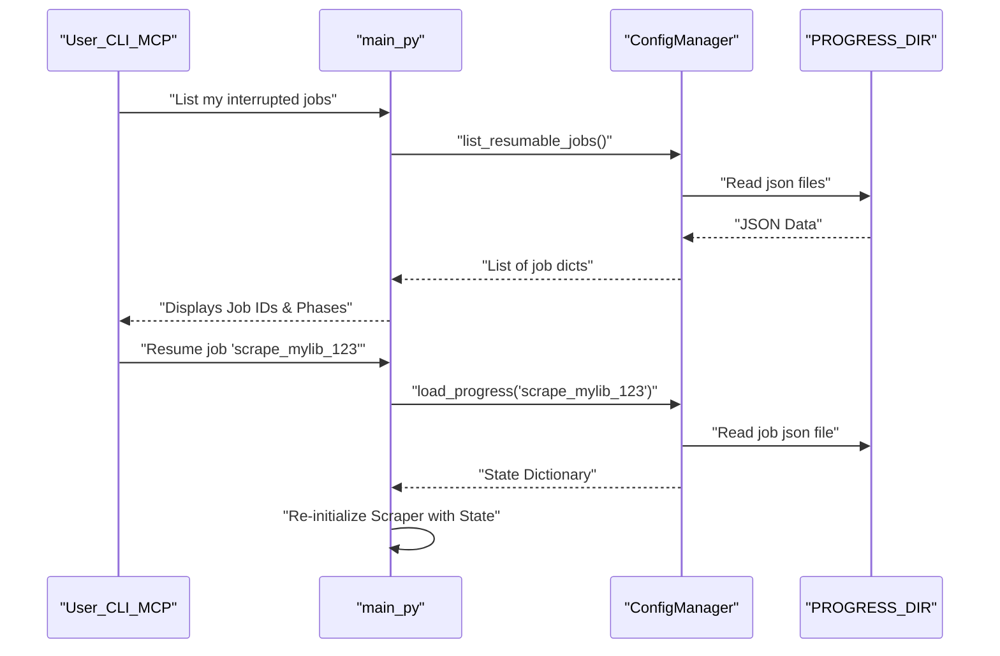

<!-- source: DeepWiki mcp.deepwiki.com · repo yusufkaraaslan/Skill_Seekers · page 13.2 Checkpoint & Resume System · fetched 2026-10-26 -->

# Checkpoint & Resume System

<details>
<summary>Relevant source files</summary>

The following files were used as context for generating this wiki page:

- [docs/FAQ.md](docs/FAQ.md)
- [docs/TROUBLESHOOTING.md](docs/TROUBLESHOOTING.md)
- [docs/features/HOW_TO_GUIDES.md](docs/features/HOW_TO_GUIDES.md)
- [src/skill_seekers/cli/arguments/enhance.py](src/skill_seekers/cli/arguments/enhance.py)
- [src/skill_seekers/cli/config_manager.py](src/skill_seekers/cli/config_manager.py)
- [src/skill_seekers/cli/execution_context.py](src/skill_seekers/cli/execution_context.py)
- [tests/conftest.py](tests/conftest.py)
- [tests/test_execution_context.py](tests/test_execution_context.py)

</details>


## Purpose and Scope

The Checkpoint & Resume System, implemented within `ConfigManager`, provides filesystem-based persistence of job progress. This allows long-running operations—such as documentation scraping, GitHub repository analysis, or unified skill building—to be resumed after interruptions caused by network failures, API rate limits, or manual cancellations (`Ctrl+C`).

This system handles the high-level persistence of job metadata and state, while specific scrapers (like `DocToSkillConverter`) may implement their own granular internal checkpoints.

Sources: [src/skill_seekers/cli/config_manager.py:32-60]()

---

## Architecture Overview

Progress is persisted as individual JSON files in a platform-appropriate data directory. Each file is managed by the `ConfigManager` singleton, which initializes progress storage directories with secure permissions upon instantiation.

### Progress Directory Locations

| Platform | Path |
|----------|------|
| **Unix/macOS** | `~/.local/share/skill-seekers/progress/` |
| **Windows** | `%LOCALAPPDATA%\skill-seekers\progress\` |

These paths are resolved by `_get_progress_dir()` and initialized with secure permissions (700 for directories, 600 for files on Unix) during `ConfigManager` setup.

Sources: [src/skill_seekers/cli/config_manager.py:25-30](), [src/skill_seekers/cli/config_manager.py:61-67]()

### Component Diagram: Code Entity Space

This diagram associates the persistence logic with the specific classes and methods in `config_manager.py`.


Sources: [src/skill_seekers/cli/config_manager.py:25-67]()

---

## Progress Data Schema and Retention Settings

The resume behavior and retention windows are governed by default configuration dictionaries stored within `ConfigManager.DEFAULT_CONFIG`.

### Resume Settings in `config.json`
```json
{
  "resume": {
    "auto_save_interval_seconds": 60,
    "keep_progress_days": 7
  }
}
```

| Key | Default | Description |
|-----|---------|-------------|
| `auto_save_interval_seconds` | `60` | Recommended frequency for scrapers to trigger a state save. |
| `keep_progress_days` | `7` | Retention period for progress files before `cleanup_old_progress` removes stale entries. |

Sources: [src/skill_seekers/cli/config_manager.py:42-60]()

---

## Logic Flow: Natural Language to Code Entity

This diagram shows how a user's intent to interact with resumable jobs translates into specific `ConfigManager` method calls.


Sources: [src/skill_seekers/cli/config_manager.py:61-123]()

---

## Integration with Scrapers

Scrapers use a checkpoint-and-verify pattern. On startup, a scraper checks for existing progress via `load_progress`. If found, it populates its internal queues and continues execution, periodically saving state via `save_progress` at intervals dictated by `auto_save_interval_seconds`. Upon completion, progress files are cleaned up or marked non-resumable.

Sources: [src/skill_seekers/cli/config_manager.py:61-137]()

---

