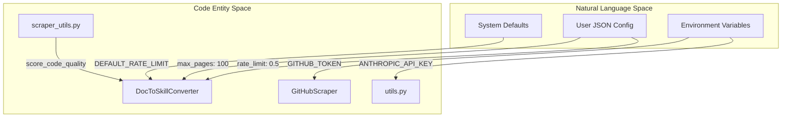
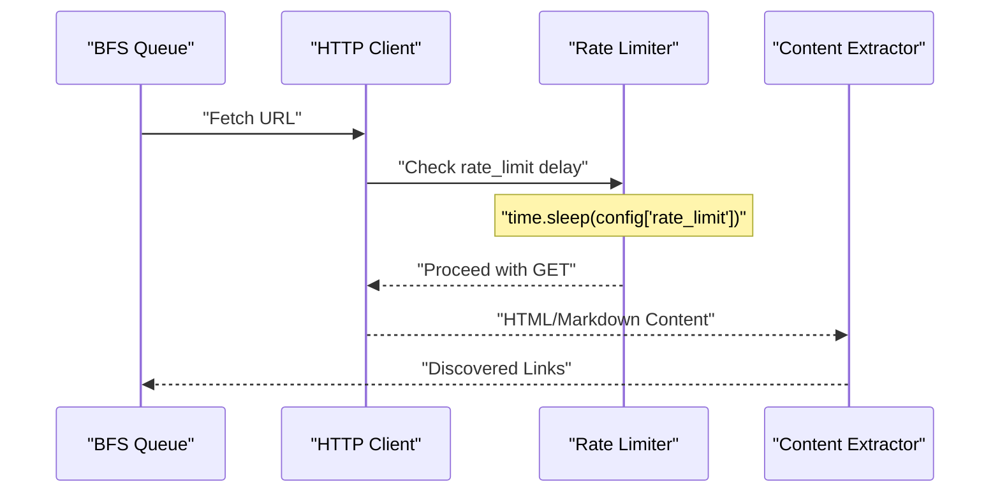

<!-- source: DeepWiki mcp.deepwiki.com · repo yusufkaraaslan/Skill_Seekers · page 13.3 Rate Limit Management · fetched 2026-10-26 -->

# Rate Limit Management

Relevant source files

The following files were used as context for generating this wiki page:

- [.github/create_issues.sh](.github/create_issues.sh)
- [docs/features/UNIFIED_SCRAPING.md](docs/features/UNIFIED_SCRAPING.md)
- [src/skill_seekers/cli/enhance_skill.py](src/skill_seekers/cli/enhance_skill.py)
- [src/skill_seekers/cli/scraper_utils.py](src/skill_seekers/cli/scraper_utils.py)
- [src/skill_seekers/cli/utils.py](src/skill_seekers/cli/utils.py)
- [tests/test_config_validation.py](tests/test_config_validation.py)
- [tests/test_issue_277_discord_e2e.py](tests/test_issue_277_discord_e2e.py)
- [tests/test_issue_277_real_world.py](tests/test_issue_277_real_world.py)
- [tests/test_markdown_parsing.py](tests/test_markdown_parsing.py)
- [tests/test_scraper_features.py](tests/test_scraper_features.py)
- [tests/test_scraper_utils.py](tests/test_scraper_utils.py)
- [tests/test_url_conversion.py](tests/test_url_conversion.py)

## Purpose and Scope

This document describes the rate limit management system in Skill Seekers, which enables robust scraping across multiple sources (GitHub API, documentation, and LLM providers) without hitting rate limits or causing indefinite waits. The system provides predictive checks, configurable delay strategies, and robust retry mechanisms for network resilience.

**Key Features:**
- **GitHub Multi-token configuration**: Support for token resolution and environment variable fallback to handle API quotas.
- **Documentation Rate Limiting**: Delay-based crawling controlled by `rate_limit` fields in configurations.
- **Predictive Estimation**: Pre-flight page discovery to warn users of large documentation sets before full scraping begins.
- **Utility-level retries**: Robust handling of transient network failures and 5xx responses during data fetching.
- **Unified timeout settings**: Configurable timeouts across scraping, sitemap probing, and AI enhancement phases.

---

## Configuration Architecture

### Configurable Limits and Timeouts

Rate limits are configured through a combination of global constants, per-source configuration fields, and profile-specific settings. The `DocToSkillConverter` uses these to throttle BFS traversal during web ingestion.

**Rate Limit Configuration Diagram**

Sources: [src/skill_seekers/cli/utils.py:77-113](), [src/skill_seekers/cli/scraper_utils.py:24-84]()

### Source-Specific Implementation

| Source Type | Configuration Field | Default Value | Implementation |
| :--- | :--- | :--- | :--- |
| **Documentation** | `rate_limit` | `DEFAULT_RATE_LIMIT` (0.1s) | `time.sleep()` between requests in BFS traversal. |
| **GitHub** | `github_token` | `os.environ["GITHUB_TOKEN"]` | Client initialization with token handling. |
| **Network Utilities** | N/A | 3 attempts | Exponential backoff for transient network errors. |
| **Estimation** | `max_discovery` | `DEFAULT_MAX_DISCOVERY` (500) | Limits BFS depth during pre-flight checks. |

Sources: [src/skill_seekers/cli/utils.py:77-113](), [src/skill_seekers/cli/scraper_utils.py:24-84]()

---

## Rate Limit Detection and Strategies

### GitHub API Rate Limiting

The `GitHubScraper` manages rate limits by checking the `github_token` field in the configuration, falling back to the `GITHUB_TOKEN` environment variable. If rate limits are exceeded, the scraper provides fallback mechanisms to local repository analysis if a local path is provided.

### Documentation BFS Rate Limiting

The `DocToSkillConverter` implements a BFS queue for URL traversal. To prevent being blocked by web servers, it enforces a delay between every page fetch based on the `rate_limit` field in the configuration.

**Scraping Flow with Rate Limiting**

Sources: [src/skill_seekers/cli/utils.py:1-36](), [src/skill_seekers/cli/scraper_utils.py:24-84]()

---

## Implementation Details

### Page Count Estimation

The estimation utilities provide a dry-run capability for rate limits by discovering URLs without downloading full content. They respect the `rate_limit` configuration during the discovery phase to ensure estimation itself does not trigger server blocks.

### Retry Utility and Backoff Logic

Network operations incorporate retry decorators and backoff strategies to handle transient failures gracefully.

**Retry Logic Behavior:**
1. **Transient Failures**: Retries connection errors, timeouts, and HTTP 5xx responses.
2. **Immediate Failure**: Client errors (such as HTTP 404 Not Found) are returned immediately without retry, as they represent definitive resource states rather than transient network faults.
3. **Backoff Schedule**: Applies increasing delays between attempts (e.g., exponential backoff) to prevent server flooding.

Sources: [src/skill_seekers/cli/utils.py:1-36](), [src/skill_seekers/cli/scraper_utils.py:24-84]()

### Timeout Management

| Layer | Default Timeout | Implementation |
| :--- | :--- | :--- |
| **Sitemap Probe** | 10s | Internal sitemap check during initialization. |
| **Network Fetch** | 30s | Asynchronous client request timeout. |
| **AI Enhancement** | 60s+ | Managed timeout policy in `AgentClient` [src/skill_seekers/cli/enhance_skill.py:45-47](). |

Sources: [src/skill_seekers/cli/enhance_skill.py:45-47](), [src/skill_seekers/cli/utils.py:1-36]()

---

## Summary of Code Entities

| Entity | Role | File |
| :--- | :--- | :--- |
| `rate_limit` | Config field defining delay between documentation page requests. | [tests/test_config_validation.py:40-42]() |
| `get_api_key` | Utility for retrieving API keys from environment variables. | [src/skill_seekers/cli/utils.py:92-113]() |
| `score_code_quality` | Heuristic quality score for code blocks in `scraper_utils`. | [src/skill_seekers/cli/scraper_utils.py:70-84]() |
| `DocToSkillConverter` | Core scraper class enforcing rate limits during BFS traversal. | [tests/test_scraper_features.py:30-33]() |
| `AgentClient` | Transport gate for AI calls with timeout and retry handling. | [src/skill_seekers/cli/enhance_skill.py:45-47]() |

Sources: [src/skill_seekers/cli/utils.py:92-113](), [src/skill_seekers/cli/scraper_utils.py:70-84](), [src/skill_seekers/cli/enhance_skill.py:45-47](), [tests/test_config_validation.py:40-42](), [tests/test_scraper_features.py:30-33]()

---

