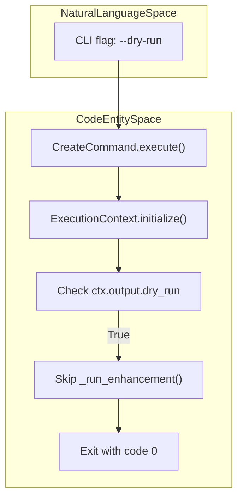
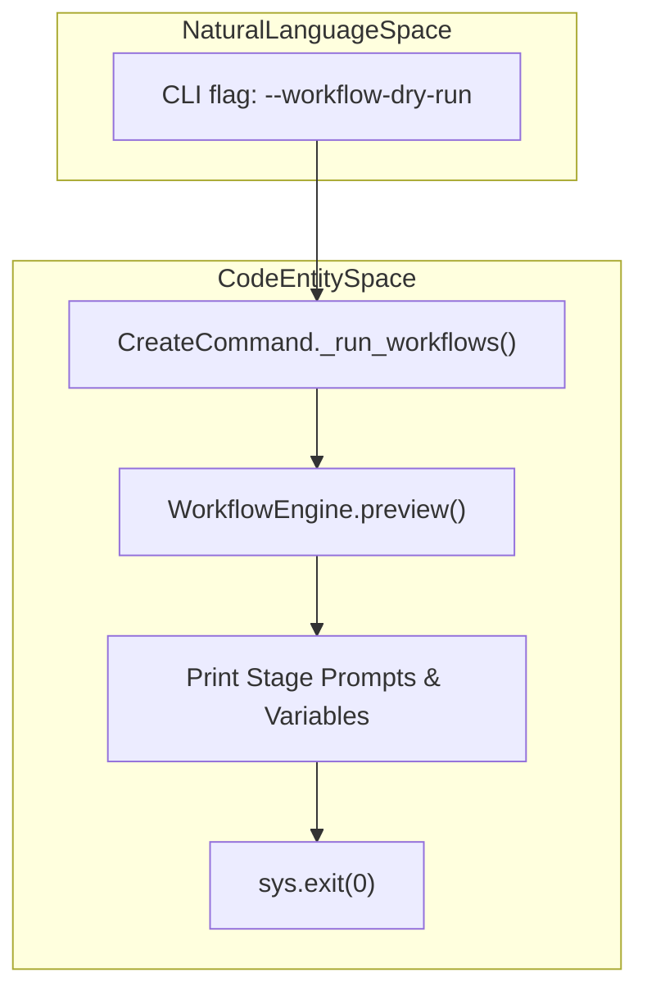
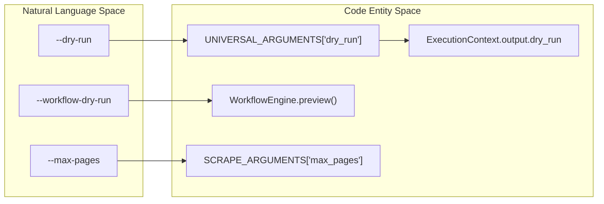

<!-- source: DeepWiki mcp.deepwiki.com · repo yusufkaraaslan/Skill_Seekers · page 13.4 Dry Run & Testing Modes · fetched 2026-10-26 -->

# Dry Run & Testing Modes

Relevant source files

The following files were used as context for generating this wiki page:

- [docs/features/SKILL_SEARCH_INDEX.md](docs/features/SKILL_SEARCH_INDEX.md)
- [src/skill_seekers/cli/arguments/common.py](src/skill_seekers/cli/arguments/common.py)
- [src/skill_seekers/cli/arguments/create.py](src/skill_seekers/cli/arguments/create.py)
- [src/skill_seekers/cli/arguments/scrape.py](src/skill_seekers/cli/arguments/scrape.py)
- [src/skill_seekers/cli/create_command.py](src/skill_seekers/cli/create_command.py)
- [src/skill_seekers/cli/skill_indexer.py](src/skill_seekers/cli/skill_indexer.py)
- [tests/test_create_arguments.py](tests/test_create_arguments.py)
- [tests/test_create_integration_basic.py](tests/test_create_integration_basic.py)

This page documents the dry-run and testing modes available in `skill-seekers` — specifically `--dry-run`, `--workflow-dry-run`, and related scoping flags — covering what each mode skips, what gets validated, how flags propagate through the architecture, and how the system handles these modes across different source types and commands.

For general CLI command documentation see [Scraping Commands (3.1)]() and [Enhancement Commands (3.2)](). For enhancement workflow internals see [Enhancement Workflows & Presets (8.3)]().

---

## Two Distinct Dry-Run Mechanisms

`skill-seekers` provides two independent dry-run mechanisms with separate scopes and execution paths. These flags can be used individually or combined depending on whether you want to test ingestion and validation or AI enhancement pipeline stages.

| Flag | Scope | Effect | Exit Behavior |
|------|-------|-------|---------------|
| `--dry-run` | Scraping & skill creation | Prevents disk writes and AI calls; validates config and source accessibility | Returns normally with exit code `0` |
| `--workflow-dry-run` | Enhancement workflow only | Previews prompt stages and variables instead of executing real AI transport | Forces `sys.exit(0)` after rendering previews |

**Argument definitions and citations:**
- `--dry-run` is defined in `UNIVERSAL_ARGUMENTS` [src/skill_seekers/cli/arguments/create.py:82-88]() and `BEHAVIOR_ARGUMENTS` [src/skill_seekers/cli/arguments/common.py:104-110]().
- `--workflow-dry-run` is defined in `UNIVERSAL_ARGUMENTS` [src/skill_seekers/cli/arguments/create.py:149-155]().
- Both flags are registered in the unified CLI via argument builders [src/skill_seekers/cli/arguments/create.py:20-183](), [src/skill_seekers/cli/arguments/scrape.py:154-181]().

Sources: [src/skill_seekers/cli/arguments/create.py:82-155](), [src/skill_seekers/cli/arguments/common.py:104-110](), [src/skill_seekers/cli/arguments/scrape.py:154-181]()

---

## `--dry-run`: Scraping Preview Mode

### What It Does
When `--dry-run` is passed, the skill creation pipeline is short-circuited before any destructive or state-changing operations occur. The flag instructs the system to **validate sources and configurations, but produce no files and invoke no AI providers**.

The standard help text for this option is: `"Preview what will be created without actually creating it"` [src/skill_seekers/cli/arguments/create.py:86]().

### What Still Runs
Even when `--dry-run` is active, the initial validation and resolution phases execute fully to catch configuration errors early:
1. **Source Detection**: Resolving the input string (URL, local path, or repository) via `SourceDetector.resolve()` [src/skill_seekers/cli/create_command.py:58-60]().
2. **Context Initialization**: Assembling the `ExecutionContext` singleton to establish settings consistency [src/skill_seekers/cli/create_command.py:80-84]().
3. **Argument Validation**: Checking for incompatible flags using `_validate_arguments()` [src/skill_seekers/cli/create_command.py:87]().

### What Is Skipped
- **Disk Writes & Output Generation**: No files or directories are saved to `output/` or `.skillseeker-cache/`. Scrapers respect `ctx.output.dry_run` to bypass persistence steps [src/skill_seekers/cli/create_command.py:100-102]().
- **AI Enhancement**: Steps 6 (`_run_enhancement`) and 7 (`_run_workflows`) of `CreateCommand.execute()` are explicitly bypassed when `dry_run` is true, avoiding external network calls [src/skill_seekers/cli/create_command.py:100-102]().

### Propagation Through `CreateCommand`
The dry-run flag is captured in the execution context and inspects control flow gates before post-processing.

Title: "Dry-Run Execution Flow"

Sources: [src/skill_seekers/cli/create_command.py:47-105](), [src/skill_seekers/cli/arguments/create.py:82-88]()

---

## `--workflow-dry-run`: Enhancement Preview Mode

### What It Does
`--workflow-dry-run` targets the AI Enhancement System specifically. It permits users to inspect prompt templates, variable substitution, and stage sequence layouts for workflows like `security-focus` or `architecture-comprehensive` without hitting commercial LLM APIs.

When invoked:
1. The workflow engine loads designated workflow definitions [src/skill_seekers/cli/arguments/create.py:125-131]().
2. Instead of executing network calls via `AgentClient`, the engine prints resolved prompt structures and variables.
3. Execution terminates immediately post-preview via `sys.exit(0)`.

Title: "Workflow Dry-Run Architecture"

Sources: [src/skill_seekers/cli/arguments/create.py:125-155](), [src/skill_seekers/cli/create_command.py:106-107]()

---

## Additional Testing & Scoping Flags

In addition to dedicated dry-run flags, `skill-seekers` supports incremental development and testing flags across commands:

| Flag | Target Command | Description |
|------|----------------|-------------|
| `--max-pages N` | `create`, `scrape` | Caps BFS traversal depth to `N` pages for rapid prototyping [src/skill_seekers/cli/arguments/scrape.py:58-64](). |
| `--skip-scrape` | `scrape`, `create` | Bypasses ingestion and uses existing cached data in `.skillseeker-cache/` [src/skill_seekers/cli/arguments/scrape.py:67-71](). |
| `--resume` | `scrape`, `create` | Resumes interrupted jobs from saved checkpoints [src/skill_seekers/cli/arguments/scrape.py:73-78](). |
| `--preset PRESET` | `create` | Applies analysis presets (`quick`, `standard`, `comprehensive`) to balance speed vs. depth [src/skill_seekers/cli/arguments/create.py:106-114](). |

Sources: [src/skill_seekers/cli/arguments/create.py:106-114](), [src/skill_seekers/cli/arguments/scrape.py:58-78]()

---

## Summary: Flag-to-Code Mapping

This diagram bridges user-facing command-line flags to their internal code entities.

Title: "Flag-to-Code Mapping for Testing Modes"

Sources: [src/skill_seekers/cli/arguments/create.py:82-155](), [src/skill_seekers/cli/arguments/scrape.py:58-64](), [src/skill_seekers/cli/create_command.py:47-105]()

---

