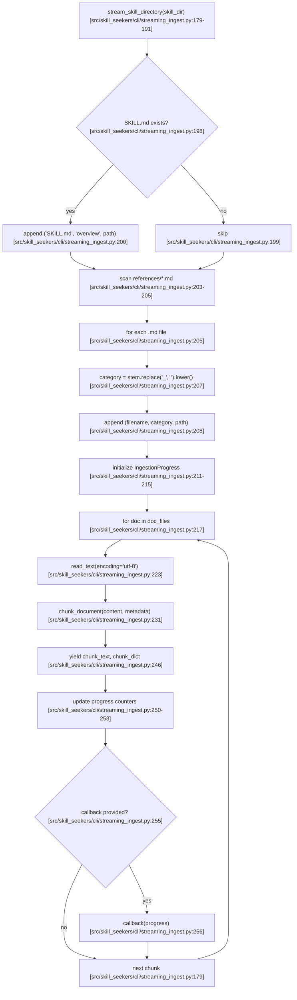

<!-- source: DeepWiki mcp.deepwiki.com · repo yusufkaraaslan/Skill_Seekers · page 13.5 Streaming Ingestion · fetched 2026-10-26 -->

# Streaming Ingestion

<details>
<summary>Relevant source files</summary>

The following files were used as context for generating this wiki page:

- [src/skill_seekers/cli/adaptors/markdown.py](src/skill_seekers/cli/adaptors/markdown.py)
- [src/skill_seekers/cli/adaptors/streaming_adaptor.py](src/skill_seekers/cli/adaptors/streaming_adaptor.py)
- [src/skill_seekers/cli/parsers/stream_parser.py](src/skill_seekers/cli/parsers/stream_parser.py)
- [src/skill_seekers/cli/rag_chunker.py](src/skill_seekers/cli/rag_chunker.py)
- [src/skill_seekers/cli/streaming_ingest.py](src/skill_seekers/cli/streaming_ingest.py)
- [tests/test_adaptors/test_markdown_adaptor.py](tests/test_adaptors/test_markdown_adaptor.py)
- [tests/test_cli_refactor_e2e.py](tests/test_cli_refactor_e2e.py)
- [tests/test_streaming_ingestion.py](tests/test_streaming_ingestion.py)

</details>


This page documents the streaming ingestion subsystem: its data classes, chunking logic, progress tracking, batch iteration, checkpoint/resume capability, and the `StreamingAdaptorMixin` (`src/skill_seekers/cli/adaptors/streaming_adaptor.py`) that integrates streaming into platform adaptors.

For the standard (non-streaming) packaging pipeline, see [Skill Packaging & Distribution](). For incremental update detection and cloud storage, see [Incremental Updates & Cloud Storage](). For the chunking used specifically during vector database export, see [Chunking & Vector Database Export]().

Sources: [src/skill_seekers/cli/streaming_ingest.py:1-15](), [src/skill_seekers/cli/adaptors/streaming_adaptor.py:1-15]()

---

## Purpose

Standard packaging loads an entire skill directory into memory at once. For large documentation sets (>100 documents or >10 MB of text), this is impractical. The streaming ingestion subsystem (`src/skill_seekers/cli/streaming_ingest.py`) provides:

- **Character-level chunking** with configurable size and overlap [src/skill_seekers/cli/streaming_ingest.py:103-109]() via `StreamingIngester.chunk_document()`
- **Lazy iteration** over the skill directory — one file at a time [src/skill_seekers/cli/streaming_ingest.py:179-191]() via `StreamingIngester.stream_skill_directory()`
- **Batch grouping** of chunks for downstream bulk processing via `StreamingIngester.batch_iterator()`
- **Real-time progress tracking** with ETA estimation [src/skill_seekers/cli/streaming_ingest.py:31-71]() via `IngestionProgress`
- **Checkpoint/resume** capability to survive interrupted runs via `StreamingIngester.save_checkpoint()` and `StreamingIngester.load_checkpoint()`
- **Platform-specific format conversion** via `StreamingAdaptorMixin.package_streaming()` [src/skill_seekers/cli/adaptors/streaming_adaptor.py:29-117]()

Sources: [src/skill_seekers/cli/streaming_ingest.py:3-10](), [src/skill_seekers/cli/adaptors/streaming_adaptor.py:17-27]()

---

## Core Data Classes

Both core data classes are defined in `src/skill_seekers/cli/streaming_ingest.py`.

### `ChunkMetadata`

Carries position and provenance information for a single text chunk.

| Field | Type | Description |
|---|---|---|
| `chunk_id` | `str` | MD5 hex digest identifying this chunk deterministically [src/skill_seekers/cli/streaming_ingest.py:172-177]() generated by `StreamingIngester._generate_chunk_id()` |
| `source` | `str` | Skill directory name [src/skill_seekers/cli/streaming_ingest.py:22]() |
| `category` | `str` | Derived from filename stem (e.g., `"overview"`) [src/skill_seekers/cli/streaming_ingest.py:23]() |
| `file` | `str` | Original filename (e.g., `"SKILL.md"`) [src/skill_seekers/cli/streaming_ingest.py:24]() |
| `chunk_index` | `int` | 0-based position of this chunk within its document [src/skill_seekers/cli/streaming_ingest.py:25]() |
| `total_chunks` | `int` | Total number of chunks the document was split into [src/skill_seekers/cli/streaming_ingest.py:26]() |
| `char_start` | `int` | Start character offset in the source document [src/skill_seekers/cli/streaming_ingest.py:27]() |
| `char_end` | `int` | End character offset in the source document [src/skill_seekers/cli/streaming_ingest.py:28]() |

### `IngestionProgress`

Tracks the state of an in-progress streaming run.

| Field / Property | Type | Description |
|---|---|---|
| `total_documents` | `int` | Number of markdown files discovered [src/skill_seekers/cli/streaming_ingest.py:35]() |
| `processed_documents` | `int` | Documents fully chunked so far [src/skill_seekers/cli/streaming_ingest.py:36]() |
| `total_chunks` | `int` | Running total chunks emitted [src/skill_seekers/cli/streaming_ingest.py:37]() |
| `processed_chunks` | `int` | Chunks yielded to the caller [src/skill_seekers/cli/streaming_ingest.py:38]() |
| `failed_chunks` | `int` | Files that raised exceptions [src/skill_seekers/cli/streaming_ingest.py:39]() |
| `bytes_processed` | `int` | UTF-8 bytes emitted [src/skill_seekers/cli/streaming_ingest.py:40]() |
| `start_time` | `float` | `time.time()` at initialization [src/skill_seekers/cli/streaming_ingest.py:41]() |
| `progress_percent` | property | `processed_chunks / total_chunks × 100` [src/skill_seekers/cli/streaming_ingest.py:43-48]() |
| `elapsed_time` | property | Seconds since `start_time` [src/skill_seekers/cli/streaming_ingest.py:50-53]() |
| `chunks_per_second` | property | Throughput rate [src/skill_seekers/cli/streaming_ingest.py:55-61]() |
| `eta_seconds` | property | Remaining time estimate [src/skill_seekers/cli/streaming_ingest.py:63-70]() |

Sources: [src/skill_seekers/cli/streaming_ingest.py:17-71]()

---

## `StreamingIngester`

The central class for all streaming operations, implemented in `src/skill_seekers/cli/streaming_ingest.py` [src/skill_seekers/cli/streaming_ingest.py:73-79]().

**Constructor parameters:**

| Parameter | Default | Description |
|---|---|---|
| `chunk_size` | `4000` | Max characters per chunk [src/skill_seekers/cli/streaming_ingest.py:92]() |
| `chunk_overlap` | `200` | Characters shared between adjacent chunks [src/skill_seekers/cli/streaming_ingest.py:93]() |
| `batch_size` | `100` | Default chunks per batch [src/skill_seekers/cli/streaming_ingest.py:94]() |
| `max_memory_mb` | `500` | Advisory memory ceiling [src/skill_seekers/cli/streaming_ingest.py:95]() |

### Class Architecture & Code Mapping

Below is a class diagram mapping natural language component names to their concrete code entities in `src/skill_seekers/cli/streaming_ingest.py` and `src/skill_seekers/cli/adaptors/streaming_adaptor.py`.

```mermaid
classDiagram
    class "StreamingIngester" {
        +int chunk_size
        +int chunk_overlap
        +int batch_size
        +int max_memory_mb
        +IngestionProgress progress
        +chunk_document(content, metadata, chunk_size, chunk_overlap) Iterator
        +stream_skill_directory(skill_dir, callback) Iterator
        +batch_iterator(chunks, batch_size) Iterator
        +save_checkpoint(checkpoint_path, state) None
        +load_checkpoint(checkpoint_path) dict
        -_generate_chunk_id(content, metadata, chunk_index) str
    }

    class "ChunkMetadata" {
        +str chunk_id
        +str source
        +str category
        +str file
        +int chunk_index
        +int total_chunks
        +int char_start
        +int char_end
    }

    class "IngestionProgress" {
        +int total_documents
        +int processed_documents
        +int total_chunks
        +int processed_chunks
        +int failed_chunks
        +int bytes_processed
        +float start_time
        +float progress_percent
        +float elapsed_time
        +float chunks_per_second
        +float eta_seconds
    }

    class "StreamingAdaptorMixin" {
        +package_streaming(skill_dir, output_path, chunk_size, chunk_overlap, batch_size, progress_callback) Path
        +estimate_chunks(skill_dir, chunk_size, chunk_overlap) dict
        -_convert_chunks_to_platform_format(chunks, skill_name) dict
    }

    "StreamingIngester" --> "ChunkMetadata" : "yields [src/skill_seekers/cli/streaming_ingest.py:103-170]"
    "StreamingIngester" --> "IngestionProgress" : "tracks [src/skill_seekers/cli/streaming_ingest.py:211-215]"
    "StreamingAdaptorMixin" --> "StreamingIngester" : "instantiates [src/skill_seekers/cli/adaptors/streaming_adaptor.py:59-61]"
```

Sources: [src/skill_seekers/cli/streaming_ingest.py:17-102](), [src/skill_seekers/cli/adaptors/streaming_adaptor.py:17-61]()

---

### `chunk_document`

[src/skill_seekers/cli/streaming_ingest.py:103-170]()

Splits a string into overlapping character windows and yields `(chunk_text, ChunkMetadata)` tuples.

**Algorithm:**

- If `len(content) <= chunk_size`: yields a single chunk (index 0, total 1) [src/skill_seekers/cli/streaming_ingest.py:125-138]().
- Otherwise, computes `effective_chunk_size = chunk_size - chunk_overlap` [src/skill_seekers/cli/streaming_ingest.py:141]() and iterates:
  - `start = i * effective_chunk_size` [src/skill_seekers/cli/streaming_ingest.py:146]()
  - `end = start + chunk_size` (clamped to `len(content)`) [src/skill_seekers/cli/streaming_ingest.py:147-151]()
- Skips whitespace-only chunks [src/skill_seekers/cli/streaming_ingest.py:156-157]().
- Calls `_generate_chunk_id()` to produce an MD5 over `source`, `file`, `chunk_index`, and the first 50 characters of the chunk [src/skill_seekers/cli/streaming_ingest.py:172-177]() to ensure a deterministic `chunk_id`.

**Chunking Window Overlap Structure:**


Sources: [src/skill_seekers/cli/streaming_ingest.py:103-177]()

---

### `stream_skill_directory`

[src/skill_seekers/cli/streaming_ingest.py:179-271]()

Discovers and streams all documents from a skill directory in a fixed order:

1. `SKILL.md` (category: `"overview"`) [src/skill_seekers/cli/streaming_ingest.py:198-201]()
2. All `*.md` files under `references/` (category derived from filename stem, underscores replaced with spaces) [src/skill_seekers/cli/streaming_ingest.py:203-208]()

Hidden files (names starting with `.`) are skipped [src/skill_seekers/cli/streaming_ingest.py:206](). Each file is read once, chunked lazily via `chunk_document()`, and the progress counters updated per chunk. An optional `callback(progress: IngestionProgress)` is invoked after each chunk [src/skill_seekers/cli/streaming_ingest.py:255-256]().

**Document Discovery and Streaming Pipeline:**



Sources: [src/skill_seekers/cli/streaming_ingest.py:179-271]()

---

### `batch_iterator`

[src/skill_seekers/cli/streaming_ingest.py:273-298]()

Wraps any `Iterator[tuple[str, dict]]` into batches of `batch_size` items. The final batch may be smaller than `batch_size` [src/skill_seekers/cli/streaming_ingest.py:295-298]().

```python
# Usage pattern in batch processing
for batch in ingester.batch_iterator(chunks, batch_size=50):
    # batch: list[tuple[str, dict]], len <= 50
    upload_batch(batch)
```

Sources: [src/skill_seekers/cli/streaming_ingest.py:273-298]()

---

### Checkpoint / Resume

`save_checkpoint(checkpoint_path, state)` writes a JSON file containing a timestamp, current progress, and caller-provided state [src/skill_seekers/cli/streaming_ingest.py:317-331]().

`load_checkpoint(checkpoint_path)` returns only the `"state"` dict, or `None` if the file is missing or corrupt [src/skill_seekers/cli/streaming_ingest.py:333-346]().

Sources: [src/skill_seekers/cli/streaming_ingest.py:300-346]()

---

## `StreamingAdaptorMixin`

[src/skill_seekers/cli/adaptors/streaming_adaptor.py:17-27]()

A mixin class that adds streaming packaging capabilities to platform adaptors. It provides memory-efficient processing and progress tracking for large documentation sets.

**Adaptor Integration Architecture:**

```mermaid
classDiagram
    class "StreamingAdaptorMixin" {
        +package_streaming(skill_dir, output_path, chunk_size, chunk_overlap, batch_size, progress_callback) Path
        +estimate_chunks(skill_dir, chunk_size, chunk_overlap) dict
        -_convert_chunks_to_platform_format(chunks, skill_name) dict
    }

    class "StreamingIngester" {
        +stream_skill_directory(skill_dir, callback) Iterator
        +chunk_document(content, metadata) Iterator
    }

    class "SkillAdaptor" {
        <<abstract>>
        +package()
    }

    "StreamingAdaptorMixin" --> "StreamingIngester" : "instantiates [src/skill_seekers/cli/adaptors/streaming_adaptor.py:59-61]"
    "StreamingAdaptorMixin" --|> "SkillAdaptor" : "mixes into"
```

Sources: [src/skill_seekers/cli/adaptors/streaming_adaptor.py:17-121]()

---

### `package_streaming`

[src/skill_seekers/cli/adaptors/streaming_adaptor.py:29-117]()

The memory-efficient alternative to the standard `package()` method. It instantiates a `StreamingIngester` [src/skill_seekers/cli/adaptors/streaming_adaptor.py:59-61](), streams the directory, and converts the resulting chunks into platform-specific formats via `_convert_chunks_to_platform_format()` [src/skill_seekers/cli/adaptors/streaming_adaptor.py:97](). It outputs the final package as a JSON file [src/skill_seekers/cli/adaptors/streaming_adaptor.py:110-112]().

**When to use:** Recommended for large documentation sets exceeding 100 documents or 10MB of text [src/skill_seekers/cli/adaptors/streaming_adaptor.py:42]().

Sources: [src/skill_seekers/cli/adaptors/streaming_adaptor.py:29-117]()

---

### `estimate_chunks`

[src/skill_seekers/cli/adaptors/streaming_adaptor.py:168-230]()

Pre-flight check that scans `SKILL.md` and `references/*.md` without loading the full content into memory. It calculates `estimated_chunks` and provides statistics for planning and validation [src/skill_seekers/cli/adaptors/streaming_adaptor.py:182-191]().

Sources: [src/skill_seekers/cli/adaptors/streaming_adaptor.py:168-230]()

---

## Testing

Tests are located at `tests/test_streaming_ingestion.py` [tests/test_streaming_ingestion.py:1-231]() and cover:

| Test Case | What it validates |
|---|---|
| `test_chunk_document_single_chunk` | Documents ≤ `chunk_size` yield exactly one chunk [tests/test_streaming_ingestion.py:48-64]() |
| `test_chunk_document_multiple_chunks` | Adjacent chunk pairs have overlapping character ranges [tests/test_streaming_ingestion.py:66-85]() |
| `test_chunk_document_metadata` | `source`, `file`, `category`, and MD5 chunk ID are populated [tests/test_streaming_ingestion.py:87-103]() |
| `test_stream_skill_directory` | All files in the fixture are processed; progress counters match [tests/test_streaming_ingestion.py:105-133]() |
| `test_batch_iterator` | 25 chunks with `batch_size=10` → 3 batches (10, 10, 5) [tests/test_streaming_ingestion.py:135-149]() |
| `test_checkpoint_save_load` | Round-trip through `save_checkpoint`/`load_checkpoint` [tests/test_streaming_ingestion.py:178-206]() |

Sources: [tests/test_streaming_ingestion.py:1-231]()

---

