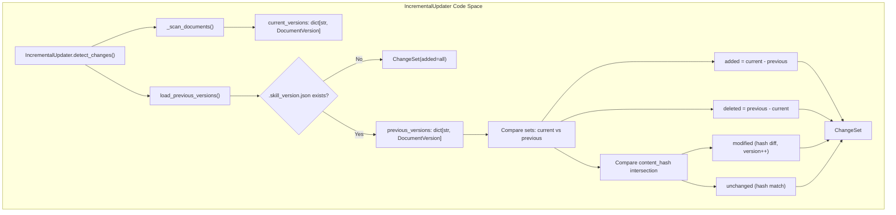
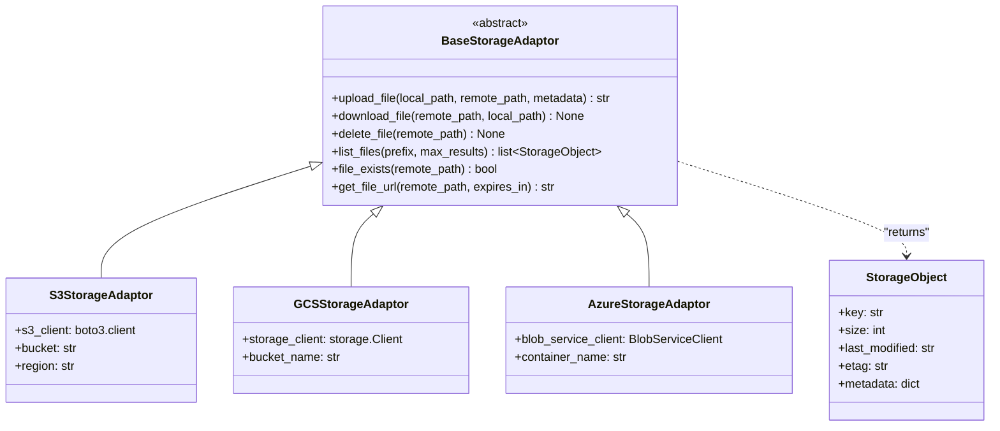
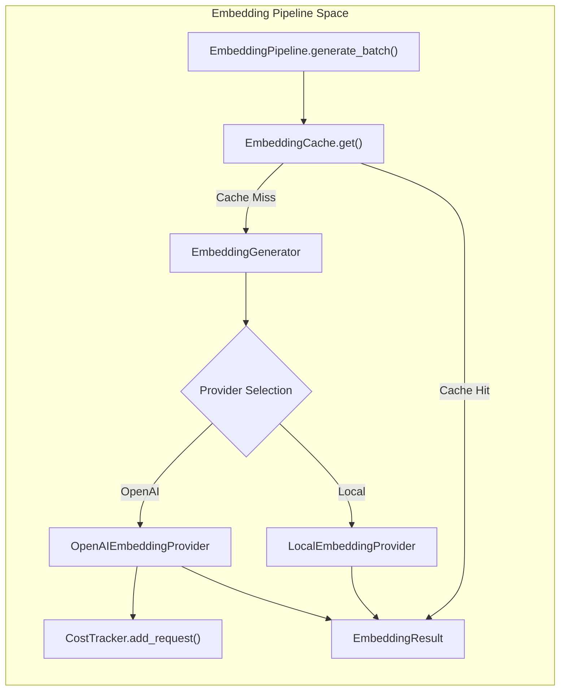
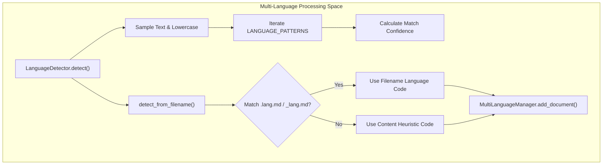

<!-- source: DeepWiki mcp.deepwiki.com · repo yusufkaraaslan/Skill_Seekers · page 13.6 Incremental Updates & Cloud Storage · fetched 2026-10-26 -->

# Incremental Updates & Cloud Storage

Relevant source files

The following files were used as context for generating this wiki page:

- [src/skill_seekers/cli/embedding_pipeline.py](src/skill_seekers/cli/embedding_pipeline.py)
- [src/skill_seekers/cli/incremental_updater.py](src/skill_seekers/cli/incremental_updater.py)
- [src/skill_seekers/cli/multilang_support.py](src/skill_seekers/cli/multilang_support.py)
- [src/skill_seekers/cli/storage/azure_storage.py](src/skill_seekers/cli/storage/azure_storage.py)
- [src/skill_seekers/cli/storage/gcs_storage.py](src/skill_seekers/cli/storage/gcs_storage.py)
- [src/skill_seekers/cli/storage/s3_storage.py](src/skill_seekers/cli/storage/s3_storage.py)
- [src/skill_seekers/embedding/generator.py](src/skill_seekers/embedding/generator.py)
- [tests/test_cloud_storage.py](tests/test_cloud_storage.py)
- [tests/test_embedding.py](tests/test_embedding.py)
- [tests/test_embedding_pipeline.py](tests/test_embedding_pipeline.py)
- [tests/test_incremental_updates.py](tests/test_incremental_updates.py)
- [tests/test_multilang_support.py](tests/test_multilang_support.py)
- [tests/test_pattern_recognizer.py](tests/test_pattern_recognizer.py)
- [tests/test_server_fastmcp_http.py](tests/test_server_fastmcp_http.py)

## Purpose & Scope

This leaf page documents three advanced operational subsystems of `skill-seekers`: the **Incremental Update System** (`IncrementalUpdater`, `ChangeSet`, `DocumentVersion`) for partial skill updates [src/skill_seekers/cli/incremental_updater.py:1-64](), the **Cloud Storage Adaptors** (`S3StorageAdaptor`, `GCSStorageAdaptor`, `AzureStorageAdaptor`) for remote skill distribution [src/skill_seekers/cli/storage/s3_storage.py:19-54](), [src/skill_seekers/cli/storage/gcs_storage.py:20-50](), and the **Embedding Pipeline** (`EmbeddingPipeline`, `EmbeddingGenerator`, `EmbeddingCache`) for vectorization [src/skill_seekers/cli/embedding_pipeline.py:3-43](). Additionally, it covers **Multi-Language Support** (`LanguageDetector`, `MultiLanguageManager`) for localized documentation [src/skill_seekers/cli/multilang_support.py:3-35]().

---

## 1. Incremental Updates System

The incremental update subsystem avoids costly full skill rebuilds by tracking per-file cryptographic content hashes and generating delta packages containing strictly modified, added, or deleted files [src/skill_seekers/cli/incremental_updater.py:3-7].

### Data Structures

The state machine relies on three core dataclasses defined in `src/skill_seekers/cli/incremental_updater.py`:

| Dataclass | Code Entity | Fields & Purpose |
|---|---|---|
| `DocumentVersion` | `src/skill_seekers/cli/incremental_updater.py:17-25` | Tracks `file_path`, `content_hash` (SHA-256), `size_bytes`, `last_modified` timestamp, and integer `version`. |
| `ChangeSet` | `src/skill_seekers/cli/incremental_updater.py:27-45` | Groups lists of `added`, `modified`, `deleted`, and `unchanged` file descriptors. Exposes `has_changes` and `total_changes` properties. |
| `UpdateMetadata` | `src/skill_seekers/cli/incremental_updater.py:48-56` | Captures `timestamp`, `previous_version`, `new_version`, `change_summary`, and `total_documents`. |

Sources: [src/skill_seekers/cli/incremental_updater.py:17-56]()

### IncrementalUpdater Implementation

`IncrementalUpdater` scans the skill directory (`SKILL.md` and `references/*.md`), computes SHA-256 hashes in 8 KB chunks via `_compute_file_hash()`, and compares the state against `.skill_version.json` [src/skill_seekers/cli/incremental_updater.py:66-134]().

*Figure 1: Incremental change detection data flow bridging natural language workflow requirements to `IncrementalUpdater` execution methods [src/skill_seekers/cli/incremental_updater.py:100-217]().*

Sources: [src/skill_seekers/cli/incremental_updater.py:58-217](), [tests/test_incremental_updates.py:47-177]()

---

## 2. Cloud Storage Adaptors

The storage module at `src/skill_seekers/cli/storage/` provides a provider-agnostic interface (`BaseStorageAdaptor`) for pushing, pulling, and listing skill packages across cloud object stores.

### Adaptor Hierarchy

*Figure 2: Cloud storage adaptor class hierarchy mapped to concrete SDK clients.*

Sources: [src/skill_seekers/cli/storage/s3_storage.py:19-90](), [src/skill_seekers/cli/storage/gcs_storage.py:20-82](), [tests/test_cloud_storage.py:11-18]()

### Provider Details & Factory

The factory function `get_storage_adaptor(provider, **kwargs)` instantiates the appropriate subclass based on the provider identifier [tests/test_cloud_storage.py:48-82]():

- **S3 (`S3StorageAdaptor`)**: Requires `boto3` and `bucket`. Supports AWS as well as S3-compatible endpoints (MinIO, DigitalOcean Spaces) via `endpoint_url` [src/skill_seekers/cli/storage/s3_storage.py:19-72]().
- **GCS (`GCSStorageAdaptor`)**: Requires `google-cloud-storage` and `bucket`. Integrates with `GOOGLE_APPLICATION_CREDENTIALS` [src/skill_seekers/cli/storage/gcs_storage.py:20-70]().
- **Azure (`AzureStorageAdaptor`)**: Requires `azure-storage-blob`, `container`, and connection strings.

Sources: [tests/test_cloud_storage.py:48-82](), [src/skill_seekers/cli/storage/s3_storage.py:19-114](), [src/skill_seekers/cli/storage/gcs_storage.py:20-101]()

---

## 3. Embedding Pipeline & Server

The embedding pipeline (`EmbeddingPipeline`) manages batch generation of vector representations across local models and remote APIs (OpenAI, Voyage AI) while minimizing costs via `EmbeddingCache` and `CostTracker` [src/skill_seekers/cli/embedding_pipeline.py:3-77]().

### Pipeline Architecture

*Figure 3: Data flow through `EmbeddingPipeline`, `EmbeddingCache`, and providers.*

Sources: [src/skill_seekers/cli/embedding_pipeline.py:20-182](), [src/skill_seekers/embedding/generator.py:131-163]()

### Key Components

- **`EmbeddingConfig`**: Defines `provider`, `model`, `dimension`, `batch_size`, and `cache_dir` [src/skill_seekers/cli/embedding_pipeline.py:20-30]().
- **`EmbeddingCache`**: Implements memory and disk-based SHA-256 caching (`{model}:{text}`) to prevent redundant computation [src/skill_seekers/cli/embedding_pipeline.py:183-215]().
- **`CostTracker`**: Accumulates `total_tokens` and computes `estimated_cost` dynamically [src/skill_seekers/cli/embedding_pipeline.py:45-77]().

Sources: [src/skill_seekers/cli/embedding_pipeline.py:20-230](), [tests/test_embedding_pipeline.py:33-150]()

---

## 4. Multi-Language Documentation Support

`multilang_support.py` provides heuristics for detecting document languages and organizing multi-language documentation repositories [src/skill_seekers/cli/multilang_support.py:3-15]().

### LanguageDetector

`LanguageDetector` evaluates text samples against `LANGUAGE_PATTERNS` (regex for frequent terms across 11 languages such as English, Spanish, French, German, Chinese, and Arabic) and checks filename suffixes (`.en.md`, `_es.md`, `-fr.md`) [src/skill_seekers/cli/multilang_support.py:36-191]().

*Figure 4: Language detection and document grouping pipeline in `LanguageDetector` and `MultiLanguageManager`.*

Sources: [src/skill_seekers/cli/multilang_support.py:36-191](), [src/skill_seekers/cli/multilang_support.py:194-226]()

- **`LanguageInfo`**: Dataclass holding `code`, `name`, `confidence`, and `script` [src/skill_seekers/cli/multilang_support.py:15-23]().
- **`MultiLanguageManager`**: Aggregates documents by language code and calculates translation completeness via `get_translation_status()` [src/skill_seekers/cli/multilang_support.py:194-206](), [src/skill_seekers/cli/multilang_support.py:185-200]().

Sources: [src/skill_seekers/cli/multilang_support.py:15-377](), [tests/test_multilang_support.py:25-215]()

---

