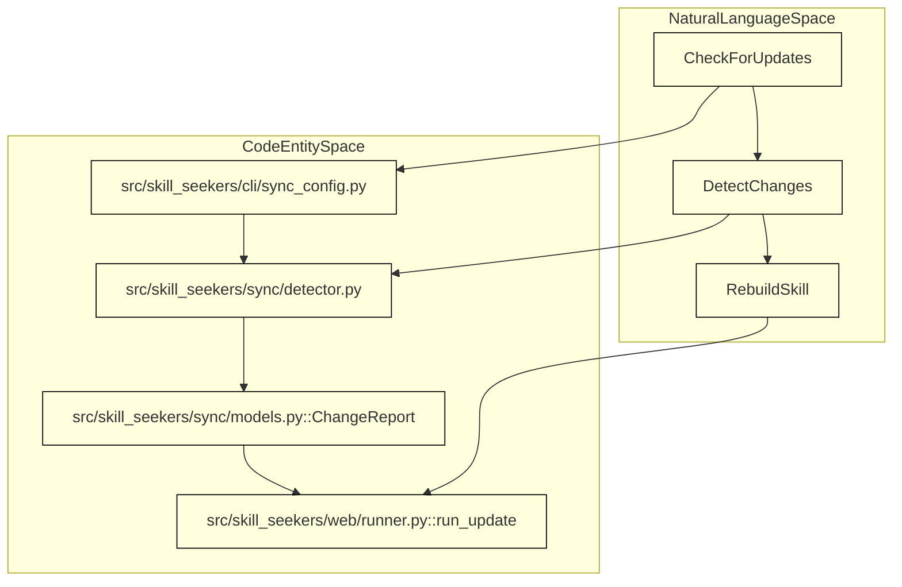
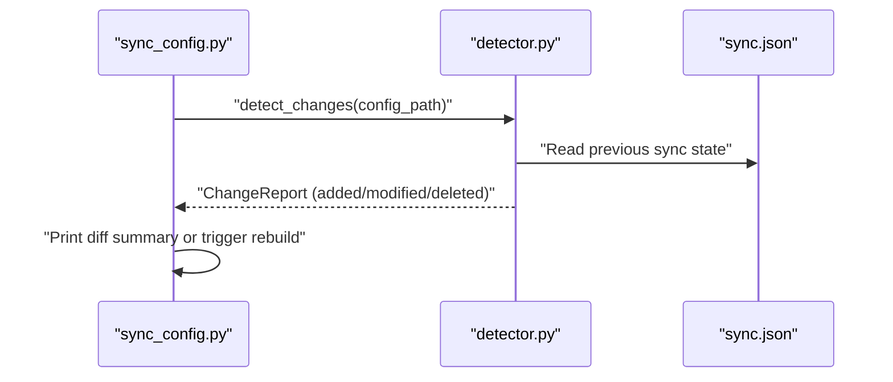
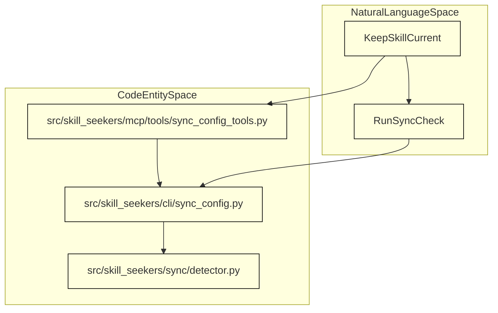

<!-- source: DeepWiki mcp.deepwiki.com · repo yusufkaraaslan/Skill_Seekers · page 13.7 Sync & Documentation Change Monitoring · fetched 2026-10-26 -->

# Sync & Documentation Change Monitoring

Relevant source files

The following files were used as context for generating this wiki page:

- [src/skill_seekers/cli/arguments/sync_config.py](src/skill_seekers/cli/arguments/sync_config.py)
- [src/skill_seekers/cli/parsers/sync_config_parser.py](src/skill_seekers/cli/parsers/sync_config_parser.py)
- [src/skill_seekers/cli/sync_config.py](src/skill_seekers/cli/sync_config.py)
- [src/skill_seekers/mcp/tools/_common.py](src/skill_seekers/mcp/tools/_common.py)
- [src/skill_seekers/mcp/tools/config_tools.py](src/skill_seekers/mcp/tools/config_tools.py)
- [src/skill_seekers/mcp/tools/marketplace_tools.py](src/skill_seekers/mcp/tools/marketplace_tools.py)
- [src/skill_seekers/mcp/tools/packaging_tools.py](src/skill_seekers/mcp/tools/packaging_tools.py)
- [src/skill_seekers/mcp/tools/splitting_tools.py](src/skill_seekers/mcp/tools/splitting_tools.py)
- [src/skill_seekers/mcp/tools/sync_config_tools.py](src/skill_seekers/mcp/tools/sync_config_tools.py)
- [src/skill_seekers/mcp/tools/vector_db_tools.py](src/skill_seekers/mcp/tools/vector_db_tools.py)
- [src/skill_seekers/web/analysis_store.py](src/skill_seekers/web/analysis_store.py)
- [src/skill_seekers/web/routes/configs.py](src/skill_seekers/web/routes/configs.py)
- [src/skill_seekers/web/routes/environment.py](src/skill_seekers/web/routes/environment.py)
- [src/skill_seekers/web/routes/skill_detail.py](src/skill_seekers/web/routes/skill_detail.py)
- [src/skill_seekers/web/runner.py](src/skill_seekers/web/runner.py)
- [tests/test_mcp_tools_common.py](tests/test_mcp_tools_common.py)
- [tests/test_sync_config.py](tests/test_sync_config.py)
- [tests/test_web_configs.py](tests/test_web_configs.py)
- [tests/test_web_environment.py](tests/test_web_environment.py)
- [tests/test_web_runner_jobs.py](tests/test_web_runner_jobs.py)
- [tests/test_web_skill_detail.py](tests/test_web_skill_detail.py)

## Purpose and Scope

This page documents the sync and documentation change monitoring subsystem within **Skill Seekers**. This subsystem tracks upstream changes in documentation sites, repositories, and local configurations, evaluates page content hashes, records state transitions, and automates skill updates via the CLI, the Seeker HUD web backend, Model Context Protocol (MCP) tools, and background job runners.

---

## 1. Sync Architecture and the `src/skill_seekers/sync` Package

The core change monitoring logic resides in the `src/skill_seekers/sync` package. It maintains synchronization state files (typically named `<name>_sync.json` or stored under `~/.skill-seekers/sync/`) to record metadata, historical content hashes, and change sets between scraping runs [src/skill_seekers/web/routes/configs.py:76-84] [tests/test_web_configs.py:169-188].

### Core Components
* **Page Hashing & State Tracking**: Computes cryptographic hashes of scraped documentation pages or source structures to detect upstream modifications without full re-scraping.
* **Change Reports**: Encapsulates modified, added, or deleted pages into structured `ChangeReport` models [tests/test_web_configs.py:169-188].
* **Integration Points**: Powers both manual check actions and automated interval-based background sync tasks.

Sources: `src/skill_seekers/web/routes/configs.py:76-84`, `tests/test_web_configs.py:169-188`

---

## 2. CLI Command and Parsers

The synchronization features are exposed via the unified CLI dispatcher (`main.py`) using dedicated modules under `src/skill_seekers/cli/sync_config.py`, backed by argument definitions and parsers (`src/skill_seekers/cli/parsers/sync_config_parser.py`, `src/skill_seekers/cli/arguments/sync_config.py`).

### Supported CLI Operations
* Checking current skill/config sync status against live URLs or repositories.
* Forcing incremental updates or full regenerations upon detected drift.
* Managing persistence intervals (`hourly`, `daily`, `weekly`, `manual`) [src/skill_seekers/web/routes/configs.py:73].

Sources: `src/skill_seekers/web/routes/configs.py:59-74`, `tests/test_web_configs.py:137-158`

---

## 3. Web UI & Background Job Integration

The Seeker HUD web interface exposes configuration sync controls and sync-check job runners via `src/skill_seekers/web/routes/configs.py` and `src/skill_seekers/web/runner.py`.

### Lifecycle and State Routes
* **Sync Settings Persistence**: Endpoints allow updating interval preferences (`enabled`, `interval`, `auto_rebuild`) stored in UI state files [src/skill_seekers/web/routes/configs.py:59-63] [tests/test_web_configs.py:137-158].
* **Sync-Check Job Execution**: Submits background jobs dispatched via `runner.py` to evaluate changes asynchronously without blocking the FastAPI event loop [tests/test_web_configs.py:169-195].

Sources: `src/skill_seekers/web/routes/configs.py:59-93`, `tests/test_web_configs.py:137-195`

---

## 4. MCP Tools Reference (`sync_config_tools.py`)

AI coding agents leverage MCP tools defined in `src/skill_seekers/mcp/tools/sync_config_tools.py` to inspect and maintain skill freshness autonomously.

### Key MCP Capabilities
* **`sync_config_tool`**: Evaluates registered configurations for upstream drift.
* **Automated Triggering**: Enables agents to decide whether to invoke rebuilding workflows based on detected documentation updates.

Sources: `src/skill_seekers/mcp/tools/sync_config_tools.py`

---

