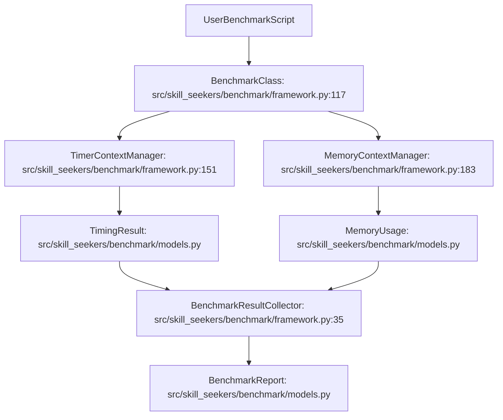
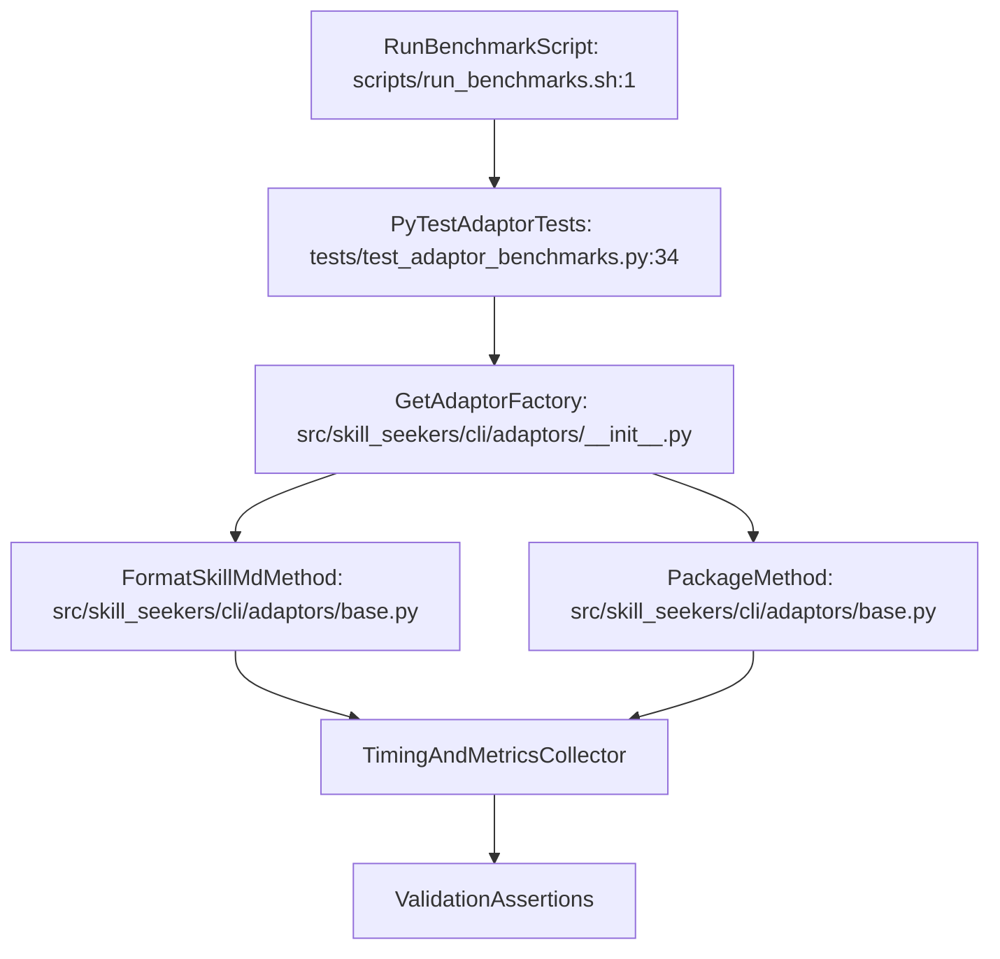

<!-- source: DeepWiki mcp.deepwiki.com · repo yusufkaraaslan/Skill_Seekers · page 13.8 Benchmarking · fetched 2026-10-26 -->

# Benchmarking

<details>
<summary>Relevant source files</summary>

The following files were used as context for generating this wiki page:

- [scripts/run_benchmarks.sh](scripts/run_benchmarks.sh)
- [src/skill_seekers/benchmark/framework.py](src/skill_seekers/benchmark/framework.py)
- [src/skill_seekers/cli/adaptors/atlas.py](src/skill_seekers/cli/adaptors/atlas.py)
- [tests/fixtures/generate_fixtures.py](tests/fixtures/generate_fixtures.py)
- [tests/test_adaptor_benchmarks.py](tests/test_adaptor_benchmarks.py)
- [tests/test_adaptors/test_openai_compatible_shared.py](tests/test_adaptors/test_openai_compatible_shared.py)
- [tests/test_architectural_pattern_detector.py](tests/test_architectural_pattern_detector.py)
- [tests/test_benchmark.py](tests/test_benchmark.py)
- [tests/test_docker_smoke.py](tests/test_docker_smoke.py)
- [tests/test_embedding_server.py](tests/test_embedding_server.py)
- [tests/test_encoding.py](tests/test_encoding.py)

</details>


## Purpose and Scope
The benchmarking subsystem provides systematic measurement of performance, execution time, peak memory usage, and scaling behavior across Skill Seekers core operations and platform adaptors. Located primarily in `src/skill_seekers/benchmark/framework.py` [src/skill_seekers/benchmark/framework.py:1-16]() and tested via `tests/test_adaptor_benchmarks.py` [tests/test_adaptor_benchmarks.py:1-432](), this framework ensures that adaptor formatting, skill packaging, and large-scale rendering operations operate within strict latency (<500ms formatting, <1s packaging) and memory thresholds. Execution is automated through the runner script at `scripts/run_benchmarks.sh` [scripts/run_benchmarks.sh:1-72]().

Sources: `src/skill_seekers/benchmark/framework.py:1-16()`, `tests/test_adaptor_benchmarks.py:1-35()`, `scripts/run_benchmarks.sh:1-15()`

---

## 1. Core Benchmarking Framework
The benchmarking framework provides context managers, decorators, and result collectors to profile Python functions for timing and true memory consumption.

### The `BenchmarkResult` Class
`BenchmarkResult` [src/skill_seekers/benchmark/framework.py:35-115]() aggregates timing intervals, memory tracking blocks, custom metrics, and host system information during a benchmark session. It manages timestamps via `datetime.utcnow()` and computes final durations upon report generation (`to_report()`).

### The `Benchmark` Class and Context Managers
The `Benchmark` class [src/skill_seekers/benchmark/framework.py:117-234]() exposes clean context managers for timing and memory profiling:
* `timer(operation, iterations)`: Measures execution duration using `time.perf_counter()` [src/skill_seekers/benchmark/framework.py:151-181]().
* `memory(operation)`: Spawns a background daemon sampling thread to track true peak Resident Set Size (RSS) memory consumption via `psutil.Process().memory_info().rss`, avoiding transient spike misses typical of single pre/post-execution snapshots [src/skill_seekers/benchmark/framework.py:183-234]().

Title: "Framework Component Architecture"

Sources: `src/skill_seekers/benchmark/framework.py:35-234()`

---

## 2. Adaptor Benchmark Suites
Performance benchmarks for platform adaptors are defined in `tests/test_adaptor_benchmarks.py` [tests/test_adaptor_benchmarks.py:1-432]() under the `TestAdaptorBenchmarks` test suite class [tests/test_adaptor_benchmarks.py:34-36](). This suite exercises 11 distinct platform and RAG adaptors (Claude, Gemini, OpenAI, Markdown, LangChain, LlamaIndex, Haystack, Weaviate, Chroma, FAISS, Qdrant) [tests/test_adaptor_benchmarks.py:86-100]().

Key test benchmarks include:
* `test_benchmark_format_skill_md_all_adaptors` [tests/test_adaptor_benchmarks.py:76-140](): Measures execution latency of `format_skill_md()` across all registered adaptors over 5 iterations with a 10-reference test skill. Asserts average execution time remains below 500ms.
* `test_benchmark_package_operations` [tests/test_adaptor_benchmarks.py:141-187](): Evaluates complete archive packaging (`package()`), validating that zip file generation completes in under 1 second and file size stays under 1 MB for standard inputs.
* `test_benchmark_scaling_with_reference_count` [tests/test_adaptor_benchmarks.py:188-204+](): Assesses linear scaling behavior by varying reference file counts from 1 to 50.

Title: "Adaptor Benchmark Execution Flow"

Sources: `tests/test_adaptor_benchmarks.py:34-204()`

---

## 3. Benchmark Execution & Automation
Performance benchmarks are executed via the shell script runner located at `scripts/run_benchmarks.sh` [scripts/run_benchmarks.sh:1-72](). 

### Execution Lifecycle
1. **Root Verification**: Ensures execution is initiated from the project root by checking for `pyproject.toml` [scripts/run_benchmarks.sh:21-24]().
2. **Dependency & Installation Check**: Verifies `skill_seekers` is importable; if not, performs an editable install (`pip install -e .`) [scripts/run_benchmarks.sh:26-31]().
3. **Pytest Dispatch**: Runs pytest specifically against the adaptor benchmark suite with the custom marker `-m benchmark`:
   ```bash
   pytest tests/test_adaptor_benchmarks.py -v -m benchmark --tb=short -s
   ```
4. **Summary & Insights Reporting**: Prints execution status, timing stats, scaling trends, and compression ratio insights (e.g., ZIP compression ratios ~80-90x) [scripts/run_benchmarks.sh:37-63]().

Sources: `scripts/run_benchmarks.sh:1-73()`

---

