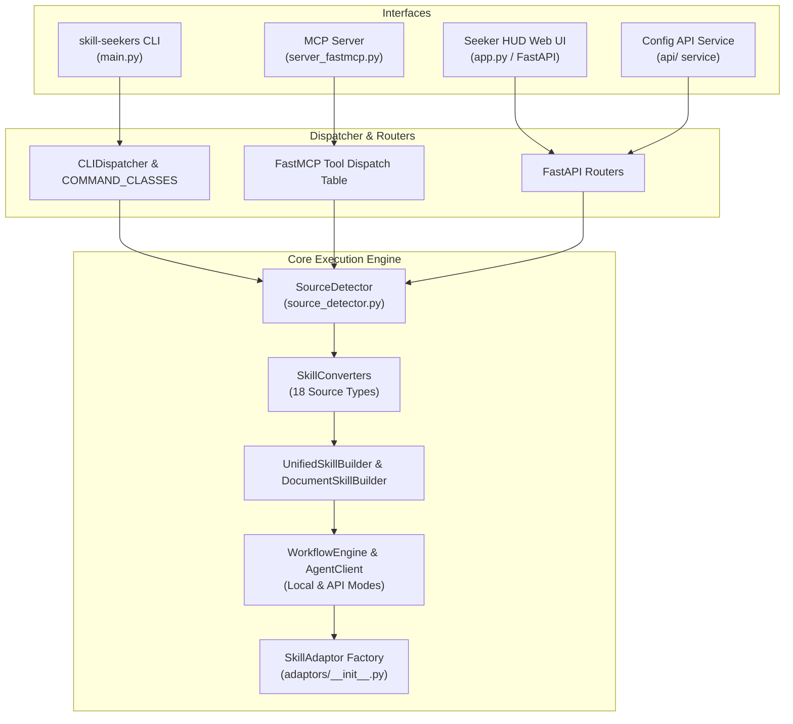
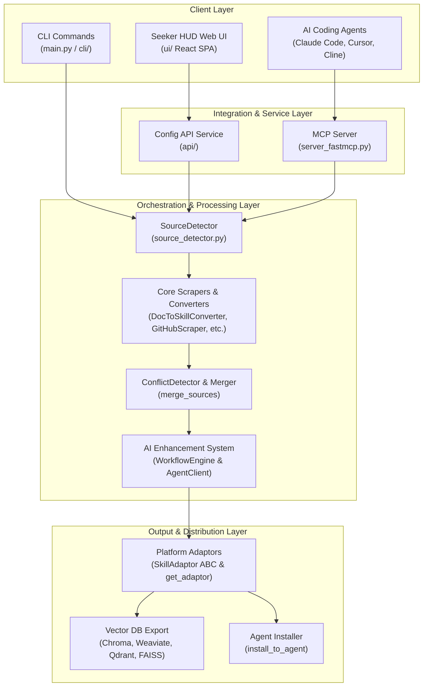
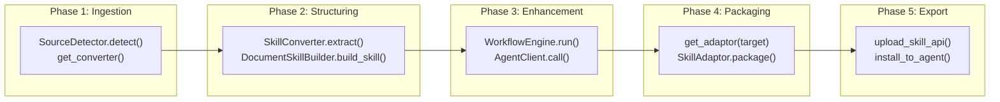

<!-- source: DeepWiki mcp.deepwiki.com · repo yusufkaraaslan/Skill_Seekers · page 14.1 System Architecture Overview · fetched 2026-10-26 -->

# System Architecture Overview

Relevant source files

The following files were used as context for generating this wiki page:

- [docs/ARCHITECTURE.md](docs/ARCHITECTURE.md)
- [docs/BEST_PRACTICES.md](docs/BEST_PRACTICES.md)
- [docs/UML/exports/01_cli_core.png](docs/UML/exports/01_cli_core.png)
- [docs/UML/exports/02_scrapers.png](docs/UML/exports/02_scrapers.png)
- [docs/UML/exports/09_parsers.png](docs/UML/exports/09_parsers.png)
- [docs/UML/exports/13_utilities.png](docs/UML/exports/13_utilities.png)
- [docs/UML/exports/14_create_pipeline_sequence.png](docs/UML/exports/14_create_pipeline_sequence.png)
- [docs/UML/exports/17_mcp_invocation_sequence.png](docs/UML/exports/17_mcp_invocation_sequence.png)
- [docs/UML/exports/19_runtime_components.png](docs/UML/exports/19_runtime_components.png)
- [docs/UML/exports/20_browser_rendering_sequence.png](docs/UML/exports/20_browser_rendering_sequence.png)
- [docs/UML/skill_seekers.mdj](docs/UML/skill_seekers.mdj)
- [docs/UML_ARCHITECTURE.md](docs/UML_ARCHITECTURE.md)
- [docs/VIDEO_GUIDE.md](docs/VIDEO_GUIDE.md)
- [docs/features/ENHANCEMENT_MODES.md](docs/features/ENHANCEMENT_MODES.md)
- [docs/reference/MCP_REFERENCE.md](docs/reference/MCP_REFERENCE.md)
- [docs/zh-CN/README.md](docs/zh-CN/README.md)
- [docs/zh-CN/user-guide/04-packaging.md](docs/zh-CN/user-guide/04-packaging.md)

## Purpose and Scope

This document provides a comprehensive deep-dive into the internal architecture of Skill Seekers, detailing its dual-interface design, core subsystem interactions, component hierarchy, five-phase execution workflow, platform adaptor strategy pattern, and StarUML design model exports located in `docs/UML/`. 

Skill Seekers is designed with a do-it-once and export-to-all-targets philosophy, ingesting documentation and code from 18 distinct source types and exporting them to 24+ target platforms, AI coding agents, and vector databases `[docs/UML_ARCHITECTURE.md:12]().`

---

## Dual-Interface Architecture

Skill Seekers exposes two primary interfaces that route requests into a shared, unified core execution pipeline: a Git-style Command-Line Interface (`main.py`) and a Model Context Protocol (MCP) server (`server_fastmcp.py`) `[docs/UML_ARCHITECTURE.md:19-26]().`

### System Entry Points & Dual Interface Flow

**Sources:** `[docs/UML_ARCHITECTURE.md:19-27](), [docs/reference/MCP_REFERENCE.md:44-79]()`

---

## Comprehensive Component Architecture

The architectural topology integrates the seven major subsystems: the CLI, Scrapers, MCP Server, Seeker HUD Web UI, Config API, Platform Adaptors, and the AI Enhancement System.

### Architectural Component Diagram

**Sources:** `[docs/UML_ARCHITECTURE.md:18-34](), [docs/reference/MCP_REFERENCE.md:64-79]()`

---

## Package Structure & Module Hierarchy

The codebase is organized into modular packages under `src/skill_seekers/`, separating command execution, parsing, converters, platform adaptors, and MCP services.

### Core and Utility Packages

| Package / Module | Responsibility | Key Classes / Functions |
| :--- | :--- | :--- |
| `cli/` | Git-style dispatcher and subcommand parsers | `CLIDispatcher`, `CreateCommand`, `SubcommandParser` `[docs/UML_ARCHITECTURE.md:41]()` |
| `scrapers/` | Ingestion engines across 18 source types | `SkillConverter`, `DocToSkillConverter`, `GitHubScraper` `[docs/UML_ARCHITECTURE.md:46]()` |
| `adaptors/` | Strategy pattern implementations for target export platforms | `SkillAdaptor`, `get_adaptor()`, `ADAPTORS` registry `[docs/UML_ARCHITECTURE.md:22]()` |
| `enhancement/` | AI improvement via local CLI agents and cloud APIs | `AgentClient`, `WorkflowEngine`, `LocalSkillEnhancer` `[docs/UML_ARCHITECTURE.md:24]()` |
| `mcp/` | FastMCP server implementation and tool integration | `server_fastmcp.py`, tool dispatch table `[docs/UML_ARCHITECTURE.md:26]()` |
| `web/` | FastAPI backend powering the Seeker HUD web UI | `app.py`, `runner.py`, background `JobManager` |
| `analysis/` | C3.x codebase analysis and pattern recognition | `PatternRecognizer`, `DependencyAnalyzer` `[docs/UML_ARCHITECTURE.md:23]()` |

**Sources:** `[docs/UML_ARCHITECTURE.md:18-35]()`

---

## Five-Phase Pipeline Implementation

The end-to-end skill creation lifecycle follows a strict five-phase pipeline governed by the Template Method pattern in `SkillConverter` `[docs/UML_ARCHITECTURE.md:46]()`.

### Phase Flow and Code Entities

**Sources:** `[docs/UML_ARCHITECTURE.md:41-48]()`

1. **Ingestion Phase:** User input is analyzed by `SourceDetector` to select the appropriate parser and scraper module `[docs/UML_ARCHITECTURE.md:41]()`.
2. **Structuring Phase:** Raw content is parsed, categorized, and assembled into standard markdown files (`SKILL.md` and `references/`) via `DocumentSkillBuilder` `[docs/UML_ARCHITECTURE.md:46]()`.
3. **Enhancement Phase:** The structured skill undergoes automated improvement using `AgentClient` and `WorkflowEngine` at enhancement levels 0–3 `[docs/UML_ARCHITECTURE.md:24]().`
4. **Packaging Phase:** The skill directory is transformed into target-specific formats using the `SkillAdaptor` factory `[docs/UML_ARCHITECTURE.md:22]()`.
5. **Export/Distribution Phase:** Packages are uploaded to platforms, embedded into vector databases, or installed directly into local AI coding agent directories `[docs/UML_ARCHITECTURE.md:25]()`.

**Sources:** `[docs/UML_ARCHITECTURE.md:41-58]()`

---

## UML Diagram Exports & StarUML Model

The complete architectural model of Skill Seekers is maintained as a StarUML project file and exported into package diagrams, sequence diagrams, and class charts `[docs/UML_ARCHITECTURE.md:3-8]()`.

- **Model Source:** `docs/UML/skill_seekers.mdj` `[docs/UML_ARCHITECTURE.md:3]()`
- **Export Directory:** `docs/UML/exports/` (contains package diagrams, CLI core structures, scraper inheritance trees, and parser registries) `[docs/UML_ARCHITECTURE.md:5-8]()`.

**Sources:** `[docs/UML_ARCHITECTURE.md:3-8]()`

---

