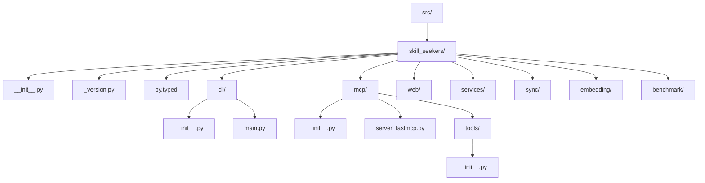
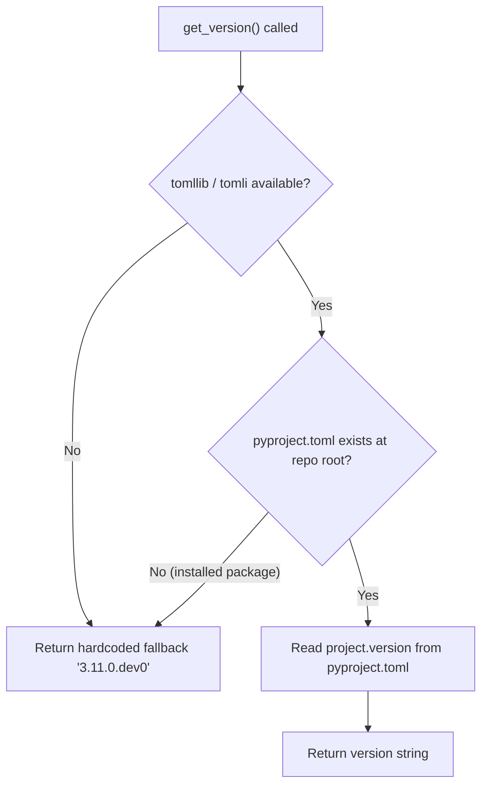

<!-- source: DeepWiki mcp.deepwiki.com · repo yusufkaraaslan/Skill_Seekers · page 14.2 Package Structure & Imports · fetched 2026-10-26 -->

# Package Structure & Imports

<details>
<summary>Relevant source files</summary>

The following files were used as context for generating this wiki page:

- [CHANGELOG.md](CHANGELOG.md)
- [CLAUDE.md](CLAUDE.md)
- [README.md](README.md)
- [configs/godot.json](configs/godot.json)
- [configs/react.json](configs/react.json)
- [pyproject.toml](pyproject.toml)
- [src/skill_seekers/__init__.py](src/skill_seekers/__init__.py)
- [src/skill_seekers/_version.py](src/skill_seekers/_version.py)
- [src/skill_seekers/cli/__init__.py](src/skill_seekers/cli/__init__.py)
- [src/skill_seekers/mcp/__init__.py](src/skill_seekers/mcp/__init__.py)
- [src/skill_seekers/mcp/tools/__init__.py](src/skill_seekers/mcp/tools/__init__.py)
- [src/skill_seekers/py.typed](src/skill_seekers/py.typed)
- [tests/test_cli_paths.py](tests/test_cli_paths.py)
- [tests/test_package_structure.py](tests/test_package_structure.py)
- [uv.lock](uv.lock)

</details>


This page describes the physical layout of the `skill_seekers` Python package, how sub-packages are organized, how version information flows through the package, public name exports via `__all__`, and PEP 561 type marking via `py.typed`. It is intended for contributors and developers embedding `skill_seekers` as a library.

For information about runtime CLI command execution, see [Unified CLI Commands](#3). For the MCP server implementation internals, see [FastMCP Server Implementation](#14.7).

---

## src/ Layout & Sub-packages

`skill_seekers` uses the modern **src layout**: all importable source code lives under `src/skill_seekers/`. This separates the package root from project-level files (`pyproject.toml`, `tests/`, etc.) and prevents accidental imports of uninstalled source code.

The package contains several key sub-packages handling specific subsystems: `cli/`, `mcp/`, `web/`, `services/`, `sync/`, `embedding/`, and `benchmark/`, alongside a PEP 561 compliance marker `py.typed`.

**Package Directory Tree**



Sources: [tests/test_package_structure.py:122-137](), [tests/test_cli_paths.py:179-204]()

---

## Package Hierarchy & Sub-packages

| Import path | Physical path / file | Role |
|---|---|---|
| `skill_seekers` | `src/skill_seekers/__init__.py` | Root package; exposes `__version__`, `__author__`, `__license__` |
| `skill_seekers._version` | `src/skill_seekers/_version.py` | Single source of truth for the version string |
| `skill_seekers.cli` | `src/skill_seekers/cli/` | Command-line interface dispatcher and execution contexts |
| `skill_seekers.mcp` | `src/skill_seekers/mcp/` | Model Context Protocol server and agent detectors |
| `skill_seekers.web` | `src/skill_seekers/web/` | Seeker HUD FastAPI backend and routing modules |
| `skill_seekers.services` | `src/skill_seekers/services/` | Shared infrastructure services (config fetching, path safety, etc.) |
| `skill_seekers.sync` | `src/skill_seekers/sync/` | Documentation change monitoring and sync checking |
| `skill_seekers.embedding` | `src/skill_seekers/embedding/` | Embedding server and vectorization utilities |
| `skill_seekers.benchmark` | `src/skill_seekers/benchmark/` | Performance benchmark suites and framework evaluation |

Sources: [src/skill_seekers/__init__.py:1-17](), [src/skill_seekers/cli/__init__.py:1-46](), [src/skill_seekers/mcp/__init__.py:1-34]()

---

## Root Package & Version Management

[src/skill_seekers/__init__.py:1-17]()

The root `__init__.py` imports `__version__` from `_version.py` and declares package-level metadata:

| Attribute | Value |
|---|---|
| `__version__` | Delegated to `_version.get_version()` [src/skill_seekers/__init__.py:8]() |
| `__author__` | `"Yusuf Karaaslan"` [src/skill_seekers/__init__.py:10]() |
| `__license__` | `"MIT"` [src/skill_seekers/__init__.py:11]() |

`__all__` contains only these metadata exports [src/skill_seekers/__init__.py:13-17]().

### Version Resolution (`_version.py`)

[src/skill_seekers/_version.py:1-52]()

`_version.py` acts as the **single source of truth** for the version string across all sub-packages, reading directly from `pyproject.toml`.

**Version Resolution Flow**



The runtime Python version determines the TOML parser used:
* **Python `>= 3.11`**: Uses standard library `tomllib` [src/skill_seekers/_version.py:12-13]()
* **Python `< 3.11`**: Uses third-party package `tomli` [src/skill_seekers/_version.py:14-16]()
* **Fallback**: Returns `"3.11.0.dev0"` if TOML parsing fails or `pyproject.toml` is absent from an installed build environment [src/skill_seekers/_version.py:31]().

Sources: [src/skill_seekers/_version.py:1-52](), [pyproject.toml:5-7]()

---

## Sub-package Exports (`__all__`) & PEP 561 Type Marking

### CLI Sub-package Exports
[src/skill_seekers/cli/__init__.py:1-46]() exports core utilities, context singletons, and detection helpers:
```python
__all__ = [
    "LlmsTxtDetector",
    "LlmsTxtDownloader",
    "LlmsTxtParser",
    "ExecutionContext",
    "get_context",
    "open_folder",
    "read_reference_files",
    "__version__",
]
```

### MCP Tools Sub-package (`skill_seekers.mcp.tools`)
[src/skill_seekers/mcp/tools/__init__.py:1-187]() imports raw async implementation functions and re-exports them with an `_impl` suffix to isolate them from FastMCP wrappers:

| Category | Exported `_impl` Names |
|---|---|
| **Config** | `generate_config_impl`, `list_configs_impl`, `validate_config_impl`, `sync_config_impl` [src/skill_seekers/mcp/tools/__init__.py:19-27]() |
| **Scraping** | `estimate_pages_impl`, `scrape_docs_impl`, `scrape_github_impl`, `scrape_pdf_impl`, `scrape_codebase_impl`, `detect_patterns_impl`, `extract_test_examples_impl`, `build_how_to_guides_impl`, `extract_config_patterns_impl`, `scrape_video_impl` [src/skill_seekers/mcp/tools/__init__.py:40-72]() |
| **Packaging** | `package_skill_impl`, `upload_skill_impl`, `enhance_skill_impl`, `install_skill_impl` [src/skill_seekers/mcp/tools/__init__.py:28-39]() |
| **Vector DB** | `export_to_weaviate_impl`, `export_to_chroma_impl`, `export_to_faiss_impl`, `export_to_qdrant_impl` [src/skill_seekers/mcp/tools/__init__.py:106-117]() |

### Type Checking (`py.typed`)
The presence of an empty `src/skill_seekers/py.typed` file satisfies PEP 561, informing static type checkers (such as `mypy`) that `skill_seekers` is a typed package supporting inline type hints across all modules.

Sources: [src/skill_seekers/cli/__init__.py:37-46](), [src/skill_seekers/mcp/tools/__init__.py:137-187]()

---

## Import Patterns & Verification Tests

Multiple import styles are fully supported and verified via package tests:
* **Package-level import**: `from skill_seekers.cli import LlmsTxtDetector` [tests/test_package_structure.py:40-44]()
* **Module-path import**: `from skill_seekers.cli.llms_txt_detector import LlmsTxtDetector` [tests/test_package_structure.py:165-172]()

**Package Integrity Test Suite**

| Test Class | File & Line Range | Purpose |
|---|---|---|
| `TestCliPackage` | [tests/test_package_structure.py:13-78]() | Verifies version synchronization, `__all__` completeness, and sub-package imports. |
| `TestMcpPackage` | [tests/test_package_structure.py:80-118]() | Validates `skill_seekers.mcp` and `skill_seekers.mcp.tools` package structures. |
| `TestModernCLICommands` | [tests/test_cli_paths.py:17-100]() | Ensures internal scripts rely on the modern `skill-seekers` CLI rather than legacy paths. |

Sources: [tests/test_package_structure.py:1-180](), [tests/test_cli_paths.py:1-196]()

---

