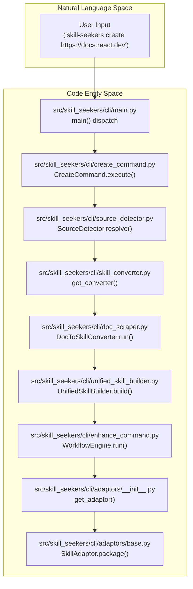
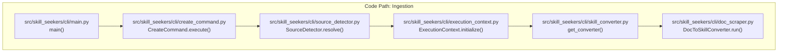
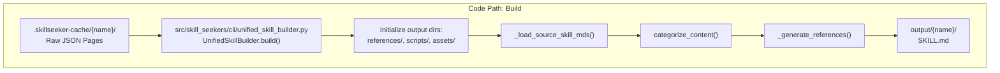
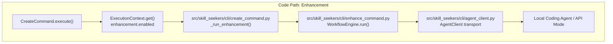
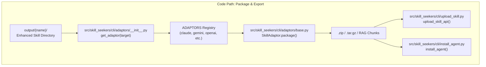

<!-- source: DeepWiki mcp.deepwiki.com · repo yusufkaraaslan/Skill_Seekers · page 14.3 Five-Phase Pipeline Implementation · fetched 2026-10-26 -->

# Five-Phase Pipeline Implementation

Relevant source files

The following files were used as context for generating this wiki page:

- [docs/features/SKILL_SEARCH_INDEX.md](docs/features/SKILL_SEARCH_INDEX.md)
- [src/skill_seekers/cli/arguments/common.py](src/skill_seekers/cli/arguments/common.py)
- [src/skill_seekers/cli/arguments/create.py](src/skill_seekers/cli/arguments/create.py)
- [src/skill_seekers/cli/arguments/scrape.py](src/skill_seekers/cli/arguments/scrape.py)
- [src/skill_seekers/cli/create_command.py](src/skill_seekers/cli/create_command.py)
- [src/skill_seekers/cli/main.py](src/skill_seekers/cli/main.py)
- [src/skill_seekers/cli/parsers/__init__.py](src/skill_seekers/cli/parsers/__init__.py)
- [src/skill_seekers/cli/skill_converter.py](src/skill_seekers/cli/skill_converter.py)
- [src/skill_seekers/cli/skill_indexer.py](src/skill_seekers/cli/skill_indexer.py)
- [src/skill_seekers/cli/source_detector.py](src/skill_seekers/cli/source_detector.py)
- [tests/test_cli_parsers.py](tests/test_cli_parsers.py)
- [tests/test_create_arguments.py](tests/test_create_arguments.py)
- [tests/test_create_integration_basic.py](tests/test_create_integration_basic.py)
- [tests/test_new_source_types.py](tests/test_new_source_types.py)

## Purpose and Scope

This document provides a detailed technical explanation of the five-phase pipeline that forms the core architecture of Skill Seekers. It traces the code path from initial CLI dispatch in `src/skill_seekers/cli/main.py` through content extraction, skill synthesis, AI enhancement, and final platform packaging.

---

## 1. Five-Phase Architecture Overview & Code Path Trace

The Skill Seekers execution model transforms raw documentation, repositories, or data feeds into structured AI skills through five sequential phases. The pipeline is orchestrated centrally by the CLI dispatcher and execution context.

**Sources:** [src/skill_seekers/cli/main.py:136-178](), [src/skill_seekers/cli/create_command.py:47-114](), [src/skill_seekers/cli/source_detector.py:58-69](), [src/skill_seekers/cli/skill_converter.py:1-40](), [src/skill_seekers/cli/unified_skill_builder.py:26-75]()

---

## 2. Phase 1 — Ingestion & Scraping (`main.py` & Converters)

Phase 1 initiates execution and extracts content into a standardized intermediate cache structure.

### 2.1 CLI Dispatch and Source Detection
When a user executes a command, `src/skill_seekers/cli/main.py` parses the arguments via `create_parser()` and routes execution based on `COMMAND_CLASSES` or `COMMAND_MODULES` [src/skill_seekers/cli/main.py:50-87](). For the `create` command, control passes to `CreateCommand.execute()` in `src/skill_seekers/cli/create_command.py` [src/skill_seekers/cli/create_command.py:47-52]().

1.  **Source Resolution:** `SourceDetector.resolve()` inspects the input string or file extension to yield a `SourceInfo` object containing the source type (e.g., `web`, `github`, `pdf`, `local`) [src/skill_seekers/cli/source_detector.py:32-69]().
2.  **Context Initialization:** `ExecutionContext.initialize()` captures the parsed arguments and source configuration as the single source of truth across the pipeline [src/skill_seekers/cli/create_command.py:70-84]().
3.  **Converter Instantiation:** `get_converter(source_type, config)` maps the source type to its concrete scraper implementation [src/skill_seekers/cli/skill_converter.py:1-40]().

**Sources:** [src/skill_seekers/cli/main.py:50-178](), [src/skill_seekers/cli/create_command.py:47-94](), [src/skill_seekers/cli/source_detector.py:32-69]()

---

## 3. Phase 2 — Structuring & Building (`UnifiedSkillBuilder`)

Phase 2 takes the raw scraped data from intermediate caches and compiles it into a unified directory layout containing `SKILL.md` and reference markdown files.

### 3.1 Build Execution Flow
*   **Directory Setup:** `UnifiedSkillBuilder` establishes the output directory structure, creating the `references/`, `scripts/`, and `assets/` subdirectories [src/skill_seekers/cli/unified_skill_builder.py:70-73]().
*   **Source Aggregation:** Standalone source descriptions and extracted markdown files are loaded and merged using `_load_source_skill_mds` [src/skill_seekers/cli/unified_skill_builder.py:91-188]().
*   **Reference Generation:** Content is sorted into functional categories and written out as individual markdown files inside `references/` [src/skill_seekers/cli/unified_skill_builder.py:150-210]().

**Sources:** [src/skill_seekers/cli/unified_skill_builder.py:26-188]()

---

## 4. Phase 3 — Enhancement (`WorkflowEngine` & AgentClient)

Phase 3 improves the generated skill's documentation quality, adds architecture summaries, and executes validation or refinement pipelines.

### 4.1 Enhancement Routing & Workflow Execution
*   **Trigger Condition:** `CreateCommand.execute()` checks if enhancement is enabled via `ExecutionContext` (`ctx.enhancement.enabled and ctx.enhancement.level > 0`) [src/skill_seekers/cli/create_command.py:102-105]().
*   **Workflow Engine:** `WorkflowEngine.run()` sequences the enhancement stages defined by CLI flags or preset files, applying prompt templates and executing transformations on `SKILL.md` and reference files [src/skill_seekers/cli/enhance_command.py:45-120]().
*   **Transport Layer:** `AgentClient` dispatches enhancement requests according to available credentials (API keys vs local CLI coding agents) [src/skill_seekers/cli/agent_client.py:20-90]().

**Sources:** [src/skill_seekers/cli/create_command.py:96-108](), [src/skill_seekers/cli/enhance_command.py:45-120](), [src/skill_seekers/cli/agent_client.py:20-90]()

---

## 5. Phase 4 & 5 — Packaging & Distribution (`SkillAdaptor` & Export)

The final phases prepare the enhanced skill directory for integration with target AI platforms, vector databases, or local agent environments.

### 5.1 Adaptor Factory and Packaging Strategy
*   **Adaptor Selection:** `get_adaptor(target)` queries the `ADAPTORS` registry to return the concrete platform adaptor instance [src/skill_seekers/cli/adaptors/__init__.py:126-207]().
*   **Packaging:** The concrete adaptor's `package()` method bundles the skill directory into target-specific formats (e.g., zip archives or chunked vector embeddings) [src/skill_seekers/cli/adaptors/base.py:10-50]().
*   **Distribution:** `upload_skill_api()` or `install_agent()` executes final deployment to remote platforms or local AI coding agent directories [src/skill_seekers/cli/upload_skill.py:40-110](), [src/skill_seekers/cli/install_agent.py:25-85]().

**Sources:** [src/skill_seekers/cli/adaptors/__init__.py:126-207](), [src/skill_seekers/cli/adaptors/base.py:10-50](), [src/skill_seekers/cli/upload_skill.py:40-110](), [src/skill_seekers/cli/install_agent.py:25-85]()

---

## Technical Data Flow Summary

| Phase | Input Data | Core Code Entity | Output Artifact |
|-------|------------|------------------|-----------------|
| **1. Scrape** | URL, Repo, or File Path | `SourceDetector`, `DocToSkillConverter`, `GitHubScraper` | Raw JSON cache files in `.skillseeker-cache/` |
| **2. Build** | Intermediate Cache | `UnifiedSkillBuilder` | `output/{name}/SKILL.md` + `references/` |
| **3. Enhance** | Skill Directory | `WorkflowEngine`, `AgentClient` | Refined Markdown & Architecture files |
| **4. Package** | Skill Directory | `SkillAdaptor` subclasses (`get_adaptor`) | Platform-specific `.zip` bundle or RAG chunks |
| **5. Export** | Package File / Directory | `upload_skill_api`, `install_agent` | Deployed platform skill or local agent integration |

**Sources:** [src/skill_seekers/cli/unified_scraper.py:41-51](), [src/skill_seekers/cli/unified_skill_builder.py:26-75](), [src/skill_seekers/cli/enhance_command.py:45-120](), [src/skill_seekers/cli/adaptors/__init__.py:126-207](), [src/skill_seekers/cli/install_agent.py:25-85]()

---

