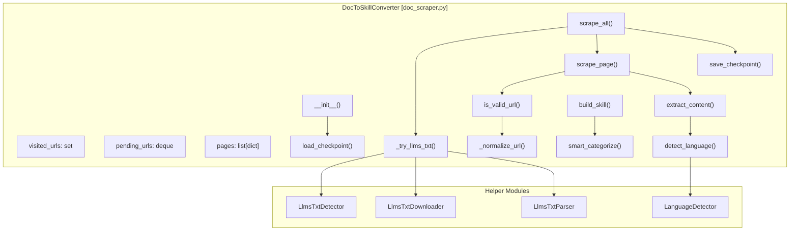
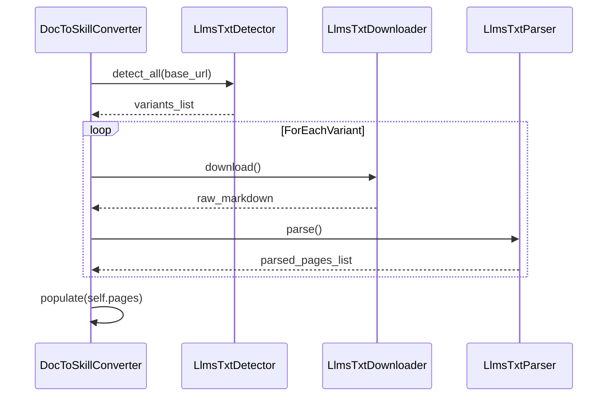

<!-- source: DeepWiki mcp.deepwiki.com · repo yusufkaraaslan/Skill_Seekers · page 14.4 DocToSkillConverter Architecture · fetched 2026-10-26 -->

# DocToSkillConverter Architecture

Relevant source files

The following files were used as context for generating this wiki page:

- [src/skill_seekers/cli/doc_scraper.py](src/skill_seekers/cli/doc_scraper.py)
- [src/skill_seekers/cli/unified_scraper.py](src/skill_seekers/cli/unified_scraper.py)
- [src/skill_seekers/cli/unified_skill_builder.py](src/skill_seekers/cli/unified_skill_builder.py)
- [tests/test_c3_integration.py](tests/test_c3_integration.py)
- [tests/test_multi_source.py](tests/test_multi_source.py)
- [tests/test_unified.py](tests/test_unified.py)
- [tests/test_unified_scraper_orchestration.py](tests/test_unified_scraper_orchestration.py)

This page documents the internal architecture of the `DocToSkillConverter` class, the core scraping engine that converts web documentation into structured skills. This class orchestrates BFS traversal, content extraction, language detection, pattern recognition, and final skill generation.

For information about command-line usage and configuration, see [Scraping Commands](#3.1). For llms.txt detection details, see [llms.txt Detection & Processing](#5.1.2). For language detection internals, see [Language Detection & Code Extraction](#5.1.3).

---

## Overview

The `DocToSkillConverter` class is the central component of the documentation scraper, located at [src/skill_seekers/cli/doc_scraper.py:204-1333](). It manages the complete scraping workflow from URL traversal to final `SKILL.md` generation, supporting multiple execution modes (sync, threaded, async), checkpoint/resume, and `llms.txt` fast paths.

**Key Responsibilities:**
- **BFS Traversal**: Systematically explores documentation sites using a queue-based approach [src/skill_seekers/cli/doc_scraper.py:690-849]().
- **Content Extraction**: Uses `BeautifulSoup` with fallback selector logic (`FALLBACK_MAIN_SELECTORS`) to find documentation bodies [src/skill_seekers/cli/doc_scraper.py:63-71]().
- **llms.txt Fast Path**: Detects and parses `llms.txt` files to bypass expensive crawling [src/skill_seekers/cli/doc_scraper.py:558-688]().
- **Smart Categorization**: Uses weighted keyword scoring to bucket pages into reference files [src/skill_seekers/cli/doc_scraper.py:990-1031]().
- **Checkpointing**: Persists state to allow resumption of long-running jobs [src/skill_seekers/cli/doc_scraper.py:287-306]().

Sources: [src/skill_seekers/cli/doc_scraper.py:63-71](), [src/skill_seekers/cli/doc_scraper.py:204-211](), [src/skill_seekers/cli/doc_scraper.py:558-688](), [src/skill_seekers/cli/doc_scraper.py:690-849]()

---

## Class Architecture

The following diagram illustrates the internal call graph and state management within `DocToSkillConverter`, bridging execution flow with concrete code symbols.

**DocToSkillConverter Internal Call Graph**

Sources: [src/skill_seekers/cli/doc_scraper.py:204-1333](), [src/skill_seekers/cli/llms_txt_detector.py:9-12](), [src/skill_seekers/cli/llms_txt_parser.py:9-10]()

---

## Initialization & State Management

The converter maintains several state attributes to manage the BFS crawl and ensure data integrity.

| Attribute | Type | Description |
| :--- | :--- | :--- |
| `visited_urls` | `set[str]` | Tracks normalized URLs already scraped to prevent infinite loops [src/skill_seekers/cli/doc_scraper.py:248](). |
| `pending_urls` | `deque[str]` | FIFO queue for Breadth-First Search traversal [src/skill_seekers/cli/doc_scraper.py:249](). |
| `pages` | `list[dict]` | In-memory storage of extracted page content and metadata [src/skill_seekers/cli/doc_scraper.py:250](). |
| `checkpoint_file` | `str` | Path to `checkpoint.json` in the cache directory [src/skill_seekers/cli/doc_scraper.py:216](). |

### Checkpoint System
The `save_checkpoint` method persists the current `visited_urls`, `pending_urls`, and `pages` to disk [src/skill_seekers/cli/doc_scraper.py:287-306](). This is triggered at intervals defined by `DEFAULT_CHECKPOINT_INTERVAL` (10 pages) [src/skill_seekers/cli/constants.py:38]().

Sources: [src/skill_seekers/cli/doc_scraper.py:216-250](), [src/skill_seekers/cli/doc_scraper.py:287-306](), [src/skill_seekers/cli/constants.py:38]()

---

## URL Processing & Normalization

Before a URL is added to the `pending_urls` queue, it undergoes normalization and validation.

### URL Normalization
The `_normalize_url` function [src/skill_seekers/cli/doc_scraper.py:105-120]() prevents duplicate scraping of the same content by:
1. Stripping tracking parameters defined in `_TRACKING_PARAMS` (e.g., `utm_`, `fbclid`, `gclid`) [src/skill_seekers/cli/doc_scraper.py:89-96]().
2. Sorting the remaining query parameters for stable comparison [src/skill_seekers/cli/doc_scraper.py:117]().

### Validation Logic
`is_valid_url` [src/skill_seekers/cli/doc_scraper.py:263-285]() enforces the following constraints:
- **Domain Scope**: URL must start with the `base_url` [src/skill_seekers/cli/doc_scraper.py:269-270]().
- **Pattern Matching**: URL must match `include` patterns and must NOT match `exclude` patterns defined in the config [src/skill_seekers/cli/doc_scraper.py:273-280]().

Sources: [src/skill_seekers/cli/doc_scraper.py:89-120](), [src/skill_seekers/cli/doc_scraper.py:263-285]()

---

## llms.txt Integration Workflow

The `_try_llms_txt` method [src/skill_seekers/cli/doc_scraper.py:558-688]() attempts a "fast path" ingestion leveraging specific parser classes.

**llms.txt Interaction Workflow**

Sources: [src/skill_seekers/cli/doc_scraper.py:558-688](), [src/skill_seekers/cli/llms_txt_detector.py:60](), [src/skill_seekers/cli/llms_txt_downloader.py:63-89](), [src/skill_seekers/cli/llms_txt_parser.py:100-124]()

---

## Content Extraction & Language Detection

Extraction is handled by `extract_content` [src/skill_seekers/cli/doc_scraper.py:342-412](), which delegates code analysis to the `LanguageDetector`.

### Code Block Processing
When an HTML code block is found:
1. `extract_content` passes the element to `detect_language` [src/skill_seekers/cli/doc_scraper.py:392-396]().
2. `detect_language` [src/skill_seekers/cli/doc_scraper.py:414-425]() calls `LanguageDetector.detect_from_html` [src/skill_seekers/cli/language_detector.py:385]().
3. If no CSS class (e.g., `language-python`) is found, it falls back to `detect_from_code` using regex-based heuristics [src/skill_seekers/cli/language_detector.py:416-432]().

### Fallback Selectors
If the user-provided `main_content` selector fails, the converter iterates through `FALLBACK_MAIN_SELECTORS` (e.g., `main`, `article`, `.content`) to find the documentation body [src/skill_seekers/cli/doc_scraper.py:63-71]().

Sources: [src/skill_seekers/cli/doc_scraper.py:63-71](), [src/skill_seekers/cli/doc_scraper.py:342-412](), [src/skill_seekers/cli/doc_scraper.py:414-425](), [src/skill_seekers/cli/language_detector.py:385-432]()

---

## Build Phase & Smart Categorization

After scraping, `build_skill` [src/skill_seekers/cli/doc_scraper.py:1090-1333]() synthesizes the final directory structure.

### Smart Categorization Algorithm
The `smart_categorize` method [src/skill_seekers/cli/doc_scraper.py:990-1031]() assigns pages to categories based on a scoring system:
- **URL Path Match**: +3 points [src/skill_seekers/cli/doc_scraper.py:1007-1008]().
- **Title Match**: +2 points [src/skill_seekers/cli/doc_scraper.py:1009-1010]().
- **Content Keyword Match**: +1 point [src/skill_seekers/cli/doc_scraper.py:1011-1012]().

Pages meeting the `MIN_CATEGORIZATION_SCORE` (default: 3) are included in the specific category's reference file [src/skill_seekers/cli/constants.py:42]().

Sources: [src/skill_seekers/cli/doc_scraper.py:990-1031](), [src/skill_seekers/cli/doc_scraper.py:1090-1333](), [src/skill_seekers/cli/constants.py:42]()

---

