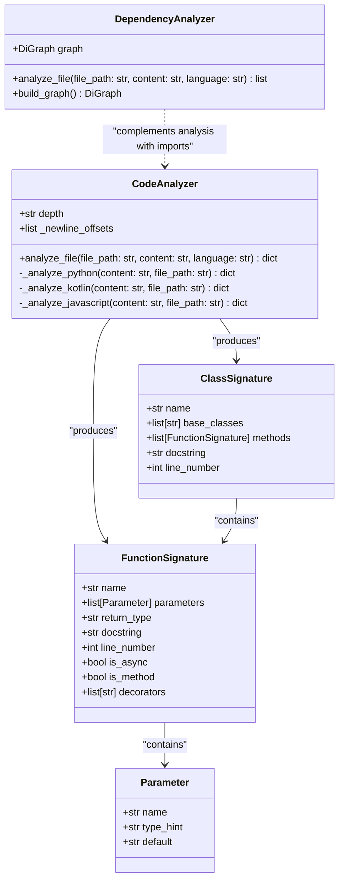
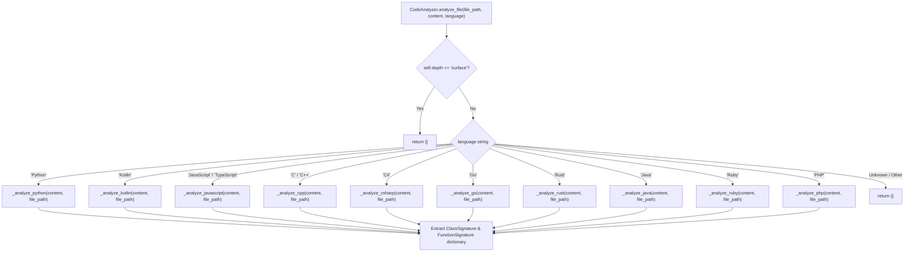

<!-- source: DeepWiki mcp.deepwiki.com · repo yusufkaraaslan/Skill_Seekers · page 14.5 Multi-Language Code Analysis · fetched 2026-10-26 -->

# Multi-Language Code Analysis

<details>
<summary>Relevant source files</summary>

The following files were used as context for generating this wiki page:

- [docs/UML/exports/04_analysis.png](docs/UML/exports/04_analysis.png)
- [src/skill_seekers/cli/architectural_pattern_detector.py](src/skill_seekers/cli/architectural_pattern_detector.py)
- [src/skill_seekers/cli/code_analyzer.py](src/skill_seekers/cli/code_analyzer.py)
- [src/skill_seekers/cli/codebase_scraper.py](src/skill_seekers/cli/codebase_scraper.py)
- [src/skill_seekers/cli/dependency_analyzer.py](src/skill_seekers/cli/dependency_analyzer.py)
- [src/skill_seekers/cli/language_detector.py](src/skill_seekers/cli/language_detector.py)
- [src/skill_seekers/cli/pdf_extractor_poc.py](src/skill_seekers/cli/pdf_extractor_poc.py)
- [src/skill_seekers/cli/signal_flow_analyzer.py](src/skill_seekers/cli/signal_flow_analyzer.py)
- [src/skill_seekers/cli/swift_patterns.py](src/skill_seekers/cli/swift_patterns.py)
- [tests/test_code_analyzer.py](tests/test_code_analyzer.py)
- [tests/test_codebase_scraper.py](tests/test_codebase_scraper.py)
- [tests/test_dependency_analyzer.py](tests/test_dependency_analyzer.py)
- [tests/test_framework_detection.py](tests/test_framework_detection.py)
- [tests/test_kotlin_support.py](tests/test_kotlin_support.py)
- [tests/test_pdf_extractor.py](tests/test_pdf_extractor.py)
- [tests/test_swift_detection.py](tests/test_swift_detection.py)

</details>


This page documents the internals of the code analysis subsystem used when skill-seekers scrapes a local codebase or GitHub repository. It covers the `CodeAnalyzer` class, its data structures (`FunctionSignature`, `ClassSignature`, `Parameter`), the three analysis depth levels, AST vs. regex parsing strategies, C-style masking, and language-specific support including Swift and Kotlin.

For how the codebase scraper invokes these components end-to-end, see [Codebase Scraper](#5.4). For the dependency graph layer built on top of these results, see [C3.6: Dependency Graph Analysis](#11.6). For design pattern and architectural detection that consumes the output of `CodeAnalyzer`, see [C3.1: Design Pattern Detection](#11.1) and [C3.7: Architectural Pattern Detection](#11.7).

Sources: [src/skill_seekers/cli/code_analyzer.py:1-23](), [src/skill_seekers/cli/codebase_scraper.py:1-25]()

---

## 1. Components Overview

The primary analysis engine is `CodeAnalyzer`, which works alongside specialized analyzers for dependency tracking and architectural insights.

| Module | Class | Role |
|--------|-------|------|
| `src/skill_seekers/cli/code_analyzer.py` | `CodeAnalyzer` | Extracts signatures (classes, functions, imports) from source files |
| `src/skill_seekers/cli/dependency_analyzer.py` | `DependencyAnalyzer` | Extracts import/require/include statements and builds dependency graphs |
| `src/skill_seekers/cli/signal_flow_analyzer.py` | `SignalFlowAnalyzer` | Analyzes signal connections and event flow for Godot/GDScript |

### Class Relationships & Code Entity Mapping

The diagram below bridges abstract architectural concepts to concrete symbols defined in the codebase, such as `CodeAnalyzer`, `_analyze_python`, `_analyze_kotlin`, `FunctionSignature`, and `ClassSignature`.



Sources: [src/skill_seekers/cli/code_analyzer.py:38-89](), [src/skill_seekers/cli/dependency_analyzer.py:82-102]()

---

## 2. Analysis Depth Levels

`CodeAnalyzer` is initialized with a `depth` parameter that dictates the granularity of file parsing.

| Depth | Behavior | When to use |
|-------|----------|-------------|
| `"surface"` | Returns `{}` immediately; skips file-level parsing | File-tree-only scans, fast structural indexing |
| `"deep"` | Parses signatures, parameters, types, imports, and comments | Default for thorough codebase analysis |
| `"full"` | Complete AST analysis and advanced relationship mapping | Deep logic understanding (planned/extended use) |

The depth guard is checked at the entry of `CodeAnalyzer.analyze_file()`:

```python
if self.depth == "surface":
    return {}
```

Sources: [src/skill_seekers/cli/code_analyzer.py:81-108]()

---

## 3. Language Dispatch Table and Parsing Strategies

`CodeAnalyzer.analyze_file()` dispatches to language-specific internal methods based on the detected programming language. The engine supports Python via AST parsing, alongside robust regex-based parsers for C-family, frontend, and mobile languages (including Swift and Kotlin).

### Dispatch Flow & Code Execution Mapping



Sources: [src/skill_seekers/cli/code_analyzer.py:95-147]()

### AST vs. Regex Parsing & C-Style Masking
- **Python AST Parser**: Leverages `ast.parse()` to build a syntax tree (`ast.ClassDef`, `ast.FunctionDef`, `ast.AsyncFunctionDef`), building a parent node map in $O(n)$ time to isolate top-level functions from class methods.
- **Regex-Based Parsers**: Used for non-Python languages. To prevent false positives inside string literals or comments, regex parsers utilize **C-style masking** and structural pattern matching to strip comments and quotes before running regex extraction.
- **Swift and Kotlin Support**: Kotlin and Swift support rely on language-specific pattern dictionaries and regex structures (`src/skill_seekers/cli/swift_patterns.py`, `src/skill_seekers/cli/language_detector.py`) to parse data classes, sealed classes, extensions, and coroutine constructs.

Sources: [src/skill_seekers/cli/code_analyzer.py:11-23](), [src/skill_seekers/cli/code_analyzer.py:149-192](), [src/skill_seekers/cli/language_detector.py:16-46]()

---

## 4. Data Structures

### `Parameter`

[src/skill_seekers/cli/code_analyzer.py:38-44]()

```python
@dataclass
class Parameter:
    name: str
    type_hint: str | None = None
    default: str | None = None
```

### `FunctionSignature`

[src/skill_seekers/cli/code_analyzer.py:48-63]()

| Field | Type | Notes |
|-------|------|-------|
| `name` | `str` | Function or method name |
| `parameters` | `list[Parameter]` | All arguments including `self`/`cls` |
| `return_type` | `str \| None` | Return type annotation if present |
| `docstring` | `str \| None` | Extracted docstring documentation |
| `line_number` | `int \| None` | 1-based starting line number |
| `is_async` | `bool` | True for asynchronous functions |
| `is_method` | `bool` | True if enclosed within a class body |
| `decorators` | `list[str]` | Applied decorators (Python) |

### `ClassSignature`

[src/skill_seekers/cli/code_analyzer.py:66-73]()

| Field | Type | Notes |
|-------|------|-------|
| `name` | `str` | Class, struct, or interface name |
| `base_classes` | `list[str]` | Inherited parent classes/traits |
| `methods` | `list[FunctionSignature]` | Methods contained in the class body |
| `docstring` | `str \| None` | Class-level documentation |
| `line_number` | `int \| None` | 1-based line number |

Sources: [src/skill_seekers/cli/code_analyzer.py:38-75]()

---

## 5. Integration with C3.x Suite

The metadata extracted by `CodeAnalyzer` and its accompanying parsers feeds directly into higher-level code intelligence systems:

- **Dependency Analysis (C3.6)**: `DependencyAnalyzer` inspects file imports alongside AST data to construct directed graphs via NetworkX [src/skill_seekers/cli/dependency_analyzer.py:82-100]().
- **Architectural Detection (C3.7)**: `ArchitecturalPatternDetector` analyzes collected code signatures and directory layouts to classify MVC, MVVM, and Clean Architecture patterns [src/skill_seekers/cli/architectural_pattern_detector.py:168-193]().
- **Signal Flow Analysis (C3.10)**: `SignalFlowAnalyzer` consumes Godot/GDScript analysis objects to track signal emissions and connections [src/skill_seekers/cli/signal_flow_analyzer.py:30-42]().

Sources: [src/skill_seekers/cli/code_analyzer.py:76-80](), [src/skill_seekers/cli/dependency_analyzer.py:82-95](), [src/skill_seekers/cli/architectural_pattern_detector.py:168-193](), [src/skill_seekers/cli/signal_flow_analyzer.py:30-50]()

---

