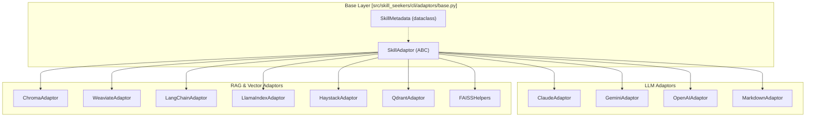
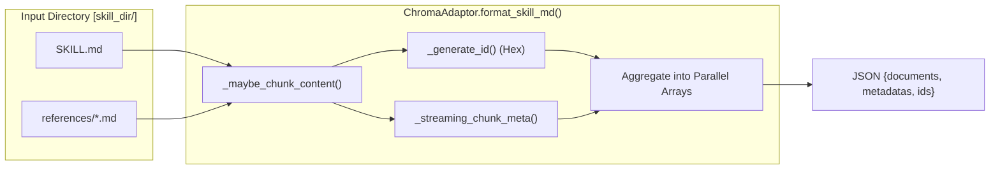
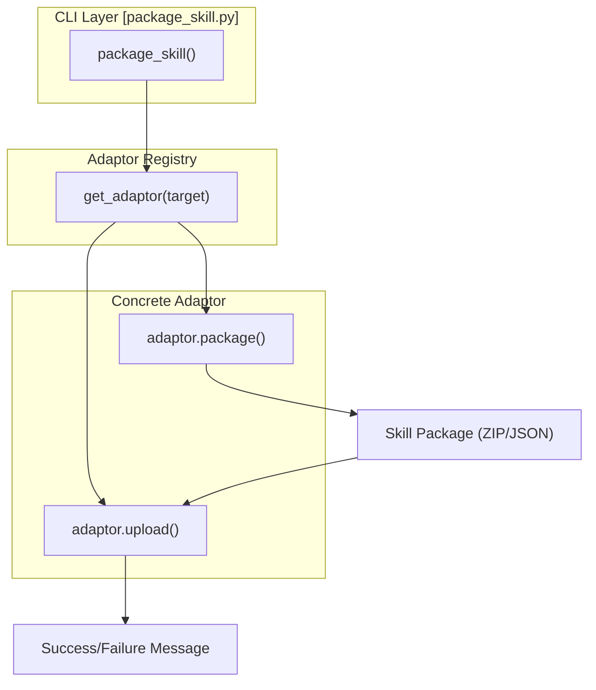

<!-- source: DeepWiki mcp.deepwiki.com · repo yusufkaraaslan/Skill_Seekers · page 14.6 Platform Adaptor Pattern Implementation · fetched 2026-10-26 -->

# Platform Adaptor Pattern Implementation

Relevant source files

The following files were used as context for generating this wiki page:

- [src/skill_seekers/cli/adaptors/__init__.py](src/skill_seekers/cli/adaptors/__init__.py)
- [src/skill_seekers/cli/adaptors/base.py](src/skill_seekers/cli/adaptors/base.py)
- [src/skill_seekers/cli/adaptors/chroma.py](src/skill_seekers/cli/adaptors/chroma.py)
- [src/skill_seekers/cli/adaptors/faiss_helpers.py](src/skill_seekers/cli/adaptors/faiss_helpers.py)
- [src/skill_seekers/cli/adaptors/haystack.py](src/skill_seekers/cli/adaptors/haystack.py)
- [src/skill_seekers/cli/adaptors/langchain.py](src/skill_seekers/cli/adaptors/langchain.py)
- [src/skill_seekers/cli/adaptors/llama_index.py](src/skill_seekers/cli/adaptors/llama_index.py)
- [src/skill_seekers/cli/adaptors/qdrant.py](src/skill_seekers/cli/adaptors/qdrant.py)
- [src/skill_seekers/cli/adaptors/weaviate.py](src/skill_seekers/cli/adaptors/weaviate.py)
- [src/skill_seekers/cli/package_skill.py](src/skill_seekers/cli/package_skill.py)

## Purpose and Scope

This page documents the technical implementation of the platform adaptor system in Skill Seekers, which uses the Strategy pattern to support packaging and uploading skills to various AI platforms and vector databases. The adaptor layer handles platform-specific formatting, packaging, and upload logic, operating in the final phases of the skill generation pipeline.

**Scope**: This page covers:
- `SkillAdaptor` abstract base class interface and abstract methods [src/skill_seekers/cli/adaptors/base.py:56-150]().
- `SkillMetadata` dataclass for universal skill information [src/skill_seekers/cli/adaptors/base.py:44-54]().
- Concrete adaptor implementations for vector databases and RAG frameworks (Chroma, Weaviate, Pinecone, Qdrant, FAISS, LangChain, LlamaIndex, Haystack) [src/skill_seekers/cli/adaptors/__init__.py:137-172]().
- Factory pattern for adaptor instantiation via `get_adaptor` and the `ADAPTORS` registry [src/skill_seekers/cli/adaptors/__init__.py:126-207]().
- ID generation strategies (Hex, UUID, UUID5).
- Intelligent chunking integration via `StreamingAdaptorMixin`.

**Out of Scope**: Scraper implementations, AI enhancement prompts, and CLI argument parsing are covered in other documentation sections.

Sources: [src/skill_seekers/cli/adaptors/base.py:44-150](), [src/skill_seekers/cli/adaptors/__init__.py:126-207]()

---

## Strategy Pattern Architecture

The adaptor system implements the Strategy pattern where `SkillAdaptor` defines the interface and concrete adaptors provide platform-specific implementations.

### Class Hierarchy and Code Entities

Title: "Adaptor Pattern Class Hierarchy"

Sources: [src/skill_seekers/cli/adaptors/base.py:56-149](), [src/skill_seekers/cli/adaptors/chroma.py:18-32](), [src/skill_seekers/cli/adaptors/weaviate.py:18-33](), [src/skill_seekers/cli/adaptors/qdrant.py:18-34]()

### Platform Registry and Factory

The system uses a registry dictionary `ADAPTORS` to map platform identifiers to their respective classes [src/skill_seekers/cli/adaptors/__init__.py:126-172](). The `get_adaptor` factory function retrieves these instances dynamically [src/skill_seekers/cli/adaptors/__init__.py:175-207]().

| Category | Platforms | Key Files | Output Format |
|----------|-----------|-----------|---------------|
| **Traditional LLM** | Claude, Gemini, OpenAI | `claude.py`, `gemini.py`, `openai.py` | ZIP or tar.gz with SKILL.md |
| **RAG Framework** | LangChain, LlamaIndex, Haystack | `langchain.py`, `llama_index.py`, `haystack.py` | JSON array of Documents/Nodes [src/skill_seekers/cli/adaptors/langchain.py:37-53](), [src/skill_seekers/cli/adaptors/llama_index.py:50-68](), [src/skill_seekers/cli/adaptors/haystack.py:37-53]() |
| **Vector Database** | Chroma, Weaviate, Qdrant, FAISS | `chroma.py`, `weaviate.py`, `qdrant.py`, `faiss_helpers.py` | JSON with Points/Objects + Metadata [src/skill_seekers/cli/adaptors/chroma.py:54-58](), [src/skill_seekers/cli/adaptors/weaviate.py:121-125]() |

Sources: [src/skill_seekers/cli/adaptors/__init__.py:126-172](), [src/skill_seekers/cli/adaptors/chroma.py:30-31](), [src/skill_seekers/cli/adaptors/qdrant.py:31-33]()

---

## Base Adaptor Interface

The `SkillAdaptor` abstract base class defines the contract for all platform integrations.

### Core Data Structures

The `SkillMetadata` dataclass [src/skill_seekers/cli/adaptors/base.py:44-54]() ensures a consistent schema for skill information:
- `name`: Unique identifier for the skill [src/skill_seekers/cli/adaptors/base.py:48-48]().
- `description`: High-level summary [src/skill_seekers/cli/adaptors/base.py:49-49]().
- `version`: Skill package version (default `"1.0.0"`) [src/skill_seekers/cli/adaptors/base.py:50-50]().
- `doc_version`: Original documentation version for RAG metadata filtering [src/skill_seekers/cli/adaptors/base.py:51-51]().

### Abstract Methods

All concrete adaptors must implement these methods:

1. **`format_skill_md`**: Transforms the raw `SKILL.md` and reference files into a platform-specific format (e.g., JSON for Chroma [src/skill_seekers/cli/adaptors/chroma.py:47-150]() or Node arrays for LlamaIndex [src/skill_seekers/cli/adaptors/llama_index.py:46-149]()).
2. **`package`**: Bundles the skill into the required archive format (ZIP, tar.gz) or JSON data file [src/skill_seekers/cli/adaptors/base.py:101-128]().
3. **`upload`**: Transmits the package to the platform's API endpoint, returning a standardized result dictionary [src/skill_seekers/cli/adaptors/base.py:130-149]().

Sources: [src/skill_seekers/cli/adaptors/base.py:44-150]()

---

## Concrete Adaptor Walkthrough: Chroma

The `ChromaAdaptor` [src/skill_seekers/cli/adaptors/chroma.py:18-32]() illustrates specialization for a vector database.

### Data Flow: Chroma Ingestion Preparation

Title: "Chroma Adaptor Data Transformation Flow"

Sources: [src/skill_seekers/cli/adaptors/chroma.py:47-150](), [src/skill_seekers/cli/adaptors/chroma.py:152-177]()

---

## RAG and Vector DB Adaptors

Vector database adaptors (Chroma, Weaviate, Qdrant, FAISS) share a common pattern of chunking and ID generation.

### Intelligent Chunking
The `_maybe_chunk_content` method handles the logic for splitting large documents [src/skill_seekers/cli/adaptors/base.py](). It uses `DEFAULT_CHUNK_TOKENS` (512) and `DEFAULT_CHUNK_OVERLAP_TOKENS` (200) [src/skill_seekers/cli/arguments/common.py:17-17]().

### Deterministic ID Generation
To support idempotent updates, adaptors use deterministic ID generators [src/skill_seekers/cli/adaptors/base.py]().
- **Hex**: Used by Chroma [src/skill_seekers/cli/adaptors/chroma.py:34-45]() and FAISS [src/skill_seekers/cli/adaptors/faiss_helpers.py:37-48]().
- **UUID**: Used by Weaviate [src/skill_seekers/cli/adaptors/weaviate.py:35-46]().
- **UUID5**: Used by Qdrant [src/skill_seekers/cli/adaptors/qdrant.py:35-46]().

### Adaptor Comparison: Vector DBs

| Adaptor | ID Format | Metadata Key | Unique Feature |
|---------|-----------|--------------|----------------|
| **Chroma** | Hex | `metadatas` | Parallel arrays for docs/ids [src/skill_seekers/cli/adaptors/chroma.py:54-58]() |
| **Weaviate** | UUID | `properties` | Auto-generated schema definition [src/skill_seekers/cli/adaptors/weaviate.py:48-114]() |
| **Qdrant** | UUID5 | `payload` | Distance metric configuration [src/skill_seekers/cli/adaptors/qdrant.py:31-33]() |
| **FAISS** | Hex | `metadatas` | Separate metadata management [src/skill_seekers/cli/adaptors/faiss_helpers.py:30-31]() |

Sources: [src/skill_seekers/cli/adaptors/chroma.py:34-150](), [src/skill_seekers/cli/adaptors/weaviate.py:35-181](), [src/skill_seekers/cli/adaptors/qdrant.py:35-184](), [src/skill_seekers/cli/adaptors/faiss_helpers.py:37-161]()

---

## Packaging and Upload Orchestration

The packaging process is triggered by `package_skill` [src/skill_seekers/cli/package_skill.py:56-91](), which retrieves the correct adaptor via `get_adaptor` [src/skill_seekers/cli/package_skill.py:121-123]().

### Upload Logic
The upload subsystem uses the adaptor interface to validate keys and push assets to target endpoints [src/skill_seekers/cli/adaptors/base.py:130-164]().

Title: "Packaging and Upload Pipeline"

Sources: [src/skill_seekers/cli/package_skill.py:119-192](), [src/skill_seekers/cli/adaptors/base.py:130-149]()

---

## Utility and Helper Methods

The `SkillAdaptor` base class and associated utilities provide shared logic:

- **`save_skill_md_atomic`**: Atomically replaces `SKILL.md` with a backup mechanism [src/skill_seekers/cli/adaptors/base.py:19-41]().
- **`get_env_var_name`**: Standardizes API key environment variable names (e.g., `CLAUDE_API_KEY`) [src/skill_seekers/cli/adaptors/base.py:166-173]().
- **`StreamingAdaptorMixin`**: Provides `package_streaming` for memory-efficient ingestion of large documentation sets [src/skill_seekers/cli/adaptors/chroma.py:18-18]().

Sources: [src/skill_seekers/cli/adaptors/base.py:19-173](), [src/skill_seekers/cli/adaptors/chroma.py:18-18]()

---

