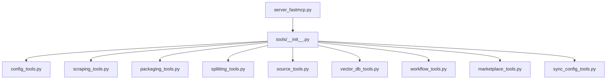
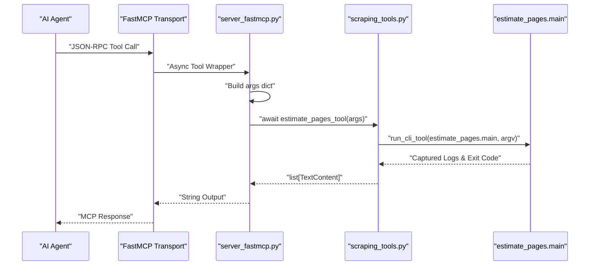

<!-- source: DeepWiki mcp.deepwiki.com · repo yusufkaraaslan/Skill_Seekers · page 14.7 FastMCP Server Implementation · fetched 2026-10-26 -->

# FastMCP Server Implementation

<details>
<summary>Relevant source files</summary>

The following files were used as context for generating this wiki page:

- [configs/godot.json](configs/godot.json)
- [configs/react.json](configs/react.json)
- [src/skill_seekers/__init__.py](src/skill_seekers/__init__.py)
- [src/skill_seekers/cli/__init__.py](src/skill_seekers/cli/__init__.py)
- [src/skill_seekers/mcp/__init__.py](src/skill_seekers/mcp/__init__.py)
- [src/skill_seekers/mcp/server_fastmcp.py](src/skill_seekers/mcp/server_fastmcp.py)
- [src/skill_seekers/mcp/tools/__init__.py](src/skill_seekers/mcp/tools/__init__.py)
- [src/skill_seekers/mcp/tools/scraping_tools.py](src/skill_seekers/mcp/tools/scraping_tools.py)
- [tests/test_mcp_scrape_generic_word.py](tests/test_mcp_scrape_generic_word.py)

</details>


This page covers the internal design of `src/skill_seekers/mcp/server_fastmcp.py`: how the `FastMCP` instance is created, how tools are registered via decorators, how tool implementations are delegated to modular `*_impl` functions, and how stdio and HTTP transport modes work [src/skill_seekers/mcp/server_fastmcp.py:1-50](). For a higher-level view of MCP integration, see [4 - MCP Integration](). For a reference listing of all exposed tools and their parameters, see [19 - MCP Tools Complete Reference](). For agent detection and config-file generation, see [4.2 - Multi-Agent Support]().

---

## Overview

`src/skill_seekers/mcp/server_fastmcp.py` is the primary MCP server entry point for skill-seekers. It provides a modern, decorator-based alternative to the legacy `server.py`, reducing the server layer by approximately 68% (from ~2200 lines to ~708 lines) [src/skill_seekers/mcp/server_fastmcp.py:8-9](). The server exposes 34 tools organized into multiple categories [src/skill_seekers/mcp/server_fastmcp.py:13-21](). All tool implementations live in the `src/skill_seekers/mcp/tools/` package; the server layer focuses on routing, parameter mapping, and transport management [src/skill_seekers/mcp/tools/__init__.py:1-187]().

Sources: [src/skill_seekers/mcp/server_fastmcp.py:1-50](), [src/skill_seekers/mcp/tools/__init__.py:1-187]()

---

## Server Initialization

The `FastMCP` class is imported from `mcp.server` and instantiated at module level. The import is wrapped in a try/except block so that the module can be imported without raising an error when the `mcp` package is absent, which is critical for the test environment [src/skill_seekers/mcp/server_fastmcp.py:57-70]().

```python
mcp = FastMCP(
    name="skill-seeker",
    instructions="Skill Seeker MCP Server - Generate LLM skills from documentation",
)
```
[src/skill_seekers/mcp/server_fastmcp.py:126-132]()

The global `mcp` object is `None` when the package is unavailable. All decorator applications check for this via `safe_tool_decorator` [src/skill_seekers/mcp/server_fastmcp.py:136-145]().

Sources: [src/skill_seekers/mcp/server_fastmcp.py:57-145]()

---

## `safe_tool_decorator` — Graceful Degradation

`safe_tool_decorator` is a utility that wraps `mcp.tool()`. When `mcp` is `None` (e.g., during tests or if the dependency is missing), it returns a pass-through decorator so the module can still be imported and the tool functions can be tested as standard async functions [src/skill_seekers/mcp/server_fastmcp.py:136-145]().

Every tool definition in `src/skill_seekers/mcp/server_fastmcp.py` uses this decorator rather than calling `mcp.tool()` directly.

Sources: [src/skill_seekers/mcp/server_fastmcp.py:136-145]()

---

## Tool Registration Pattern

Each tool follows a consistent registration and delegation pattern:

1. **Registration**: The tool is decorated with `@safe_tool_decorator`, providing a human-readable description for the AI agent [src/skill_seekers/mcp/server_fastmcp.py:153-155]().
2. **Signature**: The function is `async` and uses typed Python parameters, allowing FastMCP to auto-generate the JSON-RPC schema [src/skill_seekers/mcp/server_fastmcp.py:156-164]().
3. **Delegation**: The tool collects its parameters into an `args` dictionary and awaits the corresponding `*_impl` function imported from `src/skill_seekers/mcp/tools/__init__.py` [src/skill_seekers/mcp/server_fastmcp.py:180-188]().
4. **Response Mapping**: The implementation returns a `list[TextContent]`. The wrapper extracts the `.text` attribute to return a plain string to the MCP client [src/skill_seekers/mcp/server_fastmcp.py:191-193]().

**Example — `generate_config`:**
[src/skill_seekers/mcp/server_fastmcp.py:153-193]()

Sources: [src/skill_seekers/mcp/server_fastmcp.py:153-193]()

---

## Tool Categories and Dispatch Table

The 34 tools are modularized into specific files within the `src/skill_seekers/mcp/tools/` directory.

**Tool Category Dispatch Table**

| Category | Tool Count | Key Tools | Impl Module |
|---|---|---|---|
| **Config** | 3 | `generate_config`, `list_configs`, `validate_config` | `config_tools.py` |
| **Scraping** | 11 | `scrape_docs`, `scrape_github`, `scrape_codebase`, `estimate_pages` | `scraping_tools.py` |
| **Packaging** | 4 | `package_skill`, `upload_skill`, `enhance_skill`, `install_skill` | `packaging_tools.py` |
| **Splitting** | 2 | `split_config`, `generate_router` | `splitting_tools.py` |
| **Source** | 6 | `fetch_config`, `submit_config`, `add_config_source` | `source_tools.py` |
| **Marketplace** | 4 | `add_marketplace`, `publish_to_marketplace` | `marketplace_tools.py` |
| **Vector DB** | 4 | `export_to_weaviate`, `export_to_chroma`, `export_to_qdrant` | `vector_db_tools.py` |
| **Workflow** | 5 | `list_workflows`, `create_workflow`, `update_workflow` | `workflow_tools.py` |

Sources: [src/skill_seekers/mcp/server_fastmcp.py:13-21](), [src/skill_seekers/mcp/tools/__init__.py:1-187]()

---

## Module Structure Diagram

**Module Structure: `server_fastmcp.py` to Code Entities**


Sources: [src/skill_seekers/mcp/server_fastmcp.py:75-124](), [src/skill_seekers/mcp/tools/__init__.py:1-187]()

---

## Call Flow Diagram

**MCP Tool Call Flow: Natural Language to Code Entity Space**


Sources: [src/skill_seekers/mcp/server_fastmcp.py:153-193](), [src/skill_seekers/mcp/tools/scraping_tools.py:26-61](), [src/skill_seekers/mcp/tools/scraping_tools.py:108-130]()

---

## Tool Execution Environment

To ensure consistency and allow for rich logging, `src/skill_seekers/mcp/tools/scraping_tools.py` implements an in-process execution helper for CLI-based logic [src/skill_seekers/mcp/tools/scraping_tools.py:26-61]().

**Key Features:**
- **Log Capture**: Uses `capture_cli_logs` (a context manager using `io.StringIO`) to redirect `stdout` and `stderr` from the CLI modules into the MCP response [src/skill_seekers/mcp/tools/scraping_tools.py:38-39]().
- **Exit Code Handling**: Maps the return code of the CLI `main` functions to success/failure messages in the MCP output [src/skill_seekers/mcp/tools/scraping_tools.py:52-60]().
- **Exception Safety**: Wraps the converter execution in try/except blocks to report internal errors back to the agent rather than crashing the server [src/skill_seekers/mcp/tools/scraping_tools.py:40-47]().

Sources: [src/skill_seekers/mcp/tools/scraping_tools.py:26-61]()

---

## Transport Modes

The server supports two primary transport mechanisms, selected via command-line flags at startup [src/skill_seekers/mcp/server_fastmcp.py:23-49]().

| Mode | Flag | Usage Scenario |
|---|---|---|
| **stdio** | (Default) | Standard integration for Claude Code, Cursor, and Windsurf. |
| **HTTP/SSE** | `--http` | Remote access or integration with agents that support Server-Sent Events. |

**Example Config for Stdio:**
```json
{
  "mcpServers": {
    "skill-seeker": {
      "command": "python",
      "args": ["-m", "skill_seekers.mcp.server_fastmcp"]
    }
  }
}
```
[src/skill_seekers/mcp/server_fastmcp.py:31-40]()

Sources: [src/skill_seekers/mcp/server_fastmcp.py:23-49]()

---

## Implementation Delegation

The `src/skill_seekers/mcp/tools/__init__.py` file acts as a centralized registry, re-exporting implementation functions from specialized modules [src/skill_seekers/mcp/tools/__init__.py:19-135](). This allows `src/skill_seekers/mcp/server_fastmcp.py` to maintain a clean list of imports while keeping logic separated by domain.

**Example Imports in `server_fastmcp.py`:**
[src/skill_seekers/mcp/server_fastmcp.py:75-124]()

**Re-exports in `tools/__init__.py`:**
[src/skill_seekers/mcp/tools/__init__.py:137-187]()

Sources: [src/skill_seekers/mcp/server_fastmcp.py:75-124](), [src/skill_seekers/mcp/tools/__init__.py:137-187]()

---

