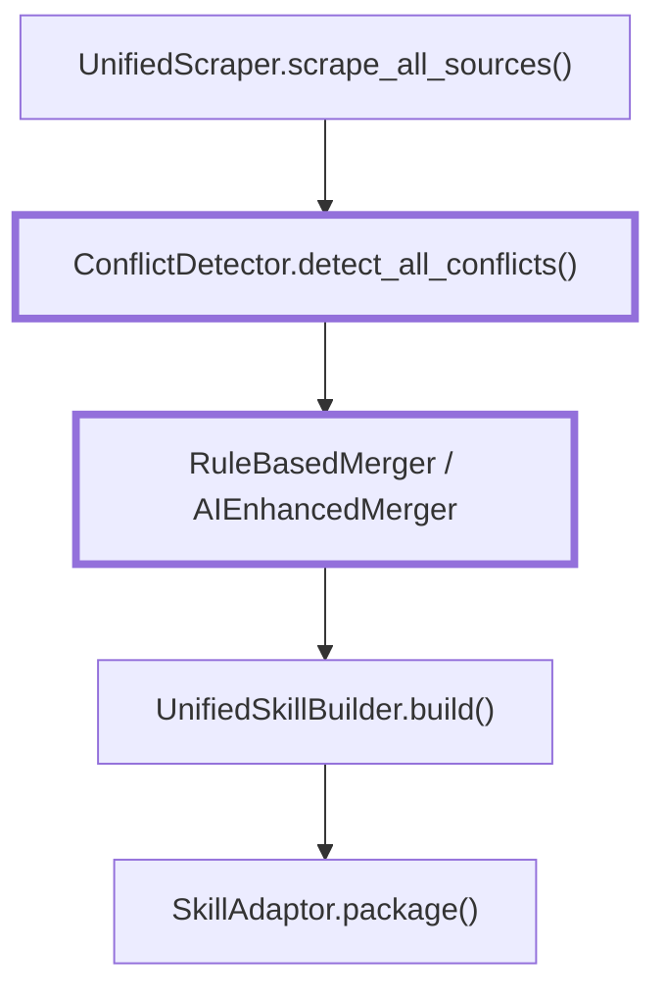
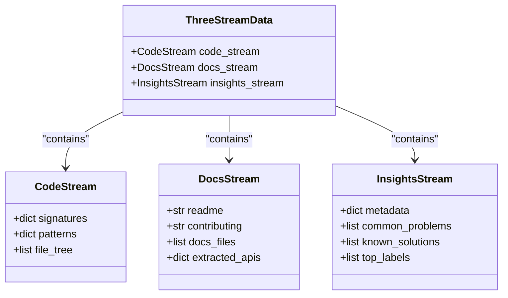
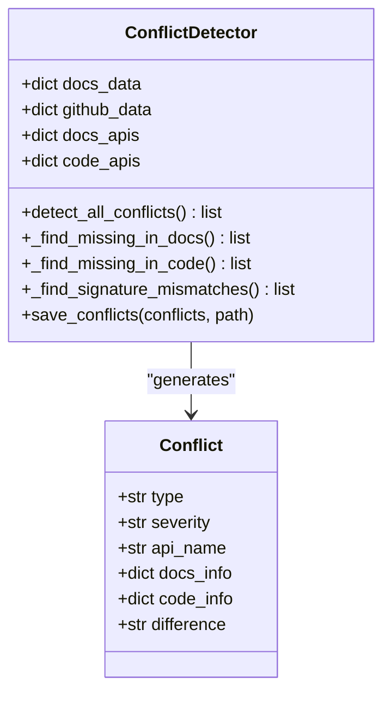
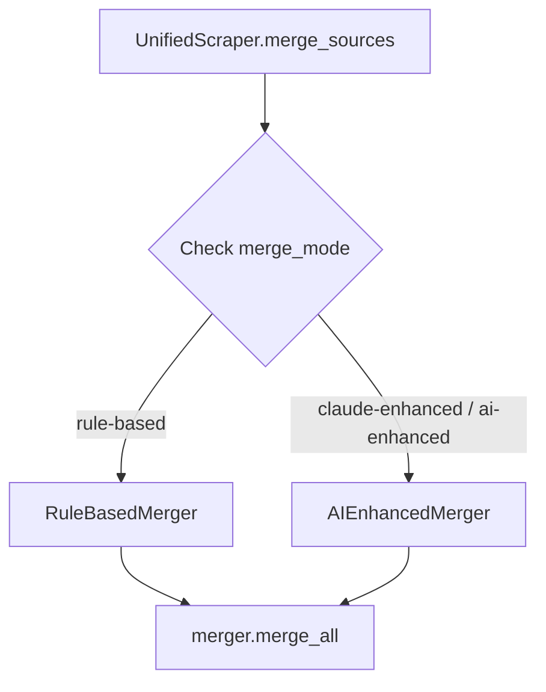

<!-- source: DeepWiki mcp.deepwiki.com · repo yusufkaraaslan/Skill_Seekers · page 14.8 Merge Sources & Conflict Resolution · fetched 2026-10-26 -->

# Merge Sources & Conflict Resolution

Relevant source files

The following files were used as context for generating this wiki page:

- [docs/BUG_AUDIT.md](docs/BUG_AUDIT.md)
- [src/skill_seekers/cli/doc_scraper.py](src/skill_seekers/cli/doc_scraper.py)
- [src/skill_seekers/cli/merge_sources.py](src/skill_seekers/cli/merge_sources.py)
- [src/skill_seekers/cli/unified_scraper.py](src/skill_seekers/cli/unified_scraper.py)
- [src/skill_seekers/cli/unified_skill_builder.py](src/skill_seekers/cli/unified_skill_builder.py)
- [src/skill_seekers/mcp/server.py](src/skill_seekers/mcp/server.py)
- [tests/test_agent_client.py](tests/test_agent_client.py)
- [tests/test_c3_integration.py](tests/test_c3_integration.py)
- [tests/test_create_pipeline_regressions.py](tests/test_create_pipeline_regressions.py)
- [tests/test_mcp_server.py](tests/test_mcp_server.py)
- [tests/test_multi_source.py](tests/test_multi_source.py)
- [tests/test_unified.py](tests/test_unified.py)
- [tests/test_unified_mcp_integration.py](tests/test_unified_mcp_integration.py)
- [tests/test_unified_scraper_orchestration.py](tests/test_unified_scraper_orchestration.py)

This page documents the `merge_sources` module ([src/skill_seekers/cli/merge_sources.py]()) and the `conflict_detector` module ([src/skill_seekers/cli/conflict_detector.py]()). Together, these implement Phases 2 and 3 of the unified multi-source scraping pipeline: detecting discrepancies between scraped sources and reconciling them into a single merged API reference.

---

## Position in the Unified Pipeline

The merge and conflict resolution system operates as Phases 2 and 3 within the `UnifiedScraper` orchestration loop (`[src/skill_seekers/cli/unified_scraper.py]()`). It bridges the gap between raw data ingestion and the final skill synthesis performed by `UnifiedSkillBuilder` (`[src/skill_seekers/cli/unified_skill_builder.py]()`).

**Unified Pipeline — Phase Positions**

Sources: [tests/test_unified_scraper_orchestration.py:10-11](), [src/skill_seekers/cli/merge_sources.py:11-16]()

---

## Multi-Layer Data Architecture

Before merging, data is organized into conceptual layers with descending priority when there is a conflict. The system utilizes a "Three-Stream" architecture to separate concerns between code ground-truth, official documentation, and community insights (`[src/skill_seekers/cli/merge_sources.py:11-35]()`).

| Layer | Stream | Source | Role |
|---|---|---|---|
| 1 | `CodeStream` | C3.x codebase analysis | Ground truth — what the code actually does |
| 2 | `DocsStream` | HTML documentation scraper | Official intent — what maintainers say it does |
| 3 | `DocsStream` | GitHub docs (README, etc.) | Community docs and high-level guides |
| 4 | `InsightsStream` | GitHub insights | Real-world signal — issues, labels, community problems |

The `ThreeStreamData` container and its constituents are defined to facilitate this multi-layer merging logic.

**Data Entity Mapping: Three-Stream Architecture**

Sources: [src/skill_seekers/cli/merge_sources.py:11-16](), [src/skill_seekers/cli/merge_sources.py:27-35]()

---

## Conflict Detection

### `ConflictDetector`

The `ConflictDetector` class (`[src/skill_seekers/cli/conflict_detector.py]()`) identifies discrepancies between the documentation-derived API and the code-derived API. It is invoked during the reconciliation phase to flag missing or mismatched signatures.

**`ConflictDetector` Logic Flow**

Sources: [src/skill_seekers/cli/conflict_detector.py:20-22](), [tests/test_unified.py:185-218]()

### Conflict Types and Severity

The detector specifically hunts for three categories of discrepancies:

| Conflict `type` | Severity | Description |
|---|---|---|
| `missing_in_docs` | `medium` | API exists in code but is not documented. Detected by `_find_missing_in_docs`. |
| `missing_in_code` | `high` | API is documented but does not exist in the codebase. Detected by `_find_missing_in_code`. |
| `signature_mismatch` | `high` | API exists in both, but parameter names/types differ. Detected by `_find_signature_mismatches`. |

Sources: [src/skill_seekers/cli/merge_sources.py:141-160](), [tests/test_unified.py:152-233]()

---

## Merge Strategies

### Selecting the Merger

The system instantiates a merger based on the `merge_mode` configuration field (`[src/skill_seekers/cli/merge_sources.py:5-9]`).

Sources: [src/skill_seekers/cli/merge_sources.py:5-9](), [tests/test_unified_scraper_orchestration.py:36-36]()

---

### `RuleBasedMerger`

The `RuleBasedMerger` uses deterministic logic to reconcile sources (`[src/skill_seekers/cli/merge_sources.py]()`). It follows a "Code as Ground Truth" philosophy for signatures.

**Priority Rules:**
1. **API only in docs:** Marked as `docs_only`. Signature is used from docs but flagged as potentially obsolete.
2. **API only in code:** Marked as `code_only`. Signature is extracted from code; flagged as potentially internal if not in public patterns.
3. **Matched (No Conflict):** Merged into a single record. Code signature is used; docs description is used.
4. **Matched (Conflict):** Code signature overrides docs signature. A `warning` is added to the record indicating the discrepancy.

Sources: [src/skill_seekers/cli/merge_sources.py:215-217](), [tests/test_unified.py:21-21]()

---

### `ClaudeEnhancedMerger` / `AIEnhancedMerger`

The `AIEnhancedMerger` (referred to as `ClaudeEnhancedMerger` in documentation aliases) leverages an LLM (via the `AgentClient` and subprocess approach) to resolve complex semantic conflicts that rule-based logic cannot handle (`[src/skill_seekers/cli/merge_sources.py:5-9]`).

**Subprocess Execution Flow:**
1. **Workspace Creation**: Creates a temporary directory for the merge session.
2. **Context Writing**: Dumps `conflicts.json`, `docs_apis.json`, and `code_apis.json` into the workspace.
3. **Claude Launch**: Launches a Claude session using `AgentClient` (`[src/skill_seekers/cli/agent_client.py]()`) with specific system instructions.
4. **Result Polling**: Polls the workspace for a `merged_apis.json` file produced by the AI.

**Fallback:** If the AI merge fails, times out, or the subprocess returns a non-zero exit code, the system automatically falls back to `RuleBasedMerger`.

Sources: [src/skill_seekers/cli/merge_sources.py:5-9](), [src/skill_seekers/cli/agent_client.py:18-21]()

---

## Supporting Logic

### Hybrid Content Generation

The `generate_hybrid_content` function enriches the merged API data with GitHub-specific context and insights (`[src/skill_seekers/cli/merge_sources.py:90-107]()`):

*   **`_match_issues_to_apis`**: Associates GitHub issues with specific API endpoints based on keyword matching against titles and labels `[src/skill_seekers/cli/merge_sources.py:172-213]()`.
*   **`categorize_issues_by_topic`**: Groups issues into functional buckets (e.g., "Performance", "Security") based on keyword match density `[src/skill_seekers/cli/merge_sources.py:42-87]()`.

### Conflict Summary

The system generates a summary of unresolved issues within the `hybrid` content structure, counting conflicts by type and severity (`[src/skill_seekers/cli/merge_sources.py:141-160]()`). This summary is used to populate the `conflicts.md` report in the `references/` directory via `UnifiedSkillBuilder` (`[src/skill_seekers/cli/unified_skill_builder.py:68]()`).

Sources: [src/skill_seekers/cli/merge_sources.py:141-160](), [src/skill_seekers/cli/merge_sources.py:90-107](), [src/skill_seekers/cli/unified_skill_builder.py:68]()

---

