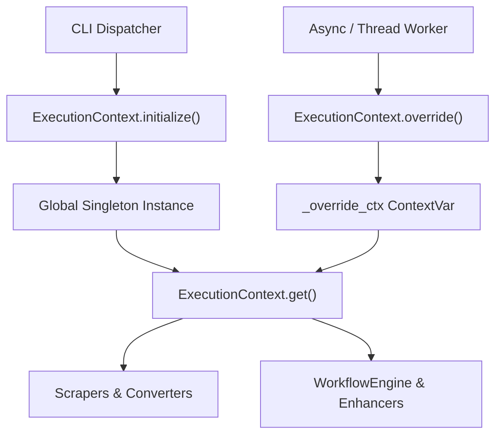
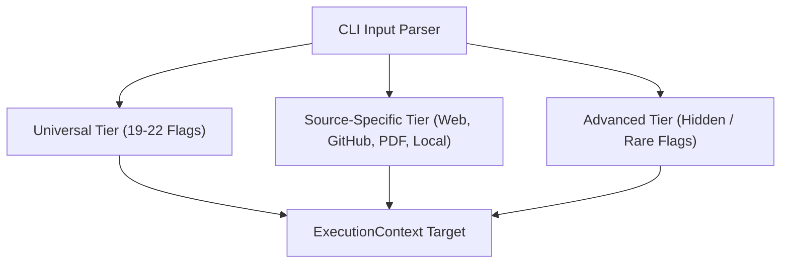
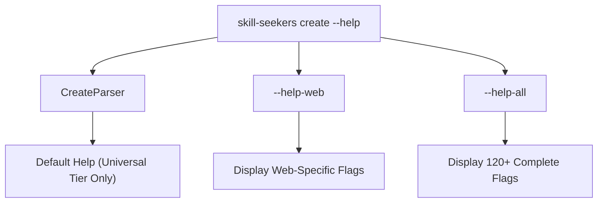
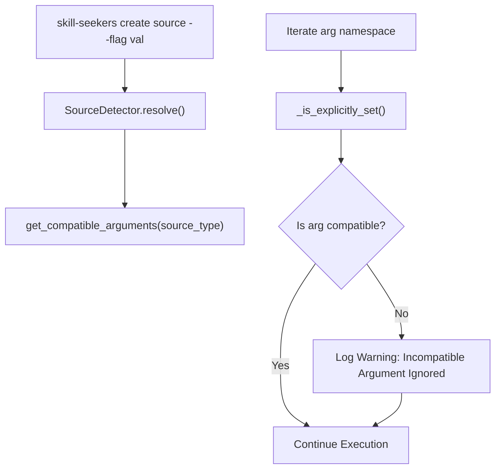
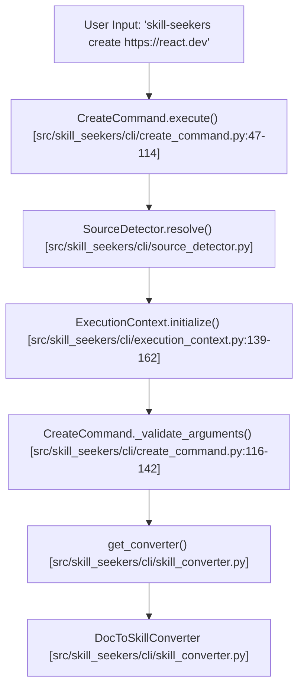
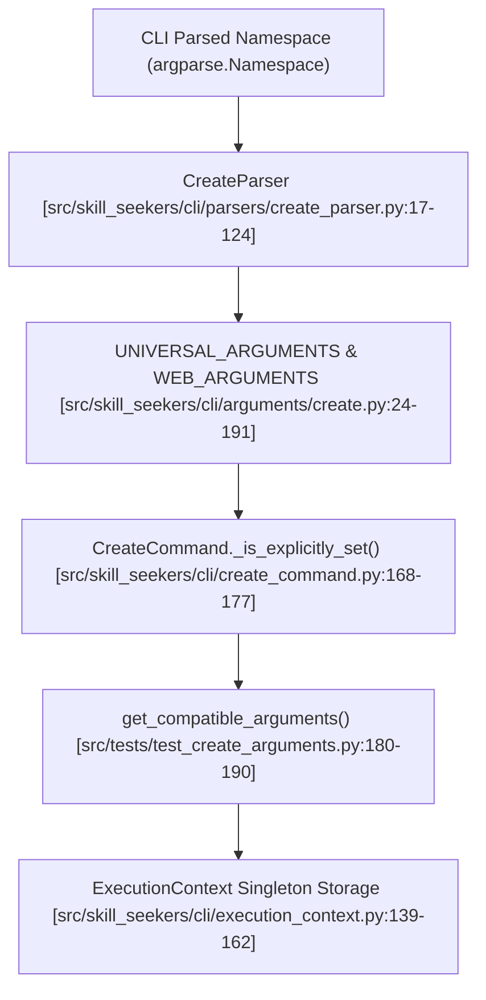

<!-- source: DeepWiki mcp.deepwiki.com · repo yusufkaraaslan/Skill_Seekers · page 14.9 Execution Context & Argument System · fetched 2026-10-26 -->

# Execution Context & Argument System

Relevant source files

The following files were used as context for generating this wiki page:

- [docs/FAQ.md](docs/FAQ.md)
- [docs/TROUBLESHOOTING.md](docs/TROUBLESHOOTING.md)
- [docs/features/HOW_TO_GUIDES.md](docs/features/HOW_TO_GUIDES.md)
- [docs/features/SKILL_SEARCH_INDEX.md](docs/features/SKILL_SEARCH_INDEX.md)
- [src/skill_seekers/cli/arguments/common.py](src/skill_seekers/cli/arguments/common.py)
- [src/skill_seekers/cli/arguments/create.py](src/skill_seekers/cli/arguments/create.py)
- [src/skill_seekers/cli/arguments/enhance.py](src/skill_seekers/cli/arguments/enhance.py)
- [src/skill_seekers/cli/arguments/scrape.py](src/skill_seekers/cli/arguments/scrape.py)
- [src/skill_seekers/cli/config_manager.py](src/skill_seekers/cli/config_manager.py)
- [src/skill_seekers/cli/create_command.py](src/skill_seekers/cli/create_command.py)
- [src/skill_seekers/cli/execution_context.py](src/skill_seekers/cli/execution_context.py)
- [src/skill_seekers/cli/parsers/base.py](src/skill_seekers/cli/parsers/base.py)
- [src/skill_seekers/cli/parsers/config_parser.py](src/skill_seekers/cli/parsers/config_parser.py)
- [src/skill_seekers/cli/parsers/create_parser.py](src/skill_seekers/cli/parsers/create_parser.py)
- [src/skill_seekers/cli/parsers/enhance_status_parser.py](src/skill_seekers/cli/parsers/enhance_status_parser.py)
- [src/skill_seekers/cli/parsers/estimate_parser.py](src/skill_seekers/cli/parsers/estimate_parser.py)
- [src/skill_seekers/cli/parsers/install_parser.py](src/skill_seekers/cli/parsers/install_parser.py)
- [src/skill_seekers/cli/parsers/multilang_parser.py](src/skill_seekers/cli/parsers/multilang_parser.py)
- [src/skill_seekers/cli/skill_indexer.py](src/skill_seekers/cli/skill_indexer.py)
- [tests/conftest.py](tests/conftest.py)
- [tests/test_create_arguments.py](tests/test_create_arguments.py)
- [tests/test_create_integration_basic.py](tests/test_create_integration_basic.py)
- [tests/test_execution_context.py](tests/test_execution_context.py)

## Purpose and Scope
This document details the internal architecture of the `ExecutionContext` singleton and the multi-tier argument system within the codebase. It covers how command-line options, configuration files, and environment variables are unified into a single source of truth, how subcommand parsers implement progressive disclosure, and how drift guards and validation mechanisms ensure runtime safety across single-source and unified workflows.

Sources: `src/skill_seekers/cli/execution_context.py:1-13`, `src/skill_seekers/cli/arguments/create.py:1-10`

---

## 1. ExecutionContext Singleton Architecture

The `ExecutionContext` class functions as a centralized container for all execution parameters, settings, and detected source metadata [src/skill_seekers/cli/execution_context.py:1-139](). Instead of individual scrapers, converters, or enhancement modules parsing `sys.argv` or managing disjointed state flags, all subsystem components retrieve configuration through `ExecutionContext.get()`.

### Configuration Sections
The singleton aggregates configuration into distinct Pydantic models:
- `SourceInfoConfig`: Holds source detection outcomes (`type`, `raw_source`, `parsed`, `suggested_name`) [src/skill_seekers/cli/execution_context.py:42-49]().
- `EnhancementSettings`: Controls AI enhancement parameters (`enabled`, `level`, `mode`, `agent`, `timeout`, `workflows`, `stages`) [src/skill_seekers/cli/execution_context.py:51-76]().
- `OutputSettings`: Manages output targets (`name`, `output_dir`, `doc_version`, `dry_run`, `index`) [src/skill_seekers/cli/execution_context.py:78-100]().
- `ScrapingSettings`: Defines web/local traversal limits (`max_pages`, `rate_limit`, `browser`, `workers`, `resume`) [src/skill_seekers/cli/execution_context.py:101-120]().
- `AnalysisSettings`: Configures codebase AST and pattern analysis (`depth`, `skip_patterns`, `skip_test_examples`, `skip_how_to_guides`) [src/skill_seekers/cli/execution_context.py:122-137]().

### Thread and Task Isolation via ContextVar
To support concurrent execution contexts (such as parallel test suites, asynchronous task processing, or multi-tenant MCP server operations), overrides are isolated using a `contextvars.ContextVar` (`_override_ctx`) [src/skill_seekers/cli/execution_context.py:31-39](). This ensures that concurrent tasks or worker threads interact with their own execution parameters without clobbering the global singleton baseline.

Sources: `src/skill_seekers/cli/execution_context.py:1-162`, `src/skill_seekers/cli/create_command.py:70-85`

---

## 2. The Three-Tier Argument System

Command-line arguments for skill creation and enhancement are organized into a strict three-tier architecture [src/skill_seekers/cli/arguments/create.py:1-10]:

1. **Universal Arguments**: Apply across all source types (web, GitHub, local code, PDF, config). Examples include `--name`, `--description`, `--output`, `--enhance-level`, `--preset`, `--config`, and RAG chunking parameters [src/skill_seekers/cli/arguments/create.py:24-191]().
2. **Source-Specific Arguments**: Relevant exclusively to a specific ingestion engine. For instance, web scraping introduces `--max-pages`, `--workers`, and `--browser` [src/tests/test_create_arguments.py:72-101](); GitHub integration uses `--repo`, `--token`, and `--max-issues` [src/tests/test_create_arguments.py:72-101]().
3. **Advanced Arguments**: Rarely modified operational parameters hidden from default help output to prevent user overload, such as `--no-rate-limit` or `--interactive-enhancement` [src/tests/test_create_arguments.py:119-128]().

Sources: `src/skill_seekers/cli/arguments/create.py:1-196`, `src/tests/test_create_arguments.py:1-128`

---

## 3. Parser Registry & Progressive Disclosure Help

The top-level entry point utilizes a command pattern dispatcher (`main.py`) paired with specialized subcommand parsers [src/skill_seekers/cli/parsers/create_parser.py:1-17]. 

`CreateParser` inherits from `SubcommandParser` and implements progressive help flags (`--help-web`, `--help-github`, `--help-local`, `--help-pdf`, `--help-advanced`, `--help-all`) [src/skill_seekers/cli/parsers/create_parser.py:17-103](). By default, running `skill-seekers create --help` renders a concise summary containing universal parameters and usage patterns, keeping the interface uncluttered while retaining access to over 120 specialized flags when extended with helper flags.

Sources: `src/skill_seekers/cli/parsers/create_parser.py:1-124`, `src/skill_seekers/cli/parsers/base.py`

---

## 4. Argument Validation, Compatibility, and Drift Guards

When executing `CreateCommand.execute()`, the system performs automatic source detection using `SourceDetector.resolve()` before initializing the `ExecutionContext` [src/skill_seekers/cli/create_command.py:56-85](). 

To prevent misconfigurations, `CreateCommand._validate_arguments()` evaluates all supplied arguments against the compatibility rules defined for the resolved source type [src/skill_seekers/cli/create_command.py:116-142]().

### Explicit Setting Detection
To distinguish between flags explicitly provided by the user and those populated by parser defaults, `_is_explicitly_set()` compares runtime namespace values against registered parser defaults [src/skill_seekers/cli/create_command.py:168-177](). If an argument is explicitly set but marked incompatible with the target source type (e.g., passing `--max-pages` to a local codebase scrape), the dispatcher logs a warning rather than failing outright or silently ignoring the intent [src/skill_seekers/cli/create_command.py:136-142]().

Sources: `src/skill_seekers/cli/create_command.py:29-177`, `src/skill_seekers/cli/arguments/create.py:1-24`

---

## 5. Natural Language Space to Code Entity Space Mappings

The following diagrams bridge high-level user interactions and natural language intent with the underlying codebase entities, linking execution commands directly to classes and functions.

### Diagram A: Ingestion Routing and Context Initialization

Sources: `src/skill_seekers/cli/create_command.py:47-114`, `src/skill_seekers/cli/execution_context.py:139-162`, `src/skill_seekers/cli/skill_converter.py`

### Diagram B: Argument Hierarchy and Validation Flow

Sources: `src/skill_seekers/cli/parsers/create_parser.py:17-124`, `src/skill_seekers/cli/arguments/create.py:24-191`, `src/skill_seekers/cli/create_command.py:168-177`, `src/skill_seekers/cli/execution_context.py:139-162`

---

