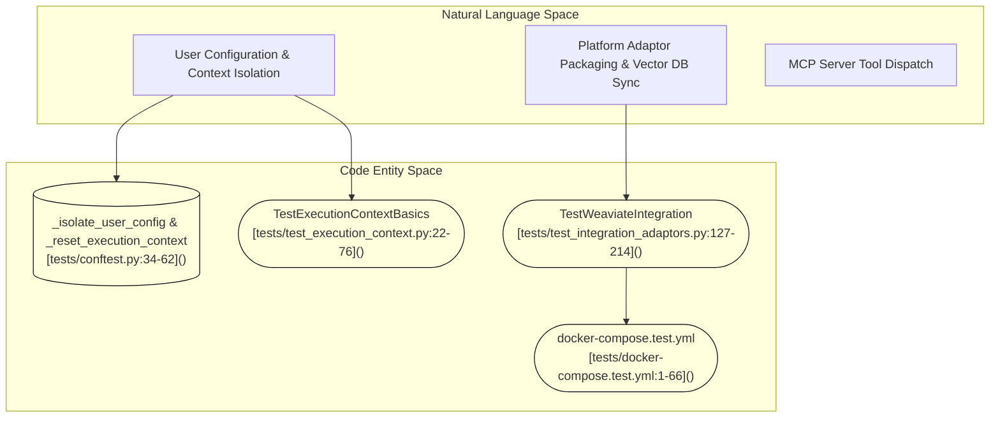
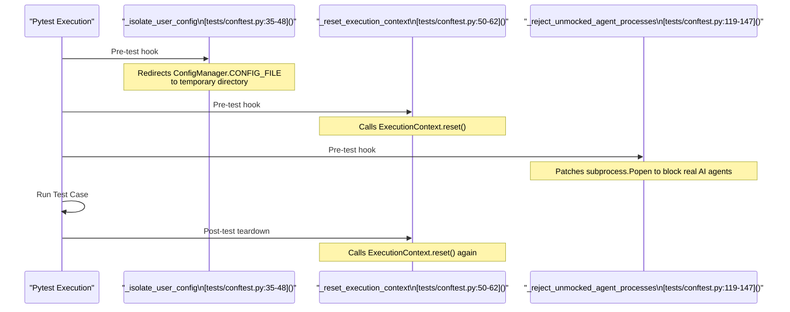

<!-- source: DeepWiki mcp.deepwiki.com · repo yusufkaraaslan/Skill_Seekers · page 15.1 Test Suite Organization · fetched 2026-10-26 -->

# Test Suite Organization

Relevant source files

The following files were used as context for generating this wiki page:

- [docs/FAQ.md](docs/FAQ.md)
- [docs/TROUBLESHOOTING.md](docs/TROUBLESHOOTING.md)
- [docs/features/HOW_TO_GUIDES.md](docs/features/HOW_TO_GUIDES.md)
- [scripts/run_integration_tests.sh](scripts/run_integration_tests.sh)
- [src/skill_seekers/cli/arguments/enhance.py](src/skill_seekers/cli/arguments/enhance.py)
- [src/skill_seekers/cli/config_manager.py](src/skill_seekers/cli/config_manager.py)
- [src/skill_seekers/cli/execution_context.py](src/skill_seekers/cli/execution_context.py)
- [tests/conftest.py](tests/conftest.py)
- [tests/docker-compose.test.yml](tests/docker-compose.test.yml)
- [tests/test_execution_context.py](tests/test_execution_context.py)
- [tests/test_integration_adaptors.py](tests/test_integration_adaptors.py)

This page details the organization, structure, fixtures, and execution patterns of the Skill Seekers test suite located in the `tests/` directory. The suite validates package integrity, configuration management via `ExecutionContext` [src/skill_seekers/cli/execution_context.py:1-13](), scraper logic, AI enhancement boundaries, Model Context Protocol (MCP) tool dispatchers, and platform adaptors (including live vector database integration).

## Test Suite Overview & Directory Structure

The test suite mirrors the architectural components of `skill_seekers`, segregating fast unit tests from slower integration, end-to-end, and network-bound tests. 

| Test Module / Path | Functional Area Covered | Key Assertions / Mechanisms |
|:---|:---|:---|
| `tests/conftest.py` | Global test session configuration | Environment isolation, singleton resets, agent process blocking [tests/conftest.py:28-147]() |
| `tests/test_execution_context.py` | `ExecutionContext` singleton | Validates argument parsing, defaults, overrides, and context clearing [tests/test_execution_context.py:22-193]() |
| `tests/test_integration_adaptors.py` | Platform & vector database adaptors | End-to-end workflows (package → upload → query) with real services [tests/test_integration_adaptors.py:126-222]() |
| `tests/test_mcp_fastmcp.py` | FastMCP server implementation | Tool registration, schema validation, and dispatcher correctness |
| `tests/test_git_sources_e2e.py` | Git config repositories & publishing | Cloning, pulling, config discovery, and source registry CRUD |
| `tests/test_constants.py` | System-wide configuration defaults | Rate limits, timeout bounds, and categorization scoring thresholds |

Sources: [tests/conftest.py:28-147](), [tests/test_execution_context.py:22-193](), [tests/test_integration_adaptors.py:126-222](), [tests/docker-compose.test.yml:1-66]()

---

## Pytest Conventions & Naming Rules

Test files follow the standard `test_*.py` naming convention, and test classes begin with `Test`. Test methods use descriptive snake_case names indicating the precondition, action, and expected outcome (e.g., `test_get_returns_defaults_when_not_initialized` [tests/test_execution_context.py:33-38]()).

Markers are registered to control test execution scopes:
*   `not slow`: Excludes long-running extraction or network tasks.
*   `mcp_only`: Targets Model Context Protocol tool verification.
*   `integration`: Requires external dependencies or containerized databases.
*   `e2e`: Full system workflow simulations.

Sources: [tests/test_execution_context.py:33-38]()

---

## Conftest Fixtures and Environment Isolation

To prevent state leakage across tests, `tests/conftest.py` provides strict automated fixtures (`autouse=True`) that run before and after every test function.

### Key Fixture Implementations
1. **User Configuration Isolation (`_isolate_user_config`)**: Monkeypatches `ConfigManager.CONFIG_FILE` to point to a temporary test directory (`tmp_path_factory`), ensuring that a developer's local `~/.config/skill-seekers/config.json` settings (such as custom enhancement levels) never bleed into assertions [tests/conftest.py:35-48]().
2. **Execution Context Reset (`_reset_execution_context`)**: Resets the singleton state of `ExecutionContext` before and after each test to prevent configuration poisoning from earlier test cases [tests/conftest.py:50-62]().
3. **Subprocess Agent Guard (`_reject_unmocked_agent_processes`)**: Intercepts `subprocess.Popen` calls. If a test attempts to execute real external coding agents (`claude`, `codex`, `copilot`, `opencode`, `kimi`, `qwen`, `aider`), it immediately fails via `pytest.fail()`, enforcing proper mocking of the AI agent boundary [tests/conftest.py:119-147]().
4. **Session Bootstrap Artifact (`bootstrap_artifact`)**: Runs a lightweight, isolated code bootstrap operation once per test session against a mock repository structure, providing a shared artifact for downstream tests without analyzing the developer's live workspace [tests/conftest.py:64-116]().

Sources: [tests/conftest.py:35-147]()

---

## Golden Fixtures & Test Assets

The test suite relies on deterministic golden files and synthesized temporary directory structures rather than live internet scraping during standard unit testing.
*   **Sample Skill Generation**: Fixtures such as `sample_skill_dir` in integration tests construct valid directory layouts containing `SKILL.md` and `references/` subdirectories with markdown content [tests/test_integration_adaptors.py:30-112]().
*   **Codebase Stubs**: The `bootstrap_artifact` fixture creates temporary files (e.g., `service.py`, `test_service.py`) with known function signatures to test AST parsing and workflow extraction without filesystem side effects [tests/conftest.py:75-91]().

Sources: [tests/conftest.py:75-91](), [tests/test_integration_adaptors.py:30-112]()

---

## Adaptor Testing & Vector DB Integration

Integration tests in `tests/test_integration_adaptors.py` verify complete packaging, uploading, and querying workflows across real vector store instances [tests/test_integration_adaptors.py:3-16]().

```mermaid
graph TD
    subgraph "Vector DB Integration Pipeline"
        Sample["sample_skill_dir fixture\n[tests/test_integration_adaptors.py:30-112]()"] --> Adaptor["get_adaptor('weaviate')\n[tests/test_integration_adaptors.py:152-154]()"]
        Adaptor --> Package["adaptor.package()\n[tests/test_integration_adaptors.py:154]()"]
        Package --> Client["weaviate.Client\n[tests/test_integration_adaptors.py:146]()"]
        Client --> DockerContainer["skill_seekers_test_weaviate\n[tests/docker-compose.test.yml:5-16]()"]
        DockerContainer --> Query["client.query.get()\n[tests/test_integration_adaptors.py:186-188]()"]
        Query --> Verify["Verify Metadata & Content\n[tests/test_integration_adaptors.py:190-208]()"]
    end

    style Sample fill:none,stroke:#000,stroke-width:1px
    style Adaptor fill:none,stroke:#000,stroke-width:1px
    style Package fill:none,stroke:#000,stroke-width:1px
    style Client fill:none,stroke:#000,stroke-width:1px
    style DockerContainer fill:none,stroke:#000,stroke-width:1px
    style Query fill:none,stroke:#000,stroke-width:1px
    style Verify fill:none,stroke:#000,stroke-width:1px
```

### Infrastructure Management
The integration test suite is supported by containerized services defined in `tests/docker-compose.test.yml`:
*   **Weaviate**: Runs on port `8080` with anonymous access enabled for containerized test runs [tests/docker-compose.test.yml:5-16]().
*   **Qdrant**: Runs on ports `6333` (HTTP) and `6334` (gRPC) [tests/docker-compose.test.yml:25-32]().
*   **ChromaDB**: Runs on port `8000` with persistent volume mapping [tests/docker-compose.test.yml:44-54]().

If services are unreachable or clients are missing, integration tests automatically skip gracefully via `pytest.skip()` to ensure CI pipelines do not fail on environments lacking Docker daemons [tests/test_integration_adaptors.py:133-149]().

Sources: [tests/test_integration_adaptors.py:3-222](), [tests/docker-compose.test.yml:1-66]()

---

