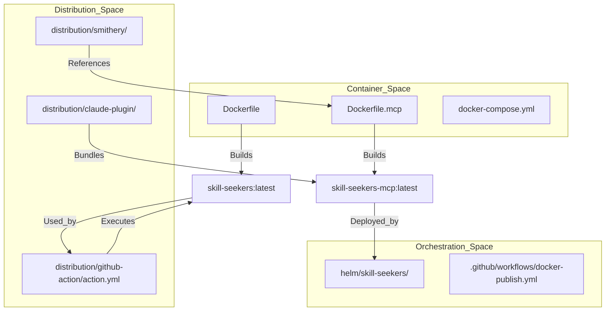

<!-- source: DeepWiki mcp.deepwiki.com · repo yusufkaraaslan/Skill_Seekers · page 16 Deployment & Distribution · fetched 2026-10-26 -->

# Deployment & Distribution

Relevant source files

The following files were used as context for generating this wiki page:

- [distribution/claude-plugin/.mcp.json](distribution/claude-plugin/.mcp.json)
- [distribution/claude-plugin/README.md](distribution/claude-plugin/README.md)
- [distribution/claude-plugin/commands/create-skill.md](distribution/claude-plugin/commands/create-skill.md)
- [distribution/claude-plugin/commands/install-skill.md](distribution/claude-plugin/commands/install-skill.md)
- [distribution/claude-plugin/commands/sync-config.md](distribution/claude-plugin/commands/sync-config.md)
- [distribution/claude-plugin/skills/skill-builder/SKILL.md](distribution/claude-plugin/skills/skill-builder/SKILL.md)
- [distribution/github-action/README.md](distribution/github-action/README.md)
- [distribution/github-action/action.yml](distribution/github-action/action.yml)
- [distribution/smithery/README.md](distribution/smithery/README.md)
- [docs/DOCKER_DEPLOYMENT.md](docs/DOCKER_DEPLOYMENT.md)
- [docs/KUBERNETES_DEPLOYMENT.md](docs/KUBERNETES_DEPLOYMENT.md)
- [docs/PRODUCTION_DEPLOYMENT.md](docs/PRODUCTION_DEPLOYMENT.md)
- [docs/zh-CN/getting-started/01-installation.md](docs/zh-CN/getting-started/01-installation.md)
- [helm/skill-seekers/values.yaml](helm/skill-seekers/values.yaml)

This page provides a high-level overview of the deployment and distribution mechanisms for the `skill-seekers` ecosystem. The project is designed with a "do-it-once, export-to-all-targets" philosophy, supporting environments ranging from local developer CLI operations to containerized cloud-native Kubernetes clusters, CI/CD pipelines, and AI agent extensions.

## Deployment Overview

The `skill-seekers` system can be deployed in several configurations depending on the required scale and integration tier. Core processing logic resides in the Python package distributed via PyPI, which is containerized and wrapped across various distribution channels.

### Deployment Components to Code Entities
The following diagram bridges the high-level deployment abstractions to concrete code entities, build files, and configuration modules within the repository.

**Deployment Architecture Mapping**

Sources: [.github/workflows/docker-publish.yml:32-38](), [Dockerfile:1-5](), [distribution/github-action/action.yml:49-51]()

---

## Docker Deployment

`skill-seekers` provides specialized Docker images to decouple CLI execution tasks from persistent MCP server operations. The standard `skill-seekers` image focuses on one-off documentation scraping, codebase parsing, and skill packaging [docs/DOCKER_DEPLOYMENT.md:52-62](). Conversely, the `skill-seekers-mcp` image runs the `FastMCP` server via `skill_seekers.mcp.server_fastmcp` to serve tool requests for AI assistants [docs/DOCKER_DEPLOYMENT.md:80-86]().

Multi-service stacks are orchestrated using `docker-compose.yml`, allowing the MCP server and embedding utilities to run alongside vector database containers such as Weaviate, Qdrant, and Chroma [docs/DOCKER_DEPLOYMENT.md:232-280]().

For detailed configuration, environment variables, health checks, and data persistence, see [Docker Deployment](#16.1).

Sources: [docs/DOCKER_DEPLOYMENT.md:1-286](), [Dockerfile.mcp:1-59]()

---

## Kubernetes & Helm Chart

For production and high-availability enterprise environments, the project includes a Helm chart located in `helm/skill-seekers/` [docs/KUBERNETES_DEPLOYMENT.md:77-81](). This orchestration layer enables horizontal pod autoscaling (HPA) for concurrent agent requests, persistent volume claims for shared skill caches and vector storage, and secure ingress routing for the MCP HTTP endpoints [helm/skill-seekers/values.yaml:93-169]().

Vector database sub-charts can also be enabled directly through the Helm configuration values to deploy isolated database instances alongside the core application [helm/skill-seekers/values.yaml:170-253]().

For detailed values schemas, replica tuning, and ingress deployment, see [Kubernetes & Helm Chart](#16.2).

Sources: [docs/KUBERNETES_DEPLOYMENT.md:63-128](), [helm/skill-seekers/values.yaml:1-253]()

---

## GitHub Action

The `yusufkaraaslan/skill-seekers-action@v3` GitHub Action embeds skill generation and documentation updating directly into CI/CD pipelines [distribution/github-action/README.md:1-11](). It exposes inputs for source selection, command type, output targets, and custom configuration paths [distribution/github-action/action.yml:9-32]().

Workflows can be scheduled weekly to keep documentation skills synchronized or triggered on push events to compile code repositories into platform-ready agent artifacts [distribution/github-action/README.md:33-109]().

For input reference schemas, output variables, and example workflow files, see [GitHub Action](#16.3).

Sources: [distribution/github-action/action.yml:1-92](), [distribution/github-action/README.md:1-110]()

---

## Claude Plugin & Smithery Registry

To integrate smoothly with conversational AI clients, `skill-seekers` supports plugin packaging and registry distribution. The Claude Code plugin (`distribution/claude-plugin/`) bundles the MCP server and provides intuitive slash commands like `/skill-seekers:install-skill` to automate end-to-end skill creation [distribution/claude-plugin/README.md:29-47]().

Additionally, the MCP server is published on the Smithery registry (`distribution/smithery/`), enabling one-command installation for clients supporting remote or local MCP registries [distribution/smithery/README.md:1-67]().

For plugin configuration, slash command specifications, and registry publishing guides, see [Claude Plugin & Smithery Registry](#16.4).

Sources: [distribution/claude-plugin/README.md:1-86](), [distribution/smithery/README.md:1-100]()

---

