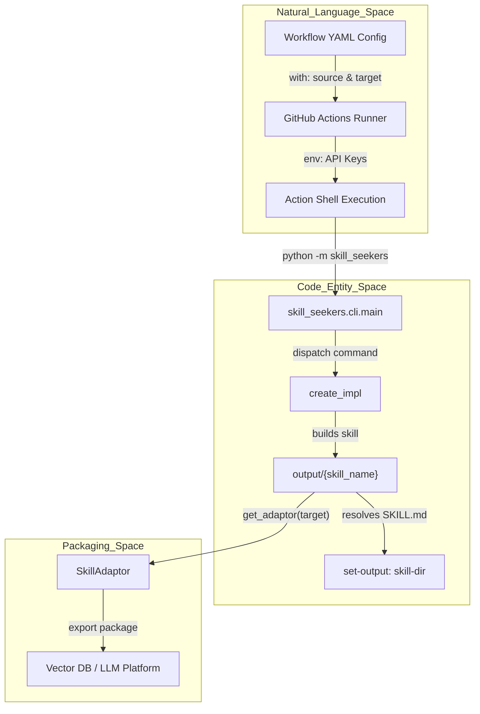
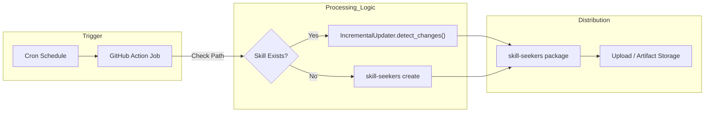

<!-- source: DeepWiki mcp.deepwiki.com · repo yusufkaraaslan/Skill_Seekers · page 16.3 GitHub Action · fetched 2026-10-26 -->

# GitHub Action

<details>
<summary>Relevant source files</summary>

The following files were used as context for generating this wiki page:

- [.dockerignore](.dockerignore)
- [.github/workflows/docker-publish.yml](.github/workflows/docker-publish.yml)
- [.github/workflows/quality-metrics.yml](.github/workflows/quality-metrics.yml)
- [.github/workflows/release.yml](.github/workflows/release.yml)
- [.github/workflows/scheduled-updates.yml](.github/workflows/scheduled-updates.yml)
- [.github/workflows/test-vector-dbs.yml](.github/workflows/test-vector-dbs.yml)
- [.gitignore](.gitignore)
- [distribution/claude-plugin/.mcp.json](distribution/claude-plugin/.mcp.json)
- [distribution/claude-plugin/README.md](distribution/claude-plugin/README.md)
- [distribution/claude-plugin/commands/create-skill.md](distribution/claude-plugin/commands/create-skill.md)
- [distribution/claude-plugin/commands/install-skill.md](distribution/claude-plugin/commands/install-skill.md)
- [distribution/claude-plugin/commands/sync-config.md](distribution/claude-plugin/commands/sync-config.md)
- [distribution/claude-plugin/skills/skill-builder/SKILL.md](distribution/claude-plugin/skills/skill-builder/SKILL.md)
- [distribution/github-action/README.md](distribution/github-action/README.md)
- [distribution/github-action/action.yml](distribution/github-action/action.yml)
- [distribution/smithery/README.md](distribution/smithery/README.md)
- [tests/test_browser_renderer.py](tests/test_browser_renderer.py)
- [ui/src/lib/utils.ts](ui/src/lib/utils.ts)
- [ui/vite.config.ts](ui/vite.config.ts)

</details>


The `yusufkaraaslan/skill-seekers-action@v3` GitHub Action provides a native CI/CD integration for the `skill-seekers` package [distribution/github-action/README.md:1-11](). It automates skill generation, incremental updating, quality verification, and multi-platform packaging directly within GitHub workflows.

## Overview and Purpose

The GitHub Action encapsulates the underlying command-line dispatcher and core Python modules to enable "Skill-as-Code" automation. Primary operational use cases include:
*   **Continuous Skill Generation**: Automatically compiling documentation sites or codebases into AI skills on every push [distribution/github-action/README.md:92-109]().
*   **Scheduled Documentation Syncing**: Running periodic scrapes of external resources to keep AI context synchronized [distribution/github-action/README.md:33-57]().
*   **Vector Database Exporting**: Packaging generated skills into formats compatible with vector search backends [.github/workflows/test-vector-dbs.yml:70-81]().

Sources: [distribution/github-action/README.md:1-57](), [.github/workflows/test-vector-dbs.yml:70-81]()

## Action Configuration & Inputs/Outputs

The action accepts configuration parameters mapping directly to execution flags and environment variables.

### Inputs

| Input | Description | Default | Required |
| :--- | :--- | :--- | :--- |
| `source` | Source URL, local file path, or `owner/repo` identifier. | — | Yes [distribution/github-action/README.md:13-17]() |
| `command` | CLI command to execute (`create`, `scan`, `package`, `upload`, `install`, etc.). | `create` | No [distribution/github-action/README.md:13-18]() |
| `target` | Platform adaptor target (`claude`, `openai`, `gemini`, `langchain`, `llama-index`, `markdown`). | `claude` | No [distribution/github-action/README.md:13-19]() |
| `config` | Path to a custom JSON configuration file for unified scraping. | — | No [distribution/github-action/README.md:13-20]() |
| `output-dir` | Target directory for generated skill outputs. | `output` | No [distribution/github-action/README.md:13-21]() |
| `extra-args` | Additional raw arguments passed to the CLI command. | — | No [distribution/github-action/README.md:13-22]() |

Sources: [distribution/github-action/README.md:13-23]()

### Outputs

| Output | Description |
| :--- | :--- |
| `skill-dir` | Filesystem path to the generated skill directory containing `SKILL.md`. |
| `skill-name` | Resolved base name of the generated skill. |

Sources: [distribution/github-action/README.md:24-30]()

## Data Flow and Implementation

The GitHub Action sets up a Python runtime, installs the `skill-seekers` package, and invokes the Python entry point using the provided configuration inputs [distribution/github-action/README.md:1-122]().

### Execution Logic Diagram

The following diagram associates the natural language and workflow inputs with the underlying Python code entities (`skill_seekers.cli.main`, `create_impl`, `SkillAdaptor`).

Title: GitHub Action Execution Pipeline

Sources: [distribution/github-action/README.md:1-122](), [.github/workflows/test-vector-dbs.yml:70-81]()

### Scheduled Update Pipeline

This diagram outlines the automated update flow used in scheduled workflows.

Title: Scheduled Update Logic

Sources: [distribution/github-action/README.md:33-57](), [.github/workflows/test-vector-dbs.yml:70-81]()

## Common Workflows

### 1. Scheduled Documentation Syncing
This workflow runs periodically to refresh framework documentation skills [distribution/github-action/README.md:33-57]().

```yaml
name: Update AI Skills
on:
  schedule:
    - cron: '0 6 * * 1'
  workflow_dispatch:

jobs:
  update-skills:
    runs-on: ubuntu-latest
    steps:
      - uses: actions/checkout@v4
      - uses: yusufkaraaslan/skill-seekers-action@v3
        with:
          source: 'https://react.dev'
          target: 'langchain'
      - uses: actions/upload-artifact@v4
        with:
          name: react-skill
          path: output/
```
Sources: [distribution/github-action/README.md:33-57]()

### 2. CI/CD Commit-Back Integration
Automatically update and commit generated skills back to the repository on documentation changes [distribution/github-action/README.md:92-109]().

```yaml
- uses: yusufkaraaslan/skill-seekers-action@v3
  id: generate
  with:
    source: 'https://fastapi.tiangolo.com'

- name: Commit skill
  run: |
    git config user.name "github-actions[bot]"
    git config user.email "github-actions[bot]@users.noreply.github.com"
    git add output/
    git diff --staged --quiet || git commit -m "Update AI skill: ${{ steps.generate.outputs.skill-name }}"
    git push
```
Sources: [distribution/github-action/README.md:92-109]()

## Internal Integration Points

The GitHub Action interfaces directly with core package components:
1.  **CLI Dispatcher**: Executes commands via entry points mapped in `src/skill_seekers/cli/main.py` [distribution/github-action/README.md:1-122]().
2.  **`SkillAdaptor`**: Instantiated via the factory `get_adaptor(target)` to package outputs for downstream consumers [.github/workflows/test-vector-dbs.yml:74-76]().

Sources: [distribution/github-action/README.md:1-122](), [.github/workflows/test-vector-dbs.yml:70-81]()

---

