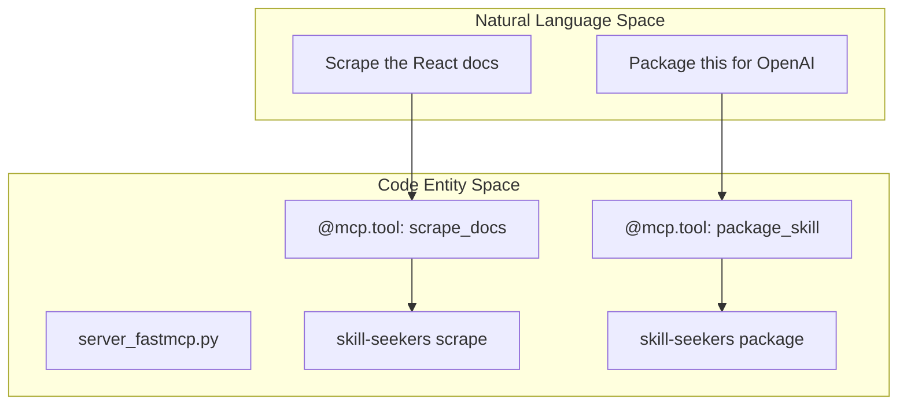
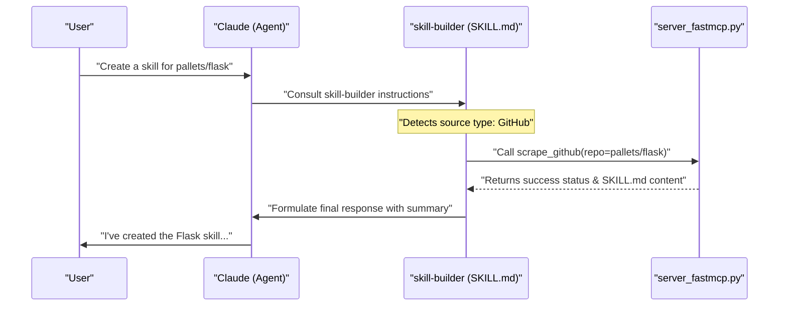

<!-- source: DeepWiki mcp.deepwiki.com · repo yusufkaraaslan/Skill_Seekers · page 16.4 Claude Plugin & Smithery Registry · fetched 2026-10-26 -->

# Claude Plugin & Smithery Registry

<details>
<summary>Relevant source files</summary>

The following files were used as context for generating this wiki page:

- [.codex-plugin/plugin.json](.codex-plugin/plugin.json)
- [.mcp.json](.mcp.json)
- [distribution/claude-plugin/.claude-plugin/plugin.json](distribution/claude-plugin/.claude-plugin/plugin.json)
- [distribution/claude-plugin/.mcp.json](distribution/claude-plugin/.mcp.json)
- [distribution/claude-plugin/README.md](distribution/claude-plugin/README.md)
- [distribution/claude-plugin/commands/create-skill.md](distribution/claude-plugin/commands/create-skill.md)
- [distribution/claude-plugin/commands/install-skill.md](distribution/claude-plugin/commands/install-skill.md)
- [distribution/claude-plugin/commands/sync-config.md](distribution/claude-plugin/commands/sync-config.md)
- [distribution/claude-plugin/skills/skill-builder/SKILL.md](distribution/claude-plugin/skills/skill-builder/SKILL.md)
- [distribution/github-action/README.md](distribution/github-action/README.md)
- [distribution/github-action/action.yml](distribution/github-action/action.yml)
- [distribution/smithery/README.md](distribution/smithery/README.md)
- [skills/skill-seekers/SKILL.md](skills/skill-seekers/SKILL.md)
- [src/skill_seekers/cli/html_parsing.py](src/skill_seekers/cli/html_parsing.py)
- [tests/test_html_parsing.py](tests/test_html_parsing.py)

</details>


The `distribution/claude-plugin/` package provides a first-class integration for Claude Code and other Model Context Protocol (MCP) clients [distribution/claude-plugin/README.md:1-4](). It bundles a high-performance MCP server, specialized slash commands, and an autonomous "skill-builder" agent skill to transform various data sources into AI-ready knowledge directly within the chat interface [distribution/claude-plugin/README.md:29-49]().

Sources: [distribution/claude-plugin/README.md:1-49]()

---

## Overview and Distribution

The Claude Plugin acts as a bridge between the `skill-seekers` core engine and AI agent environments. It is distributed via multiple primary channels:
1.  **Claude Plugin Directory**: A packaged format for Claude Code users [distribution/claude-plugin/README.md:7-13]().
2.  **Smithery MCP Registry**: A registry for MCP-compatible servers, allowing installation into agents like Cursor, Windsurf, and Claude Desktop [distribution/smithery/README.md:59-67]().
3.  **Codex Plugin Support**: Integrated metadata via `.codex-plugin/plugin.json` [.codex-plugin/plugin.json:1-21]().

### Plugin Configuration
The plugin's behavior is defined in `.claude-plugin/plugin.json` [distribution/claude-plugin/.claude-plugin/plugin.json:1-11](). The MCP connection is configured via `.mcp.json`, defaulting to a local python execution of the `FastMCP` server via `python -m skill_seekers.mcp.server_fastmcp` [.mcp.json:1-7](). Similarly, the Codex plugin configuration specifies the MCP servers and UI metadata [.codex-plugin/plugin.json:1-21]().

Sources: [distribution/claude-plugin/README.md:1-28](), [.mcp.json:1-7](), [.codex-plugin/plugin.json:1-21](), [distribution/smithery/README.md:1-15]()

---

## Bundled MCP Server

The plugin leverages the `FastMCP` implementation [distribution/claude-plugin/skills/skill-builder/SKILL.md:8-19](). This server provides 40 specialized tools organized into functional categories [distribution/smithery/README.md:84-98]().

### Tool Categories and Implementation
The server enables natural language interaction with the `skill-seekers` CLI suite by wrapping core commands into MCP tools [distribution/claude-plugin/skills/skill-builder/SKILL.md:43-70]().

| Category | Tools | Description |
| :--- | :--- | :--- |
| **Config** | `generate_config`, `validate_config`, `list_configs` | Manage scraping configurations [distribution/smithery/README.md:88]() |
| **Sync** | `sync_config` | Sync config URLs against live docs [distribution/smithery/README.md:89]() |
| **Scraping** | `scrape_docs`, `scrape_github`, `scrape_pdf`, `scrape_codebase`, `scrape_generic` | Execute the ingestion phase for 18+ types [distribution/smithery/README.md:90]() |
| **Packaging** | `package_skill`, `upload_skill`, `enhance_skill`, `install_skill` | Distribution and AI enhancement [distribution/smithery/README.md:91]() |
| **Splitting** | `split_config`, `generate_router` | Handle large documentation (10K-40K+ pages) [distribution/smithery/README.md:92]() |
| **Vector DB** | `export_to_weaviate`, `export_to_chroma`, `export_to_faiss`, `export_to_qdrant` | RAG knowledge export [distribution/smithery/README.md:94]() |

### Natural Language to Code Mapping (MCP Tools)

The following diagram illustrates how natural language requests from the agent are mapped to specific tools and CLI operations, bridging natural language space to code entity space.

**Diagram: MCP Tool Dispatch Flow**

Sources: [distribution/claude-plugin/README.md:31-38](), [distribution/smithery/README.md:84-98](), [.mcp.json:1-7](), [distribution/claude-plugin/skills/skill-builder/SKILL.md:43-70]()

---

## Slash Commands

The plugin defines primary slash commands that provide high-level abstractions over the CLI. These are documented as instructions for the agent.

### 1. `/skill-seekers:create-skill <source>`
This command automates the `skill-seekers create` workflow. It supports 17+ source types, including URLs, GitHub repos, PDFs, and local directories [distribution/claude-plugin/commands/create-skill.md:38-54]().
*   **Default Preset**: `quick` [distribution/claude-plugin/commands/create-skill.md:19-24]().
*   **Logic**: Runs the create command, reads the resulting `SKILL.md`, and summarizes it for the user [distribution/claude-plugin/commands/create-skill.md:25-27]().

### 2. `/skill-seekers:install-skill <source>`
An end-to-end workflow that combines creation, packaging, and installation to a target platform [distribution/claude-plugin/commands/install-skill.md:7-13]().
*   **Target Platforms**: Supports `claude` (default), `openai`, `gemini`, `langchain`, `llama-index`, `haystack`, and various vector DBs like `chroma`, `weaviate`, `faiss` [distribution/claude-plugin/commands/install-skill.md:31-33]().
*   **Workflow**: `create` -> `find SKILL.md` -> `package` [distribution/claude-plugin/commands/install-skill.md:17-29]().

### 3. `/skill-seekers:sync-config <config>`
Synchronizes local configuration files with live documentation sources to ensure the AI's knowledge remains current.

Sources: [distribution/claude-plugin/commands/create-skill.md:1-62](), [distribution/claude-plugin/commands/install-skill.md:1-41]()

---

## Skill-Builder Agent Skill

The **skill-builder** is an autonomous agent skill located in `distribution/claude-plugin/skills/skill-builder/` (and mirrored in `skills/skill-seekers/SKILL.md`) [distribution/claude-plugin/README.md:47-49](). It enables Claude to act as a "Knowledge Engineer" [distribution/claude-plugin/skills/skill-builder/SKILL.md:1-4]().

### Data Flow and Intent Detection
When a user provides a source, the skill-builder detects the type and orchestrates the following flow between natural language inputs and internal MCP code execution:

**Diagram: Skill-Builder Autonomous Workflow**


Sources: [distribution/claude-plugin/skills/skill-builder/SKILL.md:1-42](), [distribution/claude-plugin/README.md:47-49]()

---

## Smithery Registry Integration

`skill-seekers` is published to the **Smithery MCP Registry** under the namespace `yusufkaraaslan/skill-seekers` [distribution/smithery/README.md:7-9]().

### Installation via Smithery
Users can install the server into their local agent using the Smithery CLI:
```bash
smithery mcp add yusufkaraaslan/skill-seekers --client claude
```
Alternatively, for clients using JSON config (Claude Desktop, Cursor), the server can be added manually using the `python -m skill_seekers.mcp.server_fastmcp` command [distribution/smithery/README.md:61-82]().

### Publishing Requirements
Smithery requires a live, scannable MCP HTTP endpoint for URL-based publishing [distribution/smithery/README.md:14-16](). Developers can deploy the MCP server using the provided `Dockerfile.mcp` on platforms like Render or Fly.io [distribution/smithery/README.md:25-30]().

Sources: [distribution/smithery/README.md:1-82]()

---

