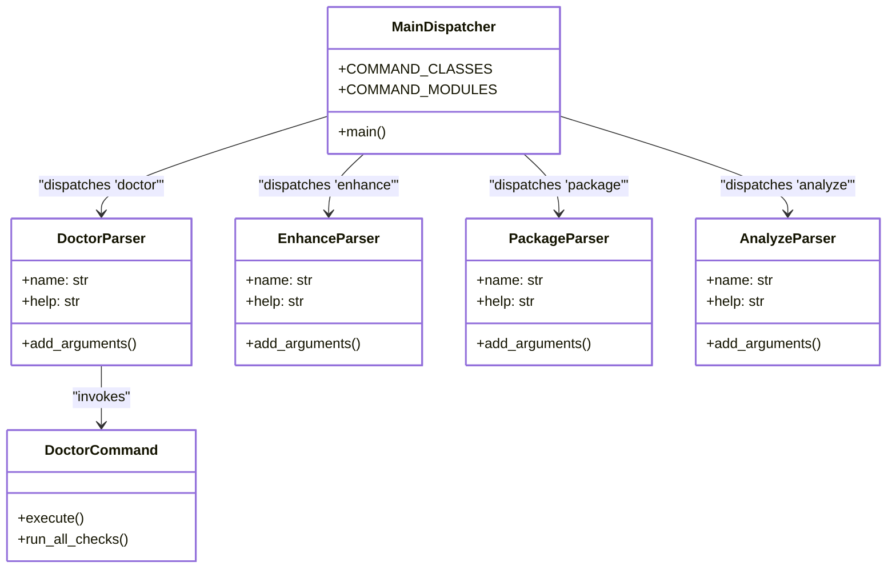

<!-- source: DeepWiki mcp.deepwiki.com · repo yusufkaraaslan/Skill_Seekers · page 17 Command-Line Reference · fetched 2026-10-26 -->

# Command-Line Reference

<details>
<summary>Relevant source files</summary>

The following files were used as context for generating this wiki page:

- [AGENTS.md](AGENTS.md)
- [docs/README.md](docs/README.md)
- [docs/reference/CLI_REFERENCE.md](docs/reference/CLI_REFERENCE.md)
- [docs/zh-CN/reference/CLI_REFERENCE.md](docs/zh-CN/reference/CLI_REFERENCE.md)
- [src/skill_seekers/cli/doctor.py](src/skill_seekers/cli/doctor.py)
- [src/skill_seekers/cli/parsers/analyze_parser.py](src/skill_seekers/cli/parsers/analyze_parser.py)
- [src/skill_seekers/cli/parsers/doctor_parser.py](src/skill_seekers/cli/parsers/doctor_parser.py)
- [src/skill_seekers/cli/parsers/enhance_parser.py](src/skill_seekers/cli/parsers/enhance_parser.py)
- [src/skill_seekers/cli/parsers/github_parser.py](src/skill_seekers/cli/parsers/github_parser.py)
- [src/skill_seekers/cli/parsers/package_parser.py](src/skill_seekers/cli/parsers/package_parser.py)
- [src/skill_seekers/cli/parsers/pdf_parser.py](src/skill_seekers/cli/parsers/pdf_parser.py)
- [src/skill_seekers/cli/parsers/scrape_parser.py](src/skill_seekers/cli/parsers/scrape_parser.py)
- [src/skill_seekers/cli/parsers/unified_parser.py](src/skill_seekers/cli/parsers/unified_parser.py)
- [src/skill_seekers/cli/parsers/upload_parser.py](src/skill_seekers/cli/parsers/upload_parser.py)
- [tests/test_doctor.py](tests/test_doctor.py)

</details>


This page provides a complete technical reference for the `skill-seekers` command-line interface. The CLI follows a Git-style dispatcher architecture (`src/skill_seekers/cli/main.py`), providing a single entry point for the entire five-phase workflow: Ingestion, Analysis, Structuring, Enhancement, and Export.

## CLI Architecture & Dispatcher

The CLI is implemented using a modular parser system defined in `src/skill_seekers/cli/parsers/`. The main entry point `src/skill_seekers/cli/main.py` dispatches subcommands using two primary mechanisms: a `COMMAND_CLASSES` mapping for newer class-based commands and a `COMMAND_MODULES` mapping for legacy or functional commands [src/skill_seekers/cli/main.py:49-84]().

### Diagram: Command Dispatch and Data Flow
This diagram illustrates how the `main.py` entry point routes CLI arguments to specific scraper and utility modules, interacting with core processing components.

```mermaid
graph TD
    User[""User Input""] --> Main[""main.py (Entry Point)""]
    Main --> Dispatcher[""COMMAND_CLASSES / COMMAND_MODULES""]
    
    subgraph "Scraper Commands"
        Dispatcher --> Create[""create_command.py (Auto-Detection)""]
        Dispatcher --> Scrape[""scrape_parser.py (Web BFS)""]
        Dispatcher --> GitHub[""github_parser.py (API/Local)""]
        Dispatcher --> Unified[""unified_parser.py (Multi-Source)""]
    end
    
    subgraph "Processing Commands"
        Dispatcher --> Enhance[""enhance_command.py (AI Refinement)""]
        Dispatcher --> Package[""package_skill.py (Adaptor Factory)""]
        Dispatcher --> Scan[""scan_command.py (AI Stack Detection)""]
    end

    Create --> SourceDet[""source_detector.py""]
    Package --> AdaptorFactory[""adaptors/__init__.py get_adaptor()""]
    
    Scrape --> Cache[".skillseeker-cache/"]
    GitHub --> Cache
    Cache --> Build["build_skill()"]
    Build --> OutputDir["output/{name}/"]
```
Sources: [src/skill_seekers/cli/main.py:49-84](), [src/skill_seekers/cli/main.py:157-160]()

---

## Universal `create` Command & Source Auto-Detection

The `create` command is the primary entry point for turning raw documentation, repositories, or files into structured skills. It identifies the input type via `SourceDetector` and routes execution to the appropriate internal scraper [src/skill_seekers/cli/main.py:11-11]().

### Universal Flags
These flags are compatible across all source types handled by `create`:

| Flag | Type | Description |
| :--- | :--- | :--- |
| `--name`, `-n` | `str` | Explicit skill name (otherwise auto-detected). |
| `--description`, `-d` | `str` | Skill description for metadata. |
| `--enhance-level` | `int` | `0`: None, `1`: SKILL.md, `2`: +Config, `3`: Full. |
| `--enhance-workflow` | `str` | Apply enhancement workflow preset. |
| `--preset` | `str` | Analysis depth preset (`quick`, `standard`, `comprehensive`). |
| `--output`, `-o` | `str` | Custom output directory path. |
| `--dry-run` | `flag` | Preview analysis without creating output. |

Sources: [src/skill_seekers/cli/main.py:91-114](), [docs/reference/CLI_REFERENCE.md:80-92]()

---

## Scraping & Ingestion Command Group

This group covers subcommands designed to ingest and parse various source types into raw knowledge assets.

### `scrape`
Performs Breadth-First Search (BFS) traversal of documentation websites.
*   **Implementation**: Dispatched via `scrape_parser.py` [src/skill_seekers/cli/main.py:62-84]().
*   **Key Flags**: `--browser` for headless rendering, `--max-pages` to limit crawl depth, and `--async` for concurrent fetching.

### `github`
Analyzes remote or local GitHub repositories using `PyGithub` or local git inspection.
*   **Implementation**: Dispatched via `github_parser.py` [src/skill_seekers/cli/parsers/github_parser.py:11-35]().
*   **Key Flags**: `--repo` (owner/repo), `--local-repo-path` to bypass API limits, and `--include-issues` [docs/reference/CLI_REFERENCE.md:25-25]().

### `scan`
AI-detects a project's technology stack and emits framework-specific configurations [docs/reference/CLI_REFERENCE.md:40-41]().
*   **Implementation**: `ScanCommand` class [src/skill_seekers/cli/main.py:51-51]().

### `analyze`
Performs deep code analysis on local codebases with pattern detection, API extraction, and document generation.
*   **Implementation**: `AnalyzeParser` in `src/skill_seekers/cli/parsers/analyze_parser.py:13-37()`.

Sources: [src/skill_seekers/cli/main.py:49-84](), [src/skill_seekers/cli/parsers/github_parser.py:11-35](), [src/skill_seekers/cli/parsers/analyze_parser.py:13-36](), [docs/reference/CLI_REFERENCE.md:40-41]()

---

## Enhancement & Workflow Command Group

### `enhance`
Triggers AI enhancement on an existing output directory. Automatically selects between API mode (Anthropic/Gemini/OpenAI) and LOCAL mode (coding agent CLI) [src/skill_seekers/cli/parsers/enhance_parser.py:23-28]().
*   **Implementation**: `EnhanceParser` wrapping `enhance_command.py` [src/skill_seekers/cli/parsers/enhance_parser.py:7-36]().
*   **Workflow Integration**: Supports `--enhance-workflow` to chain multiple processing stages.

### `workflows`
Manages enhancement workflow presets (listing, viewing, creating, or deleting custom enhancement pipelines).

Sources: [src/skill_seekers/cli/parsers/enhance_parser.py:7-36](), [docs/reference/CLI_REFERENCE.md:49-49]()

---

## Distribution & Export Command Group

### `package`
Converts the structured output directory into a platform-specific distribution format [src/skill_seekers/cli/package_skill.py:71-91]().
*   **Adaptor Selection**: Uses `--target` to select from the `ADAPTORS` registry [src/skill_seekers/cli/arguments/package.py:45-55]().
*   **RAG Chunking**: Supports `--chunk-for-rag`, `--chunk-tokens`, and `--no-preserve-code-blocks` for vector database optimization [src/skill_seekers/cli/arguments/package.py:112-143]().

### `upload`
Uploads a packaged skill (`.zip`) to a target platform or vector database [src/skill_seekers/cli/arguments/upload.py:11-100]().
*   **Targets**: Supports `ChromaDB`, `Weaviate`, and LLM cloud providers [src/skill_seekers/cli/arguments/upload.py:41-99]().

### `install-agent`
Automates the installation of a packaged skill into AI coding agent configuration directories [src/skill_seekers/cli/main.py:17-17]().

Sources: [src/skill_seekers/cli/package_skill.py:71-192](), [src/skill_seekers/cli/arguments/package.py:13-170](), [src/skill_seekers/cli/arguments/upload.py:11-100]()

---

## Diagnostics & Setup Command Group

### `doctor`
Runs comprehensive diagnostic checks on Python version, core dependencies, optional packages, API keys, and environment state [src/skill_seekers/cli/parsers/doctor_parser.py:6-26]().
*   **Implementation**: `DoctorCommand` and `run_all_checks()` in `src/skill_seekers/cli/doctor.py` [src/skill_seekers/cli/doctor.py:21-30]().
*   **Flags**: `--verbose` / `-v` for detailed output, `--json` for machine-readable output [src/skill_seekers/cli/parsers/doctor_parser.py:23-26]().

### `estimate`
Estimates page counts before executing crawls to prevent unexpected costs or runtime overruns [docs/reference/CLI_REFERENCE.md:24-24]().

### `config`
Interactive wizard for setting up API keys, GitHub tokens, and global configuration values [docs/reference/CLI_REFERENCE.md:19-19]().

Sources: [src/skill_seekers/cli/parsers/doctor_parser.py:6-26](), [src/skill_seekers/cli/doctor.py:21-30](), [docs/reference/CLI_REFERENCE.md:19-24]()

---

## Diagram: Code Entity Mapping (CLI Subcommands to Implementation)
This diagram maps core CLI subcommands to their implementation classes and parser modules in the codebase.


Sources: [src/skill_seekers/cli/main.py:49-84](), [src/skill_seekers/cli/parsers/doctor_parser.py:6-26](), [src/skill_seekers/cli/parsers/enhance_parser.py:11-36](), [src/skill_seekers/cli/parsers/package_parser.py:11-32](), [src/skill_seekers/cli/parsers/analyze_parser.py:13-36]()

---

