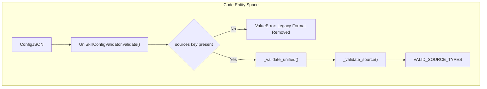
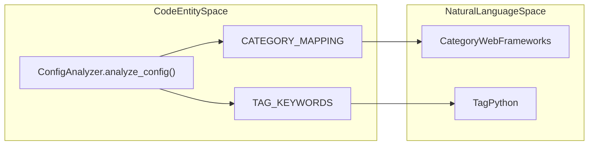

<!-- source: DeepWiki mcp.deepwiki.com · repo yusufkaraaslan/Skill_Seekers · page 18 Configuration Field Reference · fetched 2026-10-26 -->

# Configuration Field Reference

Relevant source files

The following files were used as context for generating this wiki page:

- [docs/blog/UNIVERSAL_RAG_PREPROCESSOR.md](docs/blog/UNIVERSAL_RAG_PREPROCESSOR.md)
- [docs/features/BOOTSTRAP_SKILL_TECHNICAL.md](docs/features/BOOTSTRAP_SKILL_TECHNICAL.md)
- [docs/guides/TESTING_GUIDE.md](docs/guides/TESTING_GUIDE.md)
- [docs/integrations/CLINE.md](docs/integrations/CLINE.md)
- [docs/integrations/INTEGRATIONS.md](docs/integrations/INTEGRATIONS.md)
- [docs/reference/API_REFERENCE.md](docs/reference/API_REFERENCE.md)
- [docs/reference/CONFIG_FORMAT.md](docs/reference/CONFIG_FORMAT.md)
- [src/skill_seekers/cli/config_validator.py](src/skill_seekers/cli/config_validator.py)
- [src/skill_seekers/cli/generate_router.py](src/skill_seekers/cli/generate_router.py)
- [src/skill_seekers/cli/github_scraper.py](src/skill_seekers/cli/github_scraper.py)
- [src/skill_seekers/cli/pdf_scraper.py](src/skill_seekers/cli/pdf_scraper.py)
- [src/skill_seekers/cli/split_config.py](src/skill_seekers/cli/split_config.py)
- [tests/test_github_scraper.py](tests/test_github_scraper.py)
- [tests/test_scraper_retry.py](tests/test_scraper_retry.py)

This page provides a complete technical reference for all fields supported in Skill Seeker's JSON configuration files. It covers the unified multi-source format used by the `UnifiedScraper` and validated by the `UniSkillConfigValidator` [src/skill_seekers/cli/config_validator.py:39-42]().

---

## Configuration Architecture

Skill Seeker uses a unified JSON schema to orchestrate the five-phase workflow (Ingestion, Analysis, Structuring, Enhancement, Export). Since version 2.11.0, the configuration system strictly enforces a multi-source structure, even for single-source tasks [src/skill_seekers/cli/config_validator.py:24-26]().

### Configuration Format Detection & Validation
The `UniSkillConfigValidator` class [src/skill_seekers/cli/config_validator.py:39-42]() is the primary authority for configuration integrity. It performs structural checks before any scraping or analysis begins.

Title: Validation Pipeline

Sources: [src/skill_seekers/cli/config_validator.py:39-42](), [src/skill_seekers/cli/config_validator.py:113-138](), [src/skill_seekers/cli/config_validator.py:192-203]()

---

## Top-Level Fields

### `name`
- **Type**: `string`
- **Required**: Yes
- **Description**: The unique identifier for the skill. Used by `SkillConverter.resolve_skill_dir` to determine the default output path (`output/{name}`).
- **Validation**: Must be alphanumeric with dashes or underscores.

### `description`
- **Type**: `string`
- **Required**: Yes
- **Description**: A high-level summary of the skill's purpose. This field is injected into the `SKILL.md` frontmatter.

### `merge_mode`
- **Type**: `string`
- **Required**: No (Default: `"rule-based"`)
- **Validation**: `rule-based`, `ai-enhanced`, `claude-enhanced`.
- **Implementation**: Determines which logic in `UnifiedSkillBuilder` is used to synthesize data from the `ThreeStreamData` (Code, Docs, Insights).

### `sources`
- **Type**: `array[object]`
- **Required**: Yes
- **Description**: An array of source configuration objects. Each object must contain a `type` field mapping to one of the 18+ supported scrapers.

Sources: [src/skill_seekers/cli/config_validator.py:145-168](), [docs/reference/CONFIG_FORMAT.md:89-99]()

---

## Source-Specific Fields

### Documentation Source (`type: "documentation"`)
Handled by `DocToSkillConverter` [src/skill_seekers/cli/doc_scraper.py:11]().

| Field | Type | Default | Description |
|-------|------|---------|-------------|
| `base_url` | `string` | Required | Root URL for BFS crawling. |
| `start_urls` | `array` | `[base_url]` | Specific entry points for the crawler. |
| `selectors` | `object` | Internal | CSS selectors for `main_content`, `title`, and `code_blocks`. |
| `url_patterns` | `object` | `{}` | `include` and `exclude` regex/string patterns for the BFS queue. |
| `max_pages` | `integer` | `500` | Hard limit on the number of pages scraped. |
| `rate_limit` | `number` | `0.5` | Delay in seconds between requests. |
| `max_retries` | `number` | `3` | Attempts per page with exponential backoff. |

Sources: [src/skill_seekers/cli/config_validator.py:204-245](), [docs/reference/CONFIG_FORMAT.md:87-101](), [tests/test_scraper_retry.py:33-44]()

### GitHub Source (`type: "github"`)
Handled by `GitHubScraper` [src/skill_seekers/cli/github_scraper.py:184-201]().

| Field | Type | Default | Description |
|-------|------|---------|-------------|
| `repo` | `string` | Required | Repository in `owner/repo` format. |
| `local_repo_path` | `string` | `None` | Optional path to a local clone for unlimited analysis. |
| `enable_codebase_analysis` | `boolean` | `true` | Triggers AST/regex analysis of source files. |
| `code_analysis_depth` | `string` | `"standard"` | `surface`, `standard`, or `deep`. |
| `fetch_issues` | `boolean` | `true` | Whether to scrape GitHub issues. |
| `issue_state` | `string` | `"open"` | `open`, `closed`, or `all`. |
| `max_issues` | `integer` | `20` | Limit for issue extraction. |

Sources: [src/skill_seekers/cli/github_scraper.py:202-225](), [docs/reference/CONFIG_FORMAT.md:145-165]()

### PDF Source (`type: "pdf"`)
Handled by `PDFToSkillConverter` [src/skill_seekers/cli/pdf_scraper.py:61-71]().

| Field | Type | Default | Description |
|-------|------|---------|-------------|
| `pdf_path` | `string` | Required | Path to the PDF file. |
| `enable_ocr` | `boolean` | `false` | Enables OCR for scanned documents. |
| `extract_tables` | `boolean` | `false` | Enables table extraction to markdown/JSON. |
| `page_range` | `array` | `None` | `[start, end]` page range to process. |

Sources: [docs/reference/CONFIG_FORMAT.md:202-217](), [src/skill_seekers/cli/pdf_scraper.py:61-71]()

### Local Source (`type: "local"`)
Handled by `CodebaseAnalyzer` via `ScanCommand`.

| Field | Type | Default | Description |
|-------|------|---------|-------------|
| `directory` | `string` | Required | Path to local project root. |
| `analysis_depth` | `string` | `"standard"` | Controls C3.x feature activation levels. |
| `ai_mode` | `string` | `"auto"` | `auto`, `api`, `local`, or `none` for enhancement. |

Sources: [src/skill_seekers/cli/config_validator.py:309-335](), [docs/features/BOOTSTRAP_SKILL_TECHNICAL.md:165-174]()

---

## Metadata & API Discovery

The `ConfigAnalyzer` service parses these JSON files to provide a searchable registry. It uses keyword-based heuristics to categorize skills even if the JSON doesn't explicitly define a category.

### Category and Tag Resolution
The system maps code-level identifiers to natural language categories for the API.

Title: Config Analysis Mapping

Sources: [api/config_analyzer.py:17-39](), [api/config_analyzer.py:108-113]()

---

## Extended Source Types (v3.6.0+)

Skill Seeker supports 18 specialized source types. These are detected by `SourceDetector` and validated by `UniSkillConfigValidator` [src/skill_seekers/cli/config_validator.py:39-63]().

| Type | Key Field | Implementation Class |
|------|-----------|----------------------|
| `pdf` | `pdf_path` | `PDFToSkillConverter` |
| `jupyter` | `file_path` | `JupyterToSkillConverter` |
| `openapi` | `file_path` | `OpenAPIToSkillConverter` |
| `html` | `file_path` | `HtmlToSkillConverter` |
| `rss` | `url` | `RssToSkillConverter` |
| `manpage` | `file_path` | `ManPageToSkillConverter` |
| `confluence`| `space_key` | `ConfluenceToSkillConverter`|
| `notion` | `page_id` | `NotionToSkillConverter` |

Sources: [src/skill_seekers/cli/config_validator.py:39-63](), [src/skill_seekers/cli/skill_converter.py:74-78](), [docs/reference/API_REFERENCE.md:74-78]()

---

