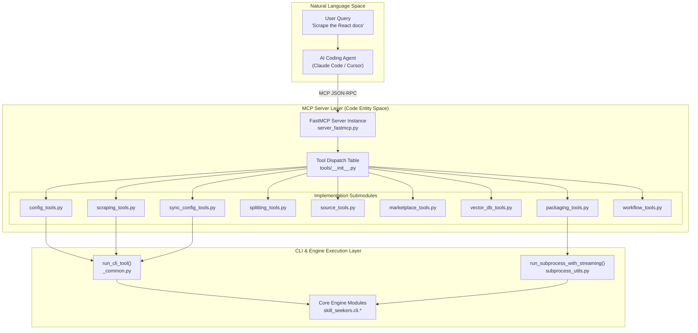
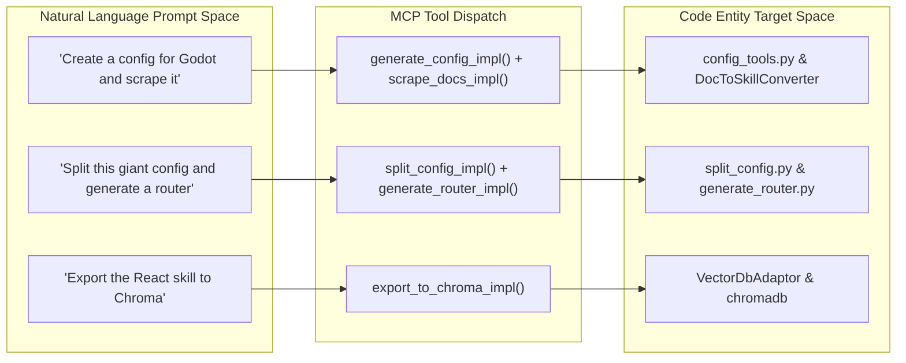

<!-- source: DeepWiki mcp.deepwiki.com · repo yusufkaraaslan/Skill_Seekers · page 19 MCP Tools Complete Reference · fetched 2026-10-26 -->

# MCP Tools Complete Reference

Relevant source files

The following files were used as context for generating this wiki page:

- [configs/godot.json](configs/godot.json)
- [configs/react.json](configs/react.json)
- [src/skill_seekers/__init__.py](src/skill_seekers/__init__.py)
- [src/skill_seekers/cli/__init__.py](src/skill_seekers/cli/__init__.py)
- [src/skill_seekers/mcp/__init__.py](src/skill_seekers/mcp/__init__.py)
- [src/skill_seekers/mcp/tools/__init__.py](src/skill_seekers/mcp/tools/__init__.py)
- [src/skill_seekers/mcp/tools/_common.py](src/skill_seekers/mcp/tools/_common.py)
- [src/skill_seekers/mcp/tools/config_tools.py](src/skill_seekers/mcp/tools/config_tools.py)
- [src/skill_seekers/mcp/tools/marketplace_tools.py](src/skill_seekers/mcp/tools/marketplace_tools.py)
- [src/skill_seekers/mcp/tools/packaging_tools.py](src/skill_seekers/mcp/tools/packaging_tools.py)
- [src/skill_seekers/mcp/tools/splitting_tools.py](src/skill_seekers/mcp/tools/splitting_tools.py)
- [src/skill_seekers/mcp/tools/sync_config_tools.py](src/skill_seekers/mcp/tools/sync_config_tools.py)
- [src/skill_seekers/mcp/tools/vector_db_tools.py](src/skill_seekers/mcp/tools/vector_db_tools.py)
- [tests/test_mcp_tools_common.py](tests/test_mcp_tools_common.py)

## Purpose and Scope

This page provides a complete reference for the **34 MCP (Model Context Protocol) tools** exposed by the Skill Seekers MCP server [src/skill_seekers/mcp/tools/__init__.py:1-187](). These tools enable AI coding agents (such as Claude Code, Cursor, Windsurf, Cline, and IntelliJ) to interact with the Skill Seekers engine via natural language. They cover multi-source scraping (web, GitHub, PDF, video, codebase), AI-powered enhancement, configuration management, config splitting, marketplace distribution, vector database export, and synchronization workflows.

The server is implemented using the **FastMCP** framework [src/skill_seekers/mcp/__init__.py:7-8](), relying on decorator-based tool registration that delegates execution either in-process via `run_cli_tool` [src/skill_seekers/mcp/tools/_common.py:158-170]() or through localized helper routines [src/skill_seekers/mcp/tools/packaging_tools.py:16-24]().

**Technical Characteristics**:
- **Transport**: Supports `stdio` (default for Claude Code) and HTTP/SSE transports [src/skill_seekers/mcp/__init__.py:24-25]().
- **Execution Strategy**: In-process execution via `run_cli_main` preserves `ExecutionContext`, warm imports, structured error propagation, and log capture [src/skill_seekers/mcp/tools/_common.py:89-121]().
- **Return Type**: All tools return `list[TextContent]` containing textual output or formatted reports [src/skill_seekers/mcp/tools/_common.py:30-48]().

---

## Tool Organization and Architecture

The MCP server delegates functionality across modular tool implementation files located in `src/skill_seekers/mcp/tools/` [src/skill_seekers/mcp/tools/__init__.py:1-14]().

**Sources**: [src/skill_seekers/mcp/tools/__init__.py:1-187](), [src/skill_seekers/mcp/tools/_common.py:89-170]()

---

## Configuration & Source Management Tools

These tools manage the creation, validation, inspection, and synchronization of skill configuration files (`configs/*.json`) and community sources.

### `generate_config`
- **Implementation**: `generate_config_impl` [src/skill_seekers/mcp/tools/__init__.py:19-21]() in `src/skill_seekers/mcp/tools/config_tools.py:21-108]()
- **Description**: Interactively generates a JSON configuration file for any documentation website with default selectors and pagination settings [src/skill_seekers/mcp/tools/config_tools.py:25-36]().
- **Parameters**:
  - `name` (string, required): Lowercase skill identifier (alphanumeric, hyphens, underscores).
  - `url` (string, required): Base documentation URL including protocol (`http://` or `https://`).
  - `description` (string, required): Operational description of when to invoke the skill.
  - `max_pages` (integer, optional): Maximum pages to scrape (default: `100`, use `-1` for unlimited).
  - `unlimited` (boolean, optional): Disables page limits entirely (default: `false`).
  - `rate_limit` (float, optional): Delay between requests in seconds (default: `0.5`).
- **Return Type**: `list[TextContent]` containing the generated config path and recommended next steps [src/skill_seekers/mcp/tools/config_tools.py:37-38]().

### `list_configs`
- **Implementation**: `list_configs_impl` [src/skill_seekers/mcp/tools/__init__.py:22-24]() in `src/skill_seekers/mcp/tools/config_tools.py:110-157]()
- **Description**: Scans the `configs/` directory and lists all available preset configuration files with metadata [src/skill_seekers/mcp/tools/config_tools.py:112-116]().
- **Parameters**: None (empty dictionary).
- **Return Type**: `list[TextContent]` with formatted config summaries [src/skill_seekers/mcp/tools/config_tools.py:120-121]().

### `validate_config`
- **Implementation**: `validate_config_impl` [src/skill_seekers/mcp/tools/__init__.py:25-27]() in `src/skill_seekers/mcp/tools/config_tools.py:160-193]()
- **Description**: Validates legacy single-source and unified JSON configuration files against required schemas and structural rules [src/skill_seekers/mcp/tools/config_tools.py:162-166]().
- **Parameters**:
  - `config_path` (string, required): Path to the target configuration JSON file.
- **Return Type**: `list[TextContent]` detailing validation results, format detection, and errors or warnings [src/skill_seekers/mcp/tools/config_tools.py:172-173]().

### `sync_config`
- **Implementation**: `sync_config_impl` [src/skill_seekers/mcp/tools/__init__.py:118-120]() in `src/skill_seekers/mcp/tools/sync_config_tools.py:10-77]()
- **Description**: Diffs a config's discovered seed URLs against what is live on the target documentation site using a BFS traversal [src/skill_seekers/mcp/tools/sync_config_tools.py:11-15]().
- **Parameters**:
  - `config_path` (string, required): Path to the config JSON file [src/skill_seekers/mcp/tools/sync_config_tools.py:28]().
  - `apply` (boolean, optional): Whether to write changes back to disk (default: `false`) [src/skill_seekers/mcp/tools/sync_config_tools.py:38]().
  - `depth` (integer, optional): BFS crawl depth (default: `2`) [src/skill_seekers/mcp/tools/sync_config_tools.py:39]().
  - `max_pages` (integer, optional): Maximum discovered URLs limit (default: `500`) [src/skill_seekers/mcp/tools/sync_config_tools.py:40]().
  - `rate_limit` (float, optional): Seconds between HTTP requests [src/skill_seekers/mcp/tools/sync_config_tools.py:41]().
  - `source_index` (int, optional): Documentation source array index (default: `0`) [src/skill_seekers/mcp/tools/sync_config_tools.py:42]().
- **Return Type**: `list[TextContent]` detailing added/removed URLs and sync summary [src/skill_seekers/mcp/tools/sync_config_tools.py:25-26]().

**Sources**: [src/skill_seekers/mcp/tools/config_tools.py:1-193](), [src/skill_seekers/mcp/tools/sync_config_tools.py:1-77]()

---

## Scraping & Analysis Tools

These tools wrap ingestion engines and codebase analysis components (`C3.x`).

### `scrape_docs`
- **Implementation**: `scrape_docs_impl` [src/skill_seekers/mcp/tools/__init__.py:59-60]()
- **Description**: Executes documentation website scraping with automatic format detection (legacy vs. unified) [configs/react.json:1-68]().
- **Parameters**:
  - `config_path` (string, required): Path to configuration file.
  - `unlimited` (boolean, optional): Removes page limits [src/skill_seekers/mcp/tools/config_tools.py:34]().
  - `dry_run` (boolean, optional): Runs validation and estimation without writing files.
  - `skip_scrape` (boolean, optional): Reuses cached data from `.skillseeker-cache/`.
  - `merge_mode` (string, optional): Overrides merge strategy (e.g., `rule-based`, `claude-enhanced`).

### `scrape_codebase`
- **Implementation**: `scrape_codebase_impl` [src/skill_seekers/mcp/tools/__init__.py:56-57]()
- **Description**: Analyzes local repositories to extract design patterns, test examples, architecture, and configuration schemas (`C3.x` suite).
- **Parameters**:
  - `repo_path` (string, required): Path to local codebase directory.
  - `depth` (string, optional): Analysis depth level (`shallow`, `standard`, `deep`) [configs/react.json:57]().

### `estimate_pages`
- **Implementation**: `estimate_pages_impl` [src/skill_seekers/mcp/tools/__init__.py:47-48]()
- **Description**: Performs a lightweight BFS traversal to pre-flight estimate documentation page counts.
- **Parameters**:
  - `config_path` (string, required): Path to config file.

**Sources**: [src/skill_seekers/mcp/tools/__init__.py:40-72](), [configs/react.json:1-68]()

---

## Packaging, Enhancement & Distribution Tools

These tools handle packaging, AI-driven refinement, and installation into local AI coding agents.

### `package_skill`
- **Implementation**: `package_skill_impl` [src/skill_seekers/mcp/tools/__init__.py:34-36]() in `src/skill_seekers/mcp/tools/packaging_tools.py:30-158]()
- **Description**: Packages a skill directory into platform-specific compressed archives [src/skill_seekers/mcp/tools/packaging_tools.py:34-39]().
- **Parameters**:
  - `skill_dir` (string, required): Path to skill directory (e.g., `output/react/`) [src/skill_seekers/mcp/tools/packaging_tools.py:36]().
  - `auto_upload` (boolean, optional): Auto-upload if API key is available (default: `true`) [src/skill_seekers/mcp/tools/packaging_tools.py:37]().
  - `target` (string, optional): Target platform (`auto`, `claude`, `gemini`, `openai`, `markdown`) [src/skill_seekers/mcp/tools/packaging_tools.py:38-39]().
- **Return Type**: `list[TextContent]` with archive metrics and upload instructions [src/skill_seekers/mcp/tools/packaging_tools.py:41-42]().

### `enhance_skill`
- **Implementation**: `enhance_skill_impl` [src/skill_seekers/mcp/tools/__init__.py:28-29]()
- **Description**: Invokes AI enhancement workflows on `SKILL.md` using local agent sessions or external model APIs [src/skill_seekers/mcp/tools/packaging_tools.py:14-17]().
- **Parameters**:
  - `skill_dir` (string, required): Path to the target skill directory.
  - `mode` (string, optional): Enhancement mode (`api` or `local`).

### `install_skill`
- **Implementation**: `install_skill_impl` [src/skill_seekers/mcp/tools/__init__.py:31-33]()
- **Description**: Auto-detects installed coding assistants and copies packaged skills into their configuration hierarchies.
- **Parameters**:
  - `skill_dir` (string, required): Path to skill directory.
  - `agent` (string, optional): Target agent name (e.g., `claude-code`, `cursor`, `windsurf`).

**Sources**: [src/skill_seekers/mcp/tools/packaging_tools.py:1-158]()

---

## Splitting & Routing Tools

### `split_config`
- **Implementation**: `split_config_impl` [src/skill_seekers/mcp/tools/__init__.py:104-105]() in `src/skill_seekers/mcp/tools/splitting_tools.py:13-69]()
- **Description**: Splits large documentation or unified configs into smaller, domain-specific focused configs [src/skill_seekers/mcp/tools/splitting_tools.py:15-25]().
- **Parameters**:
  - `config_path` (string, required): Path to JSON configuration file [src/skill_seekers/mcp/tools/splitting_tools.py:29]().
  - `strategy` (string, optional): Splitting strategy (`auto`, `source`, `category`, `router`, `size`, default: `auto`) [src/skill_seekers/mcp/tools/splitting_tools.py:30-31]().
  - `target_pages` (integer, optional): Target pages per sub-skill (default: `5000`) [src/skill_seekers/mcp/tools/splitting_tools.py:32]().
  - `dry_run` (boolean, optional): Preview split configs without writing to disk (default: `false`) [src/skill_seekers/mcp/tools/splitting_tools.py:33]().
- **Return Type**: `list[TextContent]` with split summary and created config paths [src/skill_seekers/mcp/tools/splitting_tools.py:35-37]().

### `generate_router`
- **Implementation**: `generate_router_impl` [src/skill_seekers/mcp/tools/__init__.py:100-102]() in `src/skill_seekers/mcp/tools/splitting_tools.py:72-119]()
- **Description**: Generates an intelligent hub/router skill across a set of split sub-skills [src/skill_seekers/mcp/tools/splitting_tools.py:74-78]().
- **Parameters**:
  - `config_pattern` (string, required): Glob pattern matching sub-skill configs (e.g., `configs/godot-*.json`) [src/skill_seekers/mcp/tools/splitting_tools.py:82]().
  - `router_name` (string, optional): Custom router skill name [src/skill_seekers/mcp/tools/splitting_tools.py:83]().
- **Return Type**: `list[TextContent]` with router generation results [src/skill_seekers/mcp/tools/splitting_tools.py:85-87]().

**Sources**: [src/skill_seekers/mcp/tools/splitting_tools.py:1-119]()

---

## Vector Database Export Tools

These tools export processed skill directories into structured formats for vector database ingestion.

### `export_to_weaviate`
- **Implementation**: `export_to_weaviate_impl` [src/skill_seekers/mcp/tools/__init__.py:116-117]() in `src/skill_seekers/mcp/tools/vector_db_tools.py:24-125]()
- **Parameters**: `skill_dir` (string), `output_dir` (string) [src/skill_seekers/mcp/tools/vector_db_tools.py:33-35]().
- **Return Type**: `list[TextContent]` containing JSON schema export summary and Python ingestion snippet [src/skill_seekers/mcp/tools/vector_db_tools.py:38-51]().

### `export_to_chroma`
- **Implementation**: `export_to_chroma_impl` [src/skill_seekers/mcp/tools/__init__.py:106-107]() in `src/skill_seekers/mcp/tools/vector_db_tools.py:128-230]()
- **Parameters**: `skill_dir` (string), `output_dir` (string) [src/skill_seekers/mcp/tools/vector_db_tools.py:136-138]().
- **Return Type**: `list[TextContent]` containing Chroma collection payload and initialization code [src/skill_seekers/mcp/tools/vector_db_tools.py:140-154]().

**Sources**: [src/skill_seekers/mcp/tools/vector_db_tools.py:1-230]()

---

## Natural Language Workflow Bridge

**Sources**: [src/skill_seekers/mcp/tools/__init__.py:1-187](), [src/skill_seekers/mcp/tools/config_tools.py:21-39]()

---

