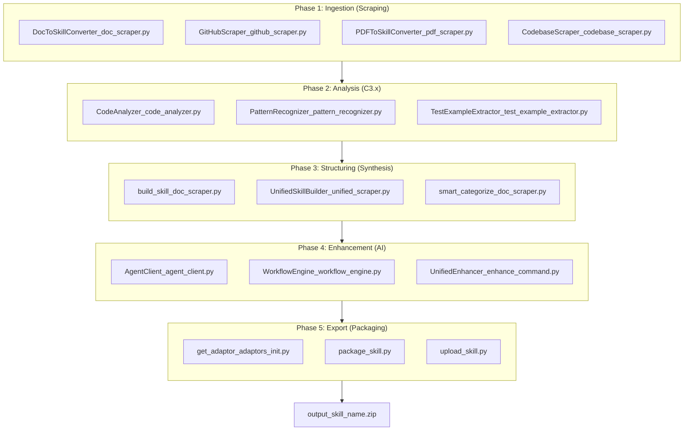
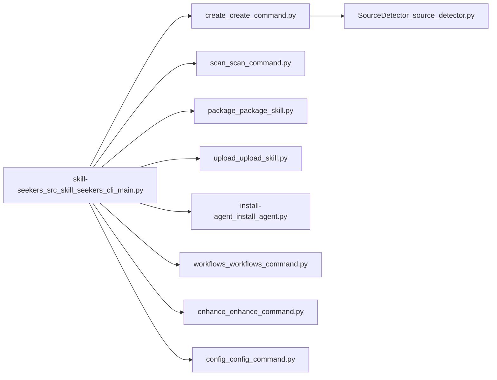

<!-- source: DeepWiki mcp.deepwiki.com · repo yusufkaraaslan/Skill_Seekers · page 2 Getting Started · fetched 2026-10-26 -->

# Getting Started

<details>
<summary>Relevant source files</summary>

The following files were used as context for generating this wiki page:

- [docs/getting-started/01-installation.md](docs/getting-started/01-installation.md)
- [docs/getting-started/02-quick-start.md](docs/getting-started/02-quick-start.md)
- [docs/getting-started/03-your-first-skill.md](docs/getting-started/03-your-first-skill.md)
- [docs/getting-started/04-next-steps.md](docs/getting-started/04-next-steps.md)
- [docs/user-guide/01-core-concepts.md](docs/user-guide/01-core-concepts.md)
- [docs/user-guide/02-scraping.md](docs/user-guide/02-scraping.md)
- [docs/user-guide/03-enhancement.md](docs/user-guide/03-enhancement.md)
- [docs/user-guide/04-packaging.md](docs/user-guide/04-packaging.md)
- [docs/user-guide/05-workflows.md](docs/user-guide/05-workflows.md)
- [docs/user-guide/06-troubleshooting.md](docs/user-guide/06-troubleshooting.md)

</details>


This page serves as the top-level entry point for new users of Skill Seekers. Its purpose is to introduce the system's core philosophy, provide a minimal viable start, outline installation options, summarize the execution pipeline, and link to detailed child pages. For complete technical deep-dives, see:
- [Installation & Prerequisites](#2.1) — Install via pip/uv, Python version requirements, optional dependency groups (`[mcp]`, `[all-llms]`, `[s3]`, `[embedding]`, `[video-full]`, `[jupyter]`, `[confluence]`, `[notion]`), setup wizard, and required environment variables.
- [Quick Start Tutorial](#2.2) — Create a first skill end-to-end: `skill-seekers create <url>`, inspect output, package, upload or install to an agent.
- [Understanding the Five-Phase Workflow](#2.3) — Explain Ingestion, Analysis, Structuring, Enhancement, Export with concrete examples.

---

## Minimum Viable Start

Three simple commands take any source from raw data to a packaged AI skill ready for deployment.

```bash
# 1. Install core package
pip install skill-seekers

# 2. Create a skill (auto-detects source type)
skill-seekers create https://docs.django.com/

# 3. Package for your target AI platform
skill-seekers package output/django --target claude
```

The `create` command in `src/skill_seekers/cli/main.py` uses `SourceDetector` to route the input to the correct internal scraper.

Sources: [docs/getting-started/02-quick-start.md:8-21]()

---

## Installation Options

Skill Seekers uses a modular dependency approach. Install only what you need:

| Command | Features Added |
|---|---|
| `pip install skill-seekers` | Core scraping (Web, GitHub, PDF) and standard adaptors. [docs/getting-started/01-installation.md:25-26]() |
| `pip install skill-seekers[mcp]` | + FastMCP server for Claude Code, Cursor, etc. [docs/getting-started/01-installation.md:121]() |
| `pip install skill-seekers[all-llms]` | + Every LLM platform. [docs/getting-started/01-installation.md:139]() |
| `pip install skill-seekers[s3]` | + AWS S3 storage. [docs/getting-started/01-installation.md:126]() |
| `pip install skill-seekers[embedding]` | + Embedding server. [docs/getting-started/01-installation.md:129]() |
| `pip install skill-seekers[all]` | Everything. [docs/getting-started/01-installation.md:140]() |

**Requirements:** Python 3.10 or higher. [docs/getting-started/01-installation.md:13]()

Sources: [docs/getting-started/01-installation.md:13](), [docs/getting-started/01-installation.md:25-26](), [docs/getting-started/01-installation.md:121](), [docs/getting-started/01-installation.md:126](), [docs/getting-started/01-installation.md:129](), [docs/getting-started/01-installation.md:139-140]()

---

## Five-Phase Pipeline

Every skill creation operation follows a standardized five-phase pipeline. This bridges the gap between natural language requests and the underlying code entities.

### Diagram: Pipeline from Natural Language to Code Entity Space



Sources: [docs/user-guide/01-core-concepts.md:324-395]()

---

## CLI Dispatcher

The unified `skill-seekers` command uses a git-style dispatcher in `main.py` to map subcommands to specific implementation modules.

### Diagram: Command Mapping from CLI to Code Modules



Sources: [docs/user-guide/01-core-concepts.md:159-163]()

---

## Export Targets

Skill Seekers follows a "do-it-once/export-to-all" philosophy. Once a skill is created in the `output/` directory, it can be packaged for different platforms using the `--target` flag.

| Flag | Adaptor Module | Output Format |
|---|---|---|
| `--target claude` | `claude.py` | ZIP + YAML (Claude Code, Claude API) [docs/user-guide/04-packaging.md:26]() |
| `--target gemini` | `gemini.py` | `.tar.gz` (Google Gemini) [docs/user-guide/04-packaging.md:27]() |
| `--target openai` | `openai.py` | ZIP + Vector (Custom GPTs) [docs/user-guide/04-packaging.md:28]() |
| `--target langchain` | `langchain.py` | Directory (RAG pipelines) [docs/user-guide/04-packaging.md:37]() |
| `--target llama-index`| `llama_index.py`| Directory (Query engines) [docs/user-guide/04-packaging.md:38]() |
| `--target chroma` | `chroma.py` | ZIP (Local vector DB) [docs/user-guide/04-packaging.md:41]() |
| `--target cursor` | `cursor.py` | `.cursorrules` (IDE AI context) [docs/user-guide/04-packaging.md:46]() |
| `--target windsurf` | `windsurf.py` | `.windsurfrules` (IDE AI context) [docs/user-guide/04-packaging.md:47]() |
| `--target cline` | `cline.py` | `.clinerules` (VS Code AI) [docs/user-guide/04-packaging.md:48]() |

Sources: [docs/user-guide/04-packaging.md:24-55]()

---

## Key Environment Variables

| Variable | Used By | Purpose |
|---|---|---|
| `ANTHROPIC_API_KEY` | `AgentClient`, `claude.py` | Enables API-mode enhancement and Claude uploads. [docs/getting-started/01-installation.md:158]() |
| `GITHUB_TOKEN` | `GitHubScraper` | Bypasses the 60 req/hr rate limit (increases to 5000). [docs/getting-started/01-installation.md:159]() |
| `SKILL_SEEKER_PROVIDER` | `UnifiedEnhancer` | Forces a specific AI provider for enhancement (e.g., `claude`, `gemini`). [docs/user-guide/03-enhancement.md:54-55]() |
| `GOOGLE_API_KEY` | `gemini.py` | Enables Google Gemini integration. [docs/getting-started/01-installation.md:158]() |

If no API keys are provided, the system falls back to **LOCAL mode**, attempting to use installed CLI agents like `claude` (Claude Code) or `kimi` for enhancement. [docs/user-guide/03-enhancement.md:76-77]()

Sources: [docs/getting-started/01-installation.md:158-159](), [docs/user-guide/03-enhancement.md:54-55](), [docs/user-guide/03-enhancement.md:76-77]()

---

## Next Steps

For detailed information on getting started, proceed to the child pages:
- [Installation & Prerequisites](#2.1)
- [Quick Start Tutorial](#2.2)
- [Understanding the Five-Phase Workflow](#2.3)

Sources: [docs/getting-started/04-next-steps.md:239-262]()

---

