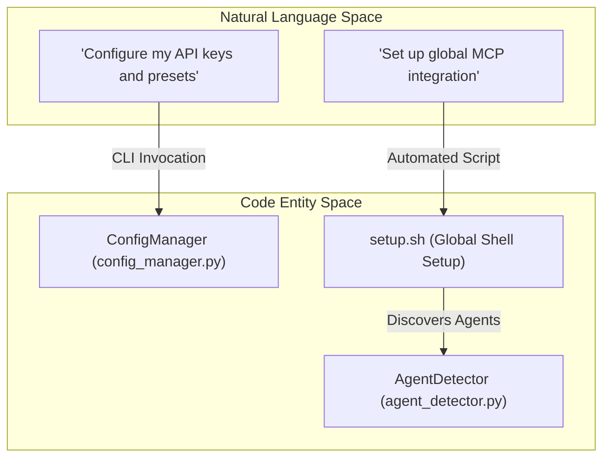
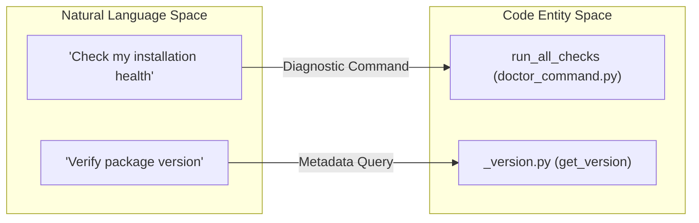

<!-- source: DeepWiki mcp.deepwiki.com · repo yusufkaraaslan/Skill_Seekers · page 2.1 Installation & Prerequisites · fetched 2026-10-26 -->

# Installation & Prerequisites

<details>
<summary>Relevant source files</summary>

The following files were used as context for generating this wiki page:

- [docs/getting-started/01-installation.md](docs/getting-started/01-installation.md)
- [docs/getting-started/02-quick-start.md](docs/getting-started/02-quick-start.md)
- [docs/getting-started/03-your-first-skill.md](docs/getting-started/03-your-first-skill.md)
- [docs/getting-started/04-next-steps.md](docs/getting-started/04-next-steps.md)
- [docs/user-guide/01-core-concepts.md](docs/user-guide/01-core-concepts.md)
- [docs/user-guide/02-scraping.md](docs/user-guide/02-scraping.md)
- [docs/user-guide/03-enhancement.md](docs/user-guide/03-enhancement.md)
- [docs/user-guide/04-packaging.md](docs/user-guide/04-packaging.md)
- [docs/user-guide/05-workflows.md](docs/user-guide/05-workflows.md)
- [docs/user-guide/06-troubleshooting.md](docs/user-guide/06-troubleshooting.md)
- [requirements.txt](requirements.txt)
- [setup.sh](setup.sh)

</details>


## Purpose & Scope

This page covers the complete installation and setup lifecycle for Skill Seekers. It details system requirements, package installation via `pip` and `uv`, optional dependency groups (`[mcp]`, `[all-llms]`, `[s3]`, `[embedding]`, `[video-full]`, `[jupyter]`, `[confluence]`, `[notion]`), the interactive setup wizard, and required environment variables.

Sources: [docs/getting-started/01-installation.md:1-15](), [setup.sh:1-25]()

---

## System Requirements

### Python Version & OS Support

Skill Seekers requires **Python 3.10 or higher**. This constraint is enforced to leverage modern syntax features such as structural pattern matching (`match` statements) and advanced type hinting utilized across the codebase and the Model Context Protocol (MCP) server.

| Requirement | Minimum | Recommended |
|-------------|---------|-------------|
| **Python** | 3.10 | 3.11, 3.12, or 3.13 |
| **RAM** | 4 GB | 8 GB+ |
| **Disk** | 500 MB | 2 GB+ |
| **OS** | Linux, macOS, Windows (WSL) | Linux, macOS |

**Verification command:**
```bash
python --version  # Should output 3.10.x or higher
```

Sources: [pyproject.toml:10](), [docs/getting-started/01-installation.md:9-17]()

---

## Installation Methods

### Method 1: pip (Standard)

The standard approach for installing stable releases from PyPI:

```bash
# Basic installation
pip install skill-seekers

# With all LLM platform support
pip install skill-seekers[all-llms]

# Verify installation
skill-seekers --version
```

Sources: [docs/getting-started/01-installation.md:20-33]()

### Method 2: uv (Recommended)

`uv` is recommended for high-speed dependency resolution, especially when installing complex optional dependency trees.

```bash
# Install as a global tool
uv tool install skill-seekers --with "all-llms"

# Run ephemerally without permanent installation
uvx skill-seekers create https://docs.python.org
```

Sources: [CLAUDE.md:38-39]()

### Method 3: Development Installation from Source

For contributors working directly with the repository structure:

```bash
git clone https://github.com/yusufkaraaslan/Skill_Seekers.git
cd Skill_Seekers

# Install in editable mode with all optional and development dependencies
pip install -e ".[all,dev]"
```

Sources: [docs/getting-started/01-installation.md:46-58]()

---

## Optional Dependency Groups

Skill Seekers utilizes a modular architecture defined in `pyproject.toml`. The core installation is lightweight, while advanced features require specific optional extras.

### Feature-Based Extras Table

| Extra Group | Purpose / Features Enabled | Install Command | Key Underlying Packages |
|-------------|----------------------------|-----------------|--------------------------|
| `[mcp]` | Model Context Protocol server (stdio/HTTP) | `pip install skill-seekers[mcp]` | `mcp`, `uvicorn`, `sse-starlette` |
| `[all-llms]` | Support for all LLM provider clients | `pip install skill-seekers[all-llms]` | `anthropic`, `google-generativeai`, `openai`, `moonshot` |
| `[s3]` | AWS S3 storage backend | `pip install skill-seekers[s3]` | `boto3` |
| `[embedding]` | Local vector embeddings server | `pip install skill-seekers[embedding]` | `sentence-transformers`, `voyageai`, `fastapi` |
| `[video-full]` | Whisper transcription, scene detection, OCR | `pip install skill-seekers[video-full]` | `torch`, `whisper`, `easyocr`, `opencv-python` |
| `[jupyter]` | Jupyter Notebook (`.ipynb`) extraction | `pip install skill-seekers[jupyter]` | `nbconvert`, `nbformat` |
| `[confluence]` | Atlassian Confluence wiki space ingestion | `pip install skill-seekers[confluence]` | `atlassian-python-api` |
| `[notion]` | Notion workspace and database ingestion | `pip install skill-seekers[notion]` | `notion-client` |
| `[all]` | Installs all stable extension groups | `pip install skill-seekers[all]` | All primary dependency groups |
| `[dev]` | Testing, linting, and docs tools | `pip install skill-seekers[dev]` | `pytest`, `ruff`, `mypy`, `coverage` |

> **Video Visual Dependencies Note:** After installing `skill-seekers[video-full]`, execute `skill-seekers create --setup` to auto-detect your accelerator (NVIDIA CUDA, Apple MPS, or CPU) and install the appropriate PyTorch build and OCR utilities.

Sources: [pyproject.toml:70-284](), [docs/getting-started/01-installation.md:114-144]()

---

## Setup Wizard & Global Configuration Script

Skill Seekers provides an interactive setup utility (`skill-seekers config` or `setup.sh`) to streamline environment configuration, API key verification, and AI coding agent integration (such as Cursor, Claude Code, and Cline).

```bash
# Run interactive setup wizard
skill-seekers config

# Or execute the automated global install & MCP setup script
./setup.sh
```

Sources: [docs/getting-started/01-installation.md:154-156](), [setup.sh:1-15]()

---

## Required Environment Variables

Runtime configuration, authentication, and platform overrides are controlled via environment variables.

### AI Provider Keys (Enhancement Pipeline)
When multiple API keys are present, `AgentClient` evaluates providers in the priority order: **Anthropic → Google → OpenAI → Moonshot**.

| Environment Variable | Description |
|----------------------|-------------|
| `ANTHROPIC_API_KEY` | Required for Claude AI enhancement and cloud uploads. |
| `GOOGLE_API_KEY` | Required for Google Gemini enhancement and uploads. |
| `OPENAI_API_KEY` | Required for OpenAI ChatGPT enhancement. |
| `MOONSHOT_API_KEY` | Required for Kimi (Moonshot AI) enhancement. |
| `SKILL_SEEKER_PROVIDER` | Forces a specific AI provider (e.g., `openai`). |
| `SKILL_SEEKER_MODEL` | Overrides the default model identifier for the chosen provider. |

Sources: [docs/user-guide/03-enhancement.md:40-55](), [docs/reference/ENVIRONMENT_VARIABLES.md:41-111]()

### Integration & Registry Keys
| Environment Variable | Description |
|----------------------|-------------|
| `GITHUB_TOKEN` | Increases GitHub API rate limits (60 to 5000 req/hr), enables private repository scraping, and authenticates publishing configs via `skill-seekers scan`. |

Sources: [docs/user-guide/02-scraping.md:141-155](), [docs/reference/ENVIRONMENT_VARIABLES.md:115-137]()

---

## Natural Language to Code Entity Space

### Setup and Configuration Flow

This diagram maps user intent for configuration and setup to the corresponding internal classes and command modules in the codebase.



Sources: [docs/getting-started/01-installation.md:154-160](), [setup.sh:146-155]()

### Diagnostics and Installation Validation

This diagram connects verification requests to the underlying diagnostic functions and version registries.



Sources: [docs/getting-started/01-installation.md:164-173](), [src/skill_seekers/_version.py:22-31]()

---

## Verification: The Doctor Command

To validate that your environment, optional packages, and dependencies are correctly provisioned, execute the built-in diagnostic utility:

```bash
skill-seekers doctor
```

The `doctor` command invokes internal check procedures (`run_all_checks`) to inspect Python runtime integrity, verify optional dependency groups (such as `mcp` or `all-llms`), audit API key visibility, and validate external system binaries like `git` and `tesseract`.

Sources: [docs/getting-started/01-installation.md:172-174]()

---

