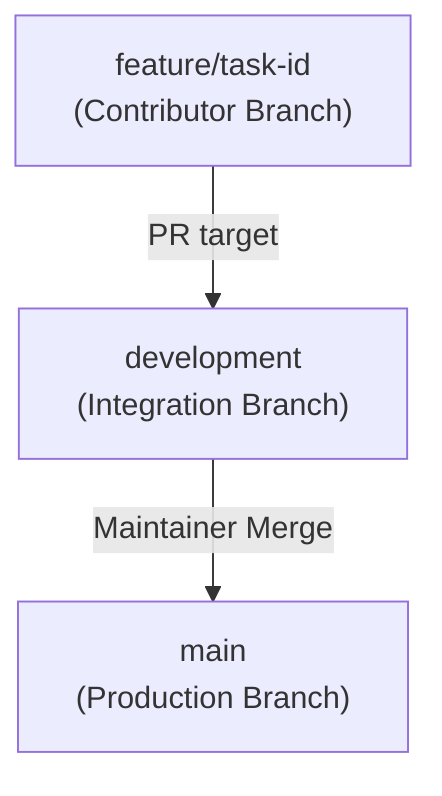
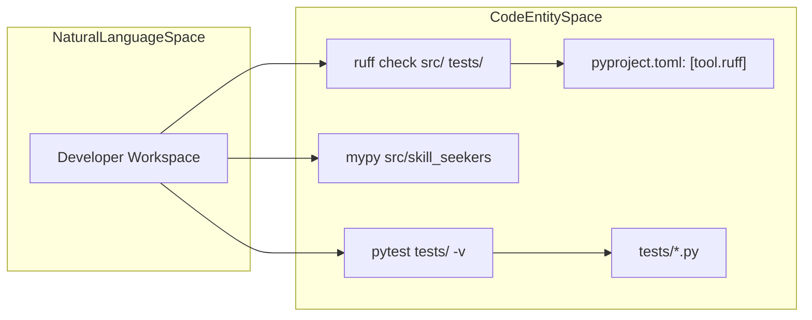
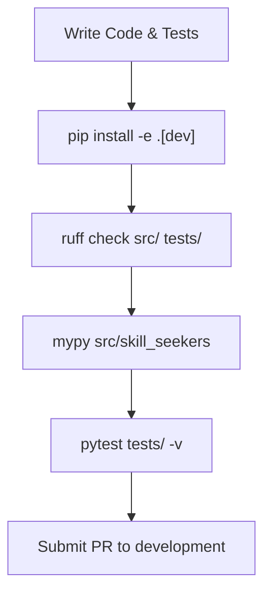

<!-- source: DeepWiki mcp.deepwiki.com · repo yusufkaraaslan/Skill_Seekers · page 20 Contributing · fetched 2026-10-26 -->

# Contributing

Relevant source files

The following files were used as context for generating this wiki page:

- [.github/ISSUE_TEMPLATE/bug_report.md](.github/ISSUE_TEMPLATE/bug_report.md)
- [.github/ISSUE_TEMPLATE/documentation.md](.github/ISSUE_TEMPLATE/documentation.md)
- [.github/ISSUE_TEMPLATE/feature_request.md](.github/ISSUE_TEMPLATE/feature_request.md)
- [.github/ISSUE_TEMPLATE/mcp_tool.md](.github/ISSUE_TEMPLATE/mcp_tool.md)
- [.github/PULL_REQUEST_TEMPLATE.md](.github/PULL_REQUEST_TEMPLATE.md)
- [AGENTS.md](AGENTS.md)
- [CONTRIBUTING.md](CONTRIBUTING.md)
- [ROADMAP.md](ROADMAP.md)
- [docs/README.md](docs/README.md)
- [docs/reference/CLI_REFERENCE.md](docs/reference/CLI_REFERENCE.md)
- [docs/zh-CN/reference/CLI_REFERENCE.md](docs/zh-CN/reference/CLI_REFERENCE.md)
- [src/skill_seekers/cli/doctor.py](src/skill_seekers/cli/doctor.py)
- [src/skill_seekers/cli/parsers/doctor_parser.py](src/skill_seekers/cli/parsers/doctor_parser.py)
- [tests/test_doctor.py](tests/test_doctor.py)

This page serves as the high-level guide for contributors to the Skill Seekers codebase. It outlines the branch workflow, repository layout, coding standards, code quality checks, agent guidelines, and pull request processes. Skill Seekers is a universal preprocessing layer that transforms documentation and code into structured knowledge assets for 21+ AI platforms [AGENTS.md:7-12]().

For detailed setup instructions, see [Development Setup](#20.1). For active tasks and roadmaps, see [Project Roadmap & Task Management](#20.2). For integration examples and recipes, see [Examples & Integration Recipes](#20.3).

---

## Branch Workflow & Repository Structure

Skill Seekers utilizes a protected two-branch integration model. Contributor work is integrated into the `development` branch via pull requests, while `main` is reserved for stable releases managed exclusively by maintainers [CONTRIBUTING.md:20-52]().

**Branch Workflow:**

Additionally, the project spans several companion repositories [CONTRIBUTING.md:79-90]() where specific subsystems are maintained:
- **Core CLI & Scrapers:** [Skill_Seekers](https://github.com/yusufkaraaslan/Skill_Seekers) [CONTRIBUTING.md:85]()
- **Website & UI:** [skillseekersweb](https://github.com/yusufkaraaslan/skillseekersweb) [CONTRIBUTING.md:86]()
- **Preset Configs:** [skill-seekers-configs](https://github.com/yusufkaraaslan/skill-seekers-configs) [CONTRIBUTING.md:87]()

Sources: [CONTRIBUTING.md:18-91]()

---

## Coding Standards & Code Quality

Skill Seekers targets Python 3.10+ [AGENTS.md:92]() and enforces strict formatting and linting rules defined in `pyproject.toml`. Code quality is verified locally and in CI using **Ruff** for linting/formatting and **Mypy** for type checking [AGENTS.md:71-76]().

**Code Quality to Code Entities:**

### Style Rules
- **Line Length:** 100 characters [AGENTS.md:91]().
- **Imports:** Sorted via isort rules in Ruff; `skill_seekers` is treated as a first-party package [AGENTS.md:97-98]().
- **Naming Conventions:** `snake_case` for files and functions, `PascalCase` for classes, and `UPPER_CASE` for constants [AGENTS.md:110-114]().

Sources: [AGENTS.md:71-137]()

---

## Agent Guidelines & Multi-Agent Abstraction

Contributors developing features involving AI integration must adhere to agent documentation protocols (`AGENTS.md`, `QWEN.md`, `CLAUDE.md`). All interactions with large language models must route through the unified `AgentClient` abstraction layer rather than invoking individual provider SDKs directly, ensuring cross-platform support [QWEN.md:63]().

For detailed agent recipes and custom integrations, see [Examples & Integration Recipes](#20.3).

Sources: [AGENTS.md:1-12](), [QWEN.md:57-64]()

---

## Pull Request Process & Testing

Before submitting a pull request to the `development` branch [CONTRIBUTING.md:170](), contributors must ensure that all code changes pass local test suites and linting checks.

**Pull Request Validation Flow:**

### CI Pipeline Matrix
The CI environment executes tests across three parallel runner jobs:
- **`test-fast`**: Executes unit tests via `pytest-xdist` across supported Python versions [AGENTS.md:84]().
- **`test-serial`**: Runs serial, integration, and network tests [AGENTS.md:85]().
- **`test-mcp`**: Runs Model Context Protocol integration tests [AGENTS.md:86]().

Sources: [AGENTS.md:47-87](), [CONTRIBUTING.md:166-178]()

---

## Child Pages

- [Development Setup](#20.1) — Detailed instructions for forking, cloning, virtual environment configuration, installing dev dependencies, and running local development servers.
- [Project Roadmap & Task Management](#20.2) — Overview of active priorities, task-based roadmap categories, issue templates, and how to claim tasks.
- [Examples & Integration Recipes](#20.3) — Comprehensive tour of pipeline examples, vector database integrations, and agent recipes for Cursor, Windsurf, Cline, and Continue.dev.

---

