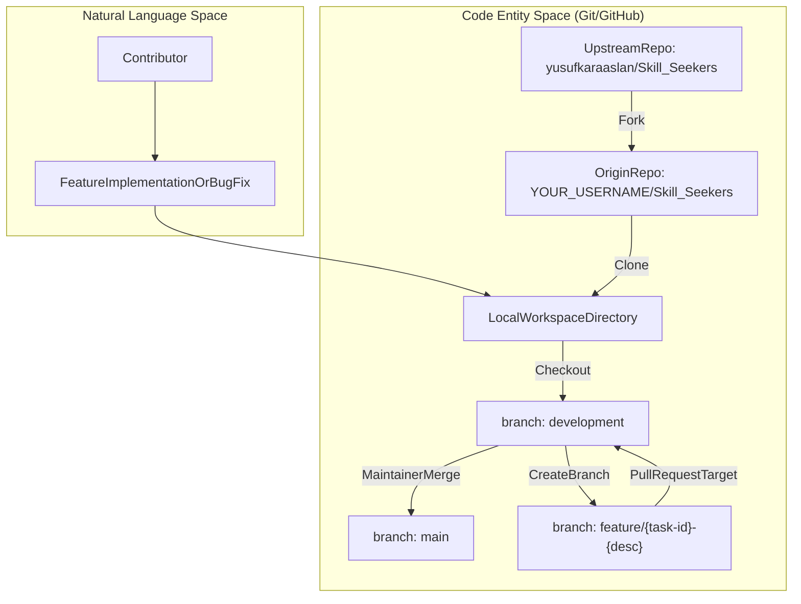
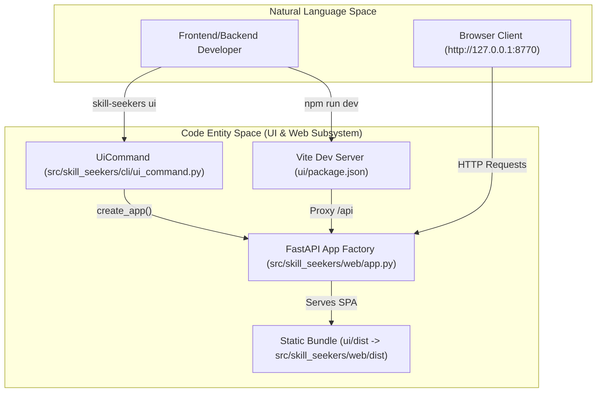

<!-- source: DeepWiki mcp.deepwiki.com · repo yusufkaraaslan/Skill_Seekers · page 20.1 Development Setup · fetched 2026-10-26 -->

# Development Setup

<details>
<summary>Relevant source files</summary>

The following files were used as context for generating this wiki page:

- [.github/ISSUE_TEMPLATE/bug_report.md](.github/ISSUE_TEMPLATE/bug_report.md)
- [.github/ISSUE_TEMPLATE/documentation.md](.github/ISSUE_TEMPLATE/documentation.md)
- [.github/ISSUE_TEMPLATE/feature_request.md](.github/ISSUE_TEMPLATE/feature_request.md)
- [.github/ISSUE_TEMPLATE/mcp_tool.md](.github/ISSUE_TEMPLATE/mcp_tool.md)
- [.github/PULL_REQUEST_TEMPLATE.md](.github/PULL_REQUEST_TEMPLATE.md)
- [.github/workflows/vector-db-export.yml](.github/workflows/vector-db-export.yml)
- [CONTRIBUTING.md](CONTRIBUTING.md)
- [ROADMAP.md](ROADMAP.md)
- [docs/guides/WEB_UI.md](docs/guides/WEB_UI.md)
- [setup.sh](setup.sh)
- [src/skill_seekers/cli/ui_command.py](src/skill_seekers/cli/ui_command.py)
- [ui/package-lock.json](ui/package-lock.json)
- [ui/package.json](ui/package.json)

</details>


This page documents how to set up a local development environment for contributing to Skill Seekers. It covers repository forking, dual-branch workflow, virtual environment setup, modular dependency installation, `ruff` and `mypy` quality checks, launching the Seeker HUD UI development server, and running the test suite.

---

## Purpose and Scope

This document guides developers through:
- Forking and cloning the repository and configuring upstream remotes.
- Adhering to the `main` / `development` / `feature` branch workflow.
- Setting up a Python 3.10+ virtual environment (`venv` or `uv`).
- Installing core, development, MCP, and UI dependencies.
- Running code quality enforcement using `ruff` and `mypy`.
- Running the Vite React dev server alongside the FastAPI backend for Seeker HUD development.
- Running unit and regression tests locally.

Sources: [CONTRIBUTING.md:18-75](), [docs/guides/WEB_UI.md:5-14](), [src/skill_seekers/cli/ui_command.py:16-54]()

---

## 1. Branch Workflow & Repository Structure

Skill Seekers enforces a strict two-branch integration workflow to ensure stability of the production release [CONTRIBUTING.md:20-34](). 

- **`main`**: Production branch. Always stable, containing only thoroughly tested releases merged from `development` by maintainers [CONTRIBUTING.md:38-41]().
- **`development`**: Integration branch. **Default branch for all pull requests**. Active contributions and feature integrations land here first [CONTRIBUTING.md:43-46]().
- **Feature branches**: Created from `development` using descriptive names (e.g., `feature/123-add-github-scraping`) and merged back via PR [CONTRIBUTING.md:49-52]().

### Natural Language to Code Entity Space: Git Workflow
Title: "Git Branch and Remote Mapping"

Sources: [CONTRIBUTING.md:18-75]()

---

## 2. Prerequisites & Environment Setup

### Python Version Requirements

Skill Seekers requires **Python 3.10 or higher** to support modern typing syntax and the FastMCP integration layer [setup.sh:29-46]().

- **Git**: Required for version control operations [CONTRIBUTING.md:185-186]().
- **Python 3.10+**: Verified via `python3 --version` [setup.sh:36-46]().
- **Node.js & npm**: Required if developing the React-based Seeker HUD UI (`ui/`) [docs/guides/WEB_UI.md:5-10]().

Sources: [setup.sh:29-46](), [CONTRIBUTING.md:185-186](), [docs/guides/WEB_UI.md:5-10]()

---

## 3. Dependency Installation & Modular Extras

Skill Seekers organizes optional dependencies into modular extra groups within `pyproject.toml`.

### Step-by-Step Installation Commands

```bash
# 1. Fork and clone the repository
git clone https://github.com/YOUR_USERNAME/Skill_Seekers.git
cd Skill_Seekers

# 2. Add upstream remote
git remote add upstream https://github.com/yusufkaraaslan/Skill_Seekers.git

# 3. Create and activate a virtual environment
python3 -m venv venv
source venv/bin/activate  # On Windows: venv\Scripts\activate

# 4. Install the package in editable mode with development, MCP, and UI extras
pip install -e .
pip install -e ".[dev,mcp,ui]"
```

Sources: [CONTRIBUTING.md:188-202](), [docs/guides/WEB_UI.md:8-9]()

---

## 4. Code Quality Tools: Ruff and Mypy

The repository uses `ruff` for ultra-fast linting and code formatting, and `mypy` for static type checking across the `src/skill_seekers` package.

```bash
# Run lint checks across codebase
ruff check src/ tests/

# Auto-fix fixable linter violations
ruff check --fix src/ tests/

# Check formatting conformity
ruff format --check src/ tests/

# Run static type analysis using mypy
mypy src/skill_seekers
```

Sources: [CONTRIBUTING.md:239-241](), [docs/guides/WEB_UI.md:50-59]()

---

## 5. UI Development Server (Seeker HUD)

The Seeker HUD web interface combines a FastAPI backend implemented in `src/skill_seekers/web/app.py` with a React single-page application located in `ui/`.

### Natural Language to Code Entity Space: Seeker HUD Architecture
Title: "Seeker HUD Development and Runtime Architecture"

Sources: [src/skill_seekers/cli/ui_command.py:16-54](), [docs/guides/WEB_UI.md:5-15](), [ui/package.json:6-12]()

### Running the UI Dev Server

For frontend development with hot-reloading:
```bash
# 1. Install Python UI dependencies
pip install -e ".[ui]"

# 2. Install Node dependencies in the ui subdirectory
npm --prefix ui ci

# 3. Start the Vite development server (proxies /api to local FastAPI backend)
npm --prefix ui run dev
```

To run the complete integrated stack locally via CLI:
```bash
# Build frontend assets and launch via Seeker CLI command
npm --prefix ui run build
skill-seekers ui --host 127.0.0.1 --port 8770
```

Sources: [docs/guides/WEB_UI.md:5-15](), [src/skill_seekers/cli/ui_command.py:35-54]()

---

## 6. Testing & Quality Verification

Run the test suite using `pytest` to verify the development environment and ensure no regressions were introduced.

```bash
# Run all unit tests with verbose output
python -m pytest tests/ -v

# Run web UI specific tests and Playwright browser tests
pytest tests/test_web_api.py tests/test_web_regressions.py -q
cd ui && npm test

# Run environment health checks via the doctor command
skill-seekers doctor
```

Sources: [docs/guides/WEB_UI.md:51-61](), [CONTRIBUTING.md:215-218]()

---

