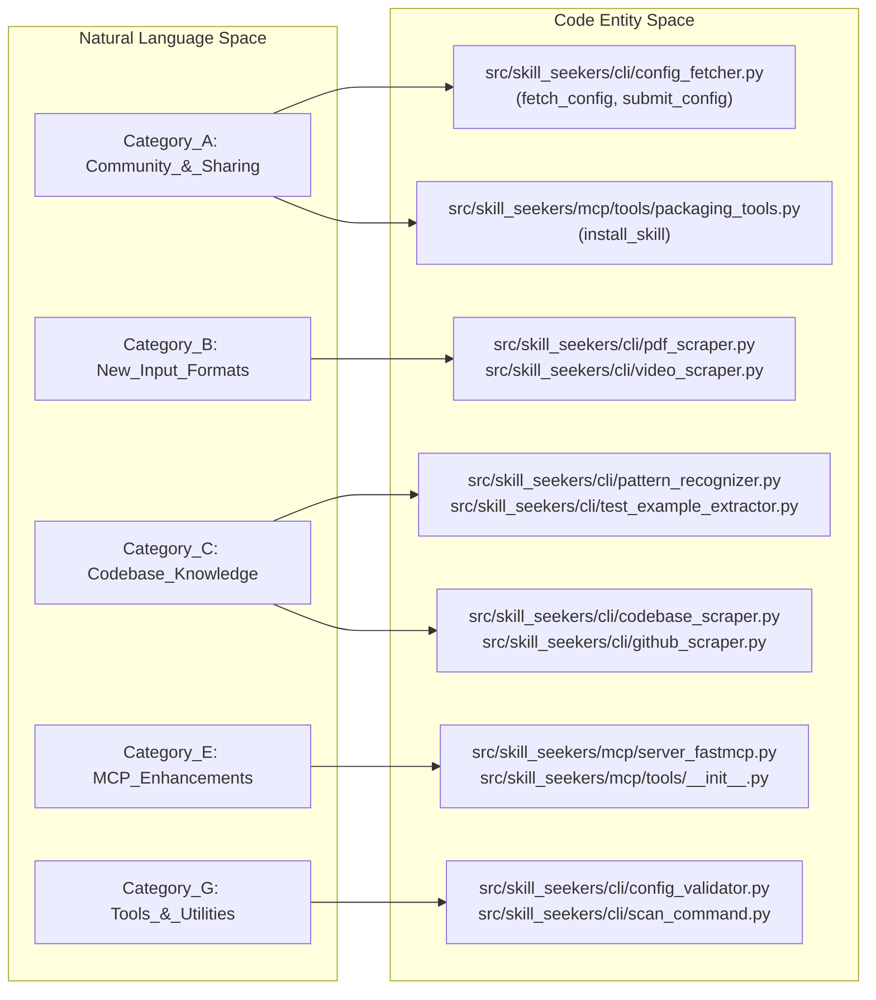

<!-- source: DeepWiki mcp.deepwiki.com · repo yusufkaraaslan/Skill_Seekers · page 20.2 Project Roadmap & Task Management · fetched 2026-10-26 -->

# Project Roadmap & Task Management

<details>
<summary>Relevant source files</summary>

The following files were used as context for generating this wiki page:

- [.github/ISSUE_TEMPLATE/bug_report.md](.github/ISSUE_TEMPLATE/bug_report.md)
- [.github/ISSUE_TEMPLATE/documentation.md](.github/ISSUE_TEMPLATE/documentation.md)
- [.github/ISSUE_TEMPLATE/feature_request.md](.github/ISSUE_TEMPLATE/feature_request.md)
- [.github/ISSUE_TEMPLATE/mcp_tool.md](.github/ISSUE_TEMPLATE/mcp_tool.md)
- [.github/PULL_REQUEST_TEMPLATE.md](.github/PULL_REQUEST_TEMPLATE.md)
- [CONTRIBUTING.md](CONTRIBUTING.md)
- [ROADMAP.md](ROADMAP.md)
- [docs/case-studies/deepwiki-open.md](docs/case-studies/deepwiki-open.md)
- [docs/strategy/ACTION_PLAN.md](docs/strategy/ACTION_PLAN.md)
- [docs/strategy/DEEPWIKI_ANALYSIS.md](docs/strategy/DEEPWIKI_ANALYSIS.md)
- [docs/strategy/INTEGRATION_STRATEGY.md](docs/strategy/INTEGRATION_STRATEGY.md)
- [docs/strategy/INTEGRATION_TEMPLATES.md](docs/strategy/INTEGRATION_TEMPLATES.md)
- [docs/strategy/KIMI_ANALYSIS_COMPARISON.md](docs/strategy/KIMI_ANALYSIS_COMPARISON.md)
- [docs/strategy/README.md](docs/strategy/README.md)

</details>


This page documents the Skill Seekers project roadmap: the current release status, the task-based development model (136 tasks across 10 categories), planned universal infrastructure features, and the process for claiming tasks and contributing.

For development environment setup and how to submit a PR, see [20.1 Development Setup](). For the contributing process (branch workflow, coding standards), see [20 Contributing]().

Sources: [ROADMAP.md:1-50](), [CONTRIBUTING.md:1-53]()

---

## Current Project Status

The current status of the codebase reflects active development toward universal AI infrastructure support.

| Attribute | Value |
|---|---|
| **Latest Stable Release** | v3.6.0 (May 2026) |
| **Python Versions** | 3.10, 3.11, 3.12+ |
| **Test Suite** | 3,445+ tests passing [ROADMAP.md:21]() |
| **MCP Tools** | 40 functional tools [ROADMAP.md:14]() |
| **Supported Sources** | 18 (Docs, GitHub, PDF, Video, Word, EPUB, Jupyter, local HTML, OpenAPI, AsciiDoc, PPTX, RSS, Man, Confluence, Notion, Slack/Discord, Codebase) [ROADMAP.md:12]() |
| **Supported Platforms** | 22 export targets (Claude, Gemini, OpenAI, DeepSeek, Qwen, Fireworks, Together, OpenRouter, IBM BoB, Kimi, MiniMax, OpenCode, LangChain, LlamaIndex, Haystack, Pinecone, ChromaDB, FAISS, Weaviate, Qdrant, Markdown, Atlas) [ROADMAP.md:15]() |

**v3.6.0 Key Improvements:**
- **18 source types** fully integrated, including Notion and Slack/Discord [ROADMAP.md:12]().
- **Unified CLI** `create` command with auto-detection for all 18 sources [ROADMAP.md:22](), [ROADMAP.md:30]().
- **C3.x codebase analysis suite** (C3.1-C3.10) for deep architectural insights [ROADMAP.md:19]().
- **Bootstrap skill feature** for self-hosting the project's own documentation [ROADMAP.md:20]().

Sources: [ROADMAP.md:7-35](), [docs/strategy/INTEGRATION_STRATEGY.md:1-40]()

---

## Development Philosophy & Task-Based Approach

Rather than rigid milestone planning, the project utilizes a flexible, task-based approach managed via `ROADMAP.md`:

> *"Small tasks → Pick one → Complete → Move on"* [ROADMAP.md:40]()

- **136 independent tasks** across 10 categories (A through J) [ROADMAP.md:43]().
- **Low friction:** Any task can be picked in any order with minimal prerequisites [ROADMAP.md:44]().
- **Continuous shipping:** Small increments lead to compounding reliability and expanded feature sets [ROADMAP.md:45-48]().

Sources: [ROADMAP.md:38-50](), [CONTRIBUTING.md:18-53]()

---

## Task Category Breakdown and Code Mappings

The 10 task categories map directly to core modules within the repository structure. The diagram below bridges the natural language task categories to the exact code entities responsible for implementing them.

**Task Category to Code Entity Mapping**



Sources: [ROADMAP.md:52-167](), [docs/strategy/KIMI_ANALYSIS_COMPARISON.md:64-135]()

---

## Completed Tasks: Implementation Matrix

The following diagram illustrates how completed task IDs map directly to concrete Python modules across the ingestion, analysis, and MCP layers.

**Completed Roadmap Tasks → Code Implementation**

```mermaid
graph TD
    subgraph "Roadmap Task Entities"
        A11["Task_A1.1: Config_API\n(api.skillseekersweb.com)"]
        A12["Task_A1.2: fetch_config_tool"]
        A17["Task_A1.7: install_skill_tool"]
        C31["Task_C3.1: Design_Patterns"]
        C32["Task_C3.2: Test_Extraction"]
        B1["Task_B1: PDF_Support"]
        B5["Task_B5: Video_Support"]
        G11["Task_G1.1: Scan_Command"]
    end

    subgraph "Code Implementation Modules"
        A11 --> CA["src/skill_seekers/cli/config_fetcher.py"]
        A12 --> CB["src/skill_seekers/mcp/tools/config_tools.py"]
        A17 --> CC["src/skill_seekers/mcp/tools/packaging_tools.py"]
        C31 --> CD["src/skill_seekers/cli/pattern_recognizer.py"]
        C32 --> CE["src/skill_seekers/cli/test_example_extractor.py"]
        B1 --> CF["src/skill_seekers/cli/pdf_scraper.py"]
        B5 --> CG["src/skill_seekers/cli/video_scraper.py"]
        G11 --> CH["src/skill_seekers/cli/scan_command.py"]
    end
```



Sources: [ROADMAP.md:58-167](), [CONTRIBUTING.md:180-210]()

---

## Active Priorities & Roadmap Implementation Details

### Category A: Community & Sharing
- **A1.1 (Complete):** REST API for configurations at `api.skillseekersweb.com` featuring 6 endpoints, auto-categorization, and tagging [ROADMAP.md:58-60]().
- **A1.2 (Complete):** `fetch_config` MCP tool enabling seamless download from the central API [ROADMAP.md:61-62]().
- **A1.7 (Complete):** `install_skill` MCP tool orchestrating the full fetch → scrape → enhance → package → upload workflow [ROADMAP.md:75-77]().
- **A1.3 (Complete):** `submit_config` MCP tool enabling users to contribute custom configurations via automated GitHub issues [ROADMAP.md:63-65]().

### Category B: New Input Formats
- **B1 (Complete):** PDF parsing via `PDFToSkillConverter` in `src/skill_seekers/cli/pdf_scraper.py` and `scrape_pdf` [ROADMAP.md:109-117]().
- **B2 (Complete):** Microsoft Word (`.docx`) and EPUB document parsing engines [ROADMAP.md:119-129]().
- **B5 (Complete):** Full coverage of 18 source types including Video (`video_scraper.py`), Jupyter Notebooks, OpenAPI specs, Confluence, and Notion [ROADMAP.md:128-141]().

### Category C: Codebase Knowledge (C3.x Suite)
- **C3.1 (Complete):** GoF pattern recognition in `src/skill_seekers/cli/pattern_recognizer.py` [ROADMAP.md:154-155]().
- **C3.2 (Complete):** Test example extraction via AST parsing in `src/skill_seekers/cli/test_example_extractor.py` [ROADMAP.md:156-157]().
- **C3.10 (Complete):** Godot signal flow analysis in `src/skill_seekers/cli/signal_flow_analyzer.py` [ROADMAP.md:166-167]().

Sources: [ROADMAP.md:54-167](), [docs/strategy/INTEGRATION_STRATEGY.md:44-120]()

---

## Bootstrap Skill & Self-Hosting Architecture

Skill Seekers implements a self-hosting **Bootstrap Skill** capability, enabling the codebase to analyze itself and generate operational instructions for AI coding agents [ROADMAP.md:20]().

- **Command Execution:** Triggered via `skill-seekers bootstrap` or the execution script `bootstrap_skill.sh`.
- **Pipeline Role:** Executes the full ingestion-to-export cycle on the local `Skill_Seekers` repository directory.
- **Artifact Generation:** Emits a production-ready skill package in `output/skill-seekers/`, containing structured reference documentation and metadata sidecars.

Sources: [ROADMAP.md:20](), [docs/strategy/DEEPWIKI_ANALYSIS.md:85-110]()

---

## Claiming Tasks, Branch Workflow & Contribution Process

Contributions follow a strict two-branch integration workflow to ensure production stability on `main`.

```
main (production)
  ↑
  │ (only maintainer merges)
  │
development (integration) ← default branch for PRs
  ↑
  │ (all contributor PRs go here)
  │
feature branches
```

### Contribution Steps
1. **Fork & Clone:** Clone your fork and add the upstream remote [CONTRIBUTING.md:58-62]().
2. **Create Feature Branch:** Branch off `development` using descriptive naming (e.g., `feature/123-add-github-scraping`) [CONTRIBUTING.md:65-67]().
3. **Run Test Suite:** Verify local correctness before submitting:
   ```bash
   python -m pytest tests/ -v
   ```
   [CONTRIBUTING.md:215-218]()
4. **Pull Request:** Open your PR targeting the `development` branch, completing the standard pull request template checklist [CONTRIBUTING.md:170-177](), [.github/PULL_REQUEST_TEMPLATE.md:22-33]().

Sources: [CONTRIBUTING.md:18-77](), [.github/PULL_REQUEST_TEMPLATE.md:1-49]()

---

